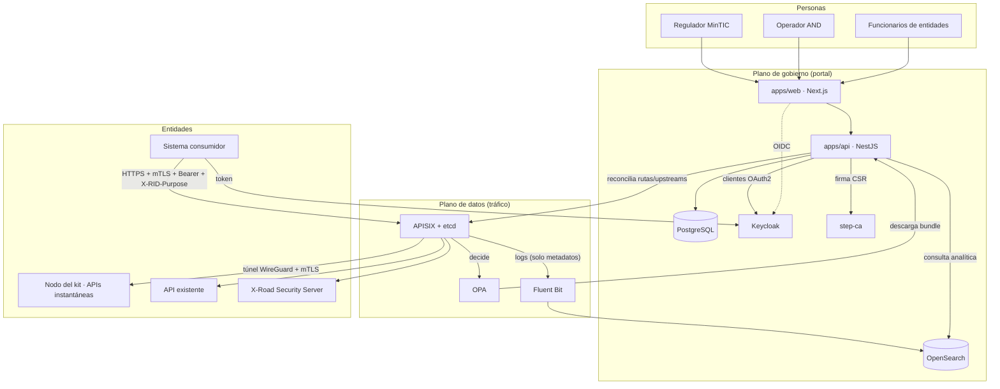
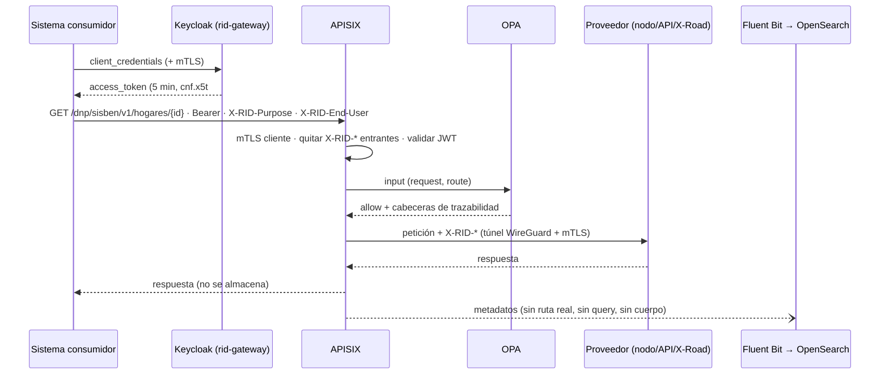

# Arquitectura técnica — Portal RID

Versión 0.1 · noviembre 2026

## 1. Vista general



Dos planos separados:

- **Plano de gobierno:** el portal. Si cae, el tráfico sigue funcionando con la última configuración.
- **Plano de datos:** APISIX + OPA. Autoriza cada llamada con datos que el portal publica. Nunca consulta la base de datos del portal en línea.

## 2. Componentes

| Componente | Responsabilidad | Notas |
| :-- | :-- | :-- |
| `apps/web` | UI del portal, consolas de operador/regulador | Next.js App Router, Server Components, Auth.js con Keycloak. Llama a `apps/api` con el token del usuario |
| `apps/api` | Dominio, flujos, autorización, auditoría, reconciliadores, bundle OPA, contrato con nodos | NestJS + Fastify, Prisma, pg-boss |
| PostgreSQL | Estado de dominio, outbox, auditoría, colas pg-boss | Única fuente de verdad |
| Keycloak | Realm `rid-portal` (personas, MFA) y realm `rid-gateway` (clientes de aplicaciones) | Dos realms para separar políticas de tokens |
| APISIX + etcd | Gateway: mTLS, validación de token, llamada a OPA, límites, enrutamiento, logs | Admin API solo en red interna |
| OPA | Decisión de autorización por llamada | Se despliega junto a cada nodo de APISIX (sidecar o mismo host) |
| step-ca | CA intermedia para aplicaciones y nodos | Raíz fuera de línea; en producción, en HSM (PKCS#11) |
| Fluent Bit | Recibe logs de APISIX, aplica enmascarado, envía a OpenSearch | Segunda barrera de privacidad |
| OpenSearch | Logs de acceso (metadatos) y analítica | El navegador nunca habla con OpenSearch |
| Prometheus + Alertmanager | Métricas y alertas | Grafana opcional para operadores |
| WireGuard hub | Extremo central de los túneles de los nodos | Contenedor `wg-hub` en la red del gateway |

## 3. Identidad y autenticación

### 3.1 Personas (realm `rid-portal`)

- Login OIDC (Authorization Code + PKCE) desde `apps/web` vía Auth.js.
- `apps/api` valida el access token (JWKS de Keycloak, `aud = rid-portal-api`).
- Los recursos de una entidad se exponen bajo `/api/v1/entities/{entityId}/...` y un guard global aplica la tabla de permisos (`apps/api/src/auth/authz.policy.ts`): otra entidad → 404, miembro sin rol → 403 (ADR-0014).
- **Matriz completa (M2-03).** Cada ruta declara su acceso: `@Public`, `@CitizenAccess`, `@OptionalAuth`, `@SignedIn` (cualquier sesión, solo recursos propios), `@EntityAccess(acción)` o `@PlatformAccess(acción)`. El guard rechaza con 403 la ruta que no declare nada (falla cerrado). La matriz acción × rol y ruta → acceso está en `docs/AUTHZ.md`, generada desde la política; un test falla si queda desactualizada. Un test de integración generado llama cada ruta protegida con cada rol de entidad, cada rol de plataforma, un miembro de otra entidad, un usuario sin roles y sin sesión, y compara con la política.
- La web guarda los tokens solo en la cookie cifrada de Auth.js y renueva el access token (5 min) con el refresh token antes de que venza.
- **Cuentas (ADR-0018).** Autorregistro con verificación de correo obligatoria. Una cuenta nueva no tiene roles: los roles llegan solo con un alta aprobada (el solicitante pasa a `entity_admin`) o con una invitación aceptada. La invitación va a un correo y solo la ve y acepta quien entra con ese correo **verificado** (`email_verified` del token y el mismo correo con que se registró). El aviso por correo trae un enlace al portal, sin secreto. El portal no crea usuarios en Keycloak. El `entity_admin` invita, cambia roles y revoca (M2-02). Una revocación aplica en la siguiente petición, porque los roles se leen en cada una, y la entidad siempre conserva un administrador activo.
- **Los roles NO viven en Keycloak.** Keycloak solo autentica; roles de plataforma y membresías por entidad viven en PostgreSQL. Así el portal tiene roles personalizados por entidad sin depender de grupos de Keycloak.
- Excepción: MFA obligatorio se configura en Keycloak para usuarios marcados (el portal sincroniza un atributo `requires_mfa` y una política de flujo de autenticación lo exige).

### 3.2 Aplicaciones consumidoras (realm `rid-gateway`)

- Una `Application` = un cliente confidencial con `serviceAccountsEnabled`, solo grant `client_credentials`, `clientId = rid-app-<uuid>`.
- Mapper de audiencia `rid-gateway`. Vida del access token: 5 min.
- Con `features.mtls.required`: autenticación del cliente por `tls_client_auth` o secreto + **tokens ligados al certificado** (RFC 8705, claim `cnf.x5t#S256`). Cómo lo comprueba el gateway (SPIKE S-3, `docs/spikes/S-3.md`):
  - un objeto SSL de APISIX con `client.ca` (cadena de step-ca) rechaza en el handshake a quien no presenta un certificado válido;
  - el plugin propio `rid-client-cert` pone en `X-RID-Client-Cert-S256` la huella (base64url del SHA-256 del DER) del certificado verificado, tras borrar la que mande el cliente. No sirve `$ssl_client_fingerprint`, que es SHA-1;
  - OPA la compara con `cnf.x5t#S256` y con las huellas vigentes de la aplicación en el bundle (`data.clients[id].certificates`). Revocar es quitar la huella. La cabecera nunca llega al proveedor;
  - el TLS del gateway debe terminar en APISIX: delante solo puede haber un balanceador de capa 4 con paso directo TLS.
  - el token también se pide al gateway (SPIKE S-4, `docs/spikes/S-4.md`). Una ruta de APISIX lleva al endpoint de tokens de `rid-gateway` el certificado ya verificado, en `SSL_CLIENT_CERT` (`$ssl_client_escaped_cert`) y `ssl-client-verify`, reemplazando las del cliente. Keycloak usa el proveedor x509 `nginx` con `trust-proxy-verification`, y cada cliente usa `client-x509`, con sujeto `CN=rid-app-<uuid>`, la CA emisora fijada y tokens ligados. Como Keycloak cree en esa cabecera, toda otra vía hacia él debe borrarla.
- El portal usa una cuenta de servicio con permiso `manage-clients` **solo** en `rid-gateway`.

## 4. Patrón de reconciliación

Nada se escribe en APISIX/Keycloak/OPA desde un controlador HTTP.

```
Transacción de dominio
  ├─ cambia estado (p. ej. subscription → approved)
  ├─ AuditService.record(...)
  └─ outbox.insert({ topic: "gateway.sync", aggregate: "apiVersion:<id>" })

Worker (pg-boss)
  └─ toma outbox → encola job "reconcile:<target>"

Reconciliador
  1. desired = buildDesiredState(target)        // desde PostgreSQL
  2. actual  = readActualState(target)          // Admin API / Keycloak Admin API
  3. diff    = compare(desired, actual)
  4. apply(diff) con PUT idempotente e IDs deterministas
  5. sync_state.upsert({ target, hash(desired), appliedAt, status })
  6. si el objetivo era una suscripción → marcar active/suspended/revoked cuando se confirma
```

- **Reconciliación completa** cada 5 minutos además de la incremental, para corregir derivas.
- La consola del operador muestra `sync_state`: último hash aplicado, errores, objetos en deriva.
- IDs deterministas: `rid-route-<apiVersionId>`, `rid-upstream-<apiVersionId>`, `rid-app-<applicationId>`.

### 4.1 Objetos en APISIX por versión de API publicada

**Upstream** `rid-upstream-<apiVersionId>`
- `node`: `nodes = { "<tunnelIp>:<port>": 1 }`, `scheme = https`, mTLS hacia el nodo (M3-03): `tls.client_cert_id = rid-ssl-gateway-client` (el certificado de cliente del gateway), `tls.verify = true` y `tls.ca_certs` = la CA de la red, con `pass_host = rewrite` y `upstream_host` = el nombre del nodo, que es también el SNI y el nombre que se verifica. El servicio vive en el `servicePath` del nodo (la ruta pública se reescribe a `servicePath/...`). **Hasta M4** no hay nodos enrolados: el reconciliador resuelve el nodo con `RID_DEV_NODES` (`slug-entidad=host:puerto` del mock de esa entidad, `scheme = http`; con `https://host:puerto`, el mTLS de arriba), y una versión cuyo upstream tiene `nodeId` o cuya entidad no figura ahí queda en error de sincronización, sin escribir nada en APISIX.
- `direct`: host de la API existente, `scheme = https` con `tls.verify = true` (el certificado del proveedor se verifica contra las CA del sistema y para su nombre), y la ruta del URL como prefijo. Con `mtls`, además `tls.client_cert_id = rid-ssl-gateway-client` (M3-03): el proveedor confía en la CA de la red y en el nombre `CN=rid-gateway`. **SSRF:** el host debe ser un nombre DNS público o una IP pública. Se rechazan IPs privadas, de loopback, link-local o de metadatos, y nombres sin dominio o internos (`keycloak`, `*.local`, `*.internal`). Se valida al registrar la versión (`isPublicHostname` en `packages/contracts`, incluidas las IPv6 que embeben una IPv4) y otra vez en el reconciliador. El reconciliador además resuelve todas las direcciones A/AAAA del host en cada pasada y, si alguna no es pública, borra la ruta y el upstream (falla cerrado). Si la resolución falla, solo registra el error. **Sin DNS rebinding (M3-03):** los `nodes` del upstream son las direcciones que el reconciliador resolvió y encontró públicas, no el nombre, con `pass_host = rewrite` y `upstream_host` = el nombre (Host, SNI y nombre verificado). Si el nombre cambia de dirección, la siguiente pasada actualiza el upstream. **Despliegue (M6):** la salida del gateway debe filtrarse por red, bloqueando RFC 1918, link-local y las subredes de la plataforma.
- `xroad`: Security Server del operador (ver §10).

**Route** `rid-route-<apiVersionId>`
- `uri = /{entitySlug}/{apiSlug}/v{major}/*`, métodos declarados en el OpenAPI.
- Plugins. APISIX los ejecuta por fase y, dentro de cada fase, por prioridad (no en el orden en que se listan). Verificado en SPIKE S-1 (`docs/spikes/S-1.md`):
  1. `request-id` (rewrite, 12015): genera `X-Request-Id` si el cliente no lo envía.
  2. `openid-connect` (rewrite, 2599): `client_id: rid-gateway`, `bearer_only: true`, `use_jwks: true`, `discovery` del realm `rid-gateway` (como lo alcanza APISIX: `RID_GATEWAY_KEYCLOAK_URL`), `set_userinfo_header`, `set_access_token_header` y `set_id_token_header` en `false` (el token no viaja al proveedor en otra cabecera), y `claim_validator.audience` con `required` y `match_with_client_id`: solo pasan tokens con `aud = rid-gateway`. El emisor se valida contra el de la discovery.
  3. `proxy-rewrite` (rewrite, 1008): elimina las cabeceras que solo el gateway puede poner (`X-RID-Consumer-Entity`, `X-RID-Consumer-App`, `X-RID-Subscription`, `X-RID-Operation`, `X-RID-End-User-Hash`, `X-RID-Subject-Ref`) si vienen del cliente, antes de que OPA arme su entrada; conserva `X-RID-Purpose` y `X-RID-End-User`, que OPA necesita leer. Antes, en la misma fase y con prioridad 1020, el plugin propio `rid-data-subject` lee del cuerpo JSON el titular de las operaciones que lo declaran allí y lo pasa como `X-RID-Body-Subject`, después de borrar cualquier valor que haya enviado el cliente (ADR-0017). Con prioridad 1025, el plugin propio `rid-client-cert` borra la `X-RID-Client-Cert-S256` que mande el cliente y, si nginx verificó un certificado de cliente en el handshake, pone su huella RFC 8705 (S-3). Reescribe la ruta quitando el prefijo (solo cambia `upstream_uri`; OPA sigue viendo la ruta pública completa).
  4. `opa` (access, 2001): `host` del OPA local, `policy: rid/authz`, `with_route: true`, `send_headers_upstream: [X-RID-Consumer-Entity, X-RID-Consumer-App, X-RID-Subscription, X-RID-Purpose, X-RID-Operation, X-RID-End-User-Hash, X-RID-Subject-Ref, X-RID-End-User, X-RID-Body-Subject, X-RID-Client-Cert-S256, X-RID-Data-Subject, X-Request-Id]`. Para cada nombre de esa lista el plugin pone el valor que devuelve la política y, **si la política no lo devuelve, borra la cabecera del cliente**. Por eso la política devuelve siempre `X-RID-Purpose` y `X-Request-Id`, y **nunca** `X-RID-End-User`, `X-RID-Body-Subject` ni `X-RID-Client-Cert-S256` (así los valores en claro del funcionario y del titular no llegan al proveedor; ADR-0015, ADR-0017). `X-RID-Data-Subject`, la cabecera que antes declaraba el consumidor, también se elimina. Si OPA no responde, niega con 403 (falla cerrado).
  5. `limit-count` (access, 1002): límite por suscripción con `key_type: var`, `key: http_x_rid_subscription` y `count: "$http_x_rid_rate_limit"`, las dos cabeceras que puso OPA desde el bundle. Contadores locales en cada nodo, con el límite repartido entre los nodos (ADR-0020). Ver SPIKE S-2.
  6. `response-rewrite` (899): convierte el 429 de `limit-count` en problem+json con `vars: [["status","==",429],["upstream_status","!","~~","[0-9]"]]`. Sin upstream, la variable está vacía, así que el 429 de un proveedor pasa intacto (S-2).
  7. `prometheus` (log, 500).
  8. `http-logger` (log, 410): hacia Fluent Bit con `log_format` de §8.

Mientras una API no tiene suscripciones activas, la ruta existe pero OPA niega todo.

**SSL** `rid-ssl-gateway-client` (M3-03): de tipo `client`, con el certificado de cliente que el gateway presenta a los upstreams con mTLS (`CN=rid-gateway`, `RID_GATEWAY_CLIENT_NAME`). Lo emite step-ca con el provisioner `rid-portal` (solo autenticación de cliente). El portal guarda la clave sellada y lo renueva igual que el de servidor. Los upstreams lo referencian por id, así que renovarlo cambia un solo objeto. Lo asegura el reconciliador solo cuando una versión lo necesita, de modo que los upstreams sin mTLS no dependen de step-ca.

**SSL** `rid-ssl-gateway` (M3-02, S-3)
- `snis` = `RID_GATEWAY_TLS_HOSTS`. `cert` y `key` son el certificado de servidor del gateway, que emite step-ca con el provisioner `rid-gateway-tls`. El portal genera la clave, la guarda sellada (`gateway_certificate`, `RID_SECRETS_KEY`) y renueva el certificado en el último tercio de su vida. Lo audita (`gateway_certificate.issued`) sin la clave.
- Con `features.mtls.required`, `client.ca` lleva la intermedia y la raíz de step-ca (`depth: 2`), sin `skip_mtls_uri_regex`: APISIX rechaza en el handshake toda llamada sin un certificado válido de la red. Sin el flag, el objeto sirve TLS sin pedir certificado.
- Lo aplica el reconciliador de APISIX en cada pasada completa (`sync_state` `apisix:ssl:rid-ssl-gateway`). La clave no se compara, porque APISIX la guarda cifrada: una clave nueva siempre llega con un certificado nuevo.

**Reconciliador (M1-08):** consume `gateway.sync` (aggregate `apiVersion:<id>`) y sirve las versiones `published` y `deprecated`. Compara el estado deseado con lo que guarda APISIX campo por campo (APISIX agrega valores por defecto, que no cuentan como deriva) y solo escribe si algo cambió: upstream antes que ruta, y al borrar, ruta antes que upstream. Hace una pasada completa al arrancar y cada 5 minutos, que también borra los objetos `rid-` que ninguna versión pide. Los objetos sin ese prefijo no se tocan. El resultado queda en `sync_state` (`apisix:route:rid-route-<id>`).

- **Versiones deprecadas (ADR-0019).** La ruta sigue sirviendo y lleva `response-rewrite` con `Deprecation: @<segundos>` (RFC 9745) y `Sunset: <fecha HTTP>` (RFC 8594). Al retirarse, la versión deja de estar en el estado deseado y el reconciliador borra la ruta.

### 4.2 Bundle de OPA

- `apps/api` expone `GET /api/v1/opa/bundle.tar.gz` (autenticado con el token de servicio `OPA_BUNDLE_TOKEN`; sin token configurado rechaza todo; soporta `ETag`). OPA lo consulta cada 10–20 s (`polling.min_delay_seconds`).
- El bundle se arma desde PostgreSQL en cada consulta y es reproducible. Incluye un `.manifest` con `revision` (SHA-256 de políticas + datos) y `roots: [rid, routes, clients, config]`. El ETag es la revisión, y una revisión igual responde 304.
- **Activación (`approved → active`):** OPA tiene configurado el plugin `status`, que envía `POST /api/v1/opa/status` (mismo token) en cuanto activa un bundle. El portal guarda qué suscripciones contiene cada revisión (`policy_bundle`, se poda a las 24 h). Cuando OPA informa una revisión activa, pasa a `active` las suscripciones `approved` que contiene, con el evento `subscription.activated` (actor `system:opa`) en la misma transacción, y actualiza `sync_state` `opa:bundle`. Con varios gateways basta el primer OPA que informa; distinguir por nodo queda para M4. Objetivo: menos de 60 s (encuesta de 10–20 s y aviso inmediato).
- Contenido: políticas Rego de `packages/policy` + `data.json`:

```json
{
  "routes": {
    "rid-route-<apiVersionId>": {
      "apiVersionId": "...",
      "classification": "personal",
      "operations": [
        {
          "id": "getAfiliacion", "method": "GET", "pathRegex": "^/salud/afiliacion/v1/afiliados/[^/]+$",
          "subject": { "in": "path", "regex": "^/salud/afiliacion/v1/afiliados/([^/]+)$", "numberGroup": 1, "documentType": "CC" }
        }
      ]
    }
  },
  "clients": {
    "rid-app-<applicationId>": {
      "status": "active",
      "entityId": "...",
      "entitySlug": "dnp",
      "applicationId": "...",
      "subscriptions": [
        {
          "id": "...",
          "route": "rid-route-<apiVersionId>",
          "operations": ["getAfiliacion"],
          "purposes": ["eligibility_check"],
          "validFrom": "2026-11-30T00:00:00Z",
          "validUntil": "2027-11-30T23:59:59Z",
          "endUserRequired": true,
          "rateLimitPerMinute": 600
        }
      ],
      "certificates": ["<x5t#S256 de cada certificado vigente>"]
    }
  },
  "config": {
    "endUserHashSalt": "<RID_END_USER_HASH_SALT>",
    "subjectRefKey": "<RID_SUBJECT_REF_KEY>",
    "country": "CO",
    "documentTypes": ["CC", "CE", "TI", "PEP", "PPT", "PA"],
    "mtlsRequired": false
  }
}
```

- Política `rid.authz` (resumen):
  1. Extrae el JWT de `Authorization` (ya validado por `openid-connect`; OPA solo lo decodifica) y toma `azp`/`client_id`.
  2. `clients[client_id].status == "active"`.
  3. Encuentra la operación: método + `pathRegex` de la ruta (`input.route.id`). `input.request.path` es la ruta pública completa, con el prefijo `/{entitySlug}/{apiSlug}/v{major}` (S-1), y `pathRegex` se ancla a ella.
  4. Existe una suscripción para esa ruta con la operación, la finalidad de `X-RID-Purpose`, vigente.
  5. Si `endUserRequired` (clasificaciones `personal` y `sensitive`), exige `X-RID-End-User` y calcula `X-RID-End-User-Hash = HMAC-SHA-256(valor, sal)` con la sal del despliegue (`RID_END_USER_HASH_SALT`, mínimo 16 caracteres; sin ella el bundle no se sirve). La sal va en el bundle, que solo se sirve por red interna.
  6. Devuelve `allow`, cabeceras para el upstream y, al negar, `status_code` + cuerpo problem+json en `reason` con una razón estable (`no_subscription`, `purpose_not_allowed`, `operation_not_allowed`, `subscription_expired`, `end_user_required`, `data_subject_required`, `app_suspended`; con mTLS exigido, también `client_certificate_required`, `token_not_bound`, `certificate_mismatch` y `certificate_revoked`, según S-3). Al negar, `headers` son cabeceras de **respuesta**: `Content-Type: application/problem+json` y `X-RID-Deny-Reason: <razón>`, que el log de acceso registra con `$sent_http_x_rid_deny_reason`.
- `data.json` incluye las rutas de las versiones `published`/`deprecated` y los clientes no eliminados (las aplicaciones suspendidas aparecen con `status: suspended`). Solo lleva las suscripciones `approved` o `active` de versiones servidas. `pathRegex` se ancla a la ruta pública completa, y un parámetro `{x}` equivale a un segmento o a parte de uno (`[^/]+`).
- Certificado de cliente (M3-02). Se comprueba cuando `config.mtlsRequired` está activo, y siempre que el token esté ligado a un certificado (`cnf.x5t#S256`, RFC 8705 §3). Va justo después de la aplicación suspendida. Orden: `client_certificate_required` (no hay huella verificada), `token_not_bound`, `certificate_mismatch` (la huella no es la del token) y `certificate_revoked` (la huella no está en `clients[id].certificates`, la lista de certificados vigentes de esa aplicación). Revocar o vencer un certificado lo saca de la lista en la siguiente descarga del bundle (10–20 s).
- Una cabecera repetida cuenta como ausente. Cuando hay más de una suscripción válida, se elige siempre la misma (orden por id). Las razones se evalúan en este orden: cliente, aplicación suspendida, ruta, operación, suscripción a la ruta, operación concedida, finalidad, vigencia y funcionario.
- Las políticas tienen tests con `opa test` y cobertura ≥ 90 %, exigida en CI (`--threshold 90`).

### 4.3 Keycloak

Reconciliador de aplicaciones: crea/actualiza/deshabilita clientes en `rid-gateway`, rota secretos a pedido, configura `tls_client_auth` y el subject DN esperado cuando hay certificado.

### 4.4 step-ca

- Provisioner JWK dedicado al portal. El backend firma un token de un solo uso (OTT) y llama a `/1.0/sign` con el CSR. Implementación con `jose`; sin dependencias propietarias. Detalle (M3-01, `apps/api/src/credentials`):
  - La clave del provisioner viaja cifrada (JWE, PBES2) en la lista pública de provisioners de la CA. El API la descifra una vez con `RID_STEP_CA_PROVISIONER_PASSWORD`.
  - El OTT lleva `sub` y `sans` = clientId, `sha` = huella de la raíz, 5 minutos de vida y un `jti` único. El portal pide `notAfter` = `lifecycle.certificateValidityDays`.
  - El API verifica el TLS de la CA con su raíz: `RID_STEP_CA_ROOT_FILE` o la raíz que sirve la CA fijada por `RID_STEP_CA_ROOT_FINGERPRINT`. Solo en desarrollo, sin ninguna de las dos, confía en la raíz que sirve la CA y registra su huella.
  - Antes de la CA, el portal revisa el CSR (`pkijs`): un solo bloque PEM, campo de atributos presente, firma propia válida, clave ECDSA P-256/P-384 o RSA 2048-4096, CN = clientId y ningún otro nombre alternativo. Un CSR inválido da 400 con un mensaje estable por causa. Si la CA no responde o rechaza, 503.
  - El certificado que devuelve la CA debe tener ese sujeto y esa clave, y encadenar hasta la raíz. El portal guarda la cadena (pública), la huella RFC 8705 (`x5t#S256`), el serial y las fechas. Una aplicación tiene un solo certificado activo (índice único parcial); la rotación es M3-04.
  - Un trabajo periódico (`RID_LIFECYCLE_INTERVAL_SECONDS`) avisa a los desarrolladores de la entidad `lifecycle.certificateExpiryWarningDays` antes del vencimiento (`credential.expiry_notice_queued` → notificación `certificate_expiring`) y marca `expired` los certificados vencidos.
- Dos plantillas: `app` (CN = clientId, 90 días) y `node` (CN = `rid-node-<id>`, 90 días, renovación automática por el kit). La de `app` está en `infra/step-ca/app.tpl`: solo el CN del token como sujeto, el clientId como SAN DNS y uso de clave solo para autenticación de cliente TLS.
- Revocación: certificados de vida corta + lista de huellas revocadas en el bundle OPA (requiere SPIKE S-3).

## 5. Flujo de una llamada



## 6. Cabeceras de trazabilidad hacia el proveedor

| Cabecera | Contenido |
| :-- | :-- |
| `X-RID-Consumer-Entity` | slug de la entidad consumidora |
| `X-RID-Consumer-App` | ID de la aplicación |
| `X-RID-Subscription` | ID de la suscripción que autorizó la llamada |
| `X-RID-Purpose` | código de finalidad |
| `X-RID-Operation` | `operationId` resuelto |
| `X-RID-End-User-Hash` | hash con sal del funcionario final (si aplica) |
| `X-RID-Subject-Ref` | seudónimo del titular de los datos (HMAC con clave, ADR-0015), si la operación lo declara |
| `X-Request-Id` | ID de correlación extremo a extremo |

El proveedor sabe quién consulta, para qué y bajo qué autorización: resuelve el problema de "solo veo al gateway". En una versión futura estas cabeceras irán en una aserción firmada por el gateway (JWS) para no repudio (SPIKE S-6).

## 7. Datos

- **Prisma** con migraciones versionadas. Tablas principales = entidades de `SPEC.md §3` + `outbox`, `sync_state`, `audit_event`, `opa_bundle_revision`.
- **Outbox** para que estado de dominio y trabajo de sincronización se confirmen en la misma transacción.
- **Auditoría encadenada:** `hash = SHA-256(prevHash ‖ JSON canónico del evento)`, con claves ordenadas y los valores tal como vuelven de `jsonb`. `seq` = último + 1 bajo un bloqueo consultivo de la transacción (`pg_advisory_xact_lock`), sin usar la secuencia: así una transacción revertida no deja huecos. El bloqueo serializa las escrituras de auditoría hasta que termina cada transacción. Los eventos anteriores a M1-11 quedan fuera de la cadena, y la verificación los cuenta aparte. Endpoint de verificación de la cadena. Anclaje diario (M2-09): el hash del último evento encadenado de cada día cerrado, en la zona horaria del país, se sella con la TSA (RFC 3161). Se guarda en `audit_anchor`, de solo inserción incluso para el dueño, y se envía por correo a los reguladores. La verificación exige que cada anclaje encuentre su evento con el mismo hash, lo que detecta el corte de la cola. Exportación CSV/JSON con la misma selección de filtros, con su SHA-256 firmado por la clave del operador (JWS EdDSA, verificable con `/transparency/jwks`). Cada exportación queda auditada.
- La tabla `audit_event` tiene permisos solo de `INSERT`/`SELECT` para el rol de la aplicación (sin `UPDATE`/`DELETE`), y un trigger rechaza `UPDATE`/`DELETE`/`TRUNCATE` incluso para el dueño del esquema.
- **Roles de base de datos:** el dueño del esquema (`rid`) solo se usa para migraciones; el API corre como `rid_app`, sin DDL. El esquema de pg-boss se crea con una migración de Prisma, así que pg-boss corre sin permisos de DDL.
- **Documentos:** almacenamiento en volumen local detrás de la interfaz `StorageService` (adaptador S3 compatible a futuro, con un backend OSS como SeaweedFS o Garage). Solo PDF, antivirus opcional (ClamAV) en M6.
  - **Desde M2-01.** `RID_DOCUMENTS_DIR`; las claves son UUID aleatorios que elige el API, nunca nombres del usuario, y se escriben con nombre temporal y renombre. La fila `document` guarda tamaño, tipo y SHA-256, que se vuelve a comprobar en cada descarga.
  - **Subida:** el cuerpo es el PDF mismo (`application/pdf`); se exige la firma `%PDF-` y un tamaño máximo `RID_DOCUMENT_MAX_BYTES` (10 MiB, 413 si se pasa). Solo esa ruta tiene el límite mayor, y solo para peticiones con `Authorization: Bearer`: sin token, 401 antes de leer el cuerpo. El resto del API sigue en 1 MiB.
  - **Descarga:** `Content-Disposition: attachment`, `nosniff`, CSP `sandbox` y sin caché. La web la sirve en `/files/...` con el token de la sesión, que nunca llega al navegador.
  - **Acuerdos de intercambio (M2-07).** Se adjuntan a la solicitud con la misma ruta de subida. La plantilla del acuerdo modelo sale de `documents.agreementTemplate` de la config del país.
  - **Eliminación por orden judicial.** Es la única eliminación física. Borra los bytes después de confirmar la transacción y deja la fila con su SHA-256 y la referencia a la orden; las descargas responden 410.
- **Notificaciones (M2-08).** Derivan de la bitácora: la escritura del evento encola `notification.dispatch` en la misma transacción. El worker resuelve destinatarios con el estado actual y guarda una fila por evento y persona (clave única, entrega idempotente). Envía correo según las preferencias, salvo en los avisos de seguridad, que siempre se envían. Los textos no llevan datos de las personas consultadas, solo nombres de APIs, entidades y aplicaciones.
- **Correo saliente del API** (`RID_SMTP_URL`, Mailpit en desarrollo): solo lo envían workers desde el outbox (p. ej. `invitation.email`), así un correo sale si y solo si el cambio que lo causó se confirmó. Entrega al menos una vez, con reintentos durante horas. Los textos están en `apps/api/src/mail/messages.ts` (es/en) y los nombres del país vienen de la config.

## 8. Logs de acceso y privacidad

`http-logger` de APISIX con `log_format` restringido a:

```
ts, request_id, route_id, operation (X-RID-Operation), method, status,
latency_ms, upstream_latency_ms, consumer_entity, consumer_app,
subscription_id, purpose, end_user_hash, bytes_sent, gateway_node,
deny_reason
```

- Variables de APISIX para cada campo: `$http_x_rid_operation`, `$http_x_rid_subscription`, `$http_x_rid_consumer_entity`, `$http_x_rid_consumer_app`, `$http_x_rid_purpose`, `$http_x_rid_end_user_hash` (las cabeceras que puso OPA, visibles en la fase de log según S-1) y `$sent_http_x_rid_deny_reason`. **Nunca** `$uri`, `$request_uri` ni `$upstream_uri`: incluyen la ruta real y la query.

- **No se registran**: `uri` real, query string, cuerpos, `Authorization`, IP del ciudadano (no hay; los consumidores son sistemas).
- El access log propio de nginx en APISIX está **desactivado** (`nginx_config.http.enable_access_log: false`), porque escribe la línea de la petición y la URI del upstream. El error log queda en nivel `error`, porque los avisos (p. ej. cada denegación de un plugin) también incluyen la línea de la petición. Hay una prueba de regresión en `tests/infra`. Pendiente para M5-01: los errores reales todavía pueden llevar la línea de la petición en el log de nginx.
- Fluent Bit aplica un filtro Lua que descarta cualquier campo fuera de la lista permitida (defensa en profundidad).
- OpenSearch: índice `rid-access-YYYY.MM`, política de retención por configuración.
- La analítica del portal consulta OpenSearch desde `apps/api` filtrando por la entidad del usuario; los roles de plataforma ven todo.

## 9. Observabilidad

- Métricas: plugin `prometheus` de APISIX, `/metrics` de `apps/api` (latencia por endpoint, jobs pendientes, edad del último bundle OPA, deriva de sync), métricas de OPA.
- Alertas mínimas: gateway 5xx > 2 % 5 min, p95 de latencia del gateway > 200 ms, bundle OPA con más de 2 min de antigüedad, reconciliación fallando, nodo offline, certificado por vencer, cola pg-boss acumulada.

## 10. Contrato con el kit (nodos)

| Endpoint | Uso |
| :-- | :-- |
| `POST /api/v1/nodes/enroll` | Token de enrolamiento + CSR + clave pública WireGuard → certificado, config WireGuard (IP del túnel, peer del hub), `nodeId` |
| `POST /api/v1/nodes/{id}/heartbeat` | mTLS del nodo; versión, servicios expuestos (nombre, puerto, hash del OpenAPI), salud |
| `POST /api/v1/nodes/{id}/renew` | Renovación de certificado |
| `GET /api/v1/nodes/{id}/config` | Configuración deseada (versiones mínimas, avisos) |

El kit se especifica en otro repositorio; este contrato es la frontera. En desarrollo, `infra/mock-providers` simula un nodo (servicios Fastify con datos sintéticos, ADR-0009) y un contenedor WireGuard.

**Camino X-Road:** el gateway usa un Security Server del operador como cliente X-Road. El upstream apunta al Security Server y el reconciliador agrega `X-Road-Client` (subsistema del operador) y el identificador del servicio en la ruta REST. La identidad del consumidor real se propaga en `X-Road-UserId` y en las cabeceras `X-RID-*` (verificar soporte exacto del protocolo REST de X-Road en SPIKE S-5).

## 11. Despliegue

**Desarrollo y pilotos:** `infra/compose/docker-compose.yml` con todos los servicios, datos semilla y realms importados.

**Producción (M6):**
- Gateway: ≥ 2 nodos APISIX en zonas distintas, OPA local en cada uno, etcd en clúster de 3 con mTLS.
- Portal: ≥ 2 réplicas de web y api; PostgreSQL con réplica y respaldos (pgBackRest).
- Keycloak en clúster con base de datos propia.
- step-ca con raíz fuera de línea; intermedia con clave en HSM.
- Helm charts en `infra/helm/`.

## 12. Seguridad

- Admin API de APISIX y etcd solo en red interna, con clave de administrador y mTLS.
- El bundle OPA se sirve con token de servicio y por red interna.
- Secretos por variables de entorno en dev; en producción, OpenBao (MPL-2.0).
- Web: CSP estricta, cookies `HttpOnly` `SameSite=Lax`, CSRF por Auth.js.
- API: rate limit por usuario, tamaño máximo de cuerpo, validación zod en todas las entradas, problem+json sin trazas internas.
- Dependencias: `pnpm audit` y verificación de licencias en CI.

## 13. Transparencia para el titular (ADR-0015, ADR-0016)

```
Consumidor ─▶ APISIX ─(opa: X-RID-Subject-Ref = HMAC(clave, país|tipo|número))─▶ Proveedor
                │ tcp-logger (formato de transparencia, sin ruta ni número)
                ▼
            Fluent Bit (búfer en disco, reintentos) ─▶ API: colector ─▶ subject_access_record (solo inserción)
                                                            │ lotes Merkle + firma JWS + sello TSA RFC 3161
                                                            ▼
                                                  transparency_checkpoint ─▶ bitácora (anclaje)
Carpeta Ciudadana ─(token del ciudadano)─▶ API: /data-subjects/me/accesses, comprobantes, avisos (webhook)
```

- **Titular en el OpenAPI.** Se declara con `x-rid-data-subject` en cada operación (MT-01): un parámetro de ruta, un puntero JSON al cuerpo (`in: body`) o `none`. El bundle lleva, por operación, cómo extraerlo de la ruta (expresión con grupos de captura) y el tipo de documento.
- **Titular en el cuerpo (ADR-0017).** Lo lee el gateway, nunca lo declara el consumidor. El plugin `rid-data-subject` lee el cuerpo en memoria y con tope de 64 KiB, solo en las operaciones declaradas y después de validar el token. Resuelve el puntero y lo pasa a OPA en `X-RID-Body-Subject`. Para que el gateway y el proveedor lean siempre a la misma persona, no entrega titular (y OPA niega) si el cuerpo no se declara JSON (`Content-Type`), si repite un nombre de miembro en un mismo objeto (I-JSON, RFC 7493) o si el número o el tipo contienen `:`.
- **Falla cerrado.** En una API personal o sensible, una operación sin declaración válida (ausente o en una forma que ya no se acepta) se niega con `data_subject_required`. El lint exige la declaración en esas clasificaciones, así que solo afecta a versiones antiguas.
- **Seudónimo.** Lo calcula OPA y sale como `X-RID-Subject-Ref`. La clave (`RID_SUBJECT_REF_KEY`) viaja en el bundle, que solo se sirve por la red interna, igual que la sal del funcionario. OPA nunca devuelve `X-RID-Body-Subject`, así que el proveedor no recibe el número por esa vía (en el cuerpo y en la ruta ya lo tiene).
- **Registros separados de la analítica.** Los logs de analítica (`http-logger`, §8) siguen sin titular. El registro de transparencia usa otro logger y otro camino.
- **Registro de consultas (MT-03).** Las rutas con alguna operación que declara titular llevan un `tcp-logger` con formato propio (`TRANSPARENCY_LOG_FORMAT`): hora (`$msec`), nodo, `$request_id` de nginx, `X-Request-Id`, ruta, operación, suscripción, finalidad, hash del funcionario, `X-RID-Subject-Ref`, `$status` y `$upstream_status`. Nunca la ruta, la query ni cuerpos.
  - **Fluent Bit propio** (`fluent-bit-transparency`, perfil base, `infra/fluent-bit/transparency.yaml`): entrada TCP, búfer en disco con suma de verificación y reintentos sin límite hacia el colector. Su filtro Lua separa los lotes de APISIX, deja solo los campos permitidos y descarta las llamadas sin seudónimo o que no llegaron al proveedor.
  - **Solo llamadas autorizadas.** Cuenta una llamada cuando nginx la reenvió (`$upstream_status` existe; el cliente no puede ponerlo) y trae el seudónimo que devolvió OPA (el gateway borra el que envíe el cliente antes de OPA). Las negadas no llegan al proveedor y no se registran.
  - **Colector** `POST /api/v1/internal/subject-access`, con su propio token de servicio (`RID_TRANSPARENCY_INGEST_TOKEN`), distinto del de OPA. El token se verifica antes de leer el cuerpo (su límite es de 16 MB, por bloque de Fluent Bit): sin token, 401 sin que el API reciba nada. En producción, `/api/v1/internal/*` no se publica en el ingreso público. Inserta por tandas de 1.000 filas (PostgreSQL acepta hasta 65.535 parámetros por sentencia). Valida cada registro y lo completa desde la suscripción que OPA autorizó: entidad proveedora, API, versión, datos expuestos, entidad y aplicación consumidoras y finalidad. Guarda de dónde salió el titular (`path` o `body`) según la declaración de la operación. Lo que no cuadra (suscripción desconocida, ruta de otra versión, operación sin titular, formato inválido) se descarta y se cuenta sin registrar valores; nunca se rechaza el lote, para que Fluent Bit no reintente el mismo bloque sin fin. Los reintentos no duplican: la clave es el nodo más el `$request_id` de nginx, que el cliente no elige (el `X-Request-Id` sí).
  - **Tabla `subject_access_record`, solo inserción**: `rid_app` no tiene UPDATE, DELETE ni TRUNCATE, y un disparador lo impide a cualquiera. Solo la función `purge_subject_access_records(meses)` (SECURITY DEFINER) borra lo que pasó la retención `retention.subjectAccessMonths`. La función rechaza una retención menor que el piso de `subject_access_retention`, tabla de una fila que solo escribe el dueño del esquema (60 meses por omisión; el operador la ajusta al mínimo legal del despliegue). Así, quien obtenga las credenciales de `rid_app` no puede acortar la retención. Tampoco puede hacerlo con una tabla temporal del mismo nombre: la función fija `search_path = pg_catalog, public, pg_temp` y nombra cada objeto con su esquema. Cada llamada deja una fila en `subject_access_purge_log`, escrita por la propia función: `rid_app` puede leerla pero no modificarla. El API la llama cada 6 horas, y cada purga que borra algo queda además en la bitácora (`subject_access.purged`). Los identificadores se guardan sin claves foráneas: el registro es evidencia y debe sobrevivir a cambios posteriores.
  - **Prueba de no fuga.** El e2e consulta un número nuevo y comprueba que no aparece en los logs de APISIX, en los logs ni en el búfer de Fluent Bit, ni en un volcado completo de la base del portal.
- **Evidencia verificable (MT-04, ADR-0016).** El sellador del API (cada `RID_TRANSPARENCY_SEAL_INTERVAL_SECONDS`, con bloqueo consultivo para que solo un nodo selle) agrupa los registros sin lote, hasta `RID_TRANSPARENCY_BATCH_MAX` por lote.
  - **Hoja (formato 2).** SHA-256(0x00 ‖ JSON canónico RFC 8785 de `{v, id, occurredAt, digest}`), donde `digest` es el SHA-256 del JSON canónico del registro: identificador, hora, seudónimo, origen del titular, entidades, API, versión, operación, datos expuestos, finalidad, suscripción, hash del funcionario, estado, nodo y `$request_id`. No incluye el `X-Request-Id`, porque lo elige el cliente y no prueba nada. Como la hoja compromete el identificador y la hora, siguen ligados a la raíz firmada aunque la retención purgue el registro: no se puede hacer pasar un borrado anticipado por una purga. El formato es la `v` del punto de control firmado; los primeros lotes (formato 1, la hoja sobre el registro completo) siguen verificándose. Árbol y prueba de inclusión según RFC 9162.
  - **Punto de control.** `{v, log, seq, treeSize, root, prev, sealedAt}`, donde `prev` es el SHA-256 del JSON canónico del punto anterior. Lo firma el operador como JWS compacto (EdDSA, `typ: rid-checkpoint+jws`, `kid`), con la clave `RID_TRANSPARENCY_SIGNING_JWK`. El punto de control, sus hojas y la entrada `transparency.checkpoint` de la bitácora se escriben en una sola transacción.
  - **Sello.** La TSA (`RID_TSA_URL`) sella los bytes del JWS: el sello cubre a la vez el punto de control y la firma. El API comprueba cada sello antes de guardarlo (bytes, nonce, firma y cadena publicada por la TSA). Si la TSA no responde, el lote queda pendiente y la ronda siguiente reintenta. En desarrollo la TSA es sigstore timestamp-server con su propia cadena (`infra/tsa`, generada en un volumen); en producción, la TSA acreditada del país.
  - **Tablas de solo inserción** (`transparency_checkpoint`, `transparency_leaf`, `transparency_timestamp`): ni `rid_app` ni el dueño pueden hacer UPDATE, DELETE o TRUNCATE sin desactivar antes un disparador. Las hojas guardan su hash y la hora de la llamada, así el lote se puede reconstruir después de que la retención purgue los registros.
  - **API.** Públicos: `GET /transparency/jwks` (claves actuales y retiradas, por `kid`) y `GET /transparency/checkpoints[/:seq]` (solo hashes). Con `audit.read`: `GET /transparency/records/:id/receipt` (409 mientras el registro no tiene lote) y `GET /transparency/verify`, que recalcula cadena, firmas, raíces, sellos y cada registro contra su hoja, y reporta registros alterados, borrados antes de cumplir la retención o insertados en un lote sellado. Además cruza los puntos de control con sus anclajes en la bitácora: un anclaje sin su punto de control delata lotes eliminados, incluso al final de la cadena, y un punto de control sin anclaje delata uno insertado por fuera del sellador. El ciudadano recibe su comprobante en MT-05.
  - **Verificador abierto.** `packages/transparency-verifier` (librería y CLI `rid-verify-receipt`) verifica un comprobante sin consultar al portal: inclusión, firma contra el JWKS y sello contra la raíz de la TSA que el verificador elige confiar. Ejemplo: `rid-verify-receipt comprobante.json --jwks <url o archivo> --tsa-root <url o archivo>`. Tolera hasta 60 s más la precisión declarada por la TSA entre la hora de la llamada y la del sello, porque el gateway y la TSA tienen relojes distintos y `genTime` suele venir redondeado al segundo.
  - **Verificación incremental.** `GET /transparency/verify?fromSeq=N` revisa desde el punto de control N, encadenado al hash del N-1. Un monitor que ya verificó lo anterior solo revisa lo nuevo; sin `fromSeq` se revisa el registro completo, que en memoria tarda unos 30 s por cada 80.000 registros.
  - **Pendiente para producción.** Rotación de la clave de firma: la anterior pasa a `RID_TRANSPARENCY_RETIRED_JWKS`.
- **Identidad del ciudadano (MT-05).** La da el emisor de identidad digital configurado (`RID_CITIZEN_ISSUER`; en desarrollo, el realm `rid-citizens`, que simula la autenticación digital del país).
  - **Token aceptado.** Firma RS256 contra el JWKS del emisor, emisor, audiencia `RID_CITIZEN_AUDIENCE` (`rid-transparency-api`), vigencia, y `azp` dentro de `RID_CITIZEN_CLIENTS` (solo las aplicaciones ciudadanas autorizadas, como la Carpeta). Cualquier otro token, incluido uno del portal, recibe 401; un token ciudadano tampoco abre ningún endpoint del portal.
  - **Seudónimo.** El API toma el tipo y el número de documento de los claims (`RID_CITIZEN_DOCUMENT_TYPE_CLAIM`, `RID_CITIZEN_DOCUMENT_NUMBER_CLAIM`; sin tipo, el primero de `identifiers.person`). Normaliza igual que OPA y calcula el mismo HMAC con `RID_SUBJECT_REF_KEY`. Un vector compartido entre los tests de Rego y los del API amarra las dos implementaciones, y el e2e lo prueba de punta a punta: la ciudadana de la demo ve justo las llamadas que el gateway registró con su número. El API nunca recibe el número como parámetro, no lo guarda, no lo registra en logs y no lo devuelve.
  - **Realm `rid-citizens`.** Cliente `carpeta-ciudadana`, confidencial, con código + PKCE y sin password grant. El access token lleva solo `sub`, la audiencia y el documento, sin nombre ni correo. El ciudadano no puede editar su documento: el perfil de usuario solo deja editarlo al administrador, y no hay atributos sin declarar.
  - **API.** `GET /api/v1/data-subjects/me/accesses` lista, de la más reciente a la más antigua y con cursor opaco, quién consultó (entidad y aplicación), qué entidad respondió, qué API, operación y datos expuestos, para qué finalidad, con qué funcionario (su hash, como referencia), el resultado y si ya está sellada. `GET /api/v1/data-subjects/me/accesses/:id/receipt` entrega el comprobante (409 mientras no tiene lote). Si la consulta no es del titular que pregunta, responde 404, sin revelar que existe. En OpenAPI van con el esquema de seguridad `citizenBearer`.

- **Avisos al titular (MT-06).** El ciudadano elige desde su aplicación ciudadana de qué clasificaciones quiere enterarse (`PUT /api/v1/data-subjects/me/alerts` con `personal` y/o `sensitive`; una lista vacía los apaga). Se guarda por seudónimo y por aplicación (`subject_alert`) con un identificador opaco y aleatorio (UUID v4), que es lo único que identifica a la persona en cada aviso. El cambio queda en la bitácora con la aplicación como actor y sin el seudónimo.
  - **Encolado.** El colector inserta los registros con `createManyAndReturn` y, en la misma transacción y solo para las filas realmente nuevas, pone un aviso en el outbox (`citizen.alert`) por cada titular que pidió esa clasificación. Así, un reintento de Fluent Bit no avisa dos veces.
  - **Entrega.** Un worker de pg-boss hace POST a la aplicación ciudadana (`RID_CITIZEN_APPS`: URL del webhook y secreto por `client_id`, configuración del operador). La firma sigue Standard Webhooks (`webhook-id`, `webhook-timestamp`, `webhook-signature: v1,…`, secreto `whsec_…`), así que la aplicación puede verificarla con cualquier librería del estándar. El `webhook-id` es estable entre reintentos. Si la respuesta no es 2xx, la cola reintenta con espera exponencial (hasta 20 veces, con un máximo de 1 h entre intentos). Antes de enviar, el worker comprueba que el aviso siga activo para esa clasificación.
  - **Contenido.** `{type: subject_access.created, timestamp, data: {alertId, accessId, occurredAt, classification}}`: sin número de documento, sin datos de contacto, sin nombres. La aplicación notifica a la persona y, cuando esta entra, muestra el detalle con su propio token.

- **Carpeta de referencia (MT-07, `infra/mock-citizen-app`).** Una aplicación ciudadana mínima que muestra lo que cualquier carpeta del país tiene que hacer con el portal. Es utilería de demostración, no un producto.
  - Autentica al ciudadano con la identidad digital (código + PKCE, cliente confidencial `carpeta-ciudadana`) y guarda los tokens en el servidor.
  - Muestra "¿Quién consultó mis datos?" con la API del titular.
  - Guarda el correo del ciudadano y la relación entre el identificador opaco del aviso y su usuario: el portal nunca ve el correo. Verifica los webhooks con la librería de referencia de Standard Webhooks y los convierte en correos (Mailpit en desarrollo).
  - Verifica cada comprobante por su cuenta con `@rid/transparency-verifier`, usando el JWKS del operador y la cadena de la TSA, que toma de donde están publicados. En producción, la carpeta fijaría esa clave por un canal independiente (por ejemplo, la publicación del regulador).
  - Corre con `pnpm dev` en el puerto 3100. En el despliegue de una sola máquina va en `/carpeta`, y la cadena de certificados de la TSA queda pública en `/tsa/api/v1/timestamp/certchain` para cualquier verificador.

## 14. Spikes abiertos

| ID | Pregunta | Hito |
| :-- | :-- | :-- |
| S-1 | Plugin `opa` de APISIX: confirmar que las cabeceras de `send_headers_upstream` también son visibles para `limit-count` y `http-logger` en la misma petición, y cómo retirar `X-RID-End-User` en claro antes del upstream si se decide enviar al proveedor solo el hash | M1 |
| S-2 | Límite por suscripción con `limit-count` usando la cabecera puesta por OPA; alternativa si no funciona | M3 |
| S-3 | mTLS de cliente: variable con la huella del certificado en APISIX, comparación con `cnf.x5t#S256` del token y con lista de revocados en OPA | M3 |
| S-4 | Keycloak: `tls_client_auth` + tokens ligados a certificado en `client_credentials` | M3 |
| S-5 | X-Road REST: cabeceras para propagar el consumidor real; configuración del gateway como cliente | M5 |
| S-6 | Aserción firmada del gateway hacia el proveedor (JWS) para no repudio | M6 |
