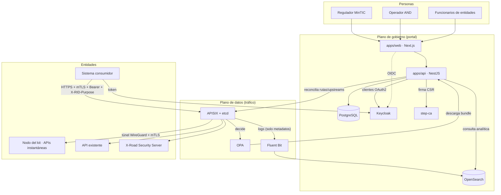
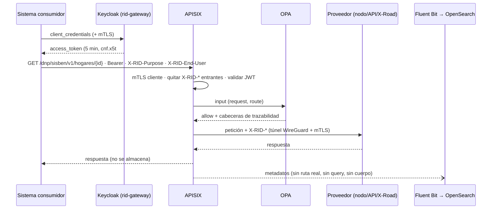

# Arquitectura técnica — Portal RID

Versión 0.1 · noviembre 2026

## 1. Vista general



Dos planos separados:

- **Plano de gobierno:** el portal. Si cae, el tráfico sigue funcionando con la última configuración.
- **Plano de datos:** APISIX + OPA. Autoriza cada llamada con datos que el portal publica. Nunca consulta la base de datos del portal en línea.

## 2. Componentes

| Componente | Responsabilidad | Notas |
| :-- | :-- | :-- |
| `apps/web` | UI del portal, consolas de operador/regulador | Next.js App Router, Server Components, Auth.js con Keycloak. Llama a `apps/api` con el token del usuario |
| `apps/api` | Dominio, flujos, autorización, auditoría, reconciliadores, bundle OPA, contrato con nodos | NestJS + Fastify, Prisma, pg-boss |
| PostgreSQL | Estado de dominio, outbox, auditoría, colas pg-boss | Única fuente de verdad |
| Keycloak | Realm `rid-portal` (personas, MFA) y realm `rid-gateway` (clientes de aplicaciones) | Dos realms para separar políticas de tokens |
| APISIX + etcd | Gateway: mTLS, validación de token, llamada a OPA, límites, enrutamiento, logs | Admin API solo en red interna |
| OPA | Decisión de autorización por llamada | Se despliega junto a cada nodo de APISIX (sidecar o mismo host) |
| step-ca | CA intermedia para aplicaciones y nodos | Raíz fuera de línea; en producción, en HSM (PKCS#11) |
| Fluent Bit | Recibe logs de APISIX, aplica enmascarado, envía a OpenSearch | Segunda barrera de privacidad |
| OpenSearch | Logs de acceso (metadatos) y analítica | El navegador nunca habla con OpenSearch |
| Prometheus + Alertmanager | Métricas y alertas | Grafana opcional para operadores |
| WireGuard hub | Extremo central de los túneles de los nodos | Contenedor `wg-hub` en la red del gateway |

## 3. Identidad y autenticación

### 3.1 Personas (realm `rid-portal`)

- Login OIDC (Authorization Code + PKCE) desde `apps/web` vía Auth.js.
- `apps/api` valida el access token (JWKS de Keycloak, `aud = rid-portal-api`).
- Los recursos de una entidad se exponen bajo `/api/v1/entities/{entityId}/...` y un guard global aplica la tabla de permisos (`apps/api/src/auth/policy.ts`): otra entidad → 404, miembro sin rol → 403 (ADR-0014).
- La web guarda los tokens solo en la cookie cifrada de Auth.js y renueva el access token (5 min) con el refresh token antes de que venza.
- **Los roles NO viven en Keycloak.** Keycloak solo autentica; roles de plataforma y membresías por entidad viven en PostgreSQL. Así el portal tiene roles personalizados por entidad sin depender de grupos de Keycloak.
- Excepción: MFA obligatorio se configura en Keycloak para usuarios marcados (el portal sincroniza un atributo `requires_mfa` y una política de flujo de autenticación lo exige).

### 3.2 Aplicaciones consumidoras (realm `rid-gateway`)

- Una `Application` = un cliente confidencial con `serviceAccountsEnabled`, solo grant `client_credentials`, `clientId = rid-app-<uuid>`.
- Mapper de audiencia `rid-gateway`. Vida del access token: 5 min.
- Con `features.mtls.required`: autenticación del cliente por `tls_client_auth` o secreto + **tokens ligados al certificado** (RFC 8705, claim `cnf.x5t#S256`). Ver SPIKE S-3.
- El portal usa una cuenta de servicio con permiso `manage-clients` **solo** en `rid-gateway`.

## 4. Patrón de reconciliación

Nada se escribe en APISIX/Keycloak/OPA desde un controlador HTTP.

```
Transacción de dominio
  ├─ cambia estado (p. ej. subscription → approved)
  ├─ AuditService.record(...)
  └─ outbox.insert({ topic: "gateway.sync", aggregate: "apiVersion:<id>" })

Worker (pg-boss)
  └─ toma outbox → encola job "reconcile:<target>"

Reconciliador
  1. desired = buildDesiredState(target)        // desde PostgreSQL
  2. actual  = readActualState(target)          // Admin API / Keycloak Admin API
  3. diff    = compare(desired, actual)
  4. apply(diff) con PUT idempotente e IDs deterministas
  5. sync_state.upsert({ target, hash(desired), appliedAt, status })
  6. si el objetivo era una suscripción → marcar active/suspended/revoked cuando se confirma
```

- **Reconciliación completa** cada 5 minutos además de la incremental, para corregir derivas.
- La consola del operador muestra `sync_state`: último hash aplicado, errores, objetos en deriva.
- IDs deterministas: `rid-route-<apiVersionId>`, `rid-upstream-<apiVersionId>`, `rid-app-<applicationId>`.

### 4.1 Objetos en APISIX por versión de API publicada

**Upstream** `rid-upstream-<apiVersionId>`
- `node`: `nodes = { "<tunnelIp>:<port>": 1 }`, `scheme = https`, `tls.client_cert/client_key` = certificado del gateway emitido por step-ca (mTLS hacia el nodo). El servicio vive en el `servicePath` del nodo (la ruta pública se reescribe a `servicePath/...`). **Hasta M4** no hay nodos enrolados: el reconciliador resuelve el nodo con `RID_DEV_NODES` (`slug-entidad=host:puerto` del mock de esa entidad, `scheme = http`), y una versión cuyo upstream tiene `nodeId` o cuya entidad no figura ahí queda en error de sincronización, sin escribir nada en APISIX.
- `direct`: host de la API existente, `scheme = https`, `pass_host = node`, y la ruta del URL como prefijo. mTLS opcional; mientras no exista (M3, ADR-0010), una versión que lo pide queda en error de sincronización en lugar de publicarse sin él. **SSRF:** el host debe ser un nombre DNS público o una IP pública. Se rechazan IPs privadas, de loopback, link-local o de metadatos, y nombres sin dominio o internos (`keycloak`, `*.local`, `*.internal`). Se valida al registrar la versión (`isPublicHostname` en `packages/contracts`, incluidas las IPv6 que embeben una IPv4) y otra vez en el reconciliador. El reconciliador además resuelve todas las direcciones A/AAAA del host en cada pasada y, si alguna no es pública, borra la ruta y el upstream (falla cerrado). Si la resolución falla, solo registra el error. **Pendiente (M3-10):** como APISIX vuelve a resolver el nombre por su cuenta, sigue posible un DNS rebinding entre pasadas. Se cerrará fijando en el upstream la IP verificada (con `upstream_host` y SNI con el nombre original), junto con el mTLS hacia upstreams. **Despliegue (M6):** la salida del gateway debe filtrarse por red, bloqueando RFC 1918, link-local y las subredes de la plataforma.
- `xroad`: Security Server del operador (ver §10).

**Route** `rid-route-<apiVersionId>`
- `uri = /{entitySlug}/{apiSlug}/v{major}/*`, métodos declarados en el OpenAPI.
- Plugins. APISIX los ejecuta por fase y, dentro de cada fase, por prioridad (no en el orden en que se listan). Verificado en SPIKE S-1 (`docs/spikes/S-1.md`):
  1. `request-id` (rewrite, 12015): genera `X-Request-Id` si el cliente no lo envía.
  2. `openid-connect` (rewrite, 2599): `client_id: rid-gateway`, `bearer_only: true`, `use_jwks: true`, `discovery` del realm `rid-gateway` (como lo alcanza APISIX: `RID_GATEWAY_KEYCLOAK_URL`), `set_userinfo_header`, `set_access_token_header` y `set_id_token_header` en `false` (el token no viaja al proveedor en otra cabecera), y `claim_validator.audience` con `required` y `match_with_client_id`: solo pasan tokens con `aud = rid-gateway`. El emisor se valida contra el de la discovery.
  3. `proxy-rewrite` (rewrite, 1008): elimina las cabeceras que solo el gateway puede poner (`X-RID-Consumer-Entity`, `X-RID-Consumer-App`, `X-RID-Subscription`, `X-RID-Operation`, `X-RID-End-User-Hash`) si vienen del cliente, antes de que OPA arme su entrada; conserva `X-RID-Purpose` y `X-RID-End-User`, que OPA necesita leer. Reescribe la ruta quitando el prefijo (solo cambia `upstream_uri`; OPA sigue viendo la ruta pública completa).
  4. `opa` (access, 2001): `host` del OPA local, `policy: rid/authz`, `with_route: true`, `send_headers_upstream: [X-RID-Consumer-Entity, X-RID-Consumer-App, X-RID-Subscription, X-RID-Purpose, X-RID-Operation, X-RID-End-User-Hash, X-RID-End-User, X-Request-Id]`. Para cada nombre de esa lista el plugin pone el valor que devuelve la política y, **si la política no lo devuelve, borra la cabecera del cliente**. Por eso la política devuelve siempre `X-RID-Purpose` y `X-Request-Id`, y **nunca** `X-RID-End-User` (así el valor en claro no llega al proveedor). Si OPA no responde, niega con 403 (falla cerrado).
  5. `limit-count` (access, 1002): límite por suscripción con `key_type: var`, `key: http_x_rid_subscription` (la cabecera que puso OPA). Ver SPIKE S-2.
  6. `response-rewrite` (899): convierte el 429 de `limit-count` en problem+json (`vars: [["status","==",429]]`; S-2 define cómo no tocar un 429 del proveedor).
  7. `prometheus` (log, 500).
  8. `http-logger` (log, 410): hacia Fluent Bit con `log_format` de §8.

Mientras una API no tiene suscripciones activas, la ruta existe pero OPA niega todo.

**Reconciliador (M1-08):** consume `gateway.sync` (aggregate `apiVersion:<id>`) y sirve las versiones `published` y `deprecated`. Compara el estado deseado con lo que guarda APISIX campo por campo (APISIX agrega valores por defecto, que no cuentan como deriva) y solo escribe si algo cambió: upstream antes que ruta, y al borrar, ruta antes que upstream. Hace una pasada completa al arrancar y cada 5 minutos, que también borra los objetos `rid-` que ninguna versión pide. Los objetos sin ese prefijo no se tocan. El resultado queda en `sync_state` (`apisix:route:rid-route-<id>`).

### 4.2 Bundle de OPA

- `apps/api` expone `GET /api/v1/opa/bundle.tar.gz` (autenticado con el token de servicio `OPA_BUNDLE_TOKEN`; sin token configurado rechaza todo; soporta `ETag`). OPA lo consulta cada 10–20 s (`polling.min_delay_seconds`).
- El bundle se arma desde PostgreSQL en cada consulta y es reproducible. Incluye un `.manifest` con `revision` (SHA-256 de políticas + datos) y `roots: [rid, routes, clients, config]`. El ETag es la revisión, y una revisión igual responde 304.
- **Activación (`approved → active`):** OPA tiene configurado el plugin `status`, que envía `POST /api/v1/opa/status` (mismo token) en cuanto activa un bundle. El portal guarda qué suscripciones contiene cada revisión (`policy_bundle`, se poda a las 24 h). Cuando OPA informa una revisión activa, pasa a `active` las suscripciones `approved` que contiene, con el evento `subscription.activated` (actor `system:opa`) en la misma transacción, y actualiza `sync_state` `opa:bundle`. Con varios gateways basta el primer OPA que informa; distinguir por nodo queda para M4. Objetivo: menos de 60 s (encuesta de 10–20 s y aviso inmediato).
- Contenido: políticas Rego de `packages/policy` + `data.json`:

```json
{
  "routes": {
    "rid-route-<apiVersionId>": {
      "apiVersionId": "...",
      "classification": "personal",
      "operations": [
        { "id": "getAfiliacion", "method": "GET", "pathRegex": "^/salud/afiliacion/v1/afiliados/[^/]+$" }
      ]
    }
  },
  "clients": {
    "rid-app-<applicationId>": {
      "status": "active",
      "entityId": "...",
      "entitySlug": "dnp",
      "applicationId": "...",
      "subscriptions": [
        {
          "id": "...",
          "route": "rid-route-<apiVersionId>",
          "operations": ["getAfiliacion"],
          "purposes": ["eligibility_check"],
          "validFrom": "2026-11-30T00:00:00Z",
          "validUntil": "2027-11-30T23:59:59Z",
          "endUserRequired": true,
          "rateLimitPerMinute": 600
        }
      ],
      "revokedCertFingerprints": []
    }
  },
  "config": { "endUserHashSalt": "<RID_END_USER_HASH_SALT>" }
}
```

- Política `rid.authz` (resumen):
  1. Extrae el JWT de `Authorization` (ya validado por `openid-connect`; OPA solo lo decodifica) y toma `azp`/`client_id`.
  2. `clients[client_id].status == "active"`.
  3. Encuentra la operación: método + `pathRegex` de la ruta (`input.route.id`). `input.request.path` es la ruta pública completa, con el prefijo `/{entitySlug}/{apiSlug}/v{major}` (S-1), y `pathRegex` se ancla a ella.
  4. Existe una suscripción para esa ruta con la operación, la finalidad de `X-RID-Purpose`, vigente.
  5. Si `endUserRequired` (clasificaciones `personal` y `sensitive`), exige `X-RID-End-User` y calcula `X-RID-End-User-Hash = HMAC-SHA-256(valor, sal)` con la sal del despliegue (`RID_END_USER_HASH_SALT`, mínimo 16 caracteres; sin ella el bundle no se sirve). La sal va en el bundle, que solo se sirve por red interna.
  6. Devuelve `allow`, cabeceras para el upstream y, al negar, `status_code` + cuerpo problem+json en `reason` con una razón estable (`no_subscription`, `purpose_not_allowed`, `operation_not_allowed`, `subscription_expired`, `end_user_required`, `app_suspended`). Al negar, `headers` son cabeceras de **respuesta**: `Content-Type: application/problem+json` y `X-RID-Deny-Reason: <razón>`, que el log de acceso registra con `$sent_http_x_rid_deny_reason`.
- `data.json` incluye las rutas de las versiones `published`/`deprecated` y los clientes no eliminados (las aplicaciones suspendidas aparecen con `status: suspended`). Solo lleva las suscripciones `approved` o `active` de versiones servidas. `pathRegex` se ancla a la ruta pública completa, y un parámetro `{x}` equivale a un segmento o a parte de uno (`[^/]+`).
- Una cabecera repetida cuenta como ausente. Cuando hay más de una suscripción válida, se elige siempre la misma (orden por id). Las razones se evalúan en este orden: cliente, aplicación suspendida, ruta, operación, suscripción a la ruta, operación concedida, finalidad, vigencia y funcionario.
- Las políticas tienen tests con `opa test` y cobertura ≥ 90 %, exigida en CI (`--threshold 90`).

### 4.3 Keycloak

Reconciliador de aplicaciones: crea/actualiza/deshabilita clientes en `rid-gateway`, rota secretos a pedido, configura `tls_client_auth` y el subject DN esperado cuando hay certificado.

### 4.4 step-ca

- Provisioner JWK dedicado al portal. El backend firma un token de un solo uso (OTT) y llama a `/1.0/sign` con el CSR. Implementación con `jose`; sin dependencias propietarias.
- Dos plantillas: `app` (CN = clientId, 90 días) y `node` (CN = `rid-node-<id>`, 90 días, renovación automática por el kit).
- Revocación: certificados de vida corta + lista de huellas revocadas en el bundle OPA (requiere SPIKE S-3).

## 5. Flujo de una llamada



## 6. Cabeceras de trazabilidad hacia el proveedor

| Cabecera | Contenido |
| :-- | :-- |
| `X-RID-Consumer-Entity` | slug de la entidad consumidora |
| `X-RID-Consumer-App` | ID de la aplicación |
| `X-RID-Subscription` | ID de la suscripción que autorizó la llamada |
| `X-RID-Purpose` | código de finalidad |
| `X-RID-Operation` | `operationId` resuelto |
| `X-RID-End-User-Hash` | hash con sal del funcionario final (si aplica) |
| `X-Request-Id` | ID de correlación extremo a extremo |

El proveedor sabe quién consulta, para qué y bajo qué autorización: resuelve el problema de "solo veo al gateway". En una versión futura estas cabeceras irán en una aserción firmada por el gateway (JWS) para no repudio (SPIKE S-6).

## 7. Datos

- **Prisma** con migraciones versionadas. Tablas principales = entidades de `SPEC.md §3` + `outbox`, `sync_state`, `audit_event`, `opa_bundle_revision`.
- **Outbox** para que estado de dominio y trabajo de sincronización se confirmen en la misma transacción.
- **Auditoría encadenada:** `hash = SHA-256(prevHash ‖ JSON canónico del evento)`, con claves ordenadas y los valores tal como vuelven de `jsonb`. `seq` = último + 1 bajo un bloqueo consultivo de la transacción (`pg_advisory_xact_lock`), sin usar la secuencia: así una transacción revertida no deja huecos. El bloqueo serializa las escrituras de auditoría hasta que termina cada transacción. Los eventos anteriores a M1-11 quedan fuera de la cadena, y la verificación los cuenta aparte. Endpoint de verificación de la cadena. Anclaje diario: el hash del último evento del día se envía por correo al regulador y se guarda en `audit_anchor` (en el futuro, sello de tiempo RFC 3161).
- La tabla `audit_event` tiene permisos solo de `INSERT`/`SELECT` para el rol de la aplicación (sin `UPDATE`/`DELETE`), y un trigger rechaza `UPDATE`/`DELETE`/`TRUNCATE` incluso para el dueño del esquema.
- **Roles de base de datos:** el dueño del esquema (`rid`) solo se usa para migraciones; el API corre como `rid_app`, sin DDL. El esquema de pg-boss se crea con una migración de Prisma, así que pg-boss corre sin permisos de DDL.
- **Documentos:** almacenamiento en volumen local detrás de la interfaz `StorageService` (adaptador S3 compatible a futuro, con un backend OSS como SeaweedFS o Garage). Solo PDF, antivirus opcional (ClamAV) en M6.

## 8. Logs de acceso y privacidad

`http-logger` de APISIX con `log_format` restringido a:

```
ts, request_id, route_id, operation (X-RID-Operation), method, status,
latency_ms, upstream_latency_ms, consumer_entity, consumer_app,
subscription_id, purpose, end_user_hash, bytes_sent, gateway_node,
deny_reason
```

- Variables de APISIX para cada campo: `$http_x_rid_operation`, `$http_x_rid_subscription`, `$http_x_rid_consumer_entity`, `$http_x_rid_consumer_app`, `$http_x_rid_purpose`, `$http_x_rid_end_user_hash` (las cabeceras que puso OPA, visibles en la fase de log según S-1) y `$sent_http_x_rid_deny_reason`. **Nunca** `$uri`, `$request_uri` ni `$upstream_uri`: incluyen la ruta real y la query.

- **No se registran**: `uri` real, query string, cuerpos, `Authorization`, IP del ciudadano (no hay; los consumidores son sistemas).
- El access log propio de nginx en APISIX está **desactivado** (`nginx_config.http.enable_access_log: false`), porque escribe la línea de la petición y la URI del upstream. El error log queda en nivel `error`, porque los avisos (p. ej. cada denegación de un plugin) también incluyen la línea de la petición. Hay una prueba de regresión en `tests/infra`. Pendiente para M5-01: los errores reales todavía pueden llevar la línea de la petición en el log de nginx.
- Fluent Bit aplica un filtro Lua que descarta cualquier campo fuera de la lista permitida (defensa en profundidad).
- OpenSearch: índice `rid-access-YYYY.MM`, política de retención por configuración.
- La analítica del portal consulta OpenSearch desde `apps/api` filtrando por la entidad del usuario; los roles de plataforma ven todo.

## 9. Observabilidad

- Métricas: plugin `prometheus` de APISIX, `/metrics` de `apps/api` (latencia por endpoint, jobs pendientes, edad del último bundle OPA, deriva de sync), métricas de OPA.
- Alertas mínimas: gateway 5xx > 2 % 5 min, p95 de latencia del gateway > 200 ms, bundle OPA con más de 2 min de antigüedad, reconciliación fallando, nodo offline, certificado por vencer, cola pg-boss acumulada.

## 10. Contrato con el kit (nodos)

| Endpoint | Uso |
| :-- | :-- |
| `POST /api/v1/nodes/enroll` | Token de enrolamiento + CSR + clave pública WireGuard → certificado, config WireGuard (IP del túnel, peer del hub), `nodeId` |
| `POST /api/v1/nodes/{id}/heartbeat` | mTLS del nodo; versión, servicios expuestos (nombre, puerto, hash del OpenAPI), salud |
| `POST /api/v1/nodes/{id}/renew` | Renovación de certificado |
| `GET /api/v1/nodes/{id}/config` | Configuración deseada (versiones mínimas, avisos) |

El kit se especifica en otro repositorio; este contrato es la frontera. En desarrollo, `infra/mock-providers` simula un nodo (servicios Fastify con datos sintéticos, ADR-0009) y un contenedor WireGuard.

**Camino X-Road:** el gateway usa un Security Server del operador como cliente X-Road. El upstream apunta al Security Server y el reconciliador agrega `X-Road-Client` (subsistema del operador) y el identificador del servicio en la ruta REST. La identidad del consumidor real se propaga en `X-Road-UserId` y en las cabeceras `X-RID-*` (verificar soporte exacto del protocolo REST de X-Road en SPIKE S-5).

## 11. Despliegue

**Desarrollo y pilotos:** `infra/compose/docker-compose.yml` con todos los servicios, datos semilla y realms importados.

**Producción (M6):**
- Gateway: ≥ 2 nodos APISIX en zonas distintas, OPA local en cada uno, etcd en clúster de 3 con mTLS.
- Portal: ≥ 2 réplicas de web y api; PostgreSQL con réplica y respaldos (pgBackRest).
- Keycloak en clúster con base de datos propia.
- step-ca con raíz fuera de línea; intermedia con clave en HSM.
- Helm charts en `infra/helm/`.

## 12. Seguridad

- Admin API de APISIX y etcd solo en red interna, con clave de administrador y mTLS.
- El bundle OPA se sirve con token de servicio y por red interna.
- Secretos por variables de entorno en dev; en producción, OpenBao (MPL-2.0).
- Web: CSP estricta, cookies `HttpOnly` `SameSite=Lax`, CSRF por Auth.js.
- API: rate limit por usuario, tamaño máximo de cuerpo, validación zod en todas las entradas, problem+json sin trazas internas.
- Dependencias: `pnpm audit` y verificación de licencias en CI.

## 13. Spikes abiertos

| ID | Pregunta | Hito |
| :-- | :-- | :-- |
| S-1 | Plugin `opa` de APISIX: confirmar que las cabeceras de `send_headers_upstream` también son visibles para `limit-count` y `http-logger` en la misma petición, y cómo retirar `X-RID-End-User` en claro antes del upstream si se decide enviar al proveedor solo el hash | M1 |
| S-2 | Límite por suscripción con `limit-count` usando la cabecera puesta por OPA; alternativa si no funciona | M3 |
| S-3 | mTLS de cliente: variable con la huella del certificado en APISIX, comparación con `cnf.x5t#S256` del token y con lista de revocados en OPA | M3 |
| S-4 | Keycloak: `tls_client_auth` + tokens ligados a certificado en `client_credentials` | M3 |
| S-5 | X-Road REST: cabeceras para propagar el consumidor real; configuración del gateway como cliente | M5 |
| S-6 | Aserción firmada del gateway hacia el proveedor (JWS) para no repudio | M6 |
