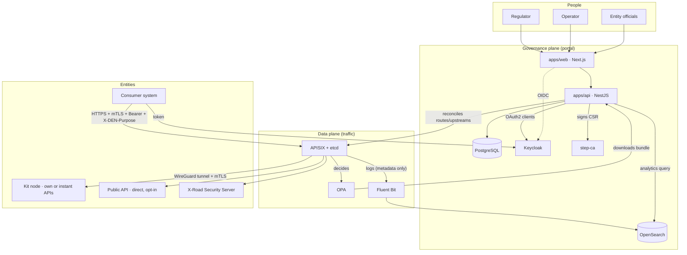
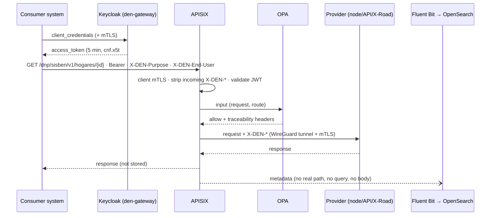

# Technical architecture — DEN Portal

> Versión en español: [docs/es/ARCHITECTURE.md](es/ARCHITECTURE.md)

Version 0.1 · November 2026

## 1. Overview



Two separate planes:

- **Governance plane:** the portal. If it goes down, traffic keeps flowing with the last configuration.
- **Data plane:** APISIX + OPA. It authorizes every call with data that the portal publishes. It never queries the portal's database online.

## 2. Components

| Component | Responsibility | Notes |
| :-- | :-- | :-- |
| `apps/web` | Portal UI, operator/regulator consoles | Next.js App Router, Server Components, Auth.js with Keycloak. Calls `apps/api` with the user's token |
| `apps/api` | Domain, flows, authorization, audit, reconcilers, OPA bundle, contract with nodes | NestJS + Fastify, Prisma, pg-boss |
| PostgreSQL | Domain state, outbox, audit, pg-boss queues | Single source of truth |
| Keycloak | Realm `den-portal` (people, MFA) and realm `den-gateway` (application clients) | Two realms to keep token policies separate |
| APISIX + etcd | Gateway: mTLS, token validation, call to OPA, limits, routing, logs | Admin API on the internal network only |
| OPA | Authorization decision per call | Deployed next to each APISIX node (sidecar or same host) |
| step-ca | Intermediate CA for applications and nodes | Offline root; in production, in an HSM (PKCS#11) |
| Fluent Bit | Receives APISIX logs, applies masking, sends to OpenSearch | Second privacy barrier |
| OpenSearch | Access logs (metadata) and analytics | The browser never talks to OpenSearch |
| Prometheus + Alertmanager | Metrics and alerts | Grafana optional for operators |
| WireGuard hub | Central end of the nodes' tunnels and TLS router to them by SNI | `wg-hub` container on the gateway network (M4-03, ADR-0023); does not forward packets |

## 3. Identity and authentication

### 3.1 People (realm `den-portal`)

- OIDC login (Authorization Code + PKCE) from `apps/web` through Auth.js.
- `apps/api` validates the access token (Keycloak JWKS, `aud = den-portal-api`).
- An entity's resources are exposed under `/api/v1/entities/{entityId}/...` and a global guard applies the permission table (`apps/api/src/auth/authz.policy.ts`): another entity → 404, member without the role → 403 (ADR-0014).
- **Full matrix (M2-03).** Every route declares its access: `@Public`, `@CitizenAccess`, `@OptionalAuth`, `@SignedIn` (any session, own resources only), `@EntityAccess(action)` or `@PlatformAccess(action)`. The guard rejects with 403 any route that declares nothing (fails closed). The action × role and route → access matrix is in `docs/AUTHZ.md`, generated from the policy; a test fails if it gets out of date. A generated integration test calls every protected route with every entity role, every platform role, a member of another entity, a user with no roles and no session, and compares the result with the policy.
- The web app keeps tokens only in the encrypted Auth.js cookie and renews the access token (5 min) with the refresh token before it expires.
- **Accounts (ADR-0018).** Self-registration with mandatory email verification. A new account has no roles: roles only come with an approved registration (the requester becomes `entity_admin`) or an accepted invitation. The invitation goes to an email address, and only the person who signs in with that **verified** email (`email_verified` in the token and the same email they registered with) can see and accept it. The email notice carries a link to the portal, with no secret. The portal does not create users in Keycloak. The `entity_admin` invites, changes roles and revokes (M2-02). A revocation applies on the next request, because roles are read on every request, and the entity always keeps one active administrator.
- **Roles do NOT live in Keycloak.** Keycloak only authenticates; platform roles and per-entity memberships live in PostgreSQL. This gives the portal custom roles per entity without depending on Keycloak groups.
- **Second factor (M3-08, ADR-0021).** Required for platform roles and for `data_steward` in any entity, through session step-up:
  - the `den-browser` flow of `den-portal` has two levels: password (`acr=password`) and TOTP code (`acr=mfa`). Asking for `acr_values=mfa` only adds the code to the session; a user who has none goes through `CONFIGURE_TOTP`;
  - the API responds 403 `mfa_required` on every entity or platform route if the roles require it and the token's `acr` is not `mfa`, always after the role checks. `/me` reports `mfa.required` and `mfa.satisfied`;
  - when the web app sees it, it signs in again with `acr_values=mfa` (`/api/session/step-up`). A short-lived cookie prevents loops and leaves a notice to retry;
  - the portal does not write to Keycloak users: it decides who needs it from the roles in PostgreSQL and checks it on every request;
  - **residual risk: enrollment on first use.** Someone who has the password of an account with a critical role that has not yet enrolled its authenticator app can enroll their own. So that this does not go unnoticed, Keycloak emails the account owner when a credential is added or removed (`email` listener, only `UPDATE_CREDENTIAL` and `REMOVE_CREDENTIAL`), and keeps those events for 90 days. A deployment that needs to close that window can require enrollment when the account is activated (required action `CONFIGURE_TOTP` for all new accounts) or enroll out of band.

### 3.2 Consumer applications (realm `den-gateway`)

- One `Application` = one confidential client with `serviceAccountsEnabled`, only the `client_credentials` grant, `clientId = den-app-<uuid>`.
- Audience mapper `den-gateway`. Access token lifetime: 5 min.
- With `features.mtls.required` (enabled in `co.yaml` since M3-10): the application authenticates with its **secret**, and its **tokens are bound to the certificate** (RFC 8705, claim `cnf.x5t#S256`, client attribute `tls.client.certificate.bound.access.tokens`). `tls_client_auth` is not used (ADR-0022). How the gateway checks it (SPIKE S-3, `docs/spikes/S-3.md`):
  - an APISIX SSL object with `client.ca` (the step-ca chain) rejects in the handshake anyone who does not present a valid certificate;
  - the custom plugin `den-client-cert` puts in `X-DEN-Client-Cert-S256` the fingerprint (base64url of the SHA-256 of the DER) of the verified certificate, after deleting any the client sends. `$ssl_client_fingerprint` does not work, because it is SHA-1;
  - OPA compares it with `cnf.x5t#S256` and with the application's current fingerprints in the bundle (`data.clients[id].certificates`). Revoking means removing the fingerprint. The header never reaches the provider;
  - the gateway's TLS must terminate in APISIX: only a layer 4 load balancer with TLS passthrough can sit in front of it.
  - the token is also requested from the gateway, at `POST <gateway>/oauth/token` (SPIKE S-4, ADR-0022).
    - The `den-oauth-token` route (APISIX reconciler) carries the already verified certificate to the `den-gateway` token endpoint, in `SSL_CLIENT_CERT` (`$ssl_client_escaped_cert`) and `ssl-client-verify` (`$ssl_client_verify`). It always rewrites those headers and deletes their other spellings.
    - Keycloak uses the `nginx` x509 provider with `trust-proxy-verification`. The application's `tokenUrl` is that route.
    - Since Keycloak trusts that header, every other path to it must delete it. Even so, a forged header authenticates nobody (the secret is required), and a token bound to someone else's certificate is useless without its private key.
  - the network root, which also issues the gateway's certificate, is public: `GET /api/v1/pki/ca`. The application guide offers it.
- The portal uses a service account with the `manage-clients` permission **only** in `den-gateway`.

## 4. Reconciliation pattern

Nothing is written to APISIX/Keycloak/OPA from an HTTP controller.

```
Domain transaction
  ├─ changes state (e.g. subscription → approved)
  ├─ AuditService.record(...)
  └─ outbox.insert({ topic: "gateway.sync", aggregate: "apiVersion:<id>" })

Worker (pg-boss)
  └─ takes outbox → enqueues job "reconcile:<target>"

Reconciler
  1. desired = buildDesiredState(target)        // from PostgreSQL
  2. actual  = readActualState(target)          // Admin API / Keycloak Admin API
  3. diff    = compare(desired, actual)
  4. apply(diff) with idempotent PUT and deterministic IDs
  5. sync_state.upsert({ target, hash(desired), appliedAt, status })
  6. if the target was a subscription → mark active/suspended/revoked once confirmed
```

- **Full reconciliation** every 5 minutes in addition to the incremental one, to correct drift.
- **Outbox retention (B-14).** The worker purges every hour the `outbox` rows relayed more than `DEN_OUTBOX_RETENTION_DAYS` ago (7 by default). Rows not yet relayed are never purged.
- **Operator console (`/operator/sync`, M5-07).** Shows `sync_state` by system and status: whether the desired hash is applied, the errors with their attempts, and the drift found.
  - **Drift.** A pass that had to write even though the desired state had not changed since it was applied (`appliedHash = desiredHash` and `in_sync`): someone changed the object outside the portal. The reconciler corrects it and records `driftDetectedAt` and `driftCount`. This is how drift is detected in APISIX versions and in Keycloak clients.
  - **Retry.** `POST /admin/sync/retry`, `platform_admin` only, enqueues the job of the reconciler that owns the target: `gateway.sync` (`apiVersion:<id>`, or `gateway:all` for TLS and the custom routes), `keycloak.sync`, `policy.sync`, `wireguard.sync` or `opensearch.sync`. It never calls the system from the controller, and it is recorded in the audit log (`sync.retry_requested`).
  - **Channels no longer accepted (P-04, ADR-0029).** `GET /admin/sync` also returns `disallowedUpstreams`: the versions not yet retired whose upstream or sandbox upstream has a type the deployment no longer accepts. The console lists them with a link to their sheet; they keep their route until the operator decides.
  - **Contract on the node (P-02).** `GET /admin/sync` also returns `nodeContracts`: the served versions whose node reports another OpenAPI (`differs`) or none (`not_reported`), with both hashes and since when (§10). The console lists them with a link to the version sheet; traffic is not affected.
- Deterministic IDs: `den-route-<apiVersionId>`, `den-upstream-<apiVersionId>`, `den-app-<applicationId>`.

### 4.1 APISIX objects per published API version

**Upstream** `den-upstream-<apiVersionId>`
- `node` with `nodeId` (M4-04, ADR-0023): `nodes = { "<DEN_GATEWAY_WG_HUB>": 1 }` (the hub's SNI router, `wg-hub:8443`), `scheme = https`, `pass_host = rewrite` and `upstream_host = den-node-<nodeId>`, which is also the SNI the hub uses to pick the node and the name verified in its certificate. mTLS to the node (M3-03): `tls.client_cert_id = den-ssl-gateway-client-<entityId>`, `tls.verify = true` and `tls.ca_certs` = the network CA. The hub passes the connection through, without opening it, to `<tunnel address>:<servicePort>`, and the service lives at the node's `servicePath` (the public path is rewritten to `servicePath/...`). The reconciler reads the node on every pass: if it does not belong to the version's entity, is not `enrolled`, `online` or `offline`, or the hub or the CA is missing, it deletes the route and the upstream (fails closed). An `offline` node keeps its route and answers again when it reconnects. Enrolling or decommissioning a node enqueues `gateway.sync` for its versions. When the version is registered, the `nodeId` must belong to a node of the entity that has not been decommissioned (400 on `upstream.nodeId`).
- `node` without `nodeId`: the environment's test service. The reconciler resolves the node with `DEN_DEV_NODES` (`entity-slug=host:port` of that entity's mock, `scheme = http`; with `https://host:port`, the mTLS above to that host). An entity not listed there ends up in sync error, without anything being written to APISIX.
- `direct`: host of the existing API, `scheme = https` with `tls.verify = true` (the provider's certificate is verified against the system CAs and for its name), and the URL's path as a prefix. With `mtls`, also `tls.client_cert_id = den-ssl-gateway-client-<entityId>` (M3-03): the provider trusts the network CA and **only** its own name, `CN=den-gateway.<entity-slug>`. **SSRF:** the host must be a public DNS name or a public IP. Private, loopback, link-local or metadata IPs are rejected, as are names without a domain or internal names (`keycloak`, `*.local`, `*.internal`). This is validated when the version is registered (`isPublicHostname` in `packages/contracts`, including IPv6 addresses that embed an IPv4) and again in the reconciler. The reconciler also resolves all the host's A/AAAA addresses on every pass and, if any is not public, deletes the route and the upstream (fails closed). If resolution fails, it only logs the error. **No DNS rebinding (M3-03):** the upstream's `nodes` are the addresses the reconciler resolved and found to be public, not the name, with `pass_host = rewrite` and `upstream_host` = the name (Host, SNI and verified name). If the name changes address, the next pass updates the upstream. **Deployment (M6):** the gateway's egress must be filtered at the network level, blocking RFC 1918, link-local and the platform's subnets.
- `xroad` (M4-05, SPIKE S-5): the operator's Security Server (`DEN_XROAD_SECURITY_SERVER_URL`), never a URL from the version, which only stores the `serviceId` and an optional path. The path is rewritten to `/r1/{instance}/{class}/{member}[/{subsystem}]/{service}{servicePath}/…` with the literal parts, because APISIX encodes `upstream_uri`. The parts are validated when the version is registered and again in the reconciler: letters, digits, space and `. _ - : ~`, never dots alone. The trailing path does not accept empty segments, `.` or `..`, which the Security Server could resolve to another service. The instance must be the operator's (first part of `DEN_XROAD_CLIENT`).
  - `proxy-rewrite` sets `X-Road-Client` = `DEN_XROAD_CLIENT` (the operator's subsystem) and deletes the consumer's `X-Road-Security-Server`, `-Represented-Party`, `-Id` and `-Request-Hash`.
  - `opa` adds `X-Road-UserId` and `X-Road-Issue` to `send_headers_upstream`. The policy (routes with `xroad: true` in the bundle) sets the official's hash and `den:subscription:<id>`, and whatever the consumer sends is deleted.
  - Over HTTPS, the gateway presents its certificate for X-Road (`den-ssl-gateway-xroad`, `CN=<DEN_GATEWAY_CLIENT_NAME>.xroad`, which the operator registers in the Security Server) and verifies the Security Server's with `DEN_XROAD_SECURITY_SERVER_CA`. The full pass keeps that SSL object while a served version (or one in review, for its check routes) has an `xroad` upstream (A-5).
  - Confused deputy: the member in the `serviceId` must be the entity's X-Road member, which the operator registers (`PUT /admin/entities/{id}/xroad-member`, `entity.xroad_member_set`, unique per entity). It is validated when the version is registered (400) and on every reconciler pass (fails closed). Changing the member reconciles the entity's `xroad` versions.
  - Without `DEN_XROAD_SECURITY_SERVER_URL` and `DEN_XROAD_CLIENT`, `xroad` versions stay in sync error, without a route.
- **Types allowed (P-04, ADR-0029).** The node is the default channel. New versions may only use the types in the country's `features.upstreams` (`[node, xroad]` if omitted; `direct` is opt-in), and `xroad` only where the deployment has `DEN_XROAD_SECURITY_SERVER_URL` and `DEN_XROAD_CLIENT`. `GET /api/v1/upstream-types` returns them to the portal's form. Creating a version, replacing its OpenAPI (a draft edit or a published revision) and submitting it check the upstream and the sandbox upstream: another type is a 400 with `upstream_type_not_allowed` or `xroad_not_configured` on `upstream.type` / `sandboxUpstream.type`. The reconciler does not look at the list: a version whose type the country stops accepting keeps its route, and the version detail flags it (`disallowedUpstreamTypes`). A list with only `xroad` and no X-Road settings stops the API at startup.

**Route** `den-route-<apiVersionId>`
- `uri = /{entitySlug}/{apiSlug}/v{major}/*`, methods declared in the OpenAPI.
- Plugins. APISIX runs them by phase and, within each phase, by priority (not in the order they are listed). Verified in SPIKE S-1 (`docs/spikes/S-1.md`):
  1. `request-id` (rewrite, 12015): generates `X-Request-Id` if the client does not send it.
  - `den-header-guard` (custom plugin, rewrite, 2700, M3-07): before any other plugin reads or sets one, it deletes **every** `X-DEN-*` header from the client except `X-DEN-Purpose` and `X-DEN-End-User`, which the consumer declares. This way a new traceability header is protected without touching any list. Underscores count as hyphens (`X_DEN_Subscription` is also deleted): APISIX accepts underscores in names, and CGI-style servers (WSGI, PHP, Rack) read `X_DEN_*` and `X-DEN-*` as the same `HTTP_X_DEN_*` variable. The `proxy-rewrite` list in step 3 remains as a second barrier.
  2. `openid-connect` (rewrite, 2599): `client_id: den-gateway`, `bearer_only: true`, `use_jwks: true`, `discovery` of the `den-gateway` realm (as APISIX reaches it: `DEN_GATEWAY_KEYCLOAK_URL`), `set_userinfo_header`, `set_access_token_header` and `set_id_token_header` set to `false` (the token does not travel to the provider in another header), and `claim_validator.audience` with `required` and `match_with_client_id`: only tokens with `aud = den-gateway` get through. The issuer is validated against the discovery's.
  3. `proxy-rewrite` (rewrite, 1008): deletes the headers that only the gateway may set (`X-DEN-Consumer-Entity`, `X-DEN-Consumer-App`, `X-DEN-Subscription`, `X-DEN-Operation`, `X-DEN-End-User-Hash`, `X-DEN-Subject-Ref`) if they come from the client, before OPA builds its input; it keeps `X-DEN-Purpose` and `X-DEN-End-User`, which OPA needs to read. Before that, in the same phase and with priority 1020, the custom plugin `den-data-subject` reads the data subject from the JSON body for the operations that declare it there and passes it on as `X-DEN-Body-Subject`, after deleting any value the client sent (ADR-0017). With priority 1025, the custom plugin `den-client-cert` deletes any `X-DEN-Client-Cert-S256` the client sends and, if nginx verified a client certificate in the handshake, sets its RFC 8705 fingerprint (S-3). It rewrites the path by removing the prefix (it only changes `upstream_uri`; OPA still sees the full public path).
  4. `opa` (access, 2001): `host` of the local OPA, `policy: den/authz/decision` (only `allow`, `headers`, `status_code` and `reason`, which is what the plugin reads: querying the whole package evaluated and returned all its rules and saturated OPA at 500 requests/s, M6-03), `with_route: true`, `send_headers_upstream: [X-DEN-Consumer-Entity, X-DEN-Consumer-App, X-DEN-Subscription, X-DEN-Purpose, X-DEN-Operation, X-DEN-End-User-Hash, X-DEN-Subject-Ref, X-DEN-End-User, X-DEN-Body-Subject, X-DEN-Client-Cert-S256, X-DEN-Data-Subject, X-Request-Id, Authorization, X-Access-Token]`. For each name in that list the plugin sets the value the policy returns and, **if the policy does not return it, deletes the client's header**. That is why the policy always returns `X-DEN-Purpose` and `X-Request-Id`, and **never** `X-DEN-End-User`, `X-DEN-Body-Subject` or `X-DEN-Client-Cert-S256` (so the clear-text values of the official and of the data subject do not reach the provider; ADR-0015, ADR-0017). `X-DEN-Data-Subject`, the header the consumer used to declare, is also removed, and so are the consumer's credentials, `Authorization` and `X-Access-Token` (M-11): the policy reads the token and never returns it, so neither the provider nor the X-Road Security Server receives a token it could replay against the application's other subscriptions. If OPA does not respond, it denies with 403 (fails closed).
     - Right after it, `den-assertion` (custom plugin, access, 2000, M6-10, ADR-0024), only with `features.gatewayAssertion`: it signs what OPA authorized in an ES256 JWS for the provider (`audience` = the provider entity's slug) and puts it in `X-DEN-Assertion`. It carries who is querying, the purpose, the subscription, the operation, the official and the data subject as pseudonyms, the method and the SHA-256 of the URI the provider receives and, with a body, the SHA-256 of the body bytes. `jti` is the request id. The key is in the plugin metadata (shared, encrypted in etcd with the deployment's keyring), which the reconciler sets. Without a key it responds 503 (fails closed).
  5. `limit-count` (access, 1002): limit per subscription with `key_type: var`, `key: http_x_den_subscription` and `count: "$http_x_den_rate_limit"`, the two headers that OPA set from the bundle. Local counters on each node, with the limit split across the nodes (ADR-0020). See SPIKE S-2.
  6. `den-rate-limited` (custom plugin, 898, M3-05): turns the 429 from `limit-count`, the one with an empty `$upstream_status`, into problem+json (`code: rate_limited`); a provider's 429 passes through untouched (S-2). The `X-RateLimit-Limit`, `-Remaining` and `-Reset` headers stay. `response-rewrite` with `vars` (what S-2 tested) is not used because a route has only one, and deprecated versions use it for `Deprecation` and `Sunset`.
  7. `prometheus` (log, 500).
  8. `http-logger` (log, 410): to Fluent Bit with the `log_format` from §8.

While an API has no active subscriptions, the route exists but OPA denies everything.

**SSL** `den-ssl-gateway-client-<entityId>` (M3-03): one per provider entity, of type `client`, with the client certificate the gateway presents to that entity's mTLS upstreams: `CN=den-gateway.<slug>` (the prefix is `DEN_GATEWAY_CLIENT_NAME`). It is one identity per provider rather than a shared one so that an entity cannot point its version at another entity's mTLS API and use the gateway's identity (confused deputy): each provider accepts only its own name. step-ca issues it with the `den-portal` provisioner (client authentication only). The portal stores the key sealed and renews it the same way as the server certificate. The entity's upstreams reference it by id, so renewing it changes a single object. The reconciler ensures it only when a version needs it, so upstreams without mTLS do not depend on step-ca. The full pass keeps it while an upstream or sandbox upstream of the entity needs it, in a served version or in one `in_review` with check routes (a provider whose only version is in review keeps it, M-10), and deletes it otherwise.

**SSL** `den-ssl-gateway` (M3-02, S-3)
- `snis` = `DEN_GATEWAY_TLS_HOSTS`. `cert` and `key` are the gateway's server certificate, which step-ca issues with the `den-gateway-tls` provisioner. The portal generates the key, stores it sealed (`gateway_certificate`, `DEN_SECRETS_KEY`) and renews the certificate in the last third of its lifetime. It audits it (`gateway_certificate.issued`) without the key.
- `client.ca` carries the step-ca intermediate and root (`depth: 2`). With `features.mtls.required`, without `skip_mtls_uri_regex`: APISIX rejects in the handshake every call without a valid network certificate. Without the flag, the certificate is optional (if one arrives, it is verified) except on the nodes' control channel (`/api/v1/nodes/{id}/heartbeat|renew|config`), where APISIX requires it: `skip_mtls_uri_regex` exempts everything else (M4-02).
- The APISIX reconciler applies it on every full pass (`sync_state` `apisix:ssl:den-ssl-gateway`). The key is not compared, because APISIX stores it encrypted: a new key always comes with a new certificate.

**Sandbox (M4-08)** of a version served with `sandboxUpstream`: route `den-sandbox-<id>` at `/sandbox{basePath}/*`, with the test upstream inside the route and the same plugin chain as the published one (token, OPA, limit, logs), without the transparency record, because the data is synthetic. The bundle has a `den-sandbox-<id>` route with `sandbox: true`, each client carries its `environment`, and the subscriptions of a sandbox application point to the sandbox route. The policy denies with `environment_mismatch` a sandbox application on a real route and a production one on a sandbox. A version that stops being served also loses its sandbox, and the full pass deletes the leftover ones.

**Verification routes (M4-06)** of an `in_review` version, for the validations run on submission for review (`SPEC.md §4.2` step 2). They skip the token and the policy, so they are narrow:
- they only exist for a request with `X-DEN-Validation` = that version's token, `HMAC(DEN_VALIDATION_TOKEN, versionId)` (APISIX `vars`; without it, 404): a leaked token only opens the routes of its own version. Neither the healthcheck nor Schemathesis follow redirects, which would carry the token elsewhere, and the lint rejects OpenAPI paths with `.`/`..` segments, encoded dots or slashes, or empty segments;
- `den-check-<id>` (`/__den/check/<id>`) only accepts GET and sends it to the service root of the real upstream (`servicePath/`): it tests connectivity (TLS, mTLS, tunnel, Security Server), never data;
- `den-check-sandbox-<id>` (`/__den/check-sandbox/<id>/*`) goes to the version's `sandboxUpstream`, with synthetic data, for the contract test;
- the upstreams go inside the route and are built like the published one (mTLS, hub, Security Server and their controls). Outside `in_review` they are deleted, and the full pass removes the leftover ones.

The `version.validate` job (enqueued on submission and when a rerun is requested) runs the healthcheck through APISIX (`DEN_GATEWAY_INTERNAL_URL`, passes with any response that is not a 5xx) and asks the runner for the contract test (`infra/contract-runner`: Schemathesis 4, MIT, behind an internal API with `DEN_CONTRACT_RUNNER_TOKEN`). The runner runs `st run` against the sandbox route with a limit on examples and on time, and returns only, per operation, the codes of the failed checks (`ST101`…) and the HTTP status, with no bodies or `curl` commands. The result is stored in `api_version.validation_report` and in the audit log (`api_version.validated`). The operator approves only with `passed` validations; otherwise the API answers 409 (`conflict`) with the reason as a form error, `validations_pending` or `validations_failed` (P-07), and the review page disables Approve with that reason next to it. Without a sandbox, the contract test is `skipped` and does not block. The version sheet explains each result (P-07): a healthcheck 502 or 504 comes from the gateway, which could not reach the upstream (for a node: its status, its tunnel, the service on it); another 5xx is the service failing; a 4xx on the service root passes, since it proves the gateway reaches the service; a failed contract test names the operations and, per operation, whether the sandbox failed (5xx) or answered something the OpenAPI does not declare.

**Reconciler (M1-08):** consumes `gateway.sync` (aggregate `apiVersion:<id>`) and serves `published` and `deprecated` versions. It compares the desired state with what APISIX stores and writes only if something changed: upstream before route and, when deleting, route before upstream. It does a full pass at startup and every 5 minutes, which also deletes the `den-` objects that no version asks for. Objects without that prefix are not touched. The result is stored in `sync_state` (`apisix:route:den-route-<id>`).

- **Exact comparison (M-08).** An object is in sync only if APISIX holds exactly what the portal would write: the same fields at every level (plugins and their configuration, `nodes`, `tls`, `vars`, `methods`…). The only extra fields tolerated are APISIX defaults with their default value (`priority: 0`, `hash_on: vars`, `pass_host: pass`, `scheme: http`), and on SSL objects the key and the validity APISIX keeps. A plugin added by hand, one the desired state no longer has (`den-assertion` once `features.gatewayAssertion` is off), an extra node in an upstream or an address the provider's DNS no longer publishes are drift: the reconciler writes the object back and counts it.
- **One unit at a time (M-09).** Every unit of work (one version with its check, sandbox and certificate objects, one gateway object, the orphan cleanup) runs holding a PostgreSQL advisory lock, shared by the `gateway.sync` jobs and the full passes of every API replica. A unit reads the database and writes APISIX with no other unit in between, so a full pass cannot delete what a job created while it ran, nor write back a state a later job removed. The cleanup also reads every candidate again before deleting it, and keeps it if its version is served (or in review) by then. A process runs one full pass at a time; one asked for meanwhile (the operator's retry) runs right after.
- **SSL objects (A-5, M-10).** The cleanup computes the SSL objects the database needs (the gateway's, the client certificate of each entity whose served or in-review upstreams use mTLS, and the X-Road one while an `xroad` upstream goes over HTTPS) and deletes only the other `den-` ones.

- **Deprecated versions (ADR-0019).** The route keeps serving and carries `response-rewrite` with `Deprecation: @<seconds>` (RFC 9745) and `Sunset: <HTTP date>` (RFC 8594). When it is retired, the version leaves the desired state and the reconciler deletes the route.

### 4.2 OPA bundle

- `apps/api` exposes `GET /api/v1/opa/bundle.tar.gz` (authenticated with the service token `OPA_BUNDLE_TOKEN`; with no token configured it rejects everything; supports `ETag`). OPA polls it every 10–20 s (`polling.min_delay_seconds`).
- **Without the portal (M6-04).** OPA saves the last activated bundle to disk (`persist: true`) and loads it at startup. If the portal does not respond, it keeps deciding with it. So does an OPA that restarts at that moment, instead of being left with no policy and denying everything. Traffic keeps flowing, and so do denials. Anything new (an approved subscription, a revocation) arrives when the portal comes back: during an outage, a revocation waits until the portal responds. Test: `pnpm resilience:test` (`docs/performance/M6-04.md`).
- The bundle is built from PostgreSQL on every request and is reproducible. It includes a `.manifest` with `revision` (SHA-256 of policies + data) and `roots: [den, routes, clients, config]`. The ETag is the revision, and an unchanged revision gets a 304.
- **Activation (`approved → active`):** OPA has the `status` plugin configured, which sends `POST /api/v1/opa/status` (same token) as soon as it activates a bundle. The portal stores which subscriptions each revision contains (`policy_bundle`, pruned after 24 h). When OPA reports an active revision, the portal moves the `approved` subscriptions it contains to `active`, with the `subscription.activated` event (actor `system:opa`) in the same transaction as each one, in batches of 100 per transaction (M6-03: a backlog of thousands, after an OPA outage or a bulk load, did not fit within a single transaction's time limit and was retried endlessly), and updates `sync_state` `opa:bundle`. With several gateways, the first OPA that reports is enough; distinguishing by node is left for M4. Target: under 60 s (10–20 s polling and immediate notice).
- Contents: Rego policies from `packages/policy` + `data.json`:

```json
{
  "routes": {
    "den-route-<apiVersionId>": {
      "apiVersionId": "...",
      "classification": "personal",
      "operations": [
        {
          "id": "getAfiliacion", "method": "GET", "pathRegex": "^/salud/afiliacion/v1/afiliados/[^/]+$",
          "subject": { "in": "path", "regex": "^/salud/afiliacion/v1/afiliados/([^/]+)$", "numberGroup": 1, "documentType": "CC" }
        }
      ]
    }
  },
  "clients": {
    "den-app-<applicationId>": {
      "status": "active",
      "entityId": "...",
      "entitySlug": "dnp",
      "applicationId": "...",
      "subscriptions": [
        {
          "id": "...",
          "route": "den-route-<apiVersionId>",
          "operations": ["getAfiliacion"],
          "purposes": ["eligibility_check"],
          "validFrom": "2026-11-30T00:00:00Z",
          "validUntil": "2027-11-30T23:59:59Z",
          "endUserRequired": true,
          "rateLimitPerMinute": 600
        }
      ],
      "certificates": ["<x5t#S256 of each current certificate>"]
    }
  },
  "config": {
    "endUserHashSalt": "<DEN_END_USER_HASH_SALT>",
    "subjectRefKey": "<DEN_SUBJECT_REF_KEY>",
    "country": "CO",
    "documentTypes": ["CC", "CE", "TI", "PEP", "PPT", "PA"],
    "mtlsRequired": false,
    "gatewayNodes": 1
  }
}
```

- `den.authz` policy (summary):
  1. Extracts the JWT from `Authorization` (already validated by `openid-connect`; OPA only decodes it) and takes `azp`/`client_id`.
  2. `clients[client_id].status == "active"`.
  3. Finds the operation: method + `pathRegex` of the route (`input.route.id`). `input.request.path` is the full public path, with the `/{entitySlug}/{apiSlug}/v{major}` prefix (S-1), and `pathRegex` is anchored to it. When more than one operation matches (`GET /afiliados/buscar` next to `GET /afiliados/{id}`), the most specific wins (M-13): segments compare from the left, and a literal segment beats one that is partly a parameter (`{id}.json`), which beats a whole parameter, as OpenAPI says of concrete and templated paths. Two equally specific matches are ambiguous and match nothing (`operation_not_allowed`). The lint (`den-ambiguous-paths`) rejects, when a version is registered, two paths that can match the same request under one method unless one is at least as specific in every segment, since routers disagree on those (`/a/{x}` and `/{y}/b` for `/a/b`); `den-data-subject` lists its operations most specific first, so it reads the subject of the operation OPA picks.
  4. There is a subscription for that route with the operation and the purpose from `X-DEN-Purpose`, and it is in force.
  5. Requires `X-DEN-End-User` if the subscription asks for it (`endUserRequired`, set from the classification when it was requested) or if the route's current classification is `personal` or `sensitive` (M3-06: an API that moved to personal data also requires it from earlier subscriptions). The value must be an identifier of 1 to 128 visible ASCII characters with no spaces. If it is not, the call is denied with `end_user_invalid` even when it is not required, and its hash is never computed. It computes `X-DEN-End-User-Hash = HMAC-SHA-256(value, salt)` with the deployment's salt (`DEN_END_USER_HASH_SALT`, at least 16 characters). Without it, or in production with the sample value from `.env.example`, the bundle is not served. The salt goes in the bundle, which is only served over the internal network. The clear-text value never reaches the provider (OPA does not return it) or any log: the access log and the transparency record only carry the hash, and Fluent Bit's allow lists have a static test.
  6. Returns `allow`, headers for the upstream (among them `X-DEN-Rate-Limit`: the subscription's `rateLimitPerMinute` divided by `config.gatewayNodes` and rounded up, ADR-0020) and, on denial, `status_code` + a problem+json body in `reason` with a stable reason (`no_subscription`, `purpose_not_allowed`, `operation_not_allowed`, `subscription_expired`, `end_user_required`, `end_user_invalid`, `data_subject_required`, `data_subject_invalid`, `app_suspended`; with mTLS required, also `client_certificate_required`, `token_not_bound`, `certificate_mismatch` and `certificate_revoked`, per S-3). On denial, `headers` are **response** headers: `Content-Type: application/problem+json` and `X-DEN-Deny-Reason: <reason>`, which the access log records with `$sent_http_x_den_deny_reason`.
- `data.json` includes the routes of `published`/`deprecated` versions and the clients that have not been deleted (suspended applications appear with `status: suspended`). It only carries `approved` or `active` subscriptions of served versions. `pathRegex` is anchored to the full public path, and a `{x}` parameter matches one segment or part of one (`[^/]+`).
- Client certificate (M3-02). It is checked when `config.mtlsRequired` is on, and whenever the token is bound to a certificate (`cnf.x5t#S256`, RFC 8705 §3). It comes right after the suspended-application check. Order: `client_certificate_required` (no verified fingerprint), `token_not_bound`, `certificate_mismatch` (the fingerprint is not the token's) and `certificate_revoked` (the fingerprint is not in `clients[id].certificates`, the list of that application's current certificates). Revoking or expiring a certificate removes it from the list on the next bundle download (10–20 s).
- A repeated header counts as absent. When there is more than one valid subscription, the same one is always chosen (ordered by id). Reasons are evaluated in this order: client, suspended application, route, operation, subscription to the route, granted operation, purpose, validity and official.
- The policies have tests with `opa test` and coverage ≥ 90 %, enforced in CI (`--threshold 90`).

### 4.3 Keycloak

Application reconciler: creates/updates/disables clients in `den-gateway`, rotates secrets on request, configures `tls_client_auth` and the expected subject DN when there is a certificate.

- **Secret rotation (M3-04).** The realm has the client policy `den-secret-rotation` (executor `secret-rotation`, condition `den.managed = true`, an attribute the reconciler sets on its clients). Keycloak ignores the rotated-secret attributes if they arrive through the Admin API, so the reconciler uses Keycloak's own mechanism:
  1. With a new secret pending (sealed) and the previous one in `rotating`, it compares by hash Keycloak's current secret with the previous one.
  2. If they match, it regenerates it (`POST client-secret`), and Keycloak turns the previous one into the rotated secret.
  3. Then it sets the new secret with `PUT`, which changes only the current one. If a pass was interrupted between the two steps, the previous one is already the rotated one and only step 3 is repeated.
  4. With no rotation in progress (revoked, or end of the window), it deletes the rotated secret (`DELETE client-secret/rotated`).
  
  The values only pass through the reconciler's memory to compare hashes. The policy keeps the rotated secret for at most 30 days; the portal closes the window after `lifecycle.credentialRotationDays`. On a Keycloak that has already imported the realm, the policy is applied with `node scripts/keycloak-client-policies.mjs`.

### 4.4 step-ca

- JWK provisioner dedicated to the portal. The backend signs a one-time token (OTT) and calls `/1.0/sign` with the CSR. Implemented with `jose`; no proprietary dependencies. Detail (M3-01, `apps/api/src/credentials`):
  - The provisioner key travels encrypted (JWE, PBES2) in the CA's public list of provisioners. The API decrypts it once with `DEN_STEP_CA_PROVISIONER_PASSWORD`.
  - The OTT carries `sub` and `sans` = clientId, `sha` = the root's fingerprint, a 5-minute lifetime and a unique `jti`. The portal asks for `notAfter` = `lifecycle.certificateValidityDays`.
  - The API verifies the CA's TLS with its root: `DEN_STEP_CA_ROOT_FILE`, or the root the CA serves pinned by `DEN_STEP_CA_ROOT_FINGERPRINT`. Only in development, with neither of the two, it trusts the root the CA serves and logs its fingerprint.
  - Before the CA, the portal checks the CSR (`pkijs`): a single PEM block, attributes field present, valid self-signature, ECDSA P-256/P-384 or RSA 2048-4096 key, CN = clientId and no other alternative name. An invalid CSR gives 400 with a stable message per cause. If the CA does not respond or rejects it, 503.
  - The certificate the CA returns must have that subject and that key, and chain up to the root. The portal stores the chain (public), the RFC 8705 fingerprint (`x5t#S256`), the serial and the dates. An application has a single active certificate (partial unique index); rotation is M3-04.
  - A periodic job (`DEN_LIFECYCLE_INTERVAL_SECONDS`) notifies the entity's developers `lifecycle.certificateExpiryWarningDays` before expiry (`credential.expiry_notice_queued` → `certificate_expiring` notification) and marks expired certificates as `expired`.
- Templates. `app` (`infra/step-ca/app.tpl`, provisioner `den-portal`): CN = clientId, the clientId as a DNS SAN, key usage for TLS client authentication only, 90 days. `node` (`infra/step-ca/node.tpl`, its own provisioner `den-nodes`, M4-02): fixed `CN=den-node` and the node's name, `den-node-<nodeId>`, as the only DNS SAN, both from the OTT. Server authentication (the gateway calls the node) and client authentication (the node calls the control channel). 90 days, renewed by the kit. step-ca requires the CSR's CN to be the OTT's `sub`; since the kit does not know its ID before it enrolls, the node's CSR always carries `CN=den-node`, with no names, and the OTT sets the SAN.
- Revocation: short-lived certificates + a list of revoked fingerprints in the OPA bundle (requires SPIKE S-3).

## 5. Flow of a call



## 6. Traceability headers to the provider

| Header | Content |
| :-- | :-- |
| `X-DEN-Consumer-Entity` | slug of the consumer entity |
| `X-DEN-Consumer-App` | application ID |
| `X-DEN-Subscription` | ID of the subscription that authorized the call |
| `X-DEN-Purpose` | purpose code |
| `X-DEN-Operation` | resolved `operationId` |
| `X-DEN-End-User-Hash` | salted hash of the end official (if applicable) |
| `X-DEN-Subject-Ref` | pseudonym of the data subject (keyed HMAC, ADR-0015), if the operation declares one |
| `X-Request-Id` | end-to-end correlation ID |

The provider never receives the consumer's access token: `Authorization` and `X-Access-Token` are removed after OPA reads them (§4.1, M-11). The provider authenticates the gateway (mTLS through the node, and `X-DEN-Assertion` where enabled), not the consumer.

The provider knows who is querying, for what purpose and under which authorization: this solves the "I only see the gateway" problem. In addition, with `features.gatewayAssertion` the gateway signs them on each call in a JWS assertion (`X-DEN-Assertion`) for non-repudiation (ADR-0024, SPIKE S-6, M6-10):
- **Key:** the portal generates it (EC P-256, table `gateway_signing_key`, sealed with `DEN_SECRETS_KEY`) and rotates it every `lifecycle.assertionKeyRotationDays` (90 by default). The APISIX reconciler puts it in the `den-assertion` metadata before the routes.
- **Public JWKS** (`GET /api/v1/gateway/jwks`, 5-minute cache): every key that has been used, from newest to oldest, so that archived assertions keep verifying. A compromised key is removed from the list.
- **Immediate rotation:** the operator requests it with `POST /api/v1/admin/gateway-signing-keys/rotate` (`platform_admin`; with `compromised`, the previous key is removed from the JWKS).
- **Verification:** how the provider verifies it is in the entity guide (`docs/guides/entities.md` §3.2). The test providers do it on every call and log the result.

## 7. Data

- **Prisma** with versioned migrations. Main tables = the entities of `SPEC.md §3` + `outbox`, `sync_state`, `audit_event`, `policy_bundle` (OPA bundle revisions).
- **Outbox** so that domain state and sync work are committed in the same transaction.
- **Chained audit log:** `hash = SHA-256(prevHash ‖ canonical JSON of the event)`, with sorted keys and the values as they come back from `jsonb`. `seq` = last + 1 under a transaction-level advisory lock (`pg_advisory_xact_lock`), without using the sequence: this way a rolled-back transaction leaves no gaps. The lock serializes audit writes until each transaction ends. Events before M1-11 are outside the chain, and verification counts them separately. Chain verification endpoint. Daily anchoring (M2-09): the hash of the last chained event of each closed day, in the country's time zone, is sealed with the TSA (RFC 3161). It is stored in `audit_anchor`, insert-only even for the owner, and emailed to the regulators. Verification requires each anchor to find its event with the same hash, which detects truncation of the tail. CSV/JSON export with the same filter selection, with its SHA-256 signed with the operator's key (EdDSA JWS, verifiable with `/transparency/jwks`). Every export is audited.
- The `audit_event` table has only `INSERT`/`SELECT` permissions for the application role (no `UPDATE`/`DELETE`), and a trigger rejects `UPDATE`/`DELETE`/`TRUNCATE` even for the schema owner.
- **Database roles:** the schema owner (`den`) is only used for migrations; the API runs as `den_app`, with no DDL. The pg-boss schema is created with a Prisma migration, so pg-boss runs without DDL permissions.
- **Documents:** storage on a local volume behind the `StorageService` interface (S3-compatible adapter in the future, with an OSS backend such as SeaweedFS or Garage). PDF only. Antivirus (M6-08): with `DEN_CLAMAV_URL`, the API sends every document to ClamAV (`clamd`, INSTREAM protocol) before storing it; an infected one is rejected and, if ClamAV does not respond, the upload fails (fails closed). In the Helm chart it is enabled with two replicas.
  - **Since M2-01.** `DEN_DOCUMENTS_DIR`; keys are random UUIDs that the API chooses, never user-supplied names, and they are written with a temporary name and a rename. The `document` row stores size, type and SHA-256, which is checked again on every download.
  - **Upload:** the body is the PDF itself (`application/pdf`); the `%PDF-` signature and a maximum size `DEN_DOCUMENT_MAX_BYTES` (10 MiB, 413 if exceeded) are required. Only that route has the larger limit, and only for requests with `Authorization: Bearer`: without a token, 401 before reading the body. The rest of the API stays at 1 MiB.
  - **Download:** `Content-Disposition: attachment`, `nosniff`, CSP `sandbox` and no caching. The web app serves it at `/files/...` with the session's token, which never reaches the browser.
  - **Data exchange agreements (M2-07).** They are attached to the request with the same upload route. The model agreement template comes from `documents.agreementTemplate` in the country config.
  - **Deletion by court order.** It is the only physical deletion. It deletes the bytes after the transaction commits and keeps the row with its SHA-256 and the reference to the order; downloads respond 410.
- **Notifications (M2-08).** They derive from the audit log: writing the event enqueues `notification.dispatch` in the same transaction. The worker resolves recipients with the current state and stores one row per event and person (unique key, idempotent delivery). It sends email according to preferences, except for security notices, which are always sent. The texts carry no data about the people queried, only names of APIs, entities and applications.
- **Outgoing email from the API** (`DEN_SMTP_URL`, Mailpit in development): only workers send it, from the outbox (e.g. `invitation.email`), so an email goes out if and only if the change that caused it was committed. At-least-once delivery, with retries over several hours. The texts are in `apps/api/src/mail/messages.ts` (es/en) and the country's names come from the config.

## 8. Access logs and privacy

APISIX `http-logger` with `log_format` restricted to:

```
ts, request_id, route_id, operation (X-DEN-Operation), method, status,
latency_ms, upstream_latency_ms, consumer_entity, consumer_app,
subscription_id, purpose, end_user_hash, bytes_sent, gateway_node,
deny_reason
```

- APISIX variables for each field: `$http_x_den_operation`, `$http_x_den_subscription`, `$http_x_den_consumer_entity`, `$http_x_den_consumer_app`, `$http_x_den_purpose`, `$http_x_den_end_user_hash` (the headers OPA set, visible in the log phase according to S-1) and `$sent_http_x_den_deny_reason`. **Never** `$uri`, `$request_uri` or `$upstream_uri`: they include the real path and the query.
- **Denied calls (M5-03).** A denial does not reach the provider, so OPA sets no request headers. When the client is known, OPA names it in its response (`X-DEN-Consumer-App`, `X-DEN-Consumer-Entity`, which the client already knows). The `log_format` reads them as `deny_consumer_app` and `deny_consumer_entity`, and Fluent Bit turns them into `consumer_app` and `consumer_entity` and drops the originals.
- **Rate limit (M5-03).** The gateway's own 429 (`den-rate-limited`, with no upstream) also carries `X-DEN-Deny-Reason: rate_limited`. In analytics it counts as a gateway denial with its reason; a provider's 429 does not carry it.
- **Provider response headers.** `den-header-guard` strips the `X-DEN-*` headers from every response that comes from an upstream (`$upstream_status` present): a provider cannot invent a denial reason or a consumer. `ngx.header` turns `_` into `-`, so a name with underscores (`X_DEN_Deny_Reason`) cannot be stripped. That is why Fluent Bit drops `deny_reason` when there was upstream time: only the gateway denies.

- **Not logged**: real `uri`, query string, bodies, `Authorization`, citizen IP (there is none; consumers are systems).
- nginx's own access log in APISIX is **disabled** (`nginx_config.http.enable_access_log: false`), because it writes the request line and the upstream URI.
- **Error log (M5-01).** It stays at the `error` level, because warnings (every denial by a plugin) also include the request line. A real error ("connect() failed… while connecting to upstream") also includes it, with the upstream URI. That is why nginx sends its error log over syslog to `fluent-bit-errors`, which masks everything from the request line to the end: the upstream URI, the host and the referrer, except APISIX's hexadecimal `request_id`. This way quotes or a fake field name in the path cannot cut the mask short. It also masks any query and any run of 6 or more digits (`infra/fluent-bit/gateway-errors.lua`). The result stays in that container's output, where the operator reads it, and never reaches OpenSearch. The file log that nginx always keeps goes to `/dev/null`. Only errors before the configuration is read go to APISIX's stderr. There are regression tests in `tests/infra`.
- **Fluent Bit (M5-01)** applies a Lua filter that drops any field outside the allow list (defense in depth). In addition:
  - it shapes the record: `status` and `bytes_sent` as integers; `latency_ms` and `upstream_latency_ms` in milliseconds (with several upstreams, the sum);
  - it checks the format of each value and drops any that does not have the shape the gateway sets. This way a client cannot slip an identification number in through a header it chooses: `X-DEN-Purpose` has to be a code and `X-Request-Id` a trace identifier of up to 128 characters, and neither may hold a run of 6 or more digits, the rule of `gateway-errors.lua` (M-16). The one exception is a request id in the UUID form the gateway itself generates, whose hex digits often run that long.
- **API logs (M6-05, ASVS 16.4.3).** Every line goes through `DenLogger` (`apps/api/src/common/logger.ts`), which masks the message and the stack trace: queries, any run of 6 or more digits (UUIDs are kept: they name records, not people), email addresses and credentials in a URL. An error may quote a path with an identification number or the database connection URL. With `DEN_LOG_FORMAT=json` (the Helm chart sets it) each record is one JSON object per line on the container's output. From there the cluster's log collector picks it up and carries it to the operator's central system, separate from the portal. The chart does not install that collector: it belongs to the operator's platform, like the one for any other workload. In text mode (the default, the pilot) it is Nest's format, with colors only in a terminal. API logs never reach OpenSearch, which only holds the access logs.
- **OpenSearch.** Monthly index `den-access-YYYY.MM`. The API maintains the `den-access` template with an idempotent reconciler, whose state is stored in `sync_state`. The template types the fields and has `dynamic: strict`: a document with a field outside the list is rejected, a third barrier. The API also maintains the ISM policy `den-access-retention` with `retention.accessLogMonths` from the country configuration: a monthly index is deleted when it is one month older than the retention, so each call is kept between N and N+1 months. Indexes created before the template keep their dynamic mapping; they are deleted when M5 is deployed (`DEPLOYMENT.md`).
- The portal's analytics query OpenSearch from `apps/api` (`DEN_OPENSEARCH_URL`); platform roles see any entity. Every query is scoped first in PostgreSQL. As a provider, an entity sees only the routes of its own versions (`den-route-<id>`, or `den-sandbox-<id>` with `environment=sandbox`, M5-02). As a consumer, only its applications (M5-03). Days are grouped in the country's time zone, with a 30-day period by default and one year at most. Without OpenSearch, the usage screens respond 503 `service_unavailable`.

## 9. Observability

M5-06. Prometheus, Alertmanager and Grafana run in the `observability` profile. The configuration is in `infra/prometheus`, `infra/alertmanager` and `infra/grafana`.

- **Metrics.** Prometheus scrapes three sources:
  - APISIX's `prometheus` plugin (internal port 9091): `apisix_http_status`, `apisix_http_latency_bucket{type}` and `apisix_etcd_reachable`.
  - The API's `GET /metrics` (outside `/api/v1`, with `DEN_METRICS_TOKEN`; without a token it responds 404). It publishes `den_api_http_request_duration_seconds` by route template, never with ids. It also publishes indicators read from PostgreSQL on every scrape: `den_queue_jobs{queue,state}` (pg-boss), `den_sync_targets{system,status}`, `den_opa_bundle_lag_seconds` (how long OPA has been on a bundle older than the current one), `den_nodes{status}` and `den_certificate_soonest_expiry_seconds{kind}` (gateway, nodes, applications). For the transparency register (§13), `den_transparency_unsealed_oldest_seconds` and `den_transparency_unstamped_oldest_seconds` (how long the oldest record has waited for its batch, and the oldest batch for the TSA), and a counter the collector keeps, `den_transparency_records_dropped_total{reason}`.
  - OPA's metrics, with its bundle status (`status.prometheus: true`: `last_success_bundle_request`).
- **Alerts** (`infra/prometheus/rules/den.rules.yml`, tested with `promtool test rules` in CI and in `tests/infra`):

  | Alert | Condition |
  | :-- | :-- |
  | `DenGateway5xxRate` | 5xx > 2 % for 5 min |
  | `DenGatewayLatencyHigh` | p95 of the full request > 200 ms for 5 min |
  | `DenTargetDown` | APISIX, the API or OPA not answering Prometheus for 2 min |
  | `DenOpaBundleBehind` | OPA more than 2 min behind the current bundle |
  | `DenOpaBundleFetchFailing` | OPA has not downloaded the bundle for more than 2 min |
  | `DenReconcileFailing` | `sync_state` objects in `error` for 10 min |
  | `DenNodeOffline` | nodes offline for 5 min |
  | `DenCertificateExpiring` | gateway or node certificate with less than 14 days left; they renew themselves, so this means a renewal is failing |
  | `DenQueueBacklog` | more than 100 jobs waiting for 15 min |
  | `DenTransparencyRecordsDropped` | the transparency collector dropped a record in the last 10 min, by reason (§13) |
  | `DenTransparencyUnsealed` | a transparency record has waited more than 5 min for its batch, for 5 min |
  | `DenTransparencyUnstamped` | a sealed batch has waited more than 15 min for the TSA, for 5 min |

- **Alertmanager** groups by alert, system and kind, and notifies the operator by email: Mailpit in development and in the pilot, the operator's SMTP in production.
- **Grafana** has an operator dashboard provisioned from a file (`DEN · Operador`), with gateway, policy, sync, queue, nodes, certificates and active alerts. Its login is Grafana's own, and it is AGPL in its own container. The dashboard's colors follow the alert thresholds.
- **Gateway availability.** It is the indicator from `SPEC.md §8` and is computed as `avg_over_time(up{job="apisix"})`: the API reads it from Prometheus with `DEN_PROMETHEUS_URL`.

## 10. Contract with the kit (nodes)

Version 1. The document the kit consumes is `docs/contracts/node-contract-v1.openapi.json`, generated from the API (a test fails if it gets out of date; `DEN_UPDATE_NODE_CONTRACT=1` regenerates it).

| Endpoint | Authentication | Use |
| :-- | :-- | :-- |
| `POST /api/v1/nodes/enroll` | enrollment token (in the body) | Token + CSR (`CN=den-node`, no names) + WireGuard public key + kit version + service port → `nodeId`, certificate (`DNS:den-node-<nodeId>`), network root, control channel URL, heartbeat interval and WireGuard configuration (`/32` address, hub key and endpoint, hub address as the only `AllowedIPs`) |
| `POST /api/v1/nodes/{id}/heartbeat` | node mTLS | Version, service port, exposed services (name, path, OpenAPI hash) and health. Responds with the status and whether it is time to renew (last third of the certificate's lifetime) |
| `POST /api/v1/nodes/{id}/renew` | node mTLS (current certificate) | New CSR → new certificate. For `DEN_NODE_RENEWAL_GRACE_HOURS` (24) the replaced certificate can only repeat that renewal, with the same key, and receives the current certificate: this way a node that lost the response recovers, but whoever holds the replaced key cannot get a certificate of their own. It does not work for heartbeat or config |
| `GET /api/v1/nodes/{id}/config` | node mTLS | Published versions the node serves (public path and `servicePath`), minimum kit version (`DEN_NODE_MIN_KIT_VERSION`) and notices |

**Enrollment (M4-02).** The token is validated first (every rejection is the same 401, without saying why), then the CSR (like the applications' one, `apps/api/src/credentials/csr.ts`) and that the hub is configured (if not, 503). The CA signs before the transaction, which marks the token as used only if nobody used it in the meantime. A failure before the commit leaves the token usable. The tunnel address is the one after the highest already assigned in `DEN_WG_SUBNET` (`10.77.0.0/16`; the hub at the first one), under an advisory lock, and it is never reused. A WireGuard key that is already enrolled gives 409. The audit log records `node.enrolled` with the fingerprint, the serial and the address, never a private key.

**Control channel (M4-02).** The node's TLS terminates at the gateway, on the `den-node-control` route (`/api/v1/nodes/*`) maintained by the APISIX reconciler:
- `den-header-guard` deletes every `X-DEN-*` from the client; `den-client-cert` sets the fingerprint of the certificate verified in the handshake; `proxy-rewrite` adds `X-DEN-Node-Control` with `DEN_NODE_CONTROL_TOKEN` and sends the request to the API (`DEN_GATEWAY_PORTAL_API_URL`).
- The API trusts the fingerprint only if it arrives with that token (constant-time comparison): without it, the request did not go through the gateway and the header proves nothing. With it, the fingerprint must be that of the node's current certificate (or of the replaced one, only to repeat the renewal), the node must be enrolled and its entity active or suspended. Otherwise, 401. A suspended entity does not renew certificates (409).
- Without the two variables, the reconciler deletes the route and the nodes cannot reach the portal.
- Without mandatory mTLS on the network, the SSL object still requests the certificate on these routes (§4.1).

**States (`SPEC.md §4.6`).** The first heartbeat moves the node to `online` (`node.online`). A change in the declared services is recorded as `node.services_changed`; heartbeats that change nothing are not audited. Every `DEN_NODE_LIFECYCLE_INTERVAL_SECONDS` (60) a job moves to `offline` the nodes with no heartbeat for `DEN_NODE_OFFLINE_AFTER_SECONDS` (300), including enrolled ones that never sent one: `node.offline` notifies (`node_offline`, in the portal and by email) the entity's `entity_admin`s and the `platform_admin`s. The next heartbeat brings it back to `online`. `entity_admin` or `platform_admin` decommission a node (`decommissioned`, final): the control channel stops accepting its certificate and the current token is voided.

**Contract the node serves (P-02).** Each heartbeat, in its transaction, compares for every `published` or `deprecated` version whose upstream names the node (and belongs to its entity) the `openapiSha256` the node reports for the service on the version's `servicePath` (that path, or else the longest prefix on a segment boundary) with the version's:
- `matches`: the version's `openapiSha256`, or one of `openapiSha256Variants`; `differs`: another hash; `not_reported`: no service on that path, or one without `openapiSha256` (a proxy service without `openapi`, or an instant service whose catalog has not compiled).
- Both sides hash bytes. The kit hashes the file it serves (for an instant API, exactly what `den-node openapi` prints). The portal hashes the text it received, which the web form may have changed: a pasted document arrives trimmed and with CRLF line endings, and reading an uploaded file drops a UTF-8 BOM. So each version also stores the hashes of the same text with LF or CRLF endings, with or without one final newline and a BOM (`openapiSha256Variants`, set on create, draft edit and revision). Versions registered before P-02 have none: only their exact hash counts. Anything else (YAML instead of JSON, another key order) differs.
- The last state is kept in `node_contract_check` (one row per version: node, status, service, both hashes, `since`), written only when something changes, so `since` is when the current status began. Each change of status is audited as `api_version.node_contract_changed` (actor: the node); the change from `matches` to `differs` notifies (`api_contract_differs`) the entity's `api_publisher`s and `entity_admin`s. A conditional write keeps a concurrent heartbeat from auditing it twice.
- The version detail (`nodeContract`), the entity's nodes (`contracts`) and `GET /admin/sync` (`nodeContracts`: `differs` first, then `not_reported`) compute it from the node's last heartbeat, with `since` from that table: after a revision the sheet shows the new status at once, and its `since` from the next heartbeat. Nothing here touches the routes.

**WireGuard hub (M4-03, ADR-0023).** `wg-hub` container: the `wg0` interface at the first address of `DEN_WG_SUBNET`, an nginx `stream` with `ssl_preread` on 8443 and an internal HTTP agent (8090, `DEN_WG_HUB_AGENT_TOKEN`).
- The portal's reconciler (`reconcilers/wireguard`, topic `wireguard.sync` on enrollment, decommissioning or a port change, and one pass per minute) computes from PostgreSQL one peer per `enrolled`, `online` or `offline` node of an active or suspended entity (its key and its `/32`). It also computes an SNI route `den-node-<id>` → `<address>:<servicePort>`.
- It hands the full state to the agent when it differs from what the agent reports, and the agent applies it with `wg syncconf` and an nginx reload. The result is stored in `sync_state` (`wg-hub:state`).
- The agent rejects malformed keys, addresses outside the subnet and routes to anything that is not a peer.
- The hub does not forward packets (`ip_forward=0`) and drops anything new that arrives over `wg0`. Tested with throwaway containers (`tests/infra/src/wg-hub.int.test.ts`): handshake, SNI routing, unknown names with no destination and nodes with no access to the hub.

**The kit bundle from the portal (P-03).** The portal does not build the kit: it says which release is current and, optionally, serves a copy of its bundle.
- `kit_release` (one row per version, never deleted): version (semver, no build metadata), https link ending in the bundle's file name, size, SHA-256, signature link and `allowed_signers` (optional, kit K5) and the mirror's storage key. The current release is the one made current last (`made_current_at`).
- `PUT /api/v1/admin/kit-releases/{version}` (`kit_release.manage`: `platform_admin`, with the second factor) registers or corrects a release and makes it current, idempotently, under an advisory lock: `kit_release.created` or `kit_release.updated` (before and after) and `kit_release.made_current`, in the same transaction. `GET /api/v1/admin/kit-releases` (`kit_release.read`: `platform_admin`, `platform_reviewer`) lists them.
- `GET /api/v1/kit/current` is public: the current release, or `null`. The web shows it on the nodes page and on `/kit`, with the commands of the entities' walkthrough (download, `sha256sum -c` against the page's checksum, extract, `sudo ./install.sh`) and `DEN_WEB_URL` as the answer to the installer's portal question.
- **Mirror.** `PUT /api/v1/admin/kit-releases/{version}/bundle` (`application/gzip`, up to `DEN_KIT_BUNDLE_MAX_BYTES`, 128 MiB; the token is checked before the body is read, like the PDF uploads) accepts only the declared size and SHA-256, stores the bytes with `StorageService` (the documents volume) and records `kit_release.mirrored`; a mirrored release keeps its file, size and checksum (409). No antivirus scan: the bytes are the release's, by checksum. `GET /api/v1/kit/releases/{version}/{file}` serves the bundle (`application/gzip`, `Content-Disposition: attachment`, `Cache-Control: public, max-age=31536000, immutable`, `nosniff`) or `<file>.sha256` in the format `sha256sum -c` reads, anonymously. The web serves the same under `/kit/<version>/<file>` (a route handler that streams the API's answer), so no proxy route is needed in any deployment. The operator's upload goes through the web route `/files/kit-releases/<version>/bundle`, which streams the body to the API with the session's token (same origin only); a server action would buffer the bundle within its body limit.
- The checksum on the page is a convenience, not a guarantee: whoever controls the portal controls the file and its checksum. The page says so; the guarantee is the operator's signature, with a key delivered through another channel.

**Data subjects (ADR-0030).** A service whose OpenAPI declares a data subject (`x-den-data-subject`) only receives numbers in the canonical form of their type (`identifiers.personNumberFormat` of the country) and must look the person up by that exact value; it may be stricter, never map two canonical values to one person.

The kit is specified in another repository; this contract is the boundary. In development, `infra/mock-node` (`nodes` profile) simulates a node. It is test tooling (ADR-0011): it waits for a token, enrolls with `openssl` and `wg`, brings up its tunnel, serves `mock-salud` over mTLS on its tunnel address (only to the gateway's certificate for its entity, `gatewayClientName`) and sends heartbeats. The sample services remain in `infra/mock-providers` (ADR-0009).

**X-Road path (SPIKE S-5, `docs/spikes/S-5.md`):** the gateway uses an operator Security Server as an X-Road client (PR-REST `r1`). The upstream points to the Security Server, the route rewrites to `/r1/{serviceId}/…` and sets `X-Road-Client` (the operator's subsystem). The real consumer's identity travels in the `X-DEN-*` headers (user-defined headers, which X-Road passes through untouched), and OPA sets `X-Road-UserId` (the official's hash) and `X-Road-Issue` (the subscription). The member in the `serviceId` must be the publishing entity's (M4-05).

## 11. Deployment

**Development:** `infra/compose/docker-compose.yml` with all the services, seed data and imported realms; web and API on the host.

**Pilots and demos:** the same file plus `infra/compose/docker-compose.deploy.yml` (web, API and citizen app in containers, with no published ports, behind a reverse proxy; `docker-compose.edge.yml` provides one). Interactive installer: `install.sh` (`docs/INSTALL.md`). Per-component detail in `docs/DEPLOYMENT.md`; setup and operation in `docs/OPERATIONS.md`.

**Production (M6):**
- Gateway: ≥ 2 APISIX nodes in different zones, a local OPA on each, etcd in a 3-member cluster with mTLS.
- Portal: ≥ 2 replicas of web and api; PostgreSQL with a replica and continuous backups (CloudNativePG's Barman Cloud to the operator's object storage; pgBackRest in the Compose pilot; ADR-0026).
- Keycloak in a cluster with its own database.
- step-ca with an offline root; intermediate with its key in an HSM.
- Helm charts in `infra/helm/`: `den-platform` (operators) and `den` (all of DEN). They are written and statically validated, but have not yet been installed on any cluster (M6-05; `DEPLOYMENT.md §9`).
  - The gateway is a StatefulSet: each pod carries APISIX, its OPA (decisions only on `127.0.0.1`), the transparency Fluent Bit with its disk, and the errors one.
  - PostgreSQL and Keycloak use CloudNativePG, with `verify-full`.
  - Secrets arrive per component from External Secrets.
  - The NetworkPolicies replicate the M6-01 segmentation.

## 12. Security

- OWASP ASVS 5.0 level 2 review, with its fixes and open items: `docs/security/ASVS-L2.md` (M6-01).
- **Networks (M6-01).**
  - `gateway`: the gateway's control plane. APISIX, etcd and OPA, plus the platform components that use them (Keycloak, Prometheus and, in the pilot, the API).
  - `logs`: APISIX and its three Fluent Bits, whose inputs have no authentication (B-17, ADR-0031): no other container can send them records. The analytics Fluent Bit reaches OpenSearch on `analytics`; in the pilot the transparency one reaches the API on `collector`.
  - `providers`: the gateway's upstreams (test providers, node hub) and the contract runner.
  - `runner` (pilot): the API and the contract runner. The API is not on `providers`, so no upstream can reach it without going through the proxy.
  - `default`: the platform (database, CA, OpenSearch, mail, portal).
  - etcd and OPA are only on `gateway`: neither the upstreams nor the runner can reach them. In Compose both also require credentials (B-15, ADR-0031): OPA's API a token (the gateway's, in the query, only for decisions; the admin token for everything else; `infra/opa/authz.rego`), etcd a user (APISIX's reads and writes only `/apisix`; `etcd-init` turns authentication on). In the Helm chart OPA listens on the pod's loopback and etcd requires mTLS. The gateway cannot reach the database, the CA, OpenSearch or the mail server. The test is `tests/infra/src/networks.int.test.ts`.
- APISIX Admin API on the internal network only, with an admin key. In production, also etcd mTLS and OPA authentication (M6-05).
- **Private keys in etcd** (gateway TLS, S-6 assertions). They are encrypted with the deployment's own `data_encryption.keyring` (`DEN_APISIX_KEYRING`), never with APISIX's factory default, which is public.
- **APISIX plugins.** APISIX only loads the ones the portal's routes use: a route that asks for another one, such as the serverless functions, is rejected.
- The OPA bundle is served with a service token and over the internal network.
- Secrets through environment variables in dev; in production, OpenBao (MPL-2.0).
- **Web (M3-09).**
  - CSP with a fresh nonce per response, set by the Next proxy (`src/proxy.ts`, `src/lib/security-headers.ts`). Next reads it from the request's CSP and puts it on its scripts.
    - `script-src 'self' 'nonce-…' 'strict-dynamic'`, without `unsafe-inline` or `unsafe-eval` (the latter only in `next dev`).
    - `style-src` allows inline styles: the brand colors and Scalar's. Styles do not execute code.
    - `frame-ancestors 'none'`, `object-src 'none'`, `base-uri 'none'` and `connect-src 'self'`.
    - `form-action` only allows the portal's own origin and Keycloak's, because the browser also applies the directive to the sign-in and sign-out redirects. Over HTTPS, `upgrade-insecure-requests` is added.
  - Routes that are not pages (Auth.js, the logo) carry a CSP that loads nothing. Downloads from `/files` carry their `sandbox`.
  - Every response carries two-year HSTS with `includeSubDomains`, `nosniff`, `X-Frame-Options: DENY`, `Referrer-Policy: strict-origin-when-cross-origin`, COOP/CORP `same-origin` and a locked-down `Permissions-Policy`. No `X-Powered-By`.
  - Cookies: the Auth.js ones are `HttpOnly`, `SameSite=Lax`, host-only and, over HTTPS, `Secure` with a `__Secure-` or `__Host-` prefix. The portal's own cookies (active entity, session step-up) follow the same rules. CSRF through Auth.js and server actions (`Origin` check).
- **API (M6-01).**
  - Rate limit before reading the body: per verified user (a forged token is not a quota of its own) or per address, and a strict quota on expensive routes and on node enrollment. Only the control routes of the platform services, each with its own credential, are exempt, and they are recognized by route template. The proxy adds a per-address limit.
  - `X-Forwarded-For` is only trusted from the proxy and the web, by address or by host name (`DEN_TRUST_PROXY`); the web forwards the visitor's address, which the audit log records (M-27).
  - Uploads verify the token before receiving the file.
  - Maximum body size, zod validation on all inputs and problem+json without internal stack traces.
  - Each field error carries `key` and `params` in addition to the English `message`, and the web app shows it in the user's language (ADR-0025, M6-02). `params` never carries what the user typed.
  - Security headers on every response (`nosniff`, CSP `default-src 'none'`, `no-store` unless the endpoint says otherwise, HSTS).
  - A JSON `request_refused` event for every refusal (400, 401, 403, 404, 409, 429) with `sub`, IP, route template and status code. Never the query, the token or the body.
- **Keycloak (M6-01).** Password policy (12 characters minimum, different from the username and the email, no reuse of the last 5), exact redirect URIs, login, logout, registration and error events, and admin events.
- **Dependencies.** `pnpm audit --audit-level high` and license checks in CI. Remediation deadlines in `docs/security/ASVS-L2.md`.

## 13. Transparency for the data subject (ADR-0015, ADR-0016)

```
Consumer ─▶ APISIX ─(opa: X-DEN-Subject-Ref = HMAC(key, country|type|number))─▶ Provider
              │ tcp-logger (transparency format, no path or number)
              ▼
          Fluent Bit (disk buffer, retries) ─▶ API: collector ─▶ subject_access_record (insert-only)
                                                       │ Merkle batches + JWS signature + RFC 3161 TSA timestamp
                                                       ▼
                                             transparency_checkpoint ─▶ audit log (anchor)
Citizen app ─(citizen's token)───────▶ API: /data-subjects/me/accesses, receipts, alerts (webhook)
```

- **Data subject in the OpenAPI.** It is declared with `x-den-data-subject` on each operation (MT-01): a path parameter, a JSON pointer into the body (`in: body`) or `none`. The bundle carries, per operation, how to extract it from the path (an expression with capture groups) and the document type.
- **Data subject in the body (ADR-0017).** The gateway reads it; the consumer never declares it. The `den-data-subject` plugin reads the body in memory, capped at 64 KiB, only for the declared operations and after validating the token. It resolves the pointer and passes it to OPA in `X-DEN-Body-Subject`. So that the gateway and the provider always read the same person, it delivers no data subject (and OPA denies) if the body is not declared as JSON (`Content-Type`), if it repeats a member name in the same object (I-JSON, RFC 7493), even one that differs only in letter case (a case-insensitive provider reads both as one member; M-12), or if the number or the type contain `:`.
- **Canonical form (ADR-0030).** The country gives each person document type the exact form of its number (`identifiers.personNumberFormat`, an anchored pattern; every type is also 3 to 20 of `A-Z` and `0-9`), and the bundle carries it (`config.documentNumberFormats`). OPA computes the pseudonym only when the type is exactly one of the country's codes and the number matches its form, as written; nothing is normalized. Any other spelling (leading zeros, dots, spaces, lower case) is denied with `data_subject_invalid`, so the number OPA records is the one the provider receives, and a provider that reads `01000000001` as `1000000001` cannot answer for a person under another pseudonym.
- **Fails closed.** In a personal or sensitive API, an operation without a valid declaration (missing or in a form that is no longer accepted) is denied with `data_subject_required`. The lint requires the declaration for those classifications, so this only affects old versions.
- **Pseudonym.** OPA computes it and it goes out as `X-DEN-Subject-Ref`. The key (`DEN_SUBJECT_REF_KEY`) travels in the bundle, which is only served over the internal network, just like the official's salt. OPA never returns `X-DEN-Body-Subject`, so the provider does not receive the number through that channel (it already has it in the body and in the path).
- **Records separate from analytics.** The analytics logs (`http-logger`, §8) still carry no data subject. The transparency record uses another logger and another path.
- **Query record (MT-03).** Routes with any operation that declares a data subject carry a `tcp-logger` with its own format (`TRANSPARENCY_LOG_FORMAT`): time (`$msec`), node, nginx's `$request_id`, route, operation, subscription, purpose, official's hash, `X-DEN-Subject-Ref`, `$status` and `$upstream_status`. Never the path, the query or bodies, nor `X-Request-Id` (M-16): the consumer writes it, so it is free text that proves nothing and could hold the very number the pseudonym stands for.
  - **Its own Fluent Bit** (`fluent-bit-transparency`, base profile, `infra/fluent-bit/transparency.yaml`): TCP input, disk buffer with checksum, and unlimited retries to the collector. APISIX sends each batch of up to 100 records as one JSON array, and the input drops a message larger than its buffer whole and in silence, so `buffer_size` is 4 MB (the default, 32 KB, held about 50 records; A-3). `tests/infra/src/transparency-batch.int.test.ts` sends full batches through the real file and counts them out. Its Lua filter splits APISIX's batches, keeps only the allowed fields, drops any value longer than 255 characters (alone, never the record or its batch) and drops calls with no pseudonym or that did not reach the provider. A `request_id` from a gateway still on the old format is dropped too.
  - **Authorized calls only.** A call counts when nginx forwarded it (`$upstream_status` exists; the client cannot set it) and it carries the pseudonym OPA returned (the gateway deletes any the client sends before OPA). Denied calls do not reach the provider and are not recorded.
  - **Collector** `POST /api/v1/internal/subject-access`, with its own service token (`DEN_TRANSPARENCY_INGEST_TOKEN`), different from OPA's. The token is verified before reading the body (its limit is 16 MB, per Fluent Bit chunk): without a token, 401 without the API receiving anything. In production, `/api/v1/internal/*` is not published on the public ingress. It inserts in chunks of 1,000 rows (PostgreSQL accepts up to 65,535 parameters per statement). It validates each record and completes it from the subscription OPA authorized: provider entity, API, version, exposed data, consumer entity and application, and purpose. It stores where the data subject came from (`path` or `body`) according to the operation's declaration. Anything that does not fit (unknown subscription, route of another version, operation without a data subject, invalid format) is dropped and counted without recording values, also on `/metrics` (`den_transparency_records_dropped_total{reason}`, alert `DenTransparencyRecordsDropped`); the batch is never rejected, so that Fluent Bit does not retry the same chunk endlessly. Retries do not create duplicates: the key is the node plus nginx's `$request_id`, which the client does not choose. A field the gateway does not set (such as the consumer's `X-Request-Id` from an older log format) is ignored, never a reason to drop the record (A-4).
  - **`subject_access_record` table, insert-only**: `den_app` has no UPDATE, DELETE or TRUNCATE, and a trigger prevents them for everyone. Only the function `purge_subject_access_records(months)` (SECURITY DEFINER) deletes what has passed the `retention.subjectAccessMonths` retention. The function rejects a retention lower than the floor in `subject_access_retention`, a one-row table that only the schema owner writes (60 months by default; the operator sets it to the deployment's legal minimum). This way, whoever obtains the `den_app` credentials cannot shorten the retention. Nor can they do it with a temporary table of the same name: the function sets `search_path = pg_catalog, public, pg_temp` and names each object with its schema. Each call leaves a row in `subject_access_purge_log`, written by the function itself: `den_app` can read it but not modify it. The API calls it every 6 hours, and every purge that deletes something is also recorded in the audit log (`subject_access.purged`). Identifiers are stored without foreign keys: the record is evidence and must survive later changes.
  - **No-leak test.** The e2e test queries a new number and checks that it does not appear in the APISIX logs, in the Fluent Bit logs or buffer, or in a full dump of the portal's database.
- **Verifiable evidence (MT-04, ADR-0016).** The API's sealer (every `DEN_TRANSPARENCY_SEAL_INTERVAL_SECONDS`, with an advisory lock so that only one node seals) groups the records that have no batch, up to `DEN_TRANSPARENCY_BATCH_MAX` per batch. It reads them from a queue, `transparency_pending`, by its index on `(received_at, record_id)` (M-15): a trigger on `subject_access_record` adds every inserted record, and a record leaves the queue in the transaction that writes its leaf. Another trigger refuses any other way out (UPDATE, TRUNCATE, or DELETE of a record without a leaf), to the owner too, so the queue cannot hide a record from the sealer; retention takes the row with its record. A round costs what is waiting, not the size of the register: the anti-join it replaced read the whole register every 10 s (1.2 s and 2.4 GB of reads at 5 million rows, growing with retention).
  - **Leaf (format 2).** SHA-256(0x00 ‖ RFC 8785 canonical JSON of `{v, id, occurredAt, digest}`), where `digest` is the SHA-256 of the record's canonical JSON: identifier, time, pseudonym, origin of the data subject, entities, API, version, operation, exposed data, purpose, subscription, official's hash, status, node and `$request_id`. `X-Request-Id` was never part of it, because the client chooses it and it proves nothing; since R-03 it is not stored either. Since the leaf commits to the identifier and the time, they stay bound to the signed root even after retention purges the record: an early deletion cannot be passed off as a purge. The format is the `v` of the signed checkpoint; the first batches (format 1, the leaf over the full record) still verify. Tree and inclusion proof according to RFC 9162.
  - **Checkpoint.** `{v, log, seq, treeSize, root, prev, sealedAt}`, where `prev` is the SHA-256 of the previous checkpoint's canonical JSON. The operator signs it as a compact JWS (EdDSA, `typ: den-checkpoint+jws`, `kid`), with the key `DEN_TRANSPARENCY_SIGNING_JWK`. The checkpoint, its leaves and the `transparency.checkpoint` audit log entry are written in a single transaction.
  - **Timestamp.** The TSA (`DEN_TSA_URL`) timestamps the JWS bytes: the timestamp covers both the checkpoint and the signature. The API checks each timestamp before storing it (bytes, nonce, signature, and a chain to the trusted roots). If the TSA does not respond, the batch stays pending and the next round retries. In development the TSA is sigstore timestamp-server with its own chain (`infra/tsa`, generated in a volume), which the API fetches from it; in production, the country's accredited TSA, reached at the full URL of its RFC 3161 endpoint and trusted only on the roots pinned in `DEN_TSA_ROOTS_FILE`, never downloaded from it (ADR-0032). In production the API logs at every start when the TSA is the development one, or refuses to start with `DEN_TSA_REQUIRE_INDEPENDENT=true` (`DEPLOYMENT.md §3.7`).
  - **Insert-only tables** (`transparency_checkpoint`, `transparency_leaf`, `transparency_timestamp`): neither `den_app` nor the owner can UPDATE, DELETE or TRUNCATE without first disabling a trigger. The leaves store their hash and the time of the call, so the batch can be rebuilt after retention purges the records.
  - **API.** Public: `GET /transparency/jwks` (current and retired keys, by `kid`) and `GET /transparency/checkpoints[/:seq]` (hashes only). With `audit.read`: `GET /transparency/records/:id/receipt` (409 while the record has no batch; it carries the data subject's pseudonym, so each read is audited as `transparency.receipt_read`, in the same transaction and without the pseudonym, B-18) and `GET /transparency/verify`, which recomputes the chain, signatures, roots, timestamps and every record against its leaf, and reports records that were altered, deleted before the retention was met, or inserted into a sealed batch. It also cross-checks the checkpoints against their anchors in the audit log: an anchor without its checkpoint reveals deleted batches, even at the end of the chain, and a checkpoint without an anchor reveals one inserted outside the sealer. The result has a `status` (B-19): `invalid` when anything was tampered with (`problems`); `incomplete` when nothing was but the register cannot be vouched for whole, because a record has waited for its batch longer than a few sealing rounds (`overdueUnsealed`; at least 5 min), a batch has waited for the TSA more than 15 min (`overdueTimestamps`), or the TSA's roots were not available; `valid` otherwise, and `valid: true` only then. Unsealed records are counted against the register itself, not the sealer's queue. Citizens receive their receipt in MT-05.
  - **Open verifier.** `packages/transparency-verifier` (library and CLI `den-verify-receipt`) verifies a receipt without querying the portal: inclusion, signature against the JWKS, and timestamp against the TSA root the verifier chooses to trust. Example: `den-verify-receipt comprobante.json --jwks <url or file> --tsa-root <url or file>`. It tolerates up to 60 s plus the accuracy declared by the TSA between the time of the call and the time of the timestamp, because the gateway and the TSA have different clocks and `genTime` is usually rounded to the second.
  - **Incremental verification.** `GET /transparency/verify?fromSeq=N` checks from checkpoint N, chained to the hash of N-1. A monitor that has already verified the earlier part only checks what is new; without `fromSeq` the full record is checked, which in memory takes about 30 s per 80,000 records.
  - **Pending for production.** Rotation of the signing key: the previous one moves to `DEN_TRANSPARENCY_RETIRED_JWKS`.
- **Citizen identity (MT-05).** It is provided by the configured digital identity issuer (`DEN_CITIZEN_ISSUER`; in development, the `den-citizens` realm, which simulates the country's digital authentication).
  - **Accepted token.** RS256 signature against the issuer's JWKS, issuer, audience `DEN_CITIZEN_AUDIENCE` (`den-transparency-api`), validity, and `azp` within `DEN_CITIZEN_CLIENTS` (only the authorized citizen applications, such as the reference citizen app). Any other token, including a portal token, gets 401; a citizen token does not open any portal endpoint either.
  - **Pseudonym.** The API takes the document type and number from the claims (`DEN_CITIZEN_DOCUMENT_TYPE_CLAIM`, `DEN_CITIZEN_DOCUMENT_NUMBER_CLAIM`; without a type, the first one in `identifiers.person`). It normalizes the same way OPA does and computes the same HMAC with `DEN_SUBJECT_REF_KEY`. A vector shared between the Rego tests and the API tests ties the two implementations together, and the e2e test checks it end to end: the demo citizen sees exactly the calls the gateway recorded with her number. The API never receives the number as a parameter, does not store it, does not log it and does not return it.
  - **`den-citizens` realm.** Client `citizen-app`, confidential, with code + PKCE and no password grant. The access token carries only `sub`, the audience and the document, with no name or email. Citizens cannot edit their document: the user profile only lets the administrator edit it, and there are no undeclared attributes.
  - **API.** `GET /api/v1/data-subjects/me/accesses` lists, from newest to oldest and with an opaque cursor, who queried (entity and application), which entity answered, which API, operation and exposed data, for what purpose, through which official (their hash, as a reference), the result and whether it is already sealed. `GET /api/v1/data-subjects/me/accesses/:id/receipt` returns the receipt (409 while it has no batch). If the query does not belong to the data subject asking, it responds 404, without revealing that it exists. In the OpenAPI they carry the `citizenBearer` security scheme.

- **Alerts to the data subject (MT-06).** From their citizen application, citizens choose which classifications they want to hear about (`PUT /api/v1/data-subjects/me/alerts` with `personal` and/or `sensitive`; an empty list turns them off). It is stored per pseudonym and per application (`subject_alert`) with an opaque, random identifier (UUID v4), which is the only thing that identifies the person in each alert. The change is recorded in the audit log with the application as actor and without the pseudonym.
  - **Enqueueing.** The collector inserts the records with `createManyAndReturn` and, in the same transaction and only for the rows that are actually new, puts an alert in the outbox (`citizen.alert`) for each data subject who asked for that classification. This way a Fluent Bit retry does not alert twice.
  - **Delivery.** A pg-boss worker POSTs to the citizen application (`DEN_CITIZEN_APPS`: webhook URL and secret per `client_id`, operator configuration). The signature follows Standard Webhooks (`webhook-id`, `webhook-timestamp`, `webhook-signature: v1,…`, secret `whsec_…`), so the application can verify it with any library for the standard. The `webhook-id` is stable across retries. If the response is not 2xx, the queue retries with exponential backoff (up to 20 times, with at most 1 h between attempts). Before sending, the worker checks that the alert is still active for that classification.
  - **Content.** `{type: subject_access.created, timestamp, data: {alertId, accessId, occurredAt, classification}}`: no document number, no contact data, no names. The application notifies the person and, when they sign in, shows the detail with their own token.

- **Reference citizen app (MT-07, `infra/mock-citizen-app`).** A minimal citizen application that shows what any of the country's citizen apps has to do with the portal. It is demo tooling, not a product.
  - It authenticates the citizen with the digital identity (code + PKCE, confidential client `citizen-app`) and keeps the tokens on the server.
  - It shows "Who queried my data?" using the data subject API.
  - It stores the citizen's email and the mapping between the alert's opaque identifier and its user: the portal never sees the email. It verifies the webhooks with the Standard Webhooks reference library and turns them into emails (Mailpit in development). A webhook counts as handled only once its email went out: if the mail server fails it answers 500, and the portal's retry of the same message sends it (B-20).
  - It verifies each receipt on its own with `@den/transparency-verifier`, using the operator's JWKS and the TSA's chain, which it takes from where they are published, or the TSA's roots pinned in `CITIZEN_APP_TSA_ROOTS_FILE` (ADR-0032; in production it warns when they are the development TSA's own). It calls a receipt valid only if it is the receipt of the consultation the citizen opened (`record.id`, B-20): a genuine receipt of another consultation is not. In production, the folder would pin that key through an independent channel (for example, the regulator's publication).
  - It runs with `pnpm dev` on port 3100. In the single-machine deployment it lives at `/citizen-app`, and the TSA's certificate chain is public at `/tsa/api/v1/timestamp/certchain` for any verifier.

## 14. Open spikes

| ID | Question | Milestone |
| :-- | :-- | :-- |
| S-1 | APISIX `opa` plugin: confirm that the `send_headers_upstream` headers are also visible to `limit-count` and `http-logger` in the same request, and how to remove the clear-text `X-DEN-End-User` before the upstream if it is decided to send only the hash to the provider | M1 |
| S-2 | Per-subscription limit with `limit-count` using the header set by OPA; alternative if it does not work | M3 |
| S-3 | Client mTLS: variable with the certificate fingerprint in APISIX, comparison with the token's `cnf.x5t#S256` and with a revocation list in OPA | M3 |
| S-4 | Keycloak: `tls_client_auth` + certificate-bound tokens in `client_credentials` | M3 |
| S-5 | X-Road REST: headers to propagate the real consumer; gateway configuration as a client (resolved, `docs/spikes/S-5.md`) | M4 |
| S-6 | Signed gateway assertion to the provider (JWS) for non-repudiation (resolved, `docs/spikes/S-6.md`, ADR-0024) | M6 |
