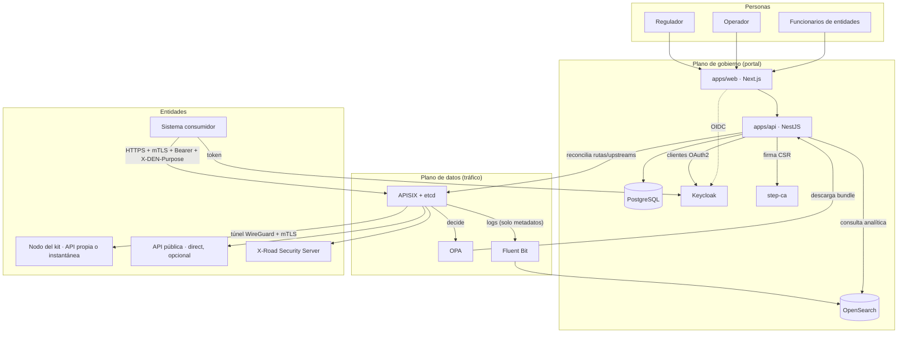
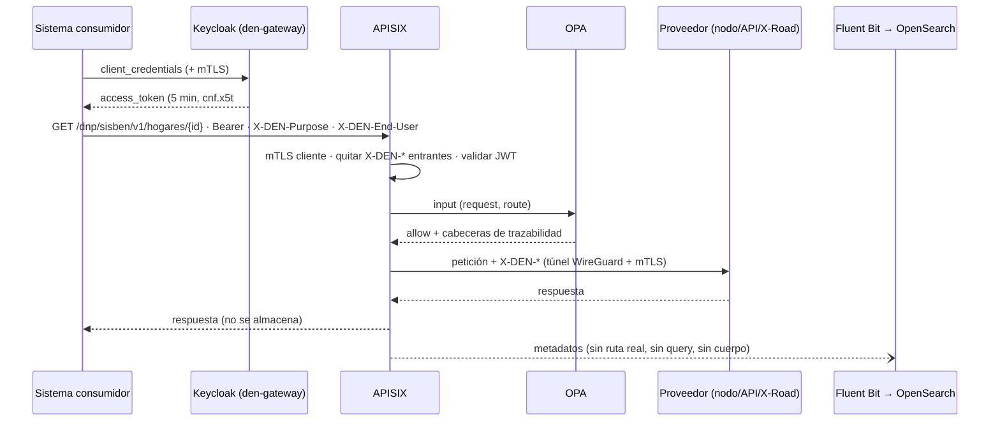

# Arquitectura técnica — Portal DEN

> English version (official): [docs/ARCHITECTURE.md](../ARCHITECTURE.md)

Versión 0.1 · noviembre 2026

## 1. Vista general



Dos planos separados:

- **Plano de gobierno:** el portal. Si cae, el tráfico sigue funcionando con la última configuración.
- **Plano de datos:** APISIX + OPA. Autoriza cada llamada con datos que el portal publica. Nunca consulta la base de datos del portal en línea.

## 2. Componentes

| Componente | Responsabilidad | Notas |
| :-- | :-- | :-- |
| `apps/web` | UI del portal, consolas de operador/regulador | Next.js App Router, Server Components, Auth.js con Keycloak. Llama a `apps/api` con el token del usuario |
| `apps/api` | Dominio, flujos, autorización, auditoría, reconciliadores, bundle OPA, contrato con nodos | NestJS + Fastify, Prisma, pg-boss |
| PostgreSQL | Estado de dominio, outbox, auditoría, colas pg-boss | Única fuente de verdad |
| Keycloak | Realm `den-portal` (personas, MFA) y realm `den-gateway` (clientes de aplicaciones) | Dos realms para separar políticas de tokens |
| APISIX + etcd | Gateway: mTLS, validación de token, llamada a OPA, límites, enrutamiento, logs | Admin API solo en red interna |
| OPA | Decisión de autorización por llamada | Se despliega junto a cada nodo de APISIX (sidecar o mismo host) |
| step-ca | CA intermedia para aplicaciones y nodos | Raíz fuera de línea; en producción, en HSM (PKCS#11) |
| Fluent Bit | Recibe logs de APISIX, aplica enmascarado, envía a OpenSearch | Segunda barrera de privacidad |
| OpenSearch | Logs de acceso (metadatos) y analítica | El navegador nunca habla con OpenSearch |
| Prometheus + Alertmanager | Métricas y alertas | Grafana opcional para operadores |
| WireGuard hub | Extremo central de los túneles de los nodos y enrutador TLS por SNI hacia ellos | Contenedor `wg-hub` en la red del gateway (M4-03, ADR-0023); no reenvía paquetes |

## 3. Identidad y autenticación

### 3.1 Personas (realm `den-portal`)

- Login OIDC (Authorization Code + PKCE) desde `apps/web` vía Auth.js.
- `apps/api` valida el access token (JWKS de Keycloak, `aud = den-portal-api`).
- Los recursos de una entidad se exponen bajo `/api/v1/entities/{entityId}/...` y un guard global aplica la tabla de permisos (`apps/api/src/auth/authz.policy.ts`): otra entidad → 404, miembro sin rol → 403 (ADR-0014).
- **Matriz completa (M2-03).** Cada ruta declara su acceso: `@Public`, `@CitizenAccess`, `@OptionalAuth`, `@SignedIn` (cualquier sesión, solo recursos propios), `@EntityAccess(acción)` o `@PlatformAccess(acción)`. El guard rechaza con 403 la ruta que no declare nada (falla cerrado). La matriz acción × rol y ruta → acceso está en `docs/es/AUTHZ.md`, generada desde la política; un test falla si queda desactualizada. Un test de integración generado llama cada ruta protegida con cada rol de entidad, cada rol de plataforma, un miembro de otra entidad, un usuario sin roles y sin sesión, y compara con la política.
- La web guarda los tokens solo en la cookie cifrada de Auth.js y renueva el access token (5 min) con el refresh token antes de que venza.
- **Cuentas (ADR-0018).** Autorregistro con verificación de correo obligatoria. Una cuenta nueva no tiene roles: los roles llegan solo con un alta aprobada (el solicitante pasa a `entity_admin`) o con una invitación aceptada. La invitación va a un correo y solo la ve y acepta quien entra con ese correo **verificado** (`email_verified` del token y el mismo correo con que se registró). El aviso por correo trae un enlace al portal, sin secreto. El portal no crea usuarios en Keycloak. El `entity_admin` invita, cambia roles y revoca (M2-02). Una revocación aplica en la siguiente petición, porque los roles se leen en cada una, y la entidad siempre conserva un administrador activo.
- **Los roles NO viven en Keycloak.** Keycloak solo autentica; roles de plataforma y membresías por entidad viven en PostgreSQL. Así el portal tiene roles personalizados por entidad sin depender de grupos de Keycloak.
- **Segundo factor (M3-08, ADR-0021, ADR-0035).** Lo exigen los roles de plataforma y `data_steward` y `entity_admin` en cualquier entidad, por escalado de sesión. Las rutas `@SignedIn` lo omiten solo porque sirven los recursos del propio usuario: quien revisa lee los expedientes de alta de otras personas por `/review/entities/:id`, una ruta `@PlatformAccess` (M-01):
  - el flujo `den-browser` de `den-portal` tiene dos niveles: contraseña (`acr=password`) y código TOTP (`acr=mfa`). Pedir `acr_values=mfa` solo agrega el código a la sesión; quien no tiene uno pasa por `CONFIGURE_TOTP`;
  - el API responde 403 `mfa_required` en toda ruta de entidad o de plataforma si los roles lo exigen y el `acr` del token no es `mfa`, siempre después de las comprobaciones de rol. `/me` informa `mfa.required` y `mfa.satisfied`;
  - la web, al verlo, vuelve a iniciar sesión con `acr_values=mfa` (`/api/session/step-up`). Una cookie corta evita los bucles y deja un aviso para reintentar;
  - el portal no escribe en los usuarios de Keycloak: decide quién lo necesita con los roles de PostgreSQL y lo comprueba en cada petición;
  - **riesgo residual: el enrolamiento en el primer uso.** Quien tiene la contraseña de una cuenta con rol crítico que aún no enroló su app puede enrolar la suya. Para que no pase inadvertido, Keycloak le avisa por correo al dueño de la cuenta cuando se pone o se quita una credencial (listener `email`, solo `UPDATE_CREDENTIAL` y `REMOVE_CREDENTIAL`), y guarda esos eventos 90 días. Un despliegue que necesite cerrar esa ventana puede exigir el enrolamiento al activar la cuenta (acción requerida `CONFIGURE_TOTP` para todas las cuentas nuevas) o enrolar fuera de banda.

### 3.2 Aplicaciones consumidoras (realm `den-gateway`)

- Una `Application` = un cliente confidencial con `serviceAccountsEnabled`, solo grant `client_credentials`, `clientId = den-app-<uuid>`.
- Mapper de audiencia `den-gateway`. Vida del access token: 5 min.
- Con `features.mtls.required` (activo en `co.yaml` desde M3-10): la aplicación se autentica con su **secreto**, y sus **tokens quedan ligados al certificado** (RFC 8705, claim `cnf.x5t#S256`, atributo `tls.client.certificate.bound.access.tokens` del cliente). No se usa `tls_client_auth` (ADR-0022). Cómo lo comprueba el gateway (SPIKE S-3, `docs/spikes/S-3.md`):
  - un objeto SSL de APISIX con `client.ca` (cadena de step-ca) rechaza en el handshake a quien no presenta un certificado válido;
  - el plugin propio `den-client-cert` pone en `X-DEN-Client-Cert-S256` la huella (base64url del SHA-256 del DER) del certificado verificado, tras borrar la que mande el cliente. No sirve `$ssl_client_fingerprint`, que es SHA-1;
  - OPA la compara con `cnf.x5t#S256` y con las huellas vigentes de la aplicación en el bundle (`data.clients[id].certificates`). Revocar es quitar la huella. La cabecera nunca llega al proveedor;
  - el TLS del gateway debe terminar en APISIX: delante solo puede haber un balanceador de capa 4 con paso directo TLS.
  - el token también se pide al gateway, en `POST <gateway>/oauth/token` (SPIKE S-4, ADR-0022).
    - La ruta `den-oauth-token` (reconciliador de APISIX) lleva al endpoint de tokens de `den-gateway` el certificado ya verificado, en `SSL_CLIENT_CERT` (`$ssl_client_escaped_cert`) y `ssl-client-verify` (`$ssl_client_verify`). Siempre reescribe esas cabeceras y borra sus otras grafías.
    - Keycloak usa el proveedor x509 `nginx` con `trust-proxy-verification`. `tokenUrl` de la aplicación es esa ruta.
    - Como Keycloak cree en esa cabecera, toda otra vía hacia él debe borrarla. Aun así, una cabecera inventada no autentica a nadie (hace falta el secreto), y un token ligado a un certificado ajeno no sirve sin su clave privada.
  - la raíz de la red, que también emite el certificado del gateway, es pública: `GET /api/v1/pki/ca`. La guía de la aplicación la ofrece.
- El portal usa una cuenta de servicio con permiso `manage-clients` **solo** en `den-gateway`.

## 4. Patrón de reconciliación

Nada se escribe en APISIX/Keycloak/OPA desde un controlador HTTP.

```
Transacción de dominio
  ├─ cambia estado (p. ej. subscription → approved)
  ├─ AuditService.record(...)
  └─ outbox.insert({ topic: "gateway.sync", aggregate: "apiVersion:<id>" })

Worker (pg-boss)
  └─ toma outbox → encola job "reconcile:<target>"

Reconciliador
  1. desired = buildDesiredState(target)        // desde PostgreSQL
  2. actual  = readActualState(target)          // Admin API / Keycloak Admin API
  3. diff    = compare(desired, actual)
  4. apply(diff) con PUT idempotente e IDs deterministas
  5. sync_state.upsert({ target, hash(desired), appliedAt, status })
  6. si el objetivo era una suscripción → marcar active/suspended/revoked cuando se confirma
```

- **Reconciliación completa** cada 5 minutos además de la incremental, para corregir derivas.
- **Retención del outbox (B-14).** El worker purga cada hora las filas de `outbox` reenviadas hace más de `DEN_OUTBOX_RETENTION_DAYS` días (7 por defecto). Las que aún no se han reenviado nunca se purgan.
- **Consola del operador (`/operator/sync`, M5-07).** Muestra `sync_state` por sistema y estado: si el hash deseado está aplicado, los errores con sus intentos y la deriva encontrada.
  - **Deriva.** Es una pasada que tuvo que escribir aunque el estado deseado no había cambiado desde que se aplicó (`appliedHash = desiredHash` y `in_sync`): alguien cambió el objeto fuera del portal. El reconciliador la corrige y deja `driftDetectedAt` y `driftCount`. Así lo detectan las versiones en APISIX y los clientes de Keycloak.
  - **Reintento.** `POST /admin/sync/retry`, solo `platform_admin`, encola el trabajo del reconciliador dueño del objetivo: `gateway.sync` (`apiVersion:<id>`, o `gateway:all` para TLS y las rutas propias), `keycloak.sync`, `policy.sync`, `wireguard.sync` u `opensearch.sync`. Nunca llama al sistema desde el controlador, y queda en auditoría (`sync.retry_requested`).
  - **Canales que ya no se aceptan (P-04, ADR-0029).** `GET /admin/sync` también devuelve `disallowedUpstreams`: las versiones no retiradas cuyo upstream o upstream de pruebas tiene un tipo que el despliegue ya no acepta. La consola las lista con un enlace a su ficha; conservan su ruta hasta que el operador decida.
  - **Contrato en el nodo (P-02).** `GET /admin/sync` también devuelve `nodeContracts`: las versiones servidas cuyo nodo informa otro OpenAPI (`differs`) o ninguno (`not_reported`), con ambos hashes y desde cuándo (§10). La consola las lista con un enlace a la ficha de la versión; el tráfico no se ve afectado.
- IDs deterministas: `den-route-<apiVersionId>`, `den-upstream-<apiVersionId>`, `den-app-<applicationId>`.

### 4.1 Objetos en APISIX por versión de API publicada

**Upstream** `den-upstream-<apiVersionId>`
- `node` con `nodeId` (M4-04, ADR-0023): `nodes = { "<DEN_GATEWAY_WG_HUB>": 1 }` (el enrutador SNI del hub, `wg-hub:8443`), `scheme = https`, `pass_host = rewrite` y `upstream_host = den-node-<nodeId>`, que es también el SNI con el que el hub elige el nodo y el nombre que se verifica en su certificado. mTLS hacia el nodo (M3-03): `tls.client_cert_id = den-ssl-gateway-client-<entityId>`, `tls.verify = true` y `tls.ca_certs` = la CA de la red. El hub pasa la conexión, sin abrirla, a `<dirección del túnel>:<servicePort>`, y el servicio vive en el `servicePath` del nodo (la ruta pública se reescribe a `servicePath/...`). El reconciliador lee el nodo en cada pasada: si no es de la entidad de la versión, no está `enrolled`, `online` u `offline`, o falta el hub o la CA, borra la ruta y el upstream (falla cerrado). Un nodo `offline` conserva su ruta y vuelve a responder cuando se reconecta. Enrolar o dar de baja un nodo encola `gateway.sync` de sus versiones. Al registrar la versión, el `nodeId` debe ser de un nodo de la entidad que no esté dado de baja (400 en `upstream.nodeId`).
- `node` sin `nodeId`: el servicio de prueba del entorno. El reconciliador resuelve el nodo con `DEN_DEV_NODES` (`slug-entidad=host:puerto` del mock de esa entidad, `scheme = http`; con `https://host:puerto`, el mTLS de arriba hacia ese host). Una entidad que no figura ahí queda en error de sincronización, sin escribir nada en APISIX.
- `direct`: host de la API existente, `scheme = https` con `tls.verify = true` (el certificado del proveedor se verifica contra las CA del sistema y para su nombre), y la ruta del URL como prefijo. Con `mtls`, además `tls.client_cert_id = den-ssl-gateway-client-<entityId>` (M3-03): el proveedor confía en la CA de la red y **solo** en su propio nombre, `CN=den-gateway.<slug-de-la-entidad>`. **SSRF:** el host debe ser un nombre DNS público o una IP pública. Se rechazan IPs privadas, de loopback, link-local o de metadatos, y nombres sin dominio o internos (`keycloak`, `*.local`, `*.internal`). Se valida al registrar la versión (`isPublicHostname` en `packages/contracts`, incluidas las IPv6 que embeben una IPv4) y otra vez en el reconciliador. El reconciliador además resuelve todas las direcciones A/AAAA del host en cada pasada y, si alguna no es pública, borra la ruta y el upstream (falla cerrado). Si la resolución falla, solo registra el error. **Sin DNS rebinding (M3-03):** los `nodes` del upstream son las direcciones que el reconciliador resolvió y encontró públicas, no el nombre, con `pass_host = rewrite` y `upstream_host` = el nombre (Host, SNI y nombre verificado). Si el nombre cambia de dirección, la siguiente pasada actualiza el upstream. **Despliegue (M6):** la salida del gateway debe filtrarse por red, bloqueando RFC 1918, link-local y las subredes de la plataforma.
- `xroad` (M4-05, SPIKE S-5): el Security Server del operador (`DEN_XROAD_SECURITY_SERVER_URL`), nunca un URL de la versión, que solo guarda el `serviceId` y una ruta opcional. La ruta se reescribe a `/r1/{instancia}/{clase}/{miembro}[/{subsistema}]/{servicio}{servicePath}/…` con las partes literales, porque APISIX codifica `upstream_uri`. Las partes se validan al registrar y otra vez en el reconciliador: letras, dígitos, espacio y `. _ - : ~`, nunca solo puntos. La ruta posterior no admite segmentos vacíos, `.` ni `..`, que el Security Server podría resolver hacia otro servicio. La instancia debe ser la del operador (primera parte de `DEN_XROAD_CLIENT`).
  - `proxy-rewrite` fija `X-Road-Client` = `DEN_XROAD_CLIENT` (el subsistema del operador) y borra `X-Road-Security-Server`, `-Represented-Party`, `-Id` y `-Request-Hash` del consumidor.
  - `opa` suma `X-Road-UserId` y `X-Road-Issue` a `send_headers_upstream`. La política (rutas con `xroad: true` en el bundle) pone el hash del funcionario y `den:subscription:<id>`, y lo que mande el consumidor se borra.
  - Sobre HTTPS, el gateway presenta su certificado para X-Road (`den-ssl-gateway-xroad`, `CN=<DEN_GATEWAY_CLIENT_NAME>.xroad`, que el operador registra en el Security Server) y verifica el del Security Server con `DEN_XROAD_SECURITY_SERVER_CA`. La pasada completa conserva ese objeto SSL mientras una versión servida (o una en revisión, por sus rutas de verificación) tenga un upstream `xroad` (A-5).
  - Diputado confundido: el miembro del `serviceId` debe ser el miembro X-Road de la entidad, que registra el operador (`PUT /admin/entities/{id}/xroad-member`, `entity.xroad_member_set`, único por entidad). Se valida al registrar (400) y en cada pasada del reconciliador (falla cerrado). Cambiar el miembro reconcilia las versiones `xroad` de la entidad.
  - Sin `DEN_XROAD_SECURITY_SERVER_URL` y `DEN_XROAD_CLIENT`, las versiones `xroad` quedan en error de sincronización, sin ruta.
- **Tipos permitidos (P-04, ADR-0029).** El nodo es el canal por defecto. Las versiones nuevas solo pueden usar los tipos de `features.upstreams` del país (`[node, xroad]` si se omite; `direct` es opcional), y `xroad` solo donde el despliegue tiene `DEN_XROAD_SECURITY_SERVER_URL` y `DEN_XROAD_CLIENT`. `GET /api/v1/upstream-types` se los da al formulario del portal. Crear una versión, reemplazar su OpenAPI (edición de un borrador o revisión de una publicada) y enviarla a revisión comprueban el upstream y el upstream de pruebas: otro tipo es un 400 con `upstream_type_not_allowed` o `xroad_not_configured` en `upstream.type` / `sandboxUpstream.type`. El reconciliador no mira la lista: una versión cuyo tipo el país deja de aceptar conserva su ruta, y el detalle de la versión la señala (`disallowedUpstreamTypes`). Una lista con solo `xroad` y sin la configuración de X-Road detiene el API al arrancar.

**Route** `den-route-<apiVersionId>`
- `uri = /{entitySlug}/{apiSlug}/v{major}/*`, métodos declarados en el OpenAPI.
- Plugins. APISIX los ejecuta por fase y, dentro de cada fase, por prioridad (no en el orden en que se listan). Verificado en SPIKE S-1 (`docs/spikes/S-1.md`):
  1. `request-id` (rewrite, 12015): genera `X-Request-Id` si el cliente no lo envía.
  - `den-header-guard` (plugin propio, rewrite, 2700, M3-07): antes que cualquier otro plugin lea o ponga una, borra **toda** cabecera `X-DEN-*` del cliente salvo `X-DEN-Purpose` y `X-DEN-End-User`, que el consumidor declara. Así una cabecera de trazabilidad nueva queda protegida sin tocar ninguna lista. Los guiones bajos cuentan como guiones (`X_DEN_Subscription` también se borra): APISIX acepta guiones bajos en los nombres, y los servidores tipo CGI (WSGI, PHP, Rack) leen `X_DEN_*` y `X-DEN-*` como la misma variable `HTTP_X_DEN_*`. La lista de `proxy-rewrite` del paso 3 queda como segunda barrera.
  2. `openid-connect` (rewrite, 2599): `client_id: den-gateway`, `bearer_only: true`, `use_jwks: true`, `discovery` del realm `den-gateway` (como lo alcanza APISIX: `DEN_GATEWAY_KEYCLOAK_URL`), `set_userinfo_header`, `set_access_token_header` y `set_id_token_header` en `false` (el token no viaja al proveedor en otra cabecera), y `claim_validator.audience` con `required` y `match_with_client_id`: solo pasan tokens con `aud = den-gateway`. El emisor se valida contra el de la discovery.
  3. `proxy-rewrite` (rewrite, 1008): elimina las cabeceras que solo el gateway puede poner (`X-DEN-Consumer-Entity`, `X-DEN-Consumer-App`, `X-DEN-Subscription`, `X-DEN-Operation`, `X-DEN-End-User-Hash`, `X-DEN-Subject-Ref`) si vienen del cliente, antes de que OPA arme su entrada; conserva `X-DEN-Purpose` y `X-DEN-End-User`, que OPA necesita leer. Antes, en la misma fase y con prioridad 1020, el plugin propio `den-data-subject` lee del cuerpo JSON el titular de las operaciones que lo declaran allí y lo pasa como `X-DEN-Body-Subject`, después de borrar cualquier valor que haya enviado el cliente (ADR-0017). Con prioridad 1025, el plugin propio `den-client-cert` borra la `X-DEN-Client-Cert-S256` que mande el cliente y, si nginx verificó un certificado de cliente en el handshake, pone su huella RFC 8705 (S-3). Reescribe la ruta quitando el prefijo (solo cambia `upstream_uri`; OPA sigue viendo la ruta pública completa).
  4. `opa` (access, 2001): `host` del OPA local, `policy: den/authz/decision` (solo `allow`, `headers`, `status_code` y `reason`, lo que el plugin lee: consultar el paquete entero evaluaba y devolvía todas sus reglas y saturaba OPA a 500 peticiones/s, M6-03), `with_route: true`, `send_headers_upstream: [X-DEN-Consumer-Entity, X-DEN-Consumer-App, X-DEN-Subscription, X-DEN-Purpose, X-DEN-Operation, X-DEN-End-User-Hash, X-DEN-Subject-Ref, X-DEN-End-User, X-DEN-Body-Subject, X-DEN-Client-Cert-S256, X-DEN-Data-Subject, X-Request-Id, Authorization, X-Access-Token]`. Para cada nombre de esa lista el plugin pone el valor que devuelve la política y, **si la política no lo devuelve, borra la cabecera del cliente**. Por eso la política devuelve siempre `X-DEN-Purpose` y `X-Request-Id`, y **nunca** `X-DEN-End-User`, `X-DEN-Body-Subject` ni `X-DEN-Client-Cert-S256` (así los valores en claro del funcionario y del titular no llegan al proveedor; ADR-0015, ADR-0017). `X-DEN-Data-Subject`, la cabecera que antes declaraba el consumidor, también se elimina, igual que las credenciales del consumidor, `Authorization` y `X-Access-Token` (M-11): la política lee el token y nunca lo devuelve, así que ni el proveedor ni el Security Server de X-Road reciben un token que podrían reutilizar contra las otras suscripciones de la aplicación. Si OPA no responde, niega con 403 (falla cerrado).
     - Justo después, `den-assertion` (plugin propio, access, 2000, M6-10, ADR-0024), solo con `features.gatewayAssertion`: firma lo que OPA autorizó en un JWS ES256 para el proveedor (`audience` = slug de la entidad proveedora) y lo pone en `X-DEN-Assertion`. Lleva quién consulta, la finalidad, la suscripción, la operación, el funcionario y el titular como seudónimos, el método y el SHA-256 de la URI que recibe el proveedor y, con cuerpo, el de los bytes del cuerpo. `jti` es el request id. La clave está en la metadata del plugin (compartida, cifrada en etcd con el keyring del despliegue), que pone el reconciliador. Sin clave responde 503 (falla cerrado).
  5. `limit-count` (access, 1002): límite por suscripción con `key_type: var`, `key: http_x_den_subscription` y `count: "$http_x_den_rate_limit"`, las dos cabeceras que puso OPA desde el bundle. Contadores locales en cada nodo, con el límite repartido entre los nodos (ADR-0020). Ver SPIKE S-2.
  6. `den-rate-limited` (plugin propio, 898, M3-05): convierte en problem+json (`code: rate_limited`) el 429 de `limit-count`, el que tiene `$upstream_status` vacío; el 429 de un proveedor pasa intacto (S-2). Las cabeceras `X-RateLimit-Limit`, `-Remaining` y `-Reset` quedan. No se usa `response-rewrite` con `vars` (lo que probó S-2) porque una ruta tiene uno solo y las versiones deprecadas lo usan para `Deprecation` y `Sunset`.
  7. `prometheus` (log, 500).
  8. `http-logger` (log, 410): hacia Fluent Bit con `log_format` de §8.

Mientras una API no tiene suscripciones activas, la ruta existe pero OPA niega todo.

**SSL** `den-ssl-gateway-client-<entityId>` (M3-03): uno por entidad proveedora, de tipo `client`, con el certificado de cliente que el gateway presenta a los upstreams con mTLS de esa entidad: `CN=den-gateway.<slug>` (el prefijo es `DEN_GATEWAY_CLIENT_NAME`). Es una identidad por proveedor y no una compartida para que una entidad no pueda apuntar su versión a la API mTLS de otra y usar la identidad del gateway (diputado confundido): cada proveedor acepta solo su nombre. Lo emite step-ca con el provisioner `den-portal` (solo autenticación de cliente). El portal guarda la clave sellada y lo renueva igual que el de servidor. Los upstreams de la entidad lo referencian por id, así que renovarlo cambia un solo objeto. Lo asegura el reconciliador solo cuando una versión lo necesita, de modo que los upstreams sin mTLS no dependen de step-ca. La pasada completa lo conserva mientras lo necesite un upstream o upstream de sandbox de la entidad, en una versión servida o en una `in_review` con rutas de verificación (un proveedor cuya única versión está en revisión lo conserva, M-10), y si no, lo borra.

**SSL** `den-ssl-gateway` (M3-02, S-3)
- `snis` = `DEN_GATEWAY_TLS_HOSTS`. `cert` y `key` son el certificado de servidor del gateway, que emite step-ca con el provisioner `den-gateway-tls`. El portal genera la clave, la guarda sellada (`gateway_certificate`, `DEN_SECRETS_KEY`) y renueva el certificado en el último tercio de su vida. Lo audita (`gateway_certificate.issued`) sin la clave.
- `client.ca` lleva la intermedia y la raíz de step-ca (`depth: 2`). Con `features.mtls.required`, sin `skip_mtls_uri_regex`: APISIX rechaza en el handshake toda llamada sin un certificado válido de la red. Sin el flag, el certificado es opcional (si llega, se verifica) salvo en el canal de control de los nodos (`/api/v1/nodes/{id}/heartbeat|renew|config`), donde APISIX lo exige: `skip_mtls_uri_regex` exime todo lo demás (M4-02).
- Lo aplica el reconciliador de APISIX en cada pasada completa (`sync_state` `apisix:ssl:den-ssl-gateway`). La clave no se compara, porque APISIX la guarda cifrada: una clave nueva siempre llega con un certificado nuevo.

**Sandbox (M4-08)** de una versión servida con `sandboxUpstream`: ruta `den-sandbox-<id>` en `/sandbox{basePath}/*`, con el upstream de pruebas dentro de la ruta y la misma cadena de plugins de la publicada (token, OPA, límite, logs), sin el registro de transparencia, porque los datos son sintéticos. El bundle tiene una ruta `den-sandbox-<id>` con `sandbox: true`, cada cliente lleva su `environment`, y las suscripciones de una aplicación sandbox apuntan a la ruta del sandbox. La política niega con `environment_mismatch` a una aplicación sandbox en una ruta real y a una de producción en un sandbox. Una versión que deja de servirse pierde también su sandbox, y la pasada completa borra los que sobran.

**Rutas de verificación (M4-06)** de una versión `in_review`, para las validaciones al enviar a revisión (`SPEC.md §4.2` paso 2). Se saltan el token y la política, así que son estrechas:
- solo existen para una petición con `X-DEN-Validation` = el token de esa versión, `HMAC(DEN_VALIDATION_TOKEN, versionId)` (`vars` de APISIX; sin él, 404): un token filtrado abre solo las rutas de su versión. Ni el healthcheck ni Schemathesis siguen redirecciones, que llevarían el token a otra parte, y el lint rechaza rutas del OpenAPI con segmentos `.`/`..`, puntos o barras codificados o segmentos vacíos;
- `den-check-<id>` (`/__den/check/<id>`) solo acepta GET y lo envía a la raíz del servicio del upstream real (`servicePath/`): prueba la conectividad (TLS, mTLS, túnel, Security Server), nunca un dato;
- `den-check-sandbox-<id>` (`/__den/check-sandbox/<id>/*`) va al `sandboxUpstream` de la versión, con datos sintéticos, para la prueba de contrato;
- los upstreams van dentro de la ruta y se construyen como el publicado (mTLS, hub, Security Server y sus controles). Fuera de `in_review` se borran, y la pasada completa elimina las que sobran.

El trabajo `version.validate` (encolado al enviar y al pedir que se repitan) hace el healthcheck por APISIX (`DEN_GATEWAY_INTERNAL_URL`, pasa con cualquier respuesta que no sea 5xx) y le pide la prueba de contrato al runner (`infra/contract-runner`: Schemathesis 4, MIT, detrás de un API interno con `DEN_CONTRACT_RUNNER_TOKEN`). El runner corre `st run` contra la ruta del sandbox con un límite de ejemplos y de tiempo, y devuelve solo, por operación, los códigos de las verificaciones que fallaron (`ST101`…) y el código HTTP, sin cuerpos ni comandos `curl`. El resultado queda en `api_version.validation_report` y en la bitácora (`api_version.validated`). El operador aprueba solo con validaciones `passed`; si no, el API responde 409 (`conflict`) con la razón como error del formulario, `validations_pending` o `validations_failed` (P-07), y la página de revisión deshabilita Aprobar con esa razón al lado. Sin sandbox, la prueba de contrato queda `skipped` y no bloquea. La ficha de la versión explica cada resultado (P-07): un 502 o 504 del healthcheck lo da el gateway, que no llegó al upstream (en un nodo: su estado, su túnel, el servicio en él); otro 5xx es el servicio fallando; un 4xx en la raíz del servicio pasa, porque prueba que el gateway llega al servicio; una prueba de contrato fallida nombra las operaciones y, por operación, si el sandbox falló (5xx) o respondió algo que el OpenAPI no declara.

**Reconciliador (M1-08):** consume `gateway.sync` (aggregate `apiVersion:<id>`) y sirve las versiones `published` y `deprecated`. Compara el estado deseado con lo que guarda APISIX y solo escribe si algo cambió: upstream antes que ruta, y al borrar, ruta antes que upstream. Hace una pasada completa al arrancar y cada 5 minutos, que también borra los objetos `den-` que ninguna versión pide. Los objetos sin ese prefijo no se tocan. El resultado queda en `sync_state` (`apisix:route:den-route-<id>`).

- **Comparación exacta (M-08).** Un objeto está sincronizado solo si APISIX guarda exactamente lo que el portal escribiría: los mismos campos en todos los niveles (plugins y su configuración, `nodes`, `tls`, `vars`, `methods`…). Los únicos campos de más que se toleran son los valores por defecto de APISIX con su valor por defecto (`priority: 0`, `hash_on: vars`, `pass_host: pass`, `scheme: http`) y, en los objetos SSL, la clave y la vigencia que guarda APISIX. Un plugin agregado a mano, uno que el estado deseado ya no tiene (`den-assertion` al apagar `features.gatewayAssertion`), un nodo de más en un upstream o una dirección que el DNS del proveedor ya no publica son deriva: el reconciliador reescribe el objeto y la cuenta.
- **Una unidad a la vez (M-09).** Cada unidad de trabajo (una versión con sus rutas de verificación, su sandbox y sus certificados; un objeto propio del gateway; la limpieza de huérfanos) corre con un advisory lock de PostgreSQL, compartido por los trabajos de `gateway.sync` y las pasadas completas de todas las réplicas del API. Una unidad lee la base de datos y escribe en APISIX sin otra unidad en medio, así que una pasada completa no puede borrar lo que un trabajo creó mientras corría, ni reescribir un estado que un trabajo posterior quitó. La limpieza además vuelve a leer cada candidato antes de borrarlo, y lo conserva si para entonces su versión está servida (o en revisión). Un proceso corre una pasada completa a la vez; la que se pida mientras tanto (el reintento del operador) corre justo después.
- **Objetos SSL (A-5, M-10).** La limpieza calcula los objetos SSL que pide la base de datos (el del gateway, el certificado de cliente de cada entidad cuyos upstreams servidos o en revisión usan mTLS, y el de X-Road mientras un upstream `xroad` vaya por HTTPS) y borra solo los demás `den-`.

- **Versiones deprecadas (ADR-0019).** La ruta sigue sirviendo y lleva `response-rewrite` con `Deprecation: @<segundos>` (RFC 9745) y `Sunset: <fecha HTTP>` (RFC 8594). Al retirarse, la versión deja de estar en el estado deseado y el reconciliador borra la ruta.

### 4.2 Bundle de OPA

- `apps/api` expone `GET /api/v1/opa/bundle.tar.gz` (autenticado con el token de servicio `OPA_BUNDLE_TOKEN`; sin token configurado rechaza todo; soporta `ETag`). OPA lo consulta cada 10–20 s (`polling.min_delay_seconds`).
- **Sin el portal (M6-04).** OPA guarda el último bundle activado en disco (`persist: true`) y lo carga al arrancar. Si el portal no responde, sigue decidiendo con él. Un OPA que reinicia en ese momento también, en lugar de quedar sin política y negarlo todo. El tráfico sigue y las negaciones también. Lo nuevo (una suscripción aprobada, una revocación) llega cuando el portal vuelve: en una caída, una revocación espera a que el portal responda. Prueba: `pnpm resilience:test` (`docs/performance/M6-04.md`).
- El bundle se arma desde PostgreSQL en cada consulta y es reproducible. Incluye un `.manifest` con `revision` (SHA-256 de políticas + datos) y `roots: [den, routes, clients, config]`. El ETag es la revisión, y una revisión igual responde 304.
- **Activación (`approved → active`):** OPA tiene configurado el plugin `status`, que envía `POST /api/v1/opa/status` (mismo token) en cuanto activa un bundle. El portal guarda qué suscripciones contiene cada revisión (`policy_bundle`, se poda a las 24 h). Cuando OPA informa una revisión activa, pasa a `active` las suscripciones `approved` que contiene, con el evento `subscription.activated` (actor `system:opa`) en la misma transacción que cada una, en lotes de 100 por transacción (M6-03: un atraso de miles, tras una caída de OPA o una carga masiva, no cabía en el límite de tiempo de una sola transacción y se reintentaba sin fin), y actualiza `sync_state` `opa:bundle`. Con varios gateways basta el primer OPA que informa; distinguir por nodo queda para M4. Objetivo: menos de 60 s (encuesta de 10–20 s y aviso inmediato).
- Contenido: políticas Rego de `packages/policy` + `data.json`:

```json
{
  "routes": {
    "den-route-<apiVersionId>": {
      "apiVersionId": "...",
      "classification": "personal",
      "operations": [
        {
          "id": "getAfiliacion", "method": "GET", "pathRegex": "^/salud/afiliacion/v1/afiliados/[^/]+$",
          "subject": { "in": "path", "regex": "^/salud/afiliacion/v1/afiliados/([^/]+)$", "numberGroup": 1, "documentType": "CC" }
        }
      ]
    }
  },
  "clients": {
    "den-app-<applicationId>": {
      "status": "active",
      "entityId": "...",
      "entitySlug": "dnp",
      "applicationId": "...",
      "subscriptions": [
        {
          "id": "...",
          "route": "den-route-<apiVersionId>",
          "operations": ["getAfiliacion"],
          "purposes": ["eligibility_check"],
          "validFrom": "2026-11-30T00:00:00Z",
          "validUntil": "2027-11-30T23:59:59Z",
          "endUserRequired": true,
          "rateLimitPerMinute": 600
        }
      ],
      "certificates": ["<x5t#S256 de cada certificado vigente>"]
    }
  },
  "config": {
    "endUserHashSalt": "<DEN_END_USER_HASH_SALT>",
    "subjectRefKey": "<DEN_SUBJECT_REF_KEY>",
    "country": "CO",
    "documentTypes": ["CC", "CE", "TI", "PEP", "PPT", "PA"],
    "mtlsRequired": false,
    "gatewayNodes": 1
  }
}
```

- Política `den.authz` (resumen):
  1. Extrae el JWT de `Authorization` (ya validado por `openid-connect`; OPA solo lo decodifica) y toma `azp`/`client_id`.
  2. `clients[client_id].status == "active"`.
  3. Encuentra la operación: método + `pathRegex` de la ruta (`input.route.id`). `input.request.path` es la ruta pública completa, con el prefijo `/{entitySlug}/{apiSlug}/v{major}` (S-1), y `pathRegex` se ancla a ella. Cuando coincide más de una operación (`GET /afiliados/buscar` junto a `GET /afiliados/{id}`), gana la más específica (M-13): los segmentos se comparan desde la izquierda, y un segmento literal gana a uno que es en parte un parámetro (`{id}.json`), que gana a un parámetro entero, como dice OpenAPI de las rutas concretas y las que tienen plantilla. Dos coincidencias igual de específicas son ambiguas y no coincide ninguna (`operation_not_allowed`). El lint (`den-ambiguous-paths`) rechaza, al registrar una versión, dos rutas que pueden coincidir con la misma petición en un mismo método salvo que una sea al menos igual de específica en cada segmento, porque los enrutadores no se ponen de acuerdo en esas (`/a/{x}` y `/{y}/b` para `/a/b`); `den-data-subject` lista sus operaciones de la más específica a la menos, así lee el titular de la operación que elige OPA.
  4. Existe una suscripción para esa ruta con la operación, la finalidad de `X-DEN-Purpose`, vigente.
  5. Exige `X-DEN-End-User` si la suscripción lo pide (`endUserRequired`, fijado al solicitarla por la clasificación) o si la clasificación actual de la ruta es `personal` o `sensitive` (M3-06: una API que pasó a datos personales lo exige también a las suscripciones anteriores). El valor debe ser un identificador, de 1 a 128 caracteres ASCII visibles y sin espacios. Si no lo es, se niega con `end_user_invalid` aunque no se exija, y nunca se calcula su hash. Calcula `X-DEN-End-User-Hash = HMAC-SHA-256(valor, sal)` con la sal del despliegue (`DEN_END_USER_HASH_SALT`, mínimo 16 caracteres). Sin ella, o en producción con el valor de ejemplo de `.env.example`, el bundle no se sirve. La sal va en el bundle, que solo se sirve por red interna. El valor en claro no llega al proveedor (OPA no lo devuelve) ni a ningún log: el log de acceso y el registro de transparencia solo llevan el hash, y las listas permitidas de Fluent Bit tienen una prueba estática.
  6. Devuelve `allow`, cabeceras para el upstream (entre ellas `X-DEN-Rate-Limit`: el `rateLimitPerMinute` de la suscripción dividido por `config.gatewayNodes` y redondeado hacia arriba, ADR-0020) y, al negar, `status_code` + cuerpo problem+json en `reason` con una razón estable (`no_subscription`, `purpose_not_allowed`, `operation_not_allowed`, `subscription_expired`, `end_user_required`, `end_user_invalid`, `data_subject_required`, `data_subject_invalid`, `app_suspended`; con mTLS exigido, también `client_certificate_required`, `token_not_bound`, `certificate_mismatch` y `certificate_revoked`, según S-3). Al negar, `headers` son cabeceras de **respuesta**: `Content-Type: application/problem+json` y `X-DEN-Deny-Reason: <razón>`, que el log de acceso registra con `$sent_http_x_den_deny_reason`.
- `data.json` incluye las rutas de las versiones `published`/`deprecated` y los clientes no eliminados (las aplicaciones suspendidas aparecen con `status: suspended`). Solo lleva las suscripciones `approved` o `active` de versiones servidas. `pathRegex` se ancla a la ruta pública completa, y un parámetro `{x}` equivale a un segmento o a parte de uno (`[^/]+`).
- Certificado de cliente (M3-02). Se comprueba cuando `config.mtlsRequired` está activo, y siempre que el token esté ligado a un certificado (`cnf.x5t#S256`, RFC 8705 §3). Va justo después de la aplicación suspendida. Orden: `client_certificate_required` (no hay huella verificada), `token_not_bound`, `certificate_mismatch` (la huella no es la del token) y `certificate_revoked` (la huella no está en `clients[id].certificates`, la lista de certificados vigentes de esa aplicación). Revocar o vencer un certificado lo saca de la lista en la siguiente descarga del bundle (10–20 s).
- Una cabecera repetida cuenta como ausente. Cuando hay más de una suscripción válida, se elige siempre la misma (orden por id). Las razones se evalúan en este orden: cliente, aplicación suspendida, ruta, operación, suscripción a la ruta, operación concedida, finalidad, vigencia y funcionario.
- Las políticas tienen tests con `opa test` y cobertura ≥ 90 %, exigida en CI (`--threshold 90`).

### 4.3 Keycloak

Reconciliador de aplicaciones: crea/actualiza/deshabilita clientes en `den-gateway`, rota secretos a pedido, configura `tls_client_auth` y el subject DN esperado cuando hay certificado.

- **Rotación del secreto (M3-04).** El realm tiene la política de cliente `den-secret-rotation` (ejecutor `secret-rotation`, condición `den.managed = true`, atributo que el reconciliador pone en sus clientes). Keycloak ignora los atributos de secreto rotado si llegan por la Admin API, así que el reconciliador usa el propio mecanismo de Keycloak:
  1. Con un secreto nuevo pendiente (sellado) y el anterior en `rotating`, compara por hash el secreto actual de Keycloak con el del anterior.
  2. Si coinciden, lo regenera (`POST client-secret`), y Keycloak pasa el anterior a secreto rotado.
  3. Luego fija el secreto nuevo con `PUT`, que cambia solo el actual. Si una pasada se interrumpió entre los dos pasos, el anterior ya es el rotado y solo repite el paso 3.
  4. Sin rotación en curso (revocado, o fin de la ventana), borra el secreto rotado (`DELETE client-secret/rotated`).
  
  Los valores solo pasan por la memoria del reconciliador para comparar hashes. La política deja el rotado a lo sumo 30 días; el portal cierra la ventana a los `lifecycle.credentialRotationDays`. En un Keycloak que ya importó el realm, la política se aplica con `node scripts/keycloak-client-policies.mjs`.

### 4.4 step-ca

- Provisioner JWK dedicado al portal. El backend firma un token de un solo uso (OTT) y llama a `/1.0/sign` con el CSR. Implementación con `jose`; sin dependencias propietarias. Detalle (M3-01, `apps/api/src/credentials`):
  - La clave del provisioner viaja cifrada (JWE, PBES2) en la lista pública de provisioners de la CA. El API la descifra una vez con `DEN_STEP_CA_PROVISIONER_PASSWORD`.
  - El OTT lleva `sub` y `sans` = clientId, `sha` = huella de la raíz, 5 minutos de vida y un `jti` único. El portal pide `notAfter` = `lifecycle.certificateValidityDays`.
  - El API verifica el TLS de la CA con su raíz: `DEN_STEP_CA_ROOT_FILE` o la raíz que sirve la CA fijada por `DEN_STEP_CA_ROOT_FINGERPRINT`. Solo en desarrollo, sin ninguna de las dos, confía en la raíz que sirve la CA y registra su huella.
  - Antes de la CA, el portal revisa el CSR (`pkijs`): un solo bloque PEM, campo de atributos presente, firma propia válida, clave ECDSA P-256/P-384 o RSA 2048-4096, CN = clientId y ningún otro nombre alternativo. Un CSR inválido da 400 con un mensaje estable por causa. Si la CA no responde o rechaza, 503.
  - El certificado que devuelve la CA debe tener ese sujeto y esa clave, y encadenar hasta la raíz. El portal guarda la cadena (pública), la huella RFC 8705 (`x5t#S256`), el serial y las fechas. Una aplicación tiene un solo certificado activo (índice único parcial); la rotación es M3-04.
  - Un trabajo periódico (`DEN_LIFECYCLE_INTERVAL_SECONDS`) avisa a los desarrolladores de la entidad `lifecycle.certificateExpiryWarningDays` antes del vencimiento (`credential.expiry_notice_queued` → notificación `certificate_expiring`) y marca `expired` los certificados vencidos.
- Plantillas. `app` (`infra/step-ca/app.tpl`, provisioner `den-portal`): CN = clientId, el clientId como SAN DNS, uso de clave solo para autenticación de cliente TLS, 90 días. `node` (`infra/step-ca/node.tpl`, provisioner propio `den-nodes`, M4-02): `CN=den-node` fijo y el nombre del nodo, `den-node-<nodeId>`, como único SAN DNS, los dos del OTT. Autenticación de servidor (el gateway llama al nodo) y de cliente (el nodo llama al canal de control). 90 días, renovados por el kit. step-ca exige que el CN del CSR sea el `sub` del OTT; como el kit no sabe su ID antes de enrolarse, el CSR del nodo lleva siempre `CN=den-node`, sin nombres, y el SAN lo pone el OTT.
- Revocación: certificados de vida corta + lista de huellas revocadas en el bundle OPA (requiere SPIKE S-3).

## 5. Flujo de una llamada



## 6. Cabeceras de trazabilidad hacia el proveedor

| Cabecera | Contenido |
| :-- | :-- |
| `X-DEN-Consumer-Entity` | slug de la entidad consumidora |
| `X-DEN-Consumer-App` | ID de la aplicación |
| `X-DEN-Subscription` | ID de la suscripción que autorizó la llamada |
| `X-DEN-Purpose` | código de finalidad |
| `X-DEN-Operation` | `operationId` resuelto |
| `X-DEN-End-User-Hash` | hash con sal del funcionario final (si aplica) |
| `X-DEN-Subject-Ref` | seudónimo del titular de los datos (HMAC con clave, ADR-0015), si la operación lo declara |
| `X-Request-Id` | ID de correlación extremo a extremo |

El proveedor nunca recibe el token de acceso del consumidor: `Authorization` y `X-Access-Token` se eliminan después de que OPA los lee (§4.1, M-11). El proveedor autentica al gateway (mTLS a través del nodo, y `X-DEN-Assertion` donde está activa), no al consumidor.

El proveedor sabe quién consulta, para qué y bajo qué autorización: resuelve el problema de "solo veo al gateway". Además, con `features.gatewayAssertion` el gateway las firma por llamada en una aserción JWS (`X-DEN-Assertion`) para no repudio (ADR-0024, SPIKE S-6, M6-10):
- **Clave:** la genera el portal (EC P-256, tabla `gateway_signing_key`, sellada con `DEN_SECRETS_KEY`) y la rota cada `lifecycle.assertionKeyRotationDays` (90 por omisión). El reconciliador de APISIX la pone en la metadata de `den-assertion` antes que las rutas.
- **JWKS público** (`GET /api/v1/gateway/jwks`, caché de 5 minutos): todas las claves usadas, de la más nueva a la más vieja, para que las aserciones archivadas sigan verificando. Una clave comprometida sale de la lista.
- **Rotación inmediata:** el operador la pide con `POST /api/v1/admin/gateway-signing-keys/rotate` (`platform_admin`; con `compromised`, la anterior sale del JWKS).
- **Verificación:** cómo la verifica el proveedor está en la guía de entidades (`docs/es/guides/entities.md` §3.2). Los proveedores de prueba lo hacen en cada llamada y registran el resultado.

## 7. Datos

- **Prisma** con migraciones versionadas. Tablas principales = entidades de `SPEC.md §3` + `outbox`, `sync_state`, `audit_event`, `policy_bundle` (revisiones del bundle de OPA).
- **Outbox** para que estado de dominio y trabajo de sincronización se confirmen en la misma transacción.
- **Auditoría encadenada:** `hash = SHA-256(prevHash ‖ JSON canónico del evento)`, con claves ordenadas y los valores tal como vuelven de `jsonb`. `seq` = último + 1 bajo un bloqueo consultivo de la transacción (`pg_advisory_xact_lock`), sin usar la secuencia: así una transacción revertida no deja huecos. El bloqueo serializa los agregados de auditoría hasta que termina cada transacción (breve, ver más abajo). Los eventos anteriores a M1-11 quedan fuera de la cadena, y la verificación los cuenta aparte. Endpoint de verificación de la cadena. Anclaje diario (M2-09): el hash del último evento encadenado de cada día cerrado, en la zona horaria del país, se sella con la TSA (RFC 3161). Se guarda en `audit_anchor`, de solo inserción incluso para el dueño, y se envía por correo a los reguladores. La verificación exige que cada anclaje encuentre su evento con el mismo hash, lo que detecta el corte de la cola. Exportación CSV/JSON con la misma selección de filtros, con su SHA-256 firmado por la clave del operador (JWS EdDSA, verificable con `/transparency/jwks`). Cada exportación queda auditada. **Qué prueba la cadena y qué no (B-01, ADR-0037).** El hash no lleva clave: quien pueda escribir en la tabla *y* conozca el algoritmo puede agregar un evento bien enlazado, o reescribir la cola y recalcular todos los hashes desde el primer cambio. Así que la cadena sola es evidencia de alteración frente a quien no puede recalcularla (un error, un operador con `den_app` que edita una fila, una restauración del respaldo equivocado), y prueba el orden solo respecto de sí misma. Lo que protege la cadena frente al dueño de la base de datos es el **anclaje**: el hash diario lo sella una autoridad de sellado de tiempo que el operador no controla (`DEN_TSA_ROOTS_FILE`, ADR-0032) y se envía por correo a los reguladores, que lo guardan fuera del sistema; reescribir la historia anterior a un día anclado cambia un hash que terceros ya tienen. Lo que pasa después del último anclaje (hasta un día) descansa solo en la cadena. La tabla rechaza al `INSERT` una fila que no extienda la cadena (disparador `audit_event_extends_chain`: `seq` es el último + 1, `prev_hash` es el último hash, `hash` existe, `occurred_at` no retrocede más de 60 s ni se adelanta más de 60 s), y el verificador comprueba lo mismo y además posiciones menores o iguales a cero, eventos previos a la cadena en orden ascendente, y `occurred_at` a lo largo de `seq` y frente a su propio reloj, con los mismos 60 s de tolerancia para los relojes de varias instancias del API (`CHAIN_CLOCK_SKEW_MS`). Las restricciones son `NOT VALID` y el disparador solo mira filas nuevas, así que las filas existentes, con o sin hash, se verifican como antes. **Los eventos se agregan al final de la transacción (B-04).** `AuditService.record` guarda el evento en memoria (copiado y saneado en ese momento) y `PrismaService.$transaction` los agrega todos, en un solo lote con una sola marca de tiempo, cuando el callback termina y justo antes del commit: el bloqueo de la cadena se mantiene durante un `INSERT`, no durante una transacción larga como la baja de una entidad o una revocación masiva. Consecuencias: el evento no existe dentro de la transacción (no lo lea de vuelta), una transacción revertida no deja evento, y una transacción que no abrió `PrismaService.$transaction` sigue escribiendo de inmediato. **Los anclajes se verifican (B-02).** `GET /audit/verify` comprueba además, por cada anclaje, que su token RFC 3161 sea válido sobre el hash del anclaje, encadene con las raíces de la TSA fijadas y lleve la hora guardada junto a él (`timestamp_invalid`), y que no tenga fecha futura (`future_dated`: genTime más de 5 minutos adelante, o un día más allá de mañana); el propio anclaje rechaza un sello del futuro. Si no se pueden leer las raíces, `anchors.timestampsChecked` es falso y la verificación no es `valid`. El correo a los reguladores lleva el token (`anchor-<día>.tsr`) para que lo comprueben con `openssl ts -verify` y su propia copia de la raíz de la TSA. `den_audit_anchor_overdue_seconds` (segundos que un día terminado lleva esperando su anclaje) y la alerta `DenAuditAnchorOverdue` (más de 6 h) avisan cuando el anclaje se detiene, sea por la TSA o porque un anclaje con fecha futura lo bloquea.
- La tabla `audit_event` tiene permisos solo de `INSERT`/`SELECT` para el rol de la aplicación (sin `UPDATE`/`DELETE`), y un trigger rechaza `UPDATE`/`DELETE`/`TRUNCATE` incluso para el dueño del esquema.
- **Roles de base de datos:** el dueño del esquema (`den`) solo se usa para migraciones; el API corre como `den_app`, sin DDL. El esquema de pg-boss se crea con una migración de Prisma, así que pg-boss corre sin permisos de DDL.
- **Documentos:** almacenamiento en volumen local detrás de la interfaz `StorageService` (adaptador S3 compatible a futuro, con un backend OSS como SeaweedFS o Garage). Solo PDF. Antivirus (M6-08): con `DEN_CLAMAV_URL`, el API manda cada documento a ClamAV (`clamd`, protocolo INSTREAM) antes de guardarlo; uno infectado se rechaza y, si ClamAV no responde, la subida falla (falla cerrada). En el chart de Helm está activado con dos réplicas.
  - **Desde M2-01.** `DEN_DOCUMENTS_DIR`; las claves son UUID aleatorios que elige el API, nunca nombres del usuario, y se escriben con nombre temporal y renombre. La fila `document` guarda tamaño, tipo y SHA-256, que se vuelve a comprobar en cada descarga.
  - **Subida:** el cuerpo es el PDF mismo (`application/pdf`); se exige la firma `%PDF-` y un tamaño máximo `DEN_DOCUMENT_MAX_BYTES` (10 MiB, 413 si se pasa). Solo esa ruta tiene el límite mayor, y solo para peticiones con `Authorization: Bearer`: sin token, 401 antes de leer el cuerpo. El resto del API sigue en 1 MiB.
  - **Descarga:** `Content-Disposition: attachment`, `nosniff`, CSP `sandbox` y sin caché. La web la sirve en `/files/...` con el token de la sesión, que nunca llega al navegador.
  - **Acuerdos de intercambio (M2-07).** Se adjuntan a la solicitud con la misma ruta de subida. La plantilla del acuerdo modelo sale de `documents.agreementTemplate` de la config del país.
  - **Eliminación por orden judicial.** Es la única eliminación física. Borra los bytes después de confirmar la transacción y deja la fila con su SHA-256 y la referencia a la orden; las descargas responden 410.
- **Notificaciones (M2-08).** Derivan de la bitácora: la escritura del evento encola `notification.dispatch` en la misma transacción. El worker resuelve destinatarios con el estado actual y guarda una fila por evento y persona (clave única, entrega idempotente). Envía correo según las preferencias, salvo en los avisos de seguridad, que siempre se envían. Los textos no llevan datos de las personas consultadas, solo nombres de APIs, entidades y aplicaciones.
- **Correo saliente del API** (`DEN_SMTP_URL`, Mailpit en desarrollo): solo lo envían workers desde el outbox (p. ej. `invitation.email`), así un correo sale si y solo si el cambio que lo causó se confirmó. Entrega al menos una vez, con reintentos durante horas. Los textos están en `apps/api/src/mail/messages.ts` (es/en) y los nombres del país vienen de la config.

## 8. Logs de acceso y privacidad

`http-logger` de APISIX con `log_format` restringido a:

```
ts, request_id, route_id, operation (X-DEN-Operation), method, status,
latency_ms, upstream_latency_ms, consumer_entity, consumer_app,
subscription_id, purpose, end_user_hash, bytes_sent, gateway_node,
deny_reason
```

- Variables de APISIX para cada campo: `$http_x_den_operation`, `$http_x_den_subscription`, `$http_x_den_consumer_entity`, `$http_x_den_consumer_app`, `$http_x_den_purpose`, `$http_x_den_end_user_hash` (las cabeceras que puso OPA, visibles en la fase de log según S-1) y `$sent_http_x_den_deny_reason`. **Nunca** `$uri`, `$request_uri` ni `$upstream_uri`: incluyen la ruta real y la query.
- **Llamadas negadas (M5-03).** Una negación no llega al proveedor, así que OPA no pone cabeceras de petición. Cuando el cliente es conocido, OPA lo nombra en su respuesta (`X-DEN-Consumer-App`, `X-DEN-Consumer-Entity`, que el cliente ya sabe). El `log_format` las lee como `deny_consumer_app` y `deny_consumer_entity`, y Fluent Bit las convierte en `consumer_app` y `consumer_entity` y las descarta.
- **Límite de peticiones (M5-03).** El 429 propio del gateway (`den-rate-limited`, sin upstream) también lleva `X-DEN-Deny-Reason: rate_limited`. En la analítica cuenta como una negación del gateway con su razón; el 429 de un proveedor no la lleva.
- **Cabeceras de respuesta del proveedor.** `den-header-guard` quita las `X-DEN-*` de toda respuesta que viene de un upstream (`$upstream_status` presente): un proveedor no puede inventar una razón de negación ni un consumidor. `ngx.header` convierte `_` en `-`, así que un nombre con guiones bajos (`X_DEN_Deny_Reason`) no se puede quitar. Por eso Fluent Bit descarta `deny_reason` cuando hubo tiempo de upstream: solo el gateway niega.

- **No se registran**: `uri` real, query string, cuerpos, `Authorization`, IP del ciudadano (no hay; los consumidores son sistemas).
- El access log propio de nginx en APISIX está **desactivado** (`nginx_config.http.enable_access_log: false`), porque escribe la línea de la petición y la URI del upstream.
- **Error log (M5-01).** Queda en nivel `error`, porque los avisos (cada negación de un plugin) también incluyen la línea de la petición. Un error real ("connect() failed… while connecting to upstream") también la incluye, con la URI del upstream. Por eso nginx manda su error log por syslog a `fluent-bit-errors`, que enmascara todo desde la línea de la petición hasta el final: la URI del upstream, el host y el referrer, salvo el `request_id` hexadecimal de APISIX. Así unas comillas o un nombre de campo falso en la ruta no cortan la máscara. También enmascara cualquier query y toda serie de 6 dígitos o más (`infra/fluent-bit/gateway-errors.lua`). El resultado queda en la salida de ese contenedor, donde lo lee el operador, y nunca llega a OpenSearch. El log en archivo que nginx siempre mantiene va a `/dev/null`. Solo los errores anteriores a leer la configuración van al stderr de APISIX. Hay pruebas de regresión en `tests/infra`.
- **Fluent Bit (M5-01)** aplica un filtro Lua que descarta cualquier campo fuera de la lista permitida (defensa en profundidad). Además:
  - da forma al registro: `status` y `bytes_sent` como enteros; `latency_ms` y `upstream_latency_ms` en milisegundos (con varios upstreams, la suma);
  - comprueba el formato de cada valor y descarta el que no tenga la forma que pone el gateway. Así un cliente no puede meter un número de identificación por una cabecera que elige él: `X-DEN-Purpose` tiene que ser un código y `X-Request-Id` un identificador de traza de hasta 128 caracteres, y ninguno puede tener una serie de 6 dígitos o más, la regla de `gateway-errors.lua` (M-16). La única excepción es un id de petición con la forma UUID que genera el propio gateway, cuyos dígitos hexadecimales suelen formar series así de largas.
- **Logs del API (M6-05, ASVS 16.4.3).** Cada línea pasa por `DenLogger` (`apps/api/src/common/logger.ts`), que enmascara el mensaje y la traza: las queries, toda serie de 6 dígitos o más (los UUID se conservan: nombran registros, no personas), las direcciones de correo y las credenciales de una URL. Un error puede citar una ruta con un número de identificación o la URL de conexión a la base. Con `DEN_LOG_FORMAT=json` (el chart de Helm lo fija) cada registro es un objeto JSON por línea en la salida del contenedor. De ahí lo toma el colector de logs del clúster y lo lleva al sistema central del operador, separado del portal. Ese colector no lo instala el chart: es de la plataforma del operador, como el de cualquier otra carga. En texto (por omisión, el piloto) es el formato de Nest, con colores solo en una terminal. Nunca llegan a OpenSearch, que solo tiene los logs de acceso.
- **OpenSearch.** Índice mensual `den-access-YYYY.MM`. El API mantiene la plantilla `den-access` con un reconciliador idempotente, cuyo estado queda en `sync_state`. La plantilla tipa los campos y tiene `dynamic: strict`: un documento con un campo fuera de la lista se rechaza, una tercera barrera. El API también mantiene la política ISM `den-access-retention` con `retention.accessLogMonths` de la configuración del país: un índice mensual se borra cuando tiene un mes más que la retención, así que cada llamada se conserva entre N y N+1 meses. Los índices creados antes de la plantilla conservan su mapeo dinámico; al desplegar M5 se borran (`DEPLOYMENT.md`).
- La analítica del portal consulta OpenSearch desde `apps/api` (`DEN_OPENSEARCH_URL`); los roles de plataforma ven cualquier entidad. Cada consulta se acota primero en PostgreSQL. Como proveedora, una entidad ve solo las rutas de sus propias versiones (`den-route-<id>`, o `den-sandbox-<id>` con `environment=sandbox`, M5-02). Como consumidora, solo sus aplicaciones (M5-03). Los días se agrupan en la zona horaria del país, con un periodo de 30 días por defecto y de un año como máximo. Sin OpenSearch, las pantallas de uso responden 503 `service_unavailable`.

## 9. Observabilidad

M5-06. Prometheus, Alertmanager y Grafana corren en el perfil `observability`. La configuración está en `infra/prometheus`, `infra/alertmanager` e `infra/grafana`.

- **Métricas.** Prometheus recoge tres fuentes:
  - El plugin `prometheus` de APISIX (puerto interno 9091): `apisix_http_status`, `apisix_http_latency_bucket{type}` y `apisix_etcd_reachable`.
  - `GET /metrics` del API (fuera de `/api/v1`, con `DEN_METRICS_TOKEN`; sin token responde 404). Publica `den_api_http_request_duration_seconds` por plantilla de ruta, nunca con ids. También publica indicadores que se leen de PostgreSQL en cada recolección: `den_queue_jobs{queue,state}` (pg-boss), `den_sync_targets{system,status}`, `den_opa_bundle_lag_seconds` (cuánto lleva OPA con un bundle anterior al vigente), `den_nodes{status}` y `den_certificate_soonest_expiry_seconds{kind}` (gateway, nodos, aplicaciones). Para el registro de transparencia (§13), `den_transparency_unsealed_oldest_seconds` y `den_transparency_unstamped_oldest_seconds` (cuánto lleva esperando su lote el registro más antiguo, y la TSA el lote más antiguo), y un contador que lleva el colector, `den_transparency_records_dropped_total{reason}`.
  - Las métricas de OPA, con su estado de bundles (`status.prometheus: true`: `last_success_bundle_request`).
- **Alertas** (`infra/prometheus/rules/den.rules.yml`, probadas con `promtool test rules` en CI y en `tests/infra`):

  | Alerta | Condición |
  | :-- | :-- |
  | `DenGateway5xxRate` | 5xx > 2 % durante 5 min |
  | `DenGatewayLatencyHigh` | p95 de la petición completa > 200 ms durante 5 min |
  | `DenTargetDown` | APISIX, el API u OPA sin responder a Prometheus durante 2 min |
  | `DenOpaBundleBehind` | OPA con más de 2 min de atraso respecto del bundle vigente |
  | `DenOpaBundleFetchFailing` | OPA sin descargar el bundle desde hace más de 2 min |
  | `DenReconcileFailing` | objetos de `sync_state` en `error` durante 10 min |
  | `DenNodeOffline` | nodos fuera de línea durante 5 min |
  | `DenCertificateExpiring` | certificado del gateway o de un nodo a menos de 14 días; se renuevan solos, así que esto es una renovación que falla |
  | `DenQueueBacklog` | más de 100 trabajos esperando durante 15 min |
  | `DenTransparencyRecordsDropped` | el colector de transparencia descartó un registro en los últimos 10 min, por motivo (§13) |
  | `DenTransparencyUnsealed` | un registro de transparencia lleva más de 5 min esperando su lote, durante 5 min |
  | `DenTransparencyUnstamped` | un lote sellado lleva más de 15 min esperando a la TSA, durante 5 min |

- **Alertmanager** agrupa por alerta, sistema y tipo, y avisa por correo al operador: Mailpit en desarrollo y en el piloto, el SMTP del operador en producción.
- **Grafana** tiene un tablero de operador aprovisionado desde archivo (`DEN · Operador`), con gateway, política, sincronización, cola, nodos, certificados y alertas activas. Su login es el propio de Grafana y es AGPL en su propio contenedor. Los colores del tablero siguen los umbrales de las alertas.
- **Disponibilidad del gateway.** Es el indicador de `SPEC.md §8` y se calcula como `avg_over_time(up{job="apisix"})`: el API la lee de Prometheus con `DEN_PROMETHEUS_URL`.

## 10. Contrato con el kit (nodos)

Versión 1. El documento que el kit consume es `docs/contracts/node-contract-v1.openapi.json`, generado desde el API (un test falla si se desactualiza; `DEN_UPDATE_NODE_CONTRACT=1` lo regenera).

| Endpoint | Autenticación | Uso |
| :-- | :-- | :-- |
| `POST /api/v1/nodes/enroll` | token de enrolamiento (en el cuerpo) | Token + CSR (`CN=den-node`, sin nombres) + clave pública WireGuard + versión del kit + puerto de servicio → `nodeId`, certificado (`DNS:den-node-<nodeId>`), raíz de la red, URL del canal de control, intervalo de heartbeat y configuración WireGuard (dirección `/32`, clave y endpoint del hub, dirección del hub como única `AllowedIPs`) |
| `POST /api/v1/nodes/{id}/heartbeat` | mTLS del nodo | Versión, puerto de servicio, servicios expuestos (nombre, ruta, hash del OpenAPI) y salud. Responde el estado y si toca renovar (último tercio de la vida del certificado) |
| `POST /api/v1/nodes/{id}/renew` | mTLS del nodo (certificado vigente) | CSR nuevo → certificado nuevo. Durante `DEN_NODE_RENEWAL_GRACE_HOURS` (24) el certificado reemplazado solo puede repetir esa renovación, con la misma clave, y recibe el certificado vigente: así un nodo que perdió la respuesta se recupera, pero quien tenga la clave reemplazada no puede certificar una propia. No sirve para heartbeat ni config |
| `GET /api/v1/nodes/{id}/config` | mTLS del nodo | Versiones publicadas que sirve el nodo (ruta pública y `servicePath`), versión mínima del kit (`DEN_NODE_MIN_KIT_VERSION`) y avisos |

**Enrolamiento (M4-02).** El token se valida primero (cualquier rechazo es el mismo 401, sin decir por qué), luego el CSR (como el de las aplicaciones, `apps/api/src/credentials/csr.ts`) y que el hub esté configurado (si no, 503). La CA firma antes de la transacción, que marca el token usado solo si nadie lo usó mientras tanto. Un fallo antes del commit deja el token usable. La dirección del túnel es la siguiente a la más alta ya dada en `DEN_WG_SUBNET` (`10.77.0.0/16`; el hub en la primera), con un bloqueo consultivo, y nunca se reutiliza. Una clave WireGuard ya enrolada da 409. Queda en la bitácora `node.enrolled` con la huella, el serial y la dirección, nunca una clave privada.

**Canal de control (M4-02).** El TLS del nodo termina en el gateway, en la ruta `den-node-control` (`/api/v1/nodes/*`) que mantiene el reconciliador de APISIX:
- `den-header-guard` borra toda `X-DEN-*` del cliente; `den-client-cert` pone la huella del certificado verificado en el handshake; `proxy-rewrite` agrega `X-DEN-Node-Control` con `DEN_NODE_CONTROL_TOKEN` y la envía al API (`DEN_GATEWAY_PORTAL_API_URL`).
- El API cree en la huella solo si llega con ese token (comparación en tiempo constante): sin él, la petición no pasó por el gateway y la cabecera no prueba nada. Con él, la huella debe ser la del certificado vigente del nodo (o la del reemplazado, solo para repetir la renovación), el nodo debe estar enrolado y su entidad activa o suspendida. Si no, 401. Una entidad suspendida no renueva certificados (409).
- Sin las dos variables, el reconciliador borra la ruta y los nodos no alcanzan el portal.
- Sin mTLS obligatorio en la red, el objeto SSL igual pide el certificado en estas rutas (§4.1).

**Estados (`SPEC.md §4.6`).** El primer heartbeat pasa el nodo a `online` (`node.online`). Un cambio de servicios declarados queda como `node.services_changed`; los heartbeats que no cambian nada no se auditan. Cada `DEN_NODE_LIFECYCLE_INTERVAL_SECONDS` (60) un trabajo pasa a `offline` los nodos sin heartbeat por `DEN_NODE_OFFLINE_AFTER_SECONDS` (300), también los enrolados que nunca enviaron uno: `node.offline` avisa (`node_offline`, en el portal y por correo) a los `entity_admin` de la entidad y a los `platform_admin`. El siguiente heartbeat lo devuelve a `online`. `entity_admin` o `platform_admin` dan de baja un nodo (`decommissioned`, definitivo): el canal de control deja de aceptar su certificado y se anula el token vigente.

**Contrato que sirve el nodo (P-02).** Cada heartbeat, en su transacción, compara para cada versión `published` o `deprecated` cuyo upstream nombra el nodo (y es de su entidad) el `openapiSha256` que el nodo informa para el servicio en el `servicePath` de la versión (esa ruta, o si no el prefijo más largo en un límite de segmento) con el de la versión:
- `matches`: el `openapiSha256` de la versión, o uno de `openapiSha256Variants`; `differs`: otro hash; `not_reported`: no hay servicio en esa ruta, o lo hay sin `openapiSha256` (un servicio proxy sin `openapi`, o un servicio instantáneo cuyo catálogo no ha compilado).
- Ambos lados calculan el hash de bytes. El kit, del archivo que sirve (en una API instantánea, exactamente lo que imprime `den-node openapi`). El portal, del texto que recibió, que el formulario web puede haber cambiado: un documento pegado llega recortado y con fines de línea CRLF, y leer un archivo subido quita un BOM UTF-8. Por eso cada versión guarda también los hashes del mismo texto con fines LF o CRLF, con o sin un salto de línea final y un BOM (`openapiSha256Variants`, al crear, editar un borrador y revisar). Las versiones registradas antes de P-02 no tienen: solo cuenta su hash exacto. Cualquier otra cosa (YAML en vez de JSON, otro orden de claves) es distinta.
- El último estado se guarda en `node_contract_check` (una fila por versión: nodo, estado, servicio, ambos hashes, `since`), que se escribe solo cuando algo cambia, así que `since` es cuándo empezó el estado actual. Cada cambio de estado se audita como `api_version.node_contract_changed` (actor: el nodo); el paso de `matches` a `differs` avisa (`api_contract_differs`) a los `api_publisher` y `entity_admin` de la entidad. Una escritura condicional evita que un heartbeat concurrente lo audite dos veces.
- El detalle de la versión (`nodeContract`), los nodos de la entidad (`contracts`) y `GET /admin/sync` (`nodeContracts`: primero `differs`, luego `not_reported`) lo calculan con el último heartbeat del nodo, y `since` sale de esa tabla: tras una revisión la ficha muestra el estado nuevo de inmediato, y su `since` desde el siguiente heartbeat. Nada de esto toca las rutas.

**Hub WireGuard (M4-03, ADR-0023).** Contenedor `wg-hub`: la interfaz `wg0` en la primera dirección de `DEN_WG_SUBNET`, un nginx `stream` con `ssl_preread` en el 8443 y un agente HTTP interno (8090, `DEN_WG_HUB_AGENT_TOKEN`).
- El reconciliador del portal (`reconcilers/wireguard`, tema `wireguard.sync` al enrolar, dar de baja o cambiar el puerto, y una pasada por minuto) calcula desde PostgreSQL un peer por nodo `enrolled`, `online` u `offline` de una entidad activa o suspendida (su clave y su `/32`). También calcula una ruta SNI `den-node-<id>` → `<dirección>:<servicePort>`.
- Le entrega el estado completo al agente cuando difiere del que reporta, y el agente lo aplica con `wg syncconf` y una recarga de nginx. El resultado queda en `sync_state` (`wg-hub:state`).
- El agente rechaza claves mal formadas, direcciones fuera de la subred y rutas a algo que no es un peer.
- El hub no reenvía paquetes (`ip_forward=0`) y descarta todo lo nuevo que llega por `wg0`. Probado con contenedores desechables (`tests/infra/src/wg-hub.int.test.ts`): handshake, enrutamiento por SNI, nombres desconocidos sin destino y nodos sin acceso al hub.

**El paquete del kit desde el portal (P-03).** El portal no construye el kit: dice cuál release es el vigente y, opcionalmente, sirve una copia de su paquete.
- `kit_release` (una fila por versión, nunca se borra): versión (semver, sin metadatos de build), enlace https que termina en el nombre del paquete, tamaño, SHA-256, enlace a la firma y `allowed_signers` (opcionales, kit K5) y la clave de almacenamiento del espejo. El release vigente es el último que se hizo vigente (`made_current_at`).
- `PUT /api/v1/admin/kit-releases/{version}` (`kit_release.manage`: `platform_admin`, con segundo factor) registra o corrige un release y lo hace vigente, de forma idempotente, bajo un bloqueo consultivo: `kit_release.created` o `kit_release.updated` (antes y después) y `kit_release.made_current`, en la misma transacción. `GET /api/v1/admin/kit-releases` (`kit_release.read`: `platform_admin`, `platform_reviewer`) los lista.
- `GET /api/v1/kit/current` es público: el release vigente, o `null`. La web lo muestra en la página de nodos y en `/kit`, con los comandos del recorrido de las entidades (descargar, `sha256sum -c` contra la suma de la página, extraer, `sudo ./install.sh`) y `DEN_WEB_URL` como respuesta a la pregunta del instalador por el portal.
- **Espejo.** `PUT /api/v1/admin/kit-releases/{version}/bundle` (`application/gzip`, hasta `DEN_KIT_BUNDLE_MAX_BYTES`, 128 MiB; el token se verifica antes de leer el cuerpo, como en las subidas de PDF) acepta solo el tamaño y el SHA-256 declarados, guarda los bytes con `StorageService` (el volumen de documentos) y registra `kit_release.mirrored`; un release en el espejo conserva su archivo, tamaño y suma (409). Sin antivirus: los bytes son los del release, por su suma. `GET /api/v1/kit/releases/{version}/{file}` sirve el paquete (`application/gzip`, `Content-Disposition: attachment`, `Cache-Control: public, max-age=31536000, immutable`, `nosniff`) o `<file>.sha256` en el formato que lee `sha256sum -c`, sin sesión. La web sirve lo mismo en `/kit/<versión>/<archivo>` (un route handler que transmite la respuesta del API), así que ningún despliegue necesita una ruta nueva en el proxy. La subida del operador pasa por la ruta web `/files/kit-releases/<versión>/bundle`, que transmite el cuerpo al API con el token de la sesión (solo mismo origen); una server action guardaría el paquete entero dentro de su límite de cuerpo.
- La suma de la página es una comodidad, no una garantía: quien controla el portal controla el archivo y su suma. La página lo dice; la garantía es la firma del operador, con una clave entregada por otro canal.

**Titulares (ADR-0030).** Un servicio cuyo OpenAPI declara un titular (`x-den-data-subject`) solo recibe números en la forma canónica de su tipo (`identifiers.personNumberFormat` del país) y debe buscar a la persona por ese valor exacto; puede ser más estricto, nunca llevar dos valores canónicos a una misma persona.

El kit se especifica en otro repositorio; este contrato es la frontera. En desarrollo, `infra/mock-node` (perfil `nodes`) simula un nodo. Es utilería de pruebas (ADR-0011): espera un token, se enrola con `openssl` y `wg`, levanta su túnel, sirve `mock-salud` por mTLS en su dirección del túnel (solo al certificado del gateway para su entidad, `gatewayClientName`) y envía heartbeats. Los servicios de ejemplo siguen en `infra/mock-providers` (ADR-0009).

**Camino X-Road (SPIKE S-5, `docs/spikes/S-5.md`):** el gateway usa un Security Server del operador como cliente X-Road (PR-REST `r1`). El upstream apunta al Security Server, la ruta reescribe a `/r1/{serviceId}/…` y fija `X-Road-Client` (subsistema del operador). La identidad del consumidor real viaja en las cabeceras `X-DEN-*` (cabeceras definidas por el usuario, que X-Road pasa intactas), y OPA pone `X-Road-UserId` (hash del funcionario) y `X-Road-Issue` (la suscripción). El miembro del `serviceId` debe ser el de la entidad que publica (M4-05).

## 11. Despliegue

**Desarrollo:** `infra/compose/docker-compose.yml` con todos los servicios, datos semilla y realms importados; web y API en el host.

**Pilotos y demos:** el mismo archivo más `infra/compose/docker-compose.deploy.yml` (web, API y app ciudadana en contenedores, sin puertos publicados, detrás de un proxy inverso; `docker-compose.edge.yml` trae uno). Instalador interactivo: `install.sh` (`docs/es/INSTALL.md`). Detalle por componente en `docs/es/DEPLOYMENT.md`; puesta en marcha y operación en `docs/es/OPERATIONS.md`.

**Producción (M6):**
- Gateway: ≥ 2 nodos APISIX en zonas distintas, OPA local en cada uno, etcd en clúster de 3 con mTLS.
- Portal: ≥ 2 réplicas de web y api; PostgreSQL con réplica y respaldos continuos (Barman Cloud de CloudNativePG al almacenamiento de objetos del operador; pgBackRest en el piloto con Compose; ADR-0026).
- Keycloak en clúster con base de datos propia.
- step-ca con raíz fuera de línea; intermedia con clave en HSM.
- Helm charts en `infra/helm/`: `den-platform` (operadores) y `den` (todo DEN). Están escritos y validados de forma estática, pero todavía no se instalaron en ningún clúster (M6-05; `DEPLOYMENT.md §9`).
  - El gateway es un StatefulSet: cada pod lleva APISIX, su OPA (decisiones solo en `127.0.0.1`), el Fluent Bit de transparencia con su disco y el de errores.
  - PostgreSQL y Keycloak usan CloudNativePG, con `verify-full`.
  - Los secretos llegan por componente desde External Secrets.
  - Las NetworkPolicies replican la segmentación de M6-01.

## 12. Seguridad

- Revisión OWASP ASVS 5.0 nivel 2 con sus correcciones y pendientes: `docs/es/security/ASVS-L2.md` (M6-01).
- **Redes (M6-01).**
  - `gateway`: el plano de control del gateway. APISIX, etcd y OPA, más los componentes de la plataforma que los usan (Keycloak, Prometheus y, en el piloto, el API).
  - `logs`: APISIX y sus tres Fluent Bit, cuyas entradas no tienen autenticación (B-17, ADR-0031): ningún otro contenedor puede enviarles registros. El Fluent Bit de analítica llega a OpenSearch por `analytics`; en el piloto el de transparencia llega al API por `collector`.
  - `providers`: los upstreams del gateway (proveedores de prueba, hub de nodos) y el runner de contrato.
  - `runner` (piloto): el API y el runner de contrato. El API no está en `providers`, así que ningún upstream lo alcanza sin pasar por el proxy.
  - `default`: la plataforma (base de datos, CA, OpenSearch, correo, portal).
  - etcd y OPA solo están en `gateway`: ni los upstreams ni el runner los alcanzan. En Compose además piden credenciales (B-15, ADR-0031): el API de OPA un token (el del gateway, en la query, solo para decisiones; el de administración para todo lo demás; `infra/opa/authz.rego`), etcd un usuario (el de APISIX solo lee y escribe `/apisix`; `etcd-init` activa la autenticación). En el chart de Helm OPA escucha en el loopback del pod y etcd exige mTLS. El gateway no alcanza la base de datos, la CA, OpenSearch ni el correo. La prueba es `tests/infra/src/networks.int.test.ts`.
- Admin API de APISIX solo en red interna y con clave de administrador. En producción también mTLS de etcd y autenticación de OPA (M6-05).
- **Claves privadas en etcd** (TLS del gateway, aserciones de S-6). Se cifran con el `data_encryption.keyring` propio del despliegue (`DEN_APISIX_KEYRING`), nunca con el de fábrica de APISIX, que es público.
- **Plugins de APISIX.** APISIX solo carga los que usan las rutas del portal: una ruta que pida otro, como las funciones serverless, se rechaza.
- El bundle OPA se sirve con token de servicio y por red interna.
- Secretos por variables de entorno en dev; en producción, OpenBao (MPL-2.0).
- **Web (M3-09).**
  - CSP con un nonce nuevo por respuesta, que pone el proxy de Next (`src/proxy.ts`, `src/lib/security-headers.ts`). Next lo lee de la CSP de la petición y lo pone en sus scripts.
    - `script-src 'self' 'nonce-…' 'strict-dynamic'`, sin `unsafe-inline` ni `unsafe-eval` (este último solo en `next dev`).
    - `style-src` admite estilos en línea: los colores de la marca y los de Scalar. Los estilos no ejecutan código.
    - `frame-ancestors 'none'`, `object-src 'none'`, `base-uri 'none'` y `connect-src 'self'`.
    - `form-action` solo permite el propio origen y el de Keycloak, porque el navegador aplica la directiva también a la redirección de inicio y cierre de sesión. Sobre HTTPS se agrega `upgrade-insecure-requests`.
  - Las rutas que no son páginas (Auth.js, el logo) llevan una CSP que no carga nada. Las descargas de `/files` llevan su `sandbox`.
  - Toda respuesta lleva HSTS de dos años con `includeSubDomains`, `nosniff`, `X-Frame-Options: DENY`, `Referrer-Policy: strict-origin-when-cross-origin`, COOP/CORP `same-origin` y una `Permissions-Policy` cerrada. Sin `X-Powered-By`.
  - Cookies: las de Auth.js son `HttpOnly`, `SameSite=Lax`, de un solo host y, sobre HTTPS, `Secure` con prefijo `__Secure-` o `__Host-`. Las propias del portal (entidad activa, escalado de sesión) siguen las mismas reglas. CSRF por Auth.js y por las server actions (comprobación de `Origin`).
- **API (M6-01).**
  - Límite de peticiones antes de leer el cuerpo: por usuario verificado (un token inventado no es una cuota propia) o por dirección, y una cuota estricta en las rutas costosas y en el enrolamiento de nodos. Solo las rutas de control de los servicios de la plataforma, cada una con su credencial, quedan fuera, y se reconocen por plantilla de ruta. El proxy suma un límite por dirección.
  - `X-Forwarded-For` solo se cree al proxy y a la web, por dirección o por nombre de host (`DEN_TRUST_PROXY`); la web reenvía la dirección del visitante, que la auditoría registra (M-27).
  - Las subidas verifican el token antes de recibir el archivo.
  - Tamaño máximo de cuerpo, validación zod en todas las entradas y problem+json sin trazas internas.
  - Cada error de campo lleva `key` y `params` además del `message` en inglés, y la web lo muestra en el idioma del usuario (ADR-0025, M6-02). `params` nunca lleva lo que escribió el usuario.
  - Cabeceras de seguridad en toda respuesta (`nosniff`, CSP `default-src 'none'`, `no-store` salvo indicación del endpoint, HSTS).
  - Un evento JSON `request_refused` por cada rechazo (400, 401, 403, 404, 409, 429) con `sub`, IP, plantilla de ruta y código. Nunca la query, el token ni el cuerpo.
- **Keycloak (M6-01).** Política de contraseñas (12 caracteres mínimo, distinta del usuario y del correo, sin repetir las 5 anteriores), URIs de redirección exactas, eventos de ingreso, cierre, registro y errores, y eventos de administración.
- **Dependencias.** `pnpm audit --audit-level high` y verificación de licencias en CI. Plazos de corrección en `docs/es/security/ASVS-L2.md`.

## 13. Transparencia para el titular (ADR-0015, ADR-0016)

```
Consumidor ─▶ APISIX ─(opa: X-DEN-Subject-Ref = HMAC(clave, país|tipo|número))─▶ Proveedor
                │ tcp-logger (formato de transparencia, sin ruta ni número)
                ▼
            Fluent Bit (búfer en disco, reintentos) ─▶ API: colector ─▶ subject_access_record (solo inserción)
                                                            │ lotes Merkle + firma JWS + sello TSA RFC 3161
                                                            ▼
                                                  transparency_checkpoint ─▶ bitácora (anclaje)
App ciudadana ─(token del ciudadano)────▶ API: /data-subjects/me/accesses, comprobantes, avisos (webhook)
```

- **Titular en el OpenAPI.** Se declara con `x-den-data-subject` en cada operación (MT-01): un parámetro de ruta, un puntero JSON al cuerpo (`in: body`) o `none`. El bundle lleva, por operación, cómo extraerlo de la ruta (expresión con grupos de captura) y el tipo de documento.
- **Titular en el cuerpo (ADR-0017).** Lo lee el gateway, nunca lo declara el consumidor. El plugin `den-data-subject` lee el cuerpo en memoria y con tope de 64 KiB, solo en las operaciones declaradas y después de validar el token. Resuelve el puntero y lo pasa a OPA en `X-DEN-Body-Subject`. Para que el gateway y el proveedor lean siempre a la misma persona, no entrega titular (y OPA niega) si el cuerpo no se declara JSON (`Content-Type`), si repite un nombre de miembro en un mismo objeto (I-JSON, RFC 7493), aunque solo cambie en mayúsculas y minúsculas (un proveedor que no las distingue lee los dos como un mismo miembro; M-12), o si el número o el tipo contienen `:`.
- **Forma canónica (ADR-0030).** El país da a cada tipo de documento de persona la forma exacta de su número (`identifiers.personNumberFormat`, un patrón anclado; todo tipo es además de 3 a 20 caracteres de `A-Z` y `0-9`), y el bundle la lleva (`config.documentNumberFormats`). OPA calcula el seudónimo solo cuando el tipo es exactamente uno de los códigos del país y el número cumple su forma, tal como viene escrito; no se normaliza nada. Cualquier otra escritura (ceros a la izquierda, puntos, espacios, minúsculas) se niega con `data_subject_invalid`, así que el número que registra OPA es el que recibe el proveedor, y un proveedor que lee `01000000001` como `1000000001` no puede responder por una persona bajo otro seudónimo.
- **Falla cerrado.** En una API personal o sensible, una operación sin declaración válida (ausente o en una forma que ya no se acepta) se niega con `data_subject_required`. El lint exige la declaración en esas clasificaciones, así que solo afecta a versiones antiguas.
- **Seudónimo.** Lo calcula OPA y sale como `X-DEN-Subject-Ref`. La clave (`DEN_SUBJECT_REF_KEY`) viaja en el bundle, que solo se sirve por la red interna, igual que la sal del funcionario. OPA nunca devuelve `X-DEN-Body-Subject`, así que el proveedor no recibe el número por esa vía (en el cuerpo y en la ruta ya lo tiene).
- **Registros separados de la analítica.** Los logs de analítica (`http-logger`, §8) siguen sin titular. El registro de transparencia usa otro logger y otro camino.
- **Registro de consultas (MT-03).** Las rutas con alguna operación que declara titular llevan un `tcp-logger` con formato propio (`TRANSPARENCY_LOG_FORMAT`): hora (`$msec`), nodo, `$request_id` de nginx, ruta, operación, suscripción, finalidad, hash del funcionario, `X-DEN-Subject-Ref`, `$status` y `$upstream_status`. Nunca la ruta, la query ni cuerpos, ni el `X-Request-Id` (M-16): lo escribe el consumidor, así que es texto libre que no prueba nada y podría llevar el mismo número que el seudónimo representa.
  - **Fluent Bit propio** (`fluent-bit-transparency`, perfil base, `infra/fluent-bit/transparency.yaml`): entrada TCP, búfer en disco con suma de verificación y reintentos sin límite hacia el colector. APISIX manda cada lote de hasta 100 registros como un solo arreglo JSON, y la entrada descarta entero y en silencio el mensaje que no cabe en su búfer, así que `buffer_size` es de 4 MB (el predeterminado, 32 KB, cabía unos 50 registros; A-3). `tests/infra/src/transparency-batch.int.test.ts` manda lotes completos por el archivo real y los cuenta a la salida. Su filtro Lua separa los lotes de APISIX, deja solo los campos permitidos, descarta todo valor de más de 255 caracteres (solo ese valor, nunca el registro ni su lote) y descarta las llamadas sin seudónimo o que no llegaron al proveedor. También descarta el `request_id` de un gateway que siga con el formato anterior.
  - **Solo llamadas autorizadas.** Cuenta una llamada cuando nginx la reenvió (`$upstream_status` existe; el cliente no puede ponerlo) y trae el seudónimo que devolvió OPA (el gateway borra el que envíe el cliente antes de OPA). Las negadas no llegan al proveedor y no se registran.
  - **Colector** `POST /api/v1/internal/subject-access`, con su propio token de servicio (`DEN_TRANSPARENCY_INGEST_TOKEN`), distinto del de OPA. El token se verifica antes de leer el cuerpo (su límite es de 16 MB, por bloque de Fluent Bit): sin token, 401 sin que el API reciba nada. En producción, `/api/v1/internal/*` no se publica en el ingreso público. Inserta por tandas de 1.000 filas (PostgreSQL acepta hasta 65.535 parámetros por sentencia). Valida cada registro y lo completa desde la suscripción que OPA autorizó: entidad proveedora, API, versión, datos expuestos, entidad y aplicación consumidoras y finalidad. Guarda de dónde salió el titular (`path` o `body`) según la declaración de la operación. Lo que no cuadra (suscripción desconocida, ruta de otra versión, operación sin titular, formato inválido) se descarta y se cuenta sin registrar valores, también en `/metrics` (`den_transparency_records_dropped_total{reason}`, alerta `DenTransparencyRecordsDropped`); nunca se rechaza el lote, para que Fluent Bit no reintente el mismo bloque sin fin. Los reintentos no duplican: la clave es el nodo más el `$request_id` de nginx, que el cliente no elige. Un campo que no pone el gateway (como el `X-Request-Id` del consumidor en un formato de log anterior) se ignora, nunca es motivo para descartar el registro (A-4).
  - **Tabla `subject_access_record`, solo inserción**: `den_app` no tiene UPDATE, DELETE ni TRUNCATE, y un disparador lo impide a cualquiera. Solo la función `purge_subject_access_records(meses)` (SECURITY DEFINER) borra lo que pasó la retención `retention.subjectAccessMonths`. La función rechaza una retención menor que el piso de `subject_access_retention`, tabla de una fila que solo escribe el dueño del esquema (60 meses por omisión; el operador la ajusta al mínimo legal del despliegue). Así, quien obtenga las credenciales de `den_app` no puede acortar la retención. Tampoco puede hacerlo con una tabla temporal del mismo nombre: la función fija `search_path = pg_catalog, public, pg_temp` y nombra cada objeto con su esquema. Cada llamada deja una fila en `subject_access_purge_log`, escrita por la propia función: `den_app` puede leerla pero no modificarla. El API la llama cada 6 horas, y cada purga que borra algo queda además en la bitácora (`subject_access.purged`). Los identificadores se guardan sin claves foráneas: el registro es evidencia y debe sobrevivir a cambios posteriores.
  - **Prueba de no fuga.** El e2e consulta un número nuevo y comprueba que no aparece en los logs de APISIX, en los logs ni en el búfer de Fluent Bit, ni en un volcado completo de la base del portal.
- **Evidencia verificable (MT-04, ADR-0016).** El sellador del API (cada `DEN_TRANSPARENCY_SEAL_INTERVAL_SECONDS`, con bloqueo consultivo para que solo un nodo selle) agrupa los registros sin lote, hasta `DEN_TRANSPARENCY_BATCH_MAX` por lote. Los lee de una cola, `transparency_pending`, por su índice sobre `(received_at, record_id)` (M-15): un trigger en `subject_access_record` agrega cada registro insertado, y el registro sale de la cola en la transacción que escribe su hoja. Otro trigger rechaza cualquier otra salida (UPDATE, TRUNCATE o DELETE de un registro sin hoja), también al dueño, así que la cola no puede esconderle un registro al sellador; la retención se lleva la fila con su registro. Una ronda cuesta lo que espera, no el tamaño del registro: el anti-join que reemplaza leía el registro entero cada 10 s (1,2 s y 2,4 GB de lecturas con 5 millones de filas, y crecía con la retención).
  - **Hoja (formato 2).** SHA-256(0x00 ‖ JSON canónico RFC 8785 de `{v, id, occurredAt, digest}`), donde `digest` es el SHA-256 del JSON canónico del registro: identificador, hora, seudónimo, origen del titular, entidades, API, versión, operación, datos expuestos, finalidad, suscripción, hash del funcionario, estado, nodo y `$request_id`. El `X-Request-Id` nunca formó parte, porque lo elige el cliente y no prueba nada; desde R-03 tampoco se guarda. Como la hoja compromete el identificador y la hora, siguen ligados a la raíz firmada aunque la retención purgue el registro: no se puede hacer pasar un borrado anticipado por una purga. El formato es la `v` del punto de control firmado; los primeros lotes (formato 1, la hoja sobre el registro completo) siguen verificándose. Árbol y prueba de inclusión según RFC 9162.
  - **Punto de control.** `{v, log, seq, treeSize, root, prev, sealedAt}`, donde `prev` es el SHA-256 del JSON canónico del punto anterior. Lo firma el operador como JWS compacto (EdDSA, `typ: den-checkpoint+jws`, `kid`), con la clave `DEN_TRANSPARENCY_SIGNING_JWK`. El punto de control, sus hojas y la entrada `transparency.checkpoint` de la bitácora se escriben en una sola transacción.
  - **Sello.** La TSA (`DEN_TSA_URL`) sella los bytes del JWS: el sello cubre a la vez el punto de control y la firma. El API comprueba cada sello antes de guardarlo (bytes, nonce, firma y cadena hasta las raíces de confianza). Si la TSA no responde, el lote queda pendiente y la ronda siguiente reintenta. En desarrollo la TSA es sigstore timestamp-server con su propia cadena (`infra/tsa`, generada en un volumen), que el API le pide a ella misma; en producción, la TSA acreditada del país, en la URL completa de su punto RFC 3161 y con confianza solo en las raíces fijadas en `DEN_TSA_ROOTS_FILE`, nunca descargadas de ella (ADR-0032). En producción el API lo registra en cada arranque si la TSA es la de desarrollo, o se niega a arrancar con `DEN_TSA_REQUIRE_INDEPENDENT=true` (`DEPLOYMENT.md §3.7`).
  - **Tablas de solo inserción** (`transparency_checkpoint`, `transparency_leaf`, `transparency_timestamp`): ni `den_app` ni el dueño pueden hacer UPDATE, DELETE o TRUNCATE sin desactivar antes un disparador. Las hojas guardan su hash y la hora de la llamada, así el lote se puede reconstruir después de que la retención purgue los registros.
  - **API.** Públicos: `GET /transparency/jwks` (claves actuales y retiradas, por `kid`) y `GET /transparency/checkpoints[/:seq]` (solo hashes). Con `audit.read`: `GET /transparency/records/:id/receipt` (409 mientras el registro no tiene lote; lleva el seudónimo del titular, así que cada lectura queda en la bitácora como `transparency.receipt_read`, en la misma transacción y sin el seudónimo, B-18) y `GET /transparency/verify`, que recalcula cadena, firmas, raíces, sellos y cada registro contra su hoja, y reporta registros alterados, borrados antes de cumplir la retención o insertados en un lote sellado. Además cruza los puntos de control con sus anclajes en la bitácora: un anclaje sin su punto de control delata lotes eliminados, incluso al final de la cadena, y un punto de control sin anclaje delata uno insertado por fuera del sellador. El resultado trae un `status` (B-19): `invalid` cuando algo se alteró (`problems`); `incomplete` cuando nada se alteró pero no se puede dar fe del registro completo, porque un registro lleva esperando su lote más de unas pocas rondas del sellador (`overdueUnsealed`; al menos 5 min), un lote lleva más de 15 min esperando a la TSA (`overdueTimestamps`) o no se pudieron obtener las raíces de la TSA; `valid` en otro caso, y solo entonces `valid: true`. Los registros sin sellar se cuentan contra el registro mismo, no contra la cola del sellador. El ciudadano recibe su comprobante en MT-05.
  - **Verificador abierto.** `packages/transparency-verifier` (librería y CLI `den-verify-receipt`) verifica un comprobante sin consultar al portal: inclusión, firma contra el JWKS y sello contra la raíz de la TSA que el verificador elige confiar. Ejemplo: `den-verify-receipt comprobante.json --jwks <url o archivo> --tsa-root <url o archivo>`. Tolera hasta 60 s más la precisión declarada por la TSA entre la hora de la llamada y la del sello, porque el gateway y la TSA tienen relojes distintos y `genTime` suele venir redondeado al segundo.
  - **Verificación incremental.** `GET /transparency/verify?fromSeq=N` revisa desde el punto de control N, encadenado al hash del N-1. Un monitor que ya verificó lo anterior solo revisa lo nuevo; sin `fromSeq` se revisa el registro completo, que en memoria tarda unos 30 s por cada 80.000 registros.
  - **Pendiente para producción.** Rotación de la clave de firma: la anterior pasa a `DEN_TRANSPARENCY_RETIRED_JWKS`.
- **Identidad del ciudadano (MT-05).** La da el emisor de identidad digital configurado (`DEN_CITIZEN_ISSUER`; en desarrollo, el realm `den-citizens`, que simula la autenticación digital del país).
  - **Token aceptado.** Firma RS256 contra el JWKS del emisor, emisor, audiencia `DEN_CITIZEN_AUDIENCE` (`den-transparency-api`), vigencia, y `azp` dentro de `DEN_CITIZEN_CLIENTS` (solo las aplicaciones ciudadanas autorizadas, como la app ciudadana de referencia). Cualquier otro token, incluido uno del portal, recibe 401; un token ciudadano tampoco abre ningún endpoint del portal.
  - **Seudónimo.** El API toma el tipo y el número de documento de los claims (`DEN_CITIZEN_DOCUMENT_TYPE_CLAIM`, `DEN_CITIZEN_DOCUMENT_NUMBER_CLAIM`; sin tipo, el primero de `identifiers.person`). Normaliza igual que OPA y calcula el mismo HMAC con `DEN_SUBJECT_REF_KEY`. Un vector compartido entre los tests de Rego y los del API amarra las dos implementaciones, y el e2e lo prueba de punta a punta: la ciudadana de la demo ve justo las llamadas que el gateway registró con su número. El API nunca recibe el número como parámetro, no lo guarda, no lo registra en logs y no lo devuelve.
  - **Realm `den-citizens`.** Cliente `citizen-app`, confidencial, con código + PKCE y sin password grant. El access token lleva solo `sub`, la audiencia y el documento, sin nombre ni correo. El ciudadano no puede editar su documento: el perfil de usuario solo deja editarlo al administrador, y no hay atributos sin declarar.
  - **API.** `GET /api/v1/data-subjects/me/accesses` lista, de la más reciente a la más antigua y con cursor opaco, quién consultó (entidad y aplicación), qué entidad respondió, qué API, operación y datos expuestos, para qué finalidad, con qué funcionario (su hash, como referencia), el resultado y si ya está sellada. `GET /api/v1/data-subjects/me/accesses/:id/receipt` entrega el comprobante (409 mientras no tiene lote). Si la consulta no es del titular que pregunta, responde 404, sin revelar que existe. En OpenAPI van con el esquema de seguridad `citizenBearer`.

- **Avisos al titular (MT-06).** El ciudadano elige desde su aplicación ciudadana de qué clasificaciones quiere enterarse (`PUT /api/v1/data-subjects/me/alerts` con `personal` y/o `sensitive`; una lista vacía los apaga). Se guarda por seudónimo y por aplicación (`subject_alert`) con un identificador opaco y aleatorio (UUID v4), que es lo único que identifica a la persona en cada aviso. El cambio queda en la bitácora con la aplicación como actor y sin el seudónimo.
  - **Encolado.** El colector inserta los registros con `createManyAndReturn` y, en la misma transacción y solo para las filas realmente nuevas, pone un aviso en el outbox (`citizen.alert`) por cada titular que pidió esa clasificación. Así, un reintento de Fluent Bit no avisa dos veces.
  - **Entrega.** Un worker de pg-boss hace POST a la aplicación ciudadana (`DEN_CITIZEN_APPS`: URL del webhook y secreto por `client_id`, configuración del operador). La firma sigue Standard Webhooks (`webhook-id`, `webhook-timestamp`, `webhook-signature: v1,…`, secreto `whsec_…`), así que la aplicación puede verificarla con cualquier librería del estándar. El `webhook-id` es estable entre reintentos. Si la respuesta no es 2xx, la cola reintenta con espera exponencial (hasta 20 veces, con un máximo de 1 h entre intentos). Antes de enviar, el worker comprueba que el aviso siga activo para esa clasificación.
  - **Contenido.** `{type: subject_access.created, timestamp, data: {alertId, accessId, occurredAt, classification}}`: sin número de documento, sin datos de contacto, sin nombres. La aplicación notifica a la persona y, cuando esta entra, muestra el detalle con su propio token.

- **App ciudadana de referencia (MT-07, `infra/mock-citizen-app`).** Una aplicación ciudadana mínima que muestra lo que cualquier app ciudadana del país tiene que hacer con el portal. Es utilería de demostración, no un producto.
  - Autentica al ciudadano con la identidad digital (código + PKCE, cliente confidencial `citizen-app`) y guarda los tokens en el servidor.
  - Muestra "¿Quién consultó mis datos?" con la API del titular.
  - Guarda el correo del ciudadano y la relación entre el identificador opaco del aviso y su usuario: el portal nunca ve el correo. Verifica los webhooks con la librería de referencia de Standard Webhooks y los convierte en correos (Mailpit en desarrollo). Un webhook cuenta como atendido solo cuando su correo salió: si falla el servidor de correo responde 500, y el reintento del portal con el mismo mensaje lo envía (B-20).
  - Verifica cada comprobante por su cuenta con `@den/transparency-verifier`, usando el JWKS del operador y la cadena de la TSA, que toma de donde están publicados, o las raíces de la TSA fijadas en `CITIZEN_APP_TSA_ROOTS_FILE` (ADR-0032; en producción avisa cuando son las de la propia TSA de desarrollo). Solo llama válido a un comprobante si es el de la consulta que abrió el ciudadano (`record.id`, B-20): un comprobante auténtico de otra consulta no lo es. En producción, la app ciudadana fijaría esa clave por un canal independiente (por ejemplo, la publicación del regulador).
  - Corre con `pnpm dev` en el puerto 3100. En el despliegue de una sola máquina va en `/citizen-app`, y la cadena de certificados de la TSA queda pública en `/tsa/api/v1/timestamp/certchain` para cualquier verificador.

## 14. Spikes abiertos

| ID | Pregunta | Hito |
| :-- | :-- | :-- |
| S-1 | Plugin `opa` de APISIX: confirmar que las cabeceras de `send_headers_upstream` también son visibles para `limit-count` y `http-logger` en la misma petición, y cómo retirar `X-DEN-End-User` en claro antes del upstream si se decide enviar al proveedor solo el hash | M1 |
| S-2 | Límite por suscripción con `limit-count` usando la cabecera puesta por OPA; alternativa si no funciona | M3 |
| S-3 | mTLS de cliente: variable con la huella del certificado en APISIX, comparación con `cnf.x5t#S256` del token y con lista de revocados en OPA | M3 |
| S-4 | Keycloak: `tls_client_auth` + tokens ligados a certificado en `client_credentials` | M3 |
| S-5 | X-Road REST: cabeceras para propagar el consumidor real; configuración del gateway como cliente (resuelta, `docs/spikes/S-5.md`) | M4 |
| S-6 | Aserción firmada del gateway hacia el proveedor (JWS) para no repudio (resuelta, `docs/spikes/S-6.md`, ADR-0024) | M6 |
