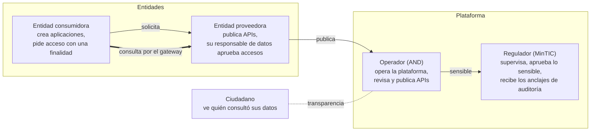
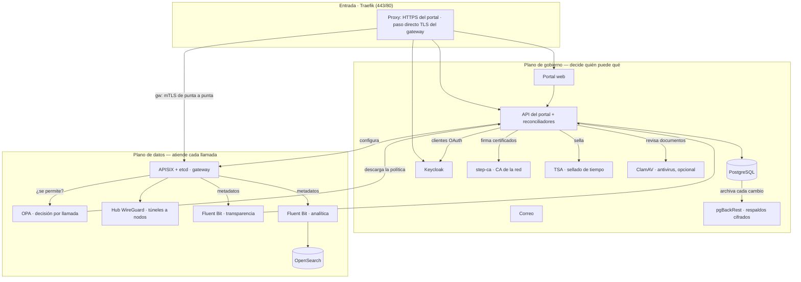
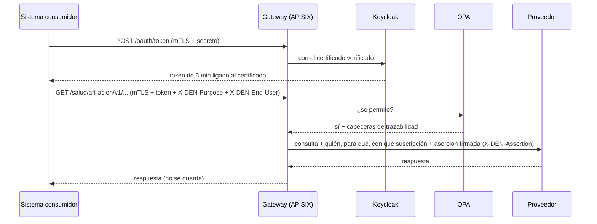

# Guía para el operador y el regulador

> English version (official): [docs/guides/operator.md](../../guides/operator.md)

Versión 1.2 · noviembre 2026 · código con el hito M6 (endurecimiento) cerrado · para la sesión de arquitectura y despliegue con el operador (AND) y el regulador (MinTIC)

Esta guía explica **qué es cada pieza de la plataforma, por qué está y quién la opera**, y cómo se despliega la infraestructura central. Para el detalle técnico remite a `ARCHITECTURE.md`, `DEPLOYMENT.md` y `OPERATIONS.md`; la instalación paso a paso está en [`INSTALL.md`](../INSTALL.md).

## Agenda sugerida (martes)

| Bloque | Contenido | Sección |
| :-- | :-- | :-- |
| 1. La red en una página | Qué resuelve, principios, quién hace qué | §1, §2 |
| 2. Arquitectura | Los dos planos y cada componente | §3, §4 |
| 3. Cómo fluye todo | Publicar, pedir acceso, aprobar, llamar, rendir cuentas al ciudadano | §5 |
| 4. Seguridad y privacidad | Qué garantiza la plataforma y cómo | §6 |
| 5. Despliegue en vivo | Instalación en el servidor del operador con `install.sh` | §7 |
| 6. Operación | Día a día, respaldos, qué vigilar | §8 |
| 7. Piloto vs. producción | Qué falta para producción | §9 |

## 1. La red en una página

La red de intercambio de datos DEN (Data Exchange Network) permite que una entidad pública **consulte los datos de otra** sin copiarlos, con **permiso explícito**, para una **finalidad declarada** y dejando **rastro de cada consulta**.

- **Los datos se quedan en cada entidad.** El gateway central solo pasa la consulta y la respuesta; no guarda contenidos (ni en base de datos ni en logs).
- **Nadie entra sin permiso.** Cada acceso es una *suscripción*: una aplicación concreta, a una API concreta, para una finalidad concreta, aprobada por el responsable de datos de la entidad dueña. Si falta algo, el gateway niega la llamada.
- **Todo queda auditado.** Cada cambio (quién aprobó qué, cuándo) va a una bitácora encadenada por hash y sellada a diario por una autoridad de sellado de tiempo: no se puede reescribir sin que se note.
- **El ciudadano ve quién consultó sus datos**, para qué y cuándo, con un comprobante verificable.
- **Solo software libre** con licencia aprobada por la OSI: sin costos de licencia ni dependencia de un proveedor.
- **Reutilizable en cualquier país:** todo lo propio de Colombia (autoridades, tipos de documento, sectores, marco legal) está en `config/country/co.yaml`.

## 2. Quién hace qué



| Rol | Quién | Puede |
| :-- | :-- | :-- |
| `platform_admin` | Equipo técnico de la AND | Todo lo operativo: aprobar entidades, publicar, gestionar nodos, suspender |
| `platform_reviewer` | Analistas de la AND | Revisar altas de entidades y publicaciones de APIs |
| `regulator` | MinTIC | Ver todo en solo lectura; aprobar publicaciones y accesos a datos **sensibles**; indicadores; auditoría |
| `auditor` | Órganos de control | Solo lectura de auditoría |
| `entity_admin` | Cada entidad | Su gente y sus roles, sus nodos |
| `api_publisher` | Cada entidad | Registrar y enviar a revisión sus APIs |
| `data_steward` | Responsable de datos de cada entidad | Aprobar, rechazar, suspender y revocar accesos a sus APIs |
| `app_developer` | Cada entidad | Crear aplicaciones, credenciales y solicitudes de acceso |

Los roles críticos (plataforma y `data_steward`) exigen **segundo factor** (código TOTP de una app autenticadora). Nadie aprueba lo que él mismo pidió (separación de funciones).

## 3. Arquitectura: dos planos



- **Plano de gobierno:** el portal y lo que lo rodea. Decide quién puede qué y lo traduce a configuración.
- **Plano de datos:** el gateway. Atiende cada llamada entre entidades con la última configuración y la última política recibidas. **Si cae el portal, el tráfico sigue funcionando.**
- El portal **nunca** configura el gateway "a mano": un *reconciliador* calcula desde la base de datos cómo debe estar APISIX, Keycloak, OPA y el hub, y los ajusta. Es idempotente: si algo se desvía o se pierde, la siguiente pasada (cada 5 minutos, o al reiniciar el API) lo repara.

## 4. Los componentes, uno por uno

Para cada uno: **qué hace**, **qué pasa si cae** y **qué guarda**. Todos corren como contenedores en el piloto.

### 4.1 Entrada

| Componente | Qué hace | Si cae | Guarda |
| :-- | :-- | :-- | :-- |
| **Traefik** (proxy incluido) | Recibe todo en 443. Por el nombre del portal termina HTTPS (Let's Encrypt o certificado propio) y reparte por ruta: `/` web, `/api/v1` API, `/auth` Keycloak. Por el nombre del gateway **no abre el TLS**: lo pasa intacto a APISIX, para que el mTLS sea de punta a punta. Nunca publica las rutas internas (`/api/v1/internal`, `/api/v1/opa`) | No entra nadie: ni personas ni sistemas | Solo el certificado de Let's Encrypt. Sin log de accesos (privacidad) |

### 4.2 Plano de gobierno

| Componente | Qué hace | Si cae | Guarda |
| :-- | :-- | :-- | :-- |
| **Portal web** (Next.js) | Interfaz de todas las personas: catálogo, documentación interactiva, consolas de operador, regulador, entidad y auditoría. No decide permisos: los decide el API | No hay portal; el tráfico sigue | Nada |
| **API del portal** (NestJS) | El cerebro. Aplica los flujos (alta, publicación, solicitud, aprobación), verifica rol y entidad en **cada** petición, registra cada cambio en la bitácora. En segundo plano: reconcilia APISIX, Keycloak, OPA y el hub; firma certificados; sella la transparencia y la bitácora; envía correos y avisos; vence suscripciones y certificados; rota cada 90 días la clave con la que el gateway firma sus aserciones y publica las claves públicas (JWKS) | No hay portal ni cambios; el tráfico sigue con lo último | Nada propio: todo en PostgreSQL |
| **PostgreSQL** | **Única fuente de verdad**: entidades, personas y roles, APIs, aplicaciones, suscripciones, bitácora, registro de transparencia, colas de trabajos. La bitácora es de solo inserción, incluso para el dueño de la base | Se detiene el plano de gobierno; el tráfico sigue | Todo. **Se respalda** |
| **pgBackRest** | Archiva cada cambio de PostgreSQL en pocos minutos (como mucho 5 minutos de pérdida), toma un respaldo completo por semana y uno diferencial por día, y conserva cuatro semanas, en un repositorio **cifrado**. Permite volver al último estado o a un instante exacto; la restauración se prueba en CI | Los cambios nuevos esperan a ser archivados; el tráfico sigue | El repositorio cifrado. **Se copia fuera del servidor** |
| **Keycloak** | Identidad: **autentica, no autoriza** (los roles viven en PostgreSQL). Tres realms: `den-portal` (personas, con segundo factor), `den-gateway` (aplicaciones de las entidades; sus clientes los crea el portal) y `den-citizens` (identidad ciudadana simulada; en producción se usa la del país) | Nadie inicia sesión; las aplicaciones no obtienen tokens nuevos | Usuarios y clientes (en PostgreSQL) |
| **step-ca** | **Autoridad certificadora de la red.** Firma los certificados de las aplicaciones (a partir del CSR que sube la entidad: la llave privada nunca sale de la entidad), el del gateway y los de los nodos. Solo le habla el API | No se emiten certificados; los vigentes siguen sirviendo | Llaves de la CA. **Perderla invalida todos los certificados: se respalda** |
| **TSA** (sellado de tiempo RFC 3161) | Sella el anclaje diario de la bitácora y los lotes del registro de transparencia: prueba que existían en ese momento y que nadie los reescribió | Los sellos quedan pendientes y se hacen al volver | Su llave (la de desarrollo; en producción, la TSA acreditada del país) |
| **Correo** (Mailpit en el piloto) | Captura todo el correo (invitaciones, avisos, verificación de cuentas, anclajes al regulador) y lo muestra en `/mail` con contraseña. En producción, el SMTP del operador | No salen correos | Correos del piloto |
| **ClamAV** (antivirus, opcional) | Revisa cada documento que se sube (designaciones, acuerdos de intercambio) antes de guardarlo. Uno infectado se rechaza; el log guarda la firma del virus y el hash, nunca el nombre ni el contenido | No se suben documentos (falla cerrado); el tráfico sigue | Sus firmas de virus, que actualiza desde internet |

### 4.3 Plano de datos

| Componente | Qué hace | Si cae | Guarda |
| :-- | :-- | :-- | :-- |
| **APISIX** (gateway) | Toda llamada entre entidades pasa por aquí. Termina el **mTLS** (exige el certificado de la aplicación), valida el token, borra las cabeceras que solo el gateway puede poner, pregunta a OPA, aplica el límite de la suscripción y reenvía al proveedor con las cabeceras de trazabilidad y una **aserción firmada** de la llamada. **No guarda cuerpos** | Se corta el tráfico | Nada (su configuración está en etcd) |
| **etcd** | Configuración del gateway (rutas, destinos, certificados). Se reconstruye desde PostgreSQL | APISIX sigue con lo que tiene en memoria, sin cambios nuevos | Configuración reconstruible |
| **OPA** | **Decide cada llamada** con la política que publica el portal (suscripciones vigentes, finalidades, operaciones, huellas de certificados). Responde "sí" o "no, por esta razón" (`no_subscription`, `purpose_not_allowed`…). No consulta la base del portal en línea. Sin política, **niega todo** (falla cerrado) | Se corta el tráfico | La última política, en disco: si reinicia sin el portal, sigue decidiendo con ella. La renueva cada 10–20 s |
| **Hub WireGuard** | Extremo central de los túneles cifrados que abren los **nodos del kit** desde la red de cada entidad, de adentro hacia afuera (la entidad no abre puertos de entrada). El gateway llega al nodo por el túnel, con mTLS de punta a punta. Un nodo no puede alcanzar a otros nodos ni a la plataforma | Las APIs servidas por nodos no responden | Último estado de los túneles |
| **Fluent Bit (transparencia)** | Lleva del gateway al portal el registro de cada consulta **autorizada** a datos de una persona: quién, para qué, con qué suscripción, y el **seudónimo** del titular (nunca su número de documento) | Los registros esperan en su búfer en disco | Búfer temporal |
| **Fluent Bit (analítica) + OpenSearch** | Segunda barrera de privacidad: deja pasar solo metadatos permitidos (sin ruta real, sin query, sin cuerpo) y los guarda para los indicadores de uso | Se pierden esos metadatos; el tráfico no se afecta | Metadatos de uso (prescindible) |
| **Prometheus + Alertmanager + Grafana** | Métricas del gateway, del API y de OPA; nueve alertas para el operador (5xx, latencia, servicio caído, política atrasada, reconciliación fallida, nodos fuera de línea, certificados por vencer, cola acumulada), que llegan por correo; tablero en `/grafana` | No hay alertas; el tráfico no se afecta | Métricas (30 días) |
| **Runner de contratos** (Schemathesis) | Cuando una entidad envía una API a revisión, prueba su contrato OpenAPI contra el sandbox. El operador solo aprueba con las validaciones superadas | No se prueban contratos | Nada (descarta el informe) |

### 4.4 Utilería del piloto (no va a producción)

- **Proveedores de prueba** (`mock-salud`, `mock-socioeconomico`): simulan dos entidades con datos sintéticos.
- **Carpeta ciudadana de referencia** (`/citizen-app`): muestra lo que debe implementar la carpeta real del país (consultas, avisos, comprobantes).
- **Datos semilla:** tres entidades ficticias y los usuarios de demo.

## 5. Cómo fluye todo

### 5.1 Publicar una API

```
borrador → en revisión → aprobada por el operador → [aprobada por el regulador, si es sensible] → publicada
```

1. El publicador de la entidad sube el contrato OpenAPI, dice dónde vive el servicio, qué datos expone, la base legal y las finalidades permitidas.
2. Al enviarla a revisión, el portal prueba la conectividad (a través del gateway) y el contrato contra el sandbox.
3. La AND revisa la ficha y la minimización de datos. Si la clasificación es **sensible**, MinTIC también aprueba.
4. Al publicarla, la ruta aparece en el gateway en segundos, **cerrada**: sin suscripciones, nadie entra.

### 5.2 Pedir y conceder acceso

```
pendiente del proveedor → [pendiente del regulador] → aprobada → activa → (suspendida | revocada | vencida)
```

1. El desarrollador de la entidad consumidora crea una aplicación: recibe un secreto (se muestra una sola vez) y sube su CSR para obtener su certificado.
2. Pide acceso: API, operaciones, **finalidad** del catálogo, detalle, base legal, vigencia y acuerdo de intercambio.
3. El responsable de datos de la proveedora aprueba (puede reducir operaciones, límite o vigencia), rechaza o pide información.
4. En menos de 60 segundos OPA tiene la política nueva y la suscripción pasa a **activa**. Suspender o revocar también se aplica en menos de 60 segundos.

### 5.3 Una llamada



El proveedor recibe en cada consulta la entidad y la aplicación consumidoras, la suscripción, la finalidad, la operación y el hash del funcionario: ya no ve "solo al gateway". Con la **aserción firmada** (un JWS por llamada, ligado al método, la URI y el cuerpo) comprueba además que la consulta pasó por el gateway y no fue alterada, con las claves públicas de `https://<portal>/api/v1/gateway/jwks`.

### 5.4 Rendición de cuentas al ciudadano

Cada consulta autorizada a datos de una persona queda en el registro de transparencia con el seudónimo del titular. Cada 10 segundos se agrupan en lotes firmados por el operador y sellados por la TSA. Desde su carpeta, el ciudadano ve quién lo consultó y para qué, recibe avisos y descarga un comprobante que **cualquiera puede verificar sin confiar en el portal** (verificador abierto `den-verify-receipt`).

## 6. Seguridad y privacidad: qué garantiza la plataforma

| Garantía | Cómo |
| :-- | :-- |
| Solo sistemas identificados llegan al gateway | mTLS obligatorio con certificados de la CA de la red; tokens de 5 minutos **ligados al certificado** (un token robado no sirve sin la llave) |
| Solo accesos aprobados | OPA decide cada llamada con las suscripciones vigentes; falla cerrado |
| No se guarda el contenido | Ni el gateway ni los logs guardan cuerpos; rutas y query strings se enmascaran; dos barreras (APISIX + Fluent Bit) |
| El titular no queda expuesto | Solo un seudónimo con clave (HMAC), en el registro de transparencia, nunca en la analítica |
| Nadie reescribe la historia | Bitácora encadenada por hash, de solo inserción, con anclaje diario sellado por la TSA y enviado al regulador |
| Cuentas protegidas | Segundo factor para roles críticos; aviso al dueño cuando cambia una credencial |
| Autorización en el servidor | Cada endpoint verifica rol y entidad; la matriz completa está en `AUTHZ.md` y la comprueban tests |
| Entidades aisladas | Cada proveedor con mTLS acepta solo el certificado del gateway emitido para él; un nodo no alcanza a otros |
| El proveedor sabe que la consulta es legítima | Aserción firmada por el gateway en cada llamada (ES256), ligada a la petición y a ese proveedor, verificable con un JWKS público. Una cabecera falsa del cliente se descarta |
| Revisada contra estándares | OWASP ASVS nivel 2, capítulo por capítulo (`docs/security/ASVS-L2.md`), y WCAG 2.1 AA en las 42 pantallas, en español y en inglés (`docs/accessibility`) |

## 7. Despliegue de la infraestructura del operador (en vivo)

Detalle completo en [`INSTALL.md`](../INSTALL.md). Resumen:

1. **Requisitos:** VPS Linux de 4–8 vCPU, 16 GB de RAM y 100 GB SSD; IP pública; **dos nombres DNS** (portal y gateway); puertos 443/tcp, 80/tcp y 51820/udp abiertos.
2. **Instalar:**
   ```bash
   git clone <url-del-repositorio> den && cd den
   sudo ./install.sh
   ```
   El script pregunta el país, los dos nombres, el proxy y el certificado, si se activan la observabilidad y el antivirus de documentos, y la contraseña de demo (12 caracteres o más). Después genera todos los secretos, compila, arranca y comprueba.
3. **Entregar:**
   - copia cifrada del `.env` fuera del servidor (custodia del operador);
   - credenciales (`sudo ./install.sh credentials`) a las personas que correspondan;
   - el segundo factor de los usuarios de demo enrolado en el teléfono de quien los usará (`sudo ./install.sh otp` da la clave).
4. **Comprobar:** `sudo ./install.sh status` y el recorrido de `DEMO.md`.

**Quién custodia qué después de la instalación:**

| Secreto | Por qué importa | Custodia sugerida |
| :-- | :-- | :-- |
| `.env` completo | Sin él no se recuperan los datos ni se verifican comprobantes | AND, copia cifrada fuera del servidor |
| `DEN_SUBJECT_REF_KEY`, `DEN_END_USER_HASH_SALT` | Definen los seudónimos; **no se rotan** | AND |
| Volumen de step-ca | Llaves de la CA de la red | AND (respaldo cifrado) |
| `PGBACKREST_REPO1_CIPHER_PASS` | Cifra los respaldos de la base: sin ella no se restaura ninguno | AND, copia fuera del servidor, junto al `.env` |
| `DEN_SECRETS_KEY` | Sella los secretos de los clientes y la clave con la que firma el gateway | AND, dentro del `.env` |
| Administrador de Keycloak | Control de las identidades | AND, dos personas |
| Usuarios con rol `regulator` | Supervisión | MinTIC |

## 8. Operación del día a día

- **Diario** (`OPERATIONS.md §4.1`): servicios sanos (`sudo ./install.sh status`), nada fuera de sincronía con el gateway, cadena de auditoría íntegra (Consola → Auditoría → "Verificar integridad"), registro de transparencia íntegro.
- **Respaldos:** la base se respalda sola (pgBackRest): cada cambio queda archivado a los pocos minutos y hay un respaldo cada día, con un mes de historia. `sudo ./install.sh backup` antes de cada actualización y con regularidad, para llevar una copia fuera del servidor. Guarda también fuera del servidor la clave `PGBACKREST_REPO1_CIPHER_PASS` del `.env`: sin ella no se restaura nada.
- **Restaurar:** `sudo ./install.sh restore` vuelve al último estado; `sudo ./install.sh restore "2026-11-20 14:30:00-05"`, a ese instante (`OPERATIONS.md §6`).
- **Actualizar:** `sudo ./install.sh update`, que respalda, actualiza, recompila y reinicia.
- **Runbook del operador** (`RUNBOOK.md`): alta de una entidad hasta su primera API publicada, suspensión y baja; incidentes con severidades y un procedimiento por caso; rotación de la CA intermedia, planificada y de emergencia; revocación masiva de certificados.
- **Revocación masiva de certificados:** Consola → Revocación masiva de certificados, solo `platform_admin` con segundo factor. Filtra por entidad, por fecha de emisión y por intermedia, muestra una vista previa y revoca solo si el conjunto no cambió. Cada certificado deja de servir en menos de 60 segundos y los desarrolladores reciben un aviso. No se deshace.
- **Clave de firma del gateway:** el portal la rota sola cada 90 días; la anterior sigue en el JWKS para que lo archivado siga verificando. Si se compromete, se rota de inmediato como comprometida (`POST /api/v1/admin/gateway-signing-keys/rotate`) y se avisa a los proveedores (`RUNBOOK.md §2.2`).
- **Al actualizar** un piloto instalado antes de los respaldos automáticos, `update` agrega la clave de cifrado de los respaldos al `.env` y lo avisa: guarda la copia de `.env` de nuevo.
- **Nunca** se corrige APISIX ni Keycloak a mano: el reconciliador lo revierte. Si algo no cuadra, se mira `sync_state` (`OPERATIONS.md §4.2`).
- **Alertas** (con la observabilidad activada): Prometheus vigila el gateway, el API y OPA, y Alertmanager avisa por correo al operador (en el piloto, a `/mail`) cuando hay muchos 5xx o latencia alta, un servicio no responde, OPA se atrasa con la política, falla una reconciliación, hay nodos fuera de línea, vence pronto un certificado o se acumula la cola de trabajos. El tablero del operador está en `https://<portal>/grafana/`.

## 9. Piloto hoy vs. producción

| Tema | Piloto (esta instalación) | Producción |
| :-- | :-- | :-- |
| Topología | Un servidor, con Docker Compose | Kubernetes con los Helm charts de `infra/helm`: ≥ 2 nodos de gateway en zonas distintas, réplicas de portal y API, etcd de 3 miembros, PostgreSQL con réplica, NetworkPolicies de entrada y salida |
| Tráfico interno | Redes de Docker separadas (gateway, proveedores, resto) | Además, TLS entre componentes con una PKI interna (cert-manager) |
| Imágenes | Se compilan en el servidor | Imágenes publicadas con versión, su SBOM y escaneo de vulnerabilidades (Trivy) |
| CA | CA de desarrollo en un volumen | Raíz fuera de línea, intermedia en HSM |
| Sellado de tiempo | TSA de desarrollo | TSA acreditada del país |
| Correo | Mailpit | SMTP del operador |
| Secretos | `.env` en disco | Gestor de secretos (OpenBao) |
| Identidad ciudadana | Simulada (`den-citizens`) | La del país |
| Datos iniciales | Entidades ficticias y usuarios de demo | Sin datos de demo; el primer `platform_admin` es quien entra primero con la dirección de `DEN_BOOTSTRAP_ADMIN_EMAIL`, verificada por Keycloak (`DEPLOYMENT.md §9`) |
| Antivirus | Opcional (paso 5 del instalador) | Activado, con dos réplicas |
| Respaldos | Automáticos con pgBackRest en el mismo servidor; la copia fuera de él con `install.sh backup` | Automáticos al almacenamiento de objetos del operador (Barman Cloud) |
| Métricas y alertas | Prometheus, Alertmanager y Grafana en el mismo servidor; avisos a Mailpit | Los mismos, con el SMTP del operador y almacenamiento de métricas de larga duración |

**Qué ya está probado y qué falta:**

- **Resiliencia, probada** (`docs/performance/M6-04.md`): con el portal caído 45 segundos, las llamadas permitidas y las negadas siguieron, cada una como debía. OPA y APISIX reinician sin el portal. Al volver, el registro de transparencia tenía todas las consultas de la caída y una revocación llegó al gateway en 18 segundos.
- **Respaldos, probados:** la restauración se prueba en CI: pérdida del volumen, vuelta a un instante y repositorio ilegible sin su clave.
- **Carga, a medias** (`docs/performance/M6-03.md`): en la máquina de desarrollo el gateway atiende 200 peticiones por segundo con un p95 de 13 ms sobre la red a su escala inicial (200 entidades, 1.000 APIs, 5.000 suscripciones). La meta es 500 por segundo con p95 menor de 50 ms. Se valida en un entorno tipo producción, con el generador de carga en otra máquina.
- **Helm charts, sin instalar:** están completos y validados de forma estática. Se instalan por primera vez en el entorno del operador, junto con una restauración desde su almacenamiento de objetos.

**Decisiones del operador y del regulador:**

| Decisión | Hoy | Qué implica |
| :-- | :-- | :-- |
| Segundo factor para `entity_admin` y `api_publisher` | Solo los roles de plataforma (incluidos `regulator` y `auditor`) y `data_steward` | ASVS nivel 2 lo pide para todo acceso. Es configuración, pero cambia el ingreso de las entidades |
| Catálogo público | Apagado (`features.publicCatalog`) | Encendido, cualquiera ve las APIs de clasificación pública, sin el contacto del responsable ni el estado de los nodos |
| Aserción firmada del gateway | Encendida (`features.gatewayAssertion`) | Cada proveedor puede verificarla, y decidir si la exige |
| Pruebas con lectores de pantalla y con usuarios | La revisión automatizada de accesibilidad pasa en todas las pantallas | Recomendadas antes de producción (NVDA, VoiceOver) |
| TSA, CA y correo de producción | De desarrollo | TSA acreditada, HSM para la intermedia y el SMTP del operador |

## 10. Preguntas que suelen surgir

- **¿El operador puede ver los datos que se intercambian?** No. El gateway los pasa sin guardarlos y los logs solo tienen metadatos enmascarados.
- **¿Qué pasa si se cae el portal?** El tráfico entre entidades sigue con la última configuración y la última política. Solo se detienen los cambios (nuevas aprobaciones, publicaciones). Está probado: con el portal caído, las llamadas siguen; OPA y APISIX reinician sin él, y al volver el portal recupera los registros de transparencia de la caída.
- **¿Cómo sabe el proveedor que una consulta viene de verdad del gateway?** Por la aserción firmada (`X-DEN-Assertion`): un JWS por llamada, ligado al método, a la URI, al cuerpo y a ese proveedor, que verifica con las claves públicas del portal. Una aserción que el cliente intente colar se descarta. La guía de entidades trae ejemplos de verificación en Node.js y Python.
- **¿Cuánto tráfico aguanta?** En la máquina de desarrollo, 200 consultas por segundo con un p95 de 13 ms agregados por el gateway. La meta, 500 por segundo, se valida en un entorno tipo producción. La capacidad crece con más nodos de gateway: cada uno cuenta los límites por su lado y la política le da su parte.
- **¿El portal está en inglés?** Sí, completo, además del español, que es el idioma por omisión. Los correos y la carpeta ciudadana también son bilingües.
- **¿Una entidad tiene que abrir puertos de entrada?** No, si usa el kit: el nodo abre el túnel hacia afuera (UDP 51820). Con una API existente, la entidad debe permitir que el gateway llegue a ella.
- **¿Se puede integrar con X-Road?** Sí: el gateway puede usar un Security Server del operador como cliente X-Road (`ARCHITECTURE.md §10`).
- **¿Quién aprueba el acceso a datos sensibles?** El responsable de datos de la entidad dueña y, además, el regulador.
- **¿Cómo se demuestra que la bitácora no fue alterada?** Con la verificación de integridad de la consola y con el anclaje diario que el regulador recibe por correo, sellado por una TSA independiente.
- **¿Se puede llevar a otro país?** Sí, sin cambiar código: un `config/country/<código>.yaml` nuevo y los textos de i18n. Está probado con un "país de ejemplo" levantado desde la plantilla `example.yaml` (`pnpm example:country`): la demo completa pasa con sus propios sectores, finalidades y tipo de documento.
