# Manual de usuario: de la primera cuenta a la primera consulta

> English version: [docs/guides/user-manual.md](../../guides/user-manual.md)

<!--
Cómo se escribe este manual (scripts/user-manual-html.mjs lo convierte en user-manual.html):
  <!- - roles: operator,provider,consumer,server - ->  después de un "## ": quién hace la sección
    una captura; sus recuadros numerados
      apuntan, en orden, a los puntos de la lista numerada que va justo antes
  > **Consejo:** / > **Atención:**  recuadros de consejo y de atención
  ```bash tab="…"  bloques seguidos con tab="…" forman pestañas
Las capturas salen del portal real con `pnpm docs:manual --yes`; nunca se editan a mano.
-->

Este manual lleva paso a paso a las personas que hacen que una entidad publique una API en la red y otra la consulte: crear las cuentas, dar de alta las entidades, instalar el nodo, publicar, aprobar, pedir acceso y hacer la primera consulta. Cada paso tiene una captura del portal con números sobre lo que hay que tocar: pulsa un número para ir a su instrucción, o la captura para verla en grande.

Las capturas se tomaron en una red de prueba con datos sintéticos. Usa estos valores de ejemplo y cámbialos por los tuyos:

| Qué | Ejemplo |
| :-- | :-- |
| Portal | `https://portal.example.org` |
| Gateway (nombre propio para mTLS) | `https://gateway.example.org` |
| Entidad proveedora | *Civil Registry*, identificador `civil-registry`, NIT `900000100` |
| Entidad consumidora | *Ministerio de Bienestar de Wakanda*, identificador `bienestar-wakanda`, NIT `900000200` |
| API | *Certificado de afiliación*, identificador `certificados-afiliacion` |
| Nodo y servicio | Nodo `nodo-principal`, servicio en la ruta `/salud` del nodo |
| Registro de prueba | Documento `1000000001` |

## Quién hace qué

| Papel | En las capturas | Qué hace |
| :-- | :-- | :-- |
| **Operador de la red** | Ana (revisión) y Pablo (administración de la plataforma) | Aprueba altas de entidades y publicaciones de APIs; da los roles de plataforma |
| **Servidor del portal** | Quien administra el servidor | Da el primer rol de plataforma con un comando |
| **Administradora de la entidad** | Rosa Registro, de *Civil Registry* | Pide el alta, registra el nodo y entrega su token |
| **Responsable de datos** | Diego Datos, de *Civil Registry* | Aprueba o rechaza cada solicitud de acceso a las APIs de su entidad |
| **Responsable técnico** | Tomás Técnico, de *Civil Registry* | Publica las APIs de la entidad |
| **Infraestructura** de la entidad proveedora | El equipo de sus servidores | Instala el nodo y conecta la API |
| **Entidad consumidora** | Wanda Bienestar, del *Ministerio de Bienestar de Wakanda* | Una sola persona con todos los papeles: crea la aplicación, su certificado y pide acceso |

Una persona puede tener varios papeles en su entidad. Lo que el portal nunca permite es aprobar lo que uno mismo pidió.

## Antes de empezar

- **Una app autenticadora** en el teléfono (Google Authenticator, Microsoft Authenticator o cualquier app TOTP). La piden los roles críticos: los de plataforma, la administración de la entidad y el responsable de datos.
- **Contraseña:** al menos 12 caracteres, distinta del usuario y del correo, y no una de las últimas 5.
- **El enlace de verificación dura 60 minutos.** Ten el correo abierto antes de registrarte. En una red de prueba los correos del portal llegan al buzón de prueba (`/mail`).
- **Una ventana privada por persona** si haces varios papeles desde el mismo computador, para que las sesiones no se mezclen.

## 1. El equipo del operador

<!-- roles: operator,server -->

**Quién:** cada persona del operador y quien administra el servidor del portal. **Necesitas:** el correo institucional de cada persona.

### 1.1 Crear la cuenta

Todas las personas, del operador o de una entidad, crean su cuenta igual:

1. En el formulario de registro, elige un **usuario** y escribe tu **correo** institucional.
2. Escribe tu **nombre y apellido** tal como aparecerán en el portal.
3. Pulsa **Registrarse**, abre el correo de verificación y define tu contraseña.

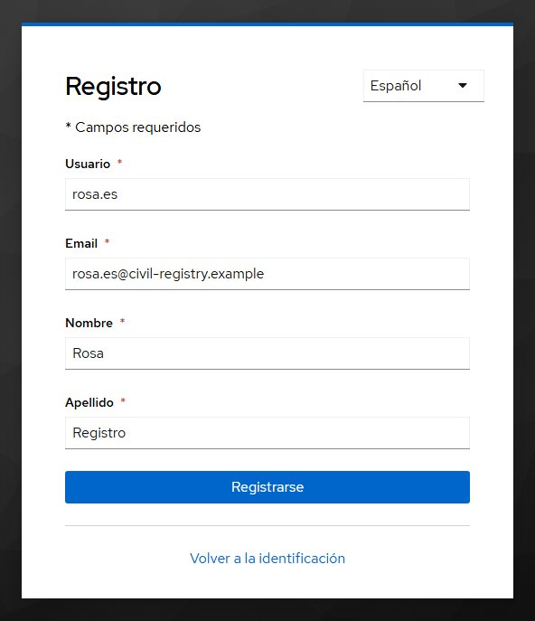

Al entrar por primera vez, el portal dice que todavía no tienes roles: es lo esperado. Entrar una vez es lo que crea tu cuenta en el portal.

### 1.2 El primer rol de plataforma, desde el servidor

El primer `platform_admin` (y la recuperación, si algún día no queda ninguno) se da en el servidor del portal:

```bash
sudo ./install.sh platform-role grant <correo> platform_admin --reason "Equipo técnico"
sudo ./install.sh platform-role list
```

### 1.3 Los demás roles, desde la consola

Con su segundo factor registrado, el `platform_admin` da los demás roles en **Consola del operador → Roles de plataforma y cuentas → Dar un rol**:

1. El **correo** con el que la persona se registró.
2. El **rol**: `Revisión del operador` (aprueba altas y APIs), `Administración de la plataforma`, `Regulador` o `Auditoría`.
3. El **motivo**, para la bitácora: quién lo pidió y con qué fundamento.
4. Pulsa **Dar el rol**.

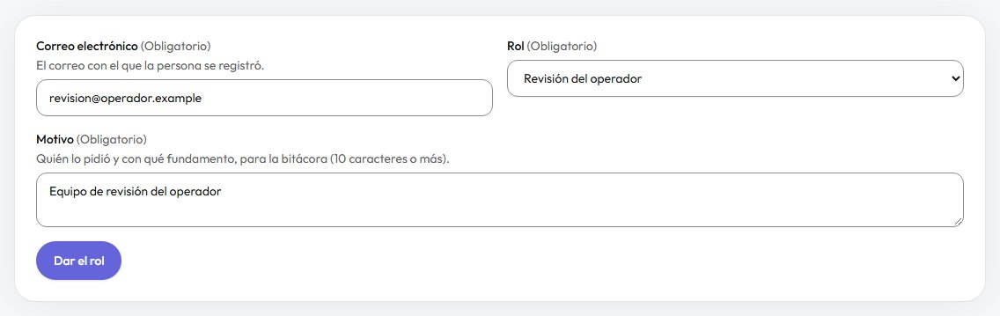

La persona vuelve a entrar: Keycloak le pide registrar la app autenticadora (como en el paso 4.1) y desde ahí ve la **Consola del operador**.

### 1.4 Desactivar las cuentas de demostración

Cuando el equipo del operador ya tiene sus roles, quien administra el servidor desactiva las cuentas de demostración del piloto:

```bash
sudo ./install.sh demo-users disable --reason "El equipo del operador ya tiene sus roles"
```

> **Atención:** no se puede deshacer desde el instalador. El comando se niega si no queda un `platform_admin` propio activo.

## 2. La entidad proveedora pide su alta

<!-- roles: provider -->

**Quién:** la persona que será administradora de la entidad (Rosa). **Necesitas:** los datos de la entidad, el nombre y correo exacto de sus dos responsables, y el documento de designación en PDF.

### 2.1 Abrir el alta de entidades

1. Crea tu cuenta como en el paso 1.1 y, en el inicio, pulsa **Alta de entidades**.

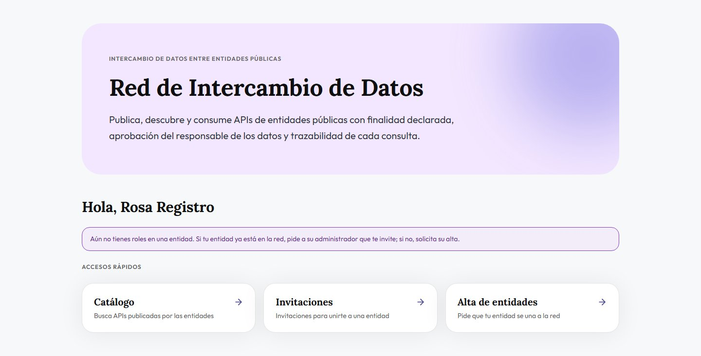

### 2.2 Llenar la solicitud

1. El **identificador** de la entidad: es el primer segmento de sus rutas en el gateway (`civil-registry`) y no cambia después.
2. El **correo exacto del responsable de datos**: con ese correo recibirá su invitación.
3. El **correo exacto del responsable técnico**.
4. Pulsa **Crear la solicitud**.

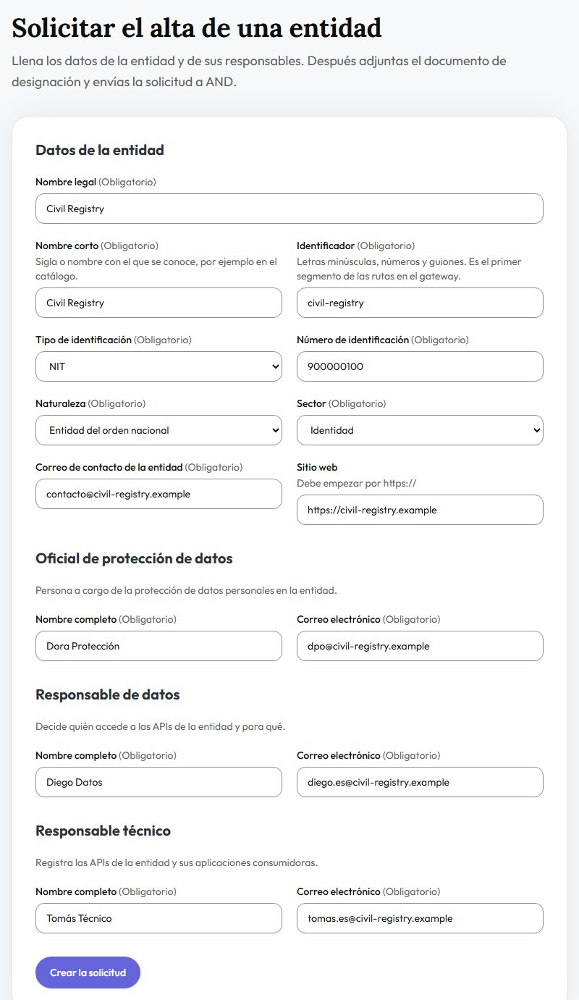

| Campo | Ejemplo |
| :-- | :-- |
| Nombre legal / Nombre corto | `Civil Registry` |
| Tipo y número de identificación | `NIT` · `900000100` |
| Naturaleza / Sector | `Entidad del orden nacional` · `Identidad` |
| Correo de contacto, sitio web | Los institucionales |
| Oficial de protección de datos | Nombre y correo |

> **Consejo:** si una sola persona tendrá varios papeles, pon su propio correo en esos campos: al aprobarse el alta recibe los roles directamente, sin invitaciones.

### 2.3 Subir el documento y enviar

1. Sube el **documento de designación** (PDF, máximo 10 MB): el acto o la carta que designa a los responsables, con los mismos nombres y correos, firmado por quien tiene la autoridad.
2. Pulsa **Enviar a revisión**.

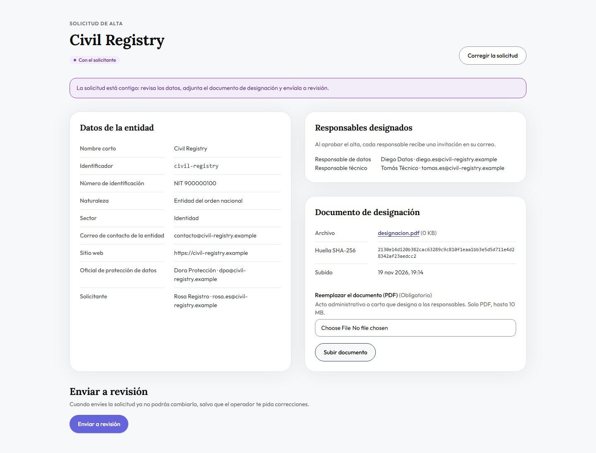

Después de enviarla ya no se puede editar, salvo que el operador pida correcciones.

## 3. El operador aprueba el alta

<!-- roles: operator -->

**Quién:** una persona con rol de revisión o de administración de la plataforma, que no sea quien pidió el alta (Ana).

1. En la **Consola del operador**, abre la solicitud en **Altas de entidades por revisar**.

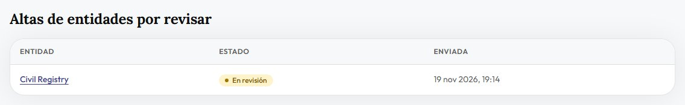

Revisa los datos, el documento y que los correos sean institucionales. Luego decide:

1. **Aprobar el alta**. Las otras opciones son **Pedir correcciones** (el solicitante lee tu comentario) o **Rechazar** (definitivo; libera el identificador).

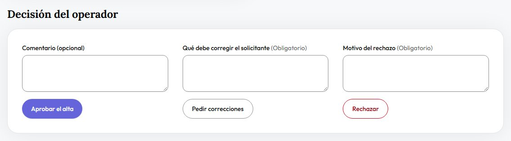

Al aprobar, quien pidió el alta queda como administradora de la entidad y cada responsable recibe una invitación por correo, que vence a los 14 días.

## 4. Los responsables entran a la entidad

<!-- roles: provider -->

**Quién:** la administradora (Rosa), el responsable de datos (Diego) y el responsable técnico (Tomás).

### 4.1 La administradora registra su segundo factor

La siguiente vez que entra, Keycloak le pide a la administradora configurar su app autenticadora:

1. Escanea el **código QR** con la app.
2. Escribe el **código de 6 dígitos** que muestra la app.
3. Pulsa **Enviar**.

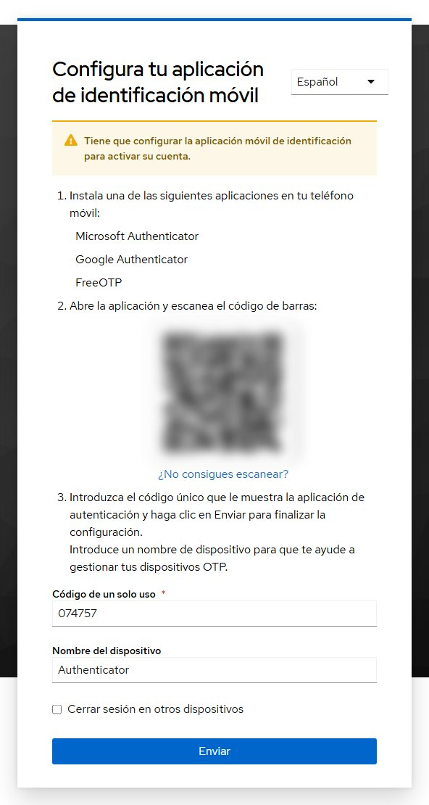

Hasta que lo haga no puede actuar por la entidad. Desde ahí ve **Mi entidad**.

### 4.2 Los responsables aceptan su invitación

Cada responsable se registra con **exactamente** el correo de la solicitud, lo verifica y entra:

1. En **Invitaciones**, pulsa **Aceptar** en la invitación de la entidad.

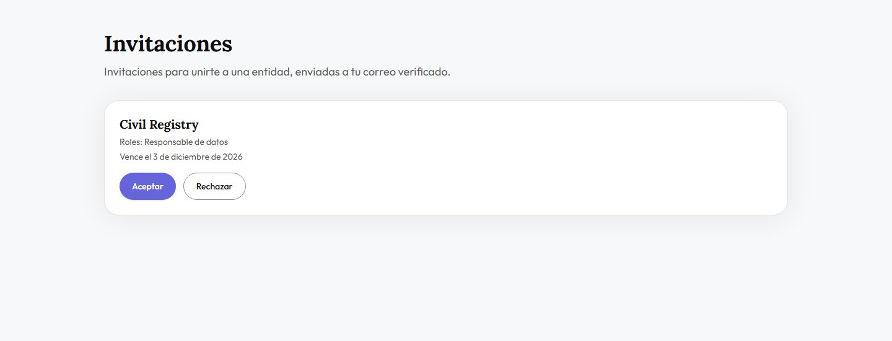

El responsable de datos registra su app autenticadora la primera vez que trabaja en la entidad, como en el paso 4.1.

> **Atención:** si **Invitaciones** sale vacía, el correo de registro no es idéntico al de la solicitud o no está verificado.

## 5. El nodo de la entidad

<!-- roles: provider -->

El nodo es el canal seguro entre el gateway de la red y la entidad: abre un túnel **hacia afuera**, sin puertos de entrada, y solo acepta al gateway. Toda entidad proveedora entra por su nodo.

**Quién:** la administradora registra el nodo; infraestructura lo instala. **Necesitas:** un servidor Ubuntu Server 22.04 o 24.04 (amd64 o arm64) con salida a internet por UDP 51820 y TCP 443, y la hora sincronizada.

### 5.1 Registrar el nodo

1. En **Mi entidad**, pulsa **Nodos del kit**.

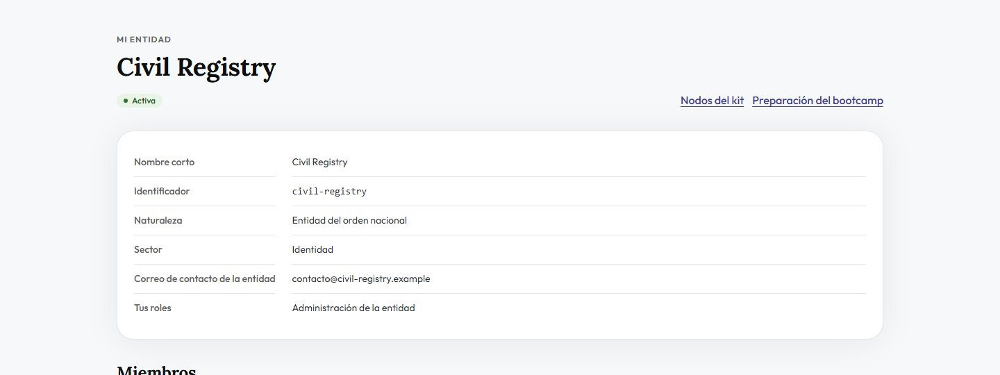

En **Registrar un nodo**:

1. Escribe un **nombre** único en la entidad, por ejemplo `nodo-principal`.
2. Pulsa **Registrar y emitir token**.

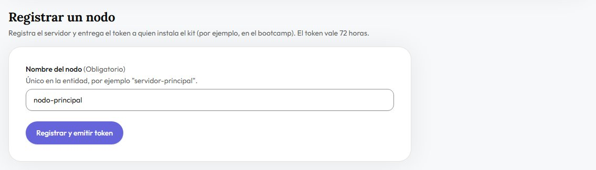

1. **Copia el token en ese momento** y entrégalo a quien instala.

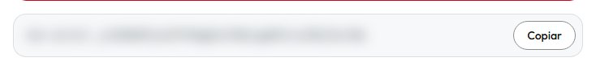

### 5.2 Instalar el nodo

Los comandos de la versión vigente, con su huella y la dirección del portal ya puestas, están en **Kit para instalar**, en la misma página:

1. Copia los **comandos** y ejecútalos en el servidor del nodo.

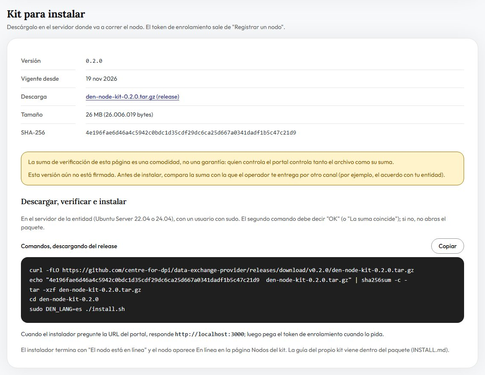

Tienen esta forma (la huella y el enlace son los de la versión vigente):

```bash
curl -fLO https://github.com/centre-for-dpi/data-exchange-provider/releases/download/v0.2.0/den-node-kit-0.2.0.tar.gz
echo "<huella SHA-256>  den-node-kit-0.2.0.tar.gz" | sha256sum -c -     # debe decir: OK
tar -xzf den-node-kit-0.2.0.tar.gz
cd den-node-kit-0.2.0
sudo DEN_LANG=es ./install.sh
```

| Pregunta del instalador | Respuesta |
| :-- | :-- |
| Modo | `canal` si la entidad ya tiene su API; `completo` para APIs instantáneas sobre su base de datos |
| Proxy corporativo | `n`, o la dirección del proxy |
| URL del portal | `https://portal.example.org` |
| Token | El del paso 5.1 (no se ve mientras se pega) |

El instalador revisa el sistema, instala Docker si falta y termina con **"El nodo está en línea"**.

### 5.3 Conectar la API al nodo

Si la entidad ya tiene su API (modo canal):

```bash
sudo /opt/den-node/install.sh service
```

| Pregunta | Ejemplo |
| :-- | :-- |
| Tipo | `proxy` |
| Nombre del servicio | `afiliacion` |
| Ruta en el nodo | `/salud` (la pide el portal en el paso 6.2) |
| URL interna de la API | `http://api-afiliacion:8000` |
| Credencial que exige la API interna | `none`, `header`, `basic` o `certificate`; nunca sale de la entidad |
| OpenAPI de la API | La ruta del **mismo archivo** que se sube al portal |

Si la entidad no tiene API, el nodo publica una **vista** de su base de datos como una consulta por clave (modo completo, APIs instantáneas). La preparación de la vista, el usuario de solo lectura y el archivo del servicio están en el [recorrido completo, paso 5.3](walkthrough.md#5-el-nodo-de-la-entidad).

Para terminar: `sudo /opt/den-node/install.sh doctor`, todo en ✔.

### 5.4 Comprobar que está en línea

1. En **Nodos del kit**, el nodo aparece **En línea** y su token como **Usado**.

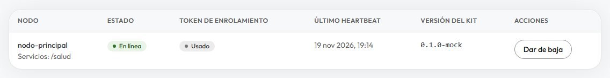

## 6. El responsable técnico publica la API

<!-- roles: provider -->

**Quién:** el responsable técnico (Tomás). **Necesitas:** el archivo OpenAPI que se configuró en el nodo, la norma que permite compartir los datos y la lista de datos que expone la API.

### 6.1 Registrar la API

En **Mis APIs → Registrar API**:

1. El **identificador en la URL**: forma la ruta pública `/civil-registry/certificados-afiliacion/v1`.
2. La **clasificación**: `Pública`, `Interna`, `Datos personales` o `Datos sensibles` (las de datos sensibles también las aprueba el regulador).
3. Pulsa **Registrar API**.

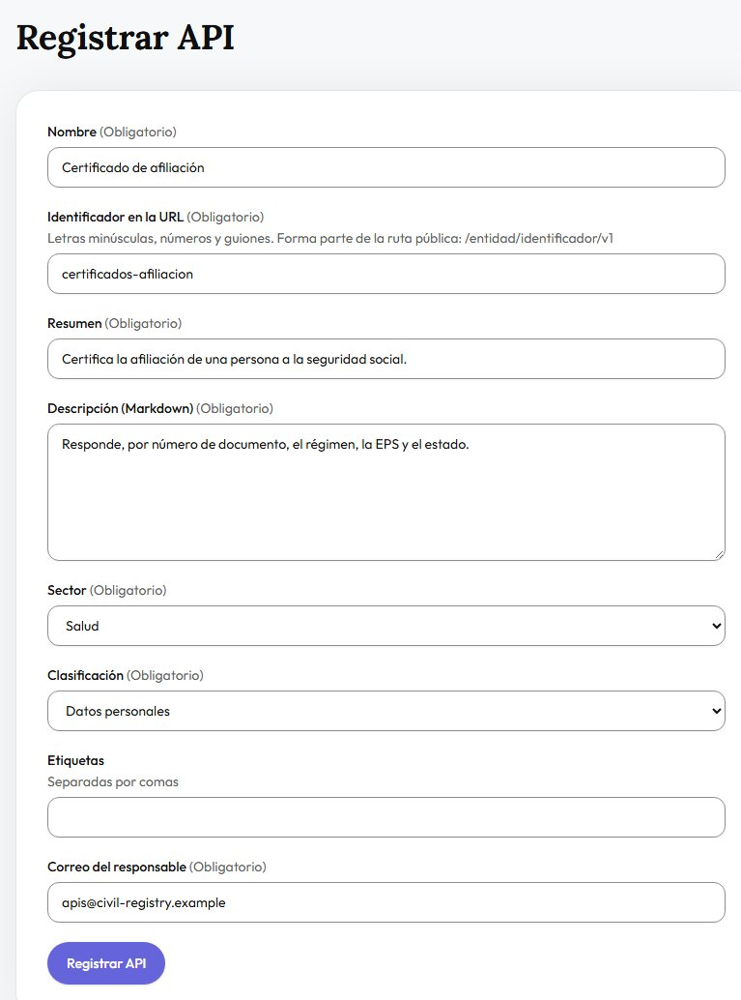

### 6.2 Crear la versión

En la API, pulsa **Nueva versión** y escribe la versión (`1.0`). Luego, dónde vive el servicio:

1. Sube el **archivo OpenAPI**: el mismo que se configuró en el nodo.
2. Elige el **nodo del kit** del paso 5.1.
3. Escribe la **ruta del servicio en el nodo** (`/salud`).

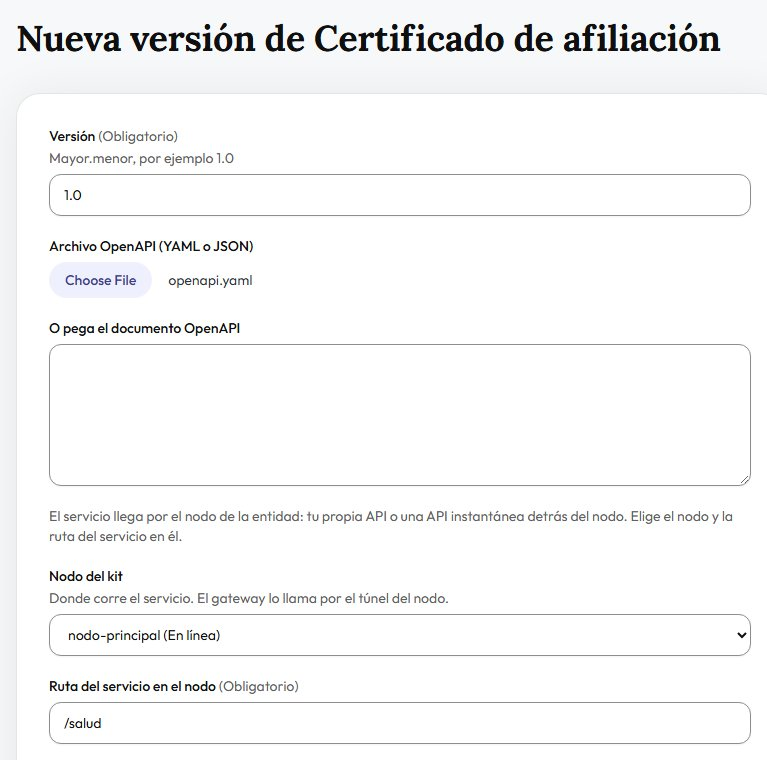

Y lo que la red necesita saber de los datos:

1. Marca las **finalidades permitidas**, por ejemplo *Verificación de requisitos de un trámite*.
2. Escribe cada **dato que expone** la respuesta, marcando los personales y los sensibles.
3. Escribe la **base legal**: la norma que permite compartir los datos.
4. Pulsa **Crear versión**.

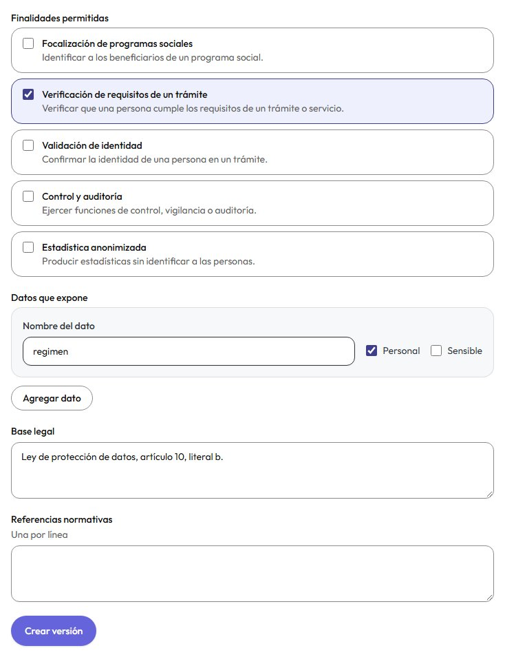

> **Atención:** errores comunes del contrato: un número de identificación en la consulta (`?documento=`) en vez de en la ruta, `operationId` repetidos, referencias externas y, en las APIs personales, no declarar de quién son los datos (`x-den-data-subject`).

### 6.3 Enviar a revisión

1. Revisa la ficha de la versión (cada operación y dónde va el titular de los datos) y pulsa **Enviar a revisión**.

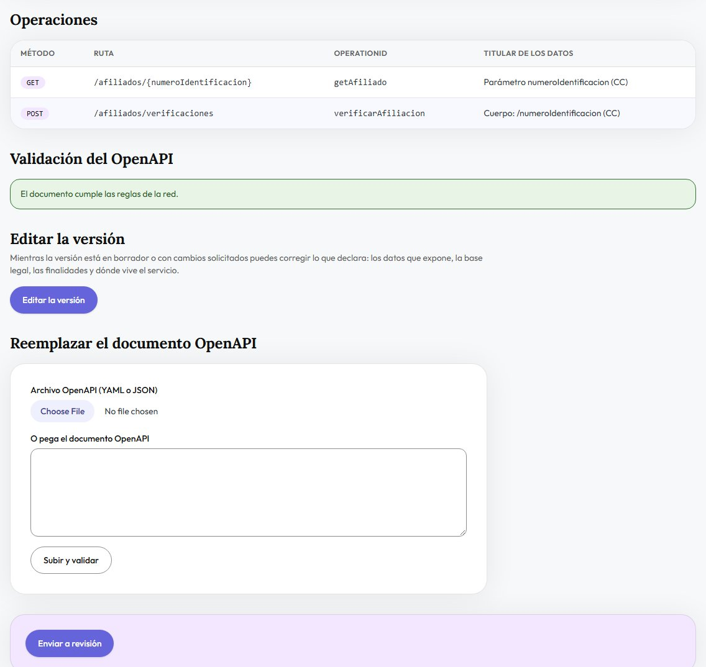

El portal ejecuta las **validaciones automáticas**: llaman al servicio a través del gateway, el túnel y el nodo.

1. Espera a que digan **Superadas**.

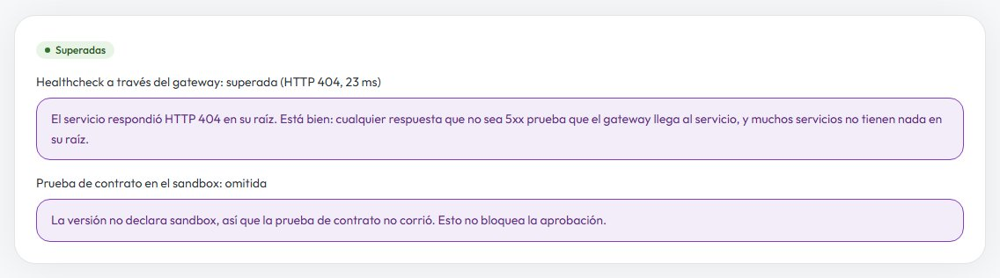

Las validaciones se pueden repetir una vez cada 5 minutos por versión.

## 7. El operador aprueba la API

<!-- roles: operator -->

**Quién:** una persona del operador con rol de revisión (Ana).

En **Consola del operador → Versiones en revisión**, abre la versión y revisa el contrato, los datos que expone y las finalidades:

1. Comprueba que las **validaciones automáticas** pasaron: con validaciones fallidas el portal no deja aprobar.
2. Pulsa **Aprobar**.

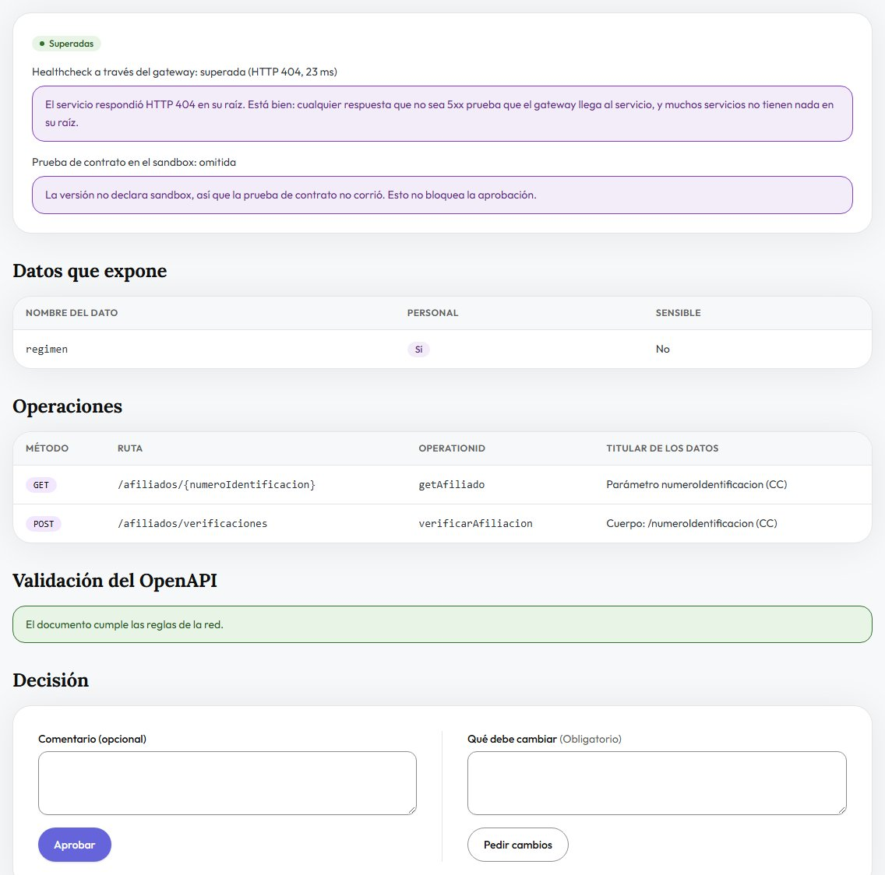

Si el operador **pide cambios**, el responsable técnico lee el comentario en la ficha, pulsa **Editar la versión**, corrige y la envía otra vez.

## 8. La entidad consumidora

<!-- roles: consumer -->

**Quién:** la entidad que va a consultar (Wanda, del *Ministerio de Bienestar de Wakanda*). **Necesitas:** el servidor donde correrá la aplicación, con OpenSSL.

### 8.1 Alta

Igual que los pasos 2 a 4, con los datos de la entidad consumidora.

> **Consejo:** Wanda puso su propio correo como responsable de datos y como responsable técnico: al aprobarse el alta recibió todos los roles, sin invitaciones que aceptar.

### 8.2 Crear la aplicación

En **Mis aplicaciones → Crear aplicación**:

1. El **nombre de la aplicación**.
2. **Para qué la usará** tu entidad.
3. El **entorno** (`Producción` para consultas reales).
4. Escribe el **correo del contacto técnico** y pulsa **Crear aplicación**.

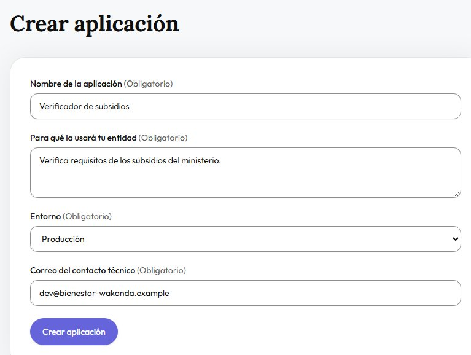

Aparece **Guarda el secreto ahora**:

1. El **Client ID** identifica a la aplicación.
2. El **Client secret** se muestra **una sola vez**: guárdalo en el gestor de secretos del servidor de la aplicación.

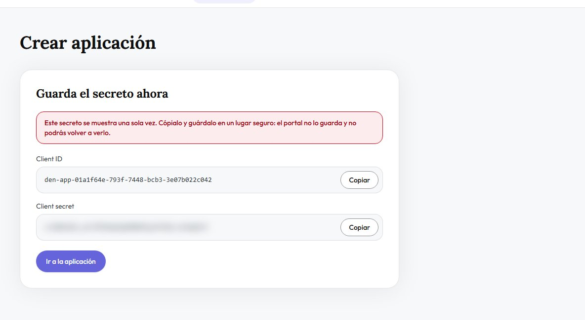

### 8.3 El certificado de la aplicación (mTLS)

La clave privada se genera **en el servidor de la aplicación** y nunca sale de ahí; al portal solo va la solicitud (CSR). En la página de la aplicación, en **Certificado de cliente (mTLS)**:

1. Elige la pestaña de tu sistema y ejecuta sus **comandos** en el servidor de la aplicación: ya traen el Client ID.
2. Pega el **CSR** completo, de `-----BEGIN CERTIFICATE REQUEST-----` a `-----END CERTIFICATE REQUEST-----`.
3. Pulsa **Solicitar certificado**.

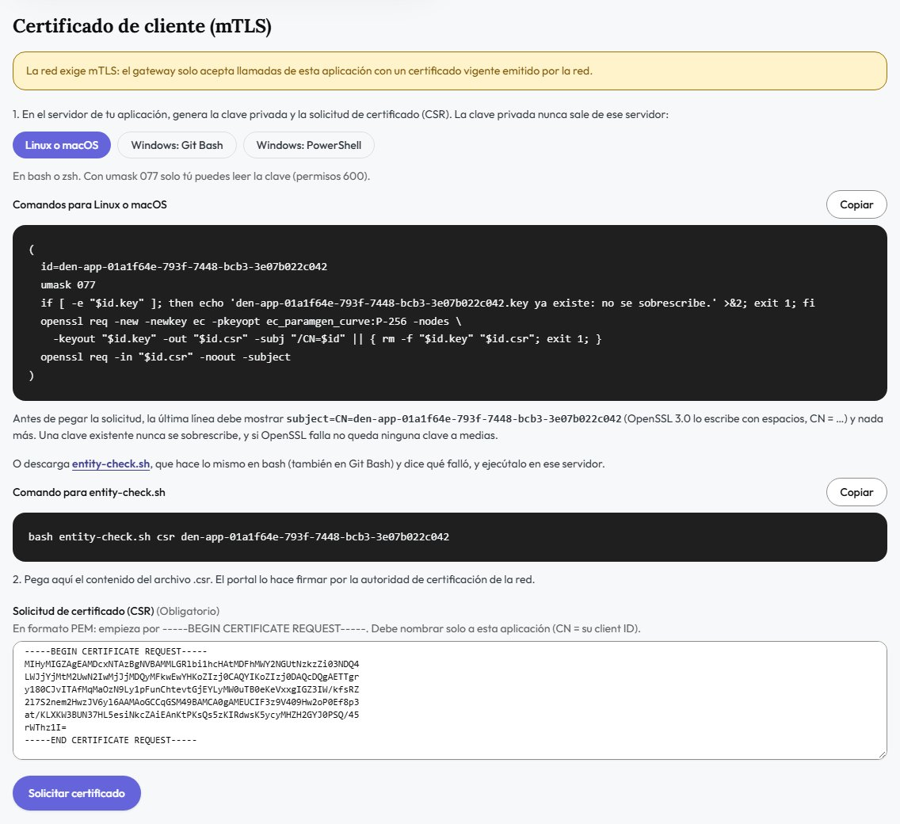

Otra opción es el script `entity-check.sh`, que se descarga desde esa misma página:

```bash
bash entity-check.sh csr <CLIENT_ID>   # crea <CLIENT_ID>.key (solo legible por su dueño) y <CLIENT_ID>.csr
cat <CLIENT_ID>.csr
```

1. Pulsa **Descargar**: se descarga como `<CLIENT_ID>.pem`. Déjalo con ese nombre junto a la clave.

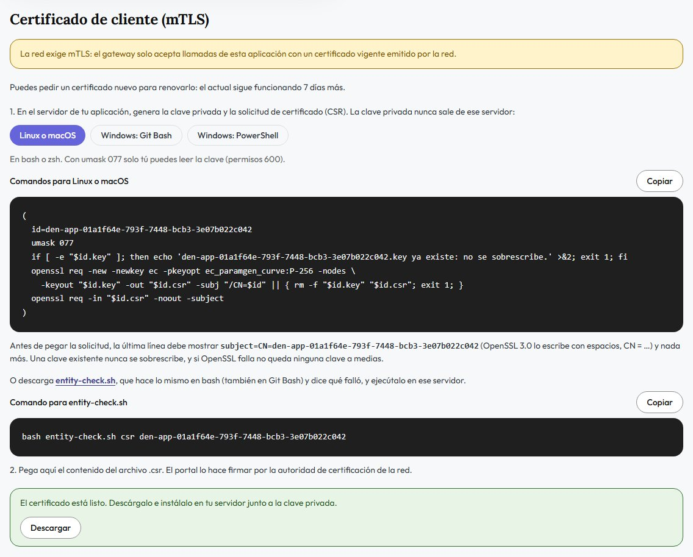

### 8.4 Pedir acceso

En el **Catálogo**:

1. **Busca** la API por nombre, resumen o etiqueta y pulsa **Filtrar**.
2. Abre la **API**.

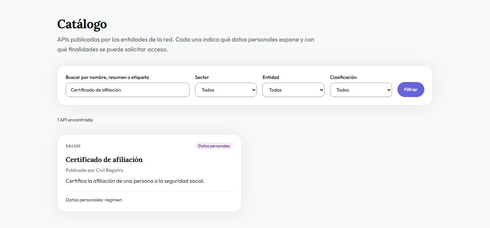

1. En la ficha de la API, pulsa **Solicitar acceso**.

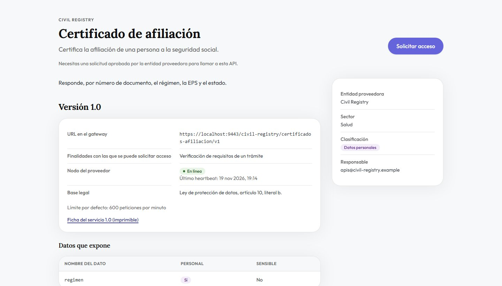

En la solicitud:

1. La **aplicación** que hará las llamadas (la del paso 8.2).
2. La **finalidad**: una de las que permite la API.
3. **Para qué usarás los datos**: el trámite o programa concreto; la entidad proveedora lo revisa.
4. La **base legal**: la norma o el convenio que te habilita a tratar estos datos.
5. La **vigencia en meses**: hasta el máximo de la clasificación (12 para datos personales).
6. Pulsa **Enviar solicitud**.

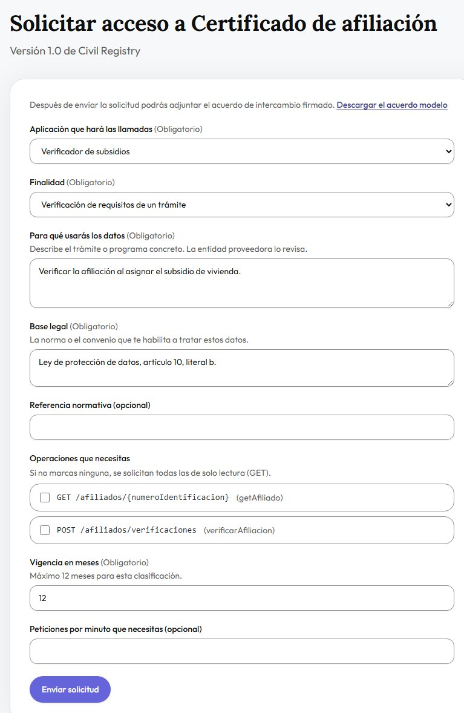

1. La solicitud queda **Pendiente del proveedor**.

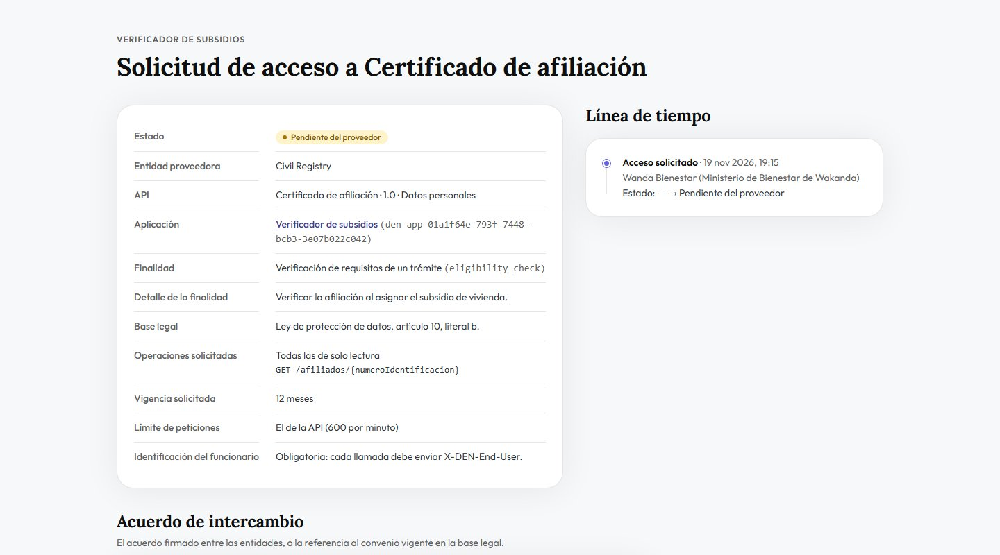

## 9. La entidad proveedora decide

<!-- roles: provider -->

**Quién:** el responsable de datos de la entidad proveedora (Diego), con su segundo factor.

1. En **Solicitudes**, abre la solicitud.

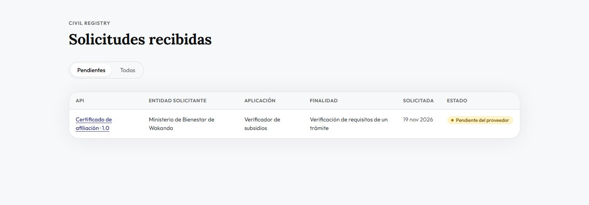

Revisa quién pide, con qué aplicación, para qué, con qué base legal y qué datos personales recibirá. Para aprobar:

1. Ajusta la **vigencia aprobada**: puedes reducir las operaciones, la vigencia o el límite, nunca ampliarlos.
2. Pulsa **Aprobar** (o rechaza con un motivo).

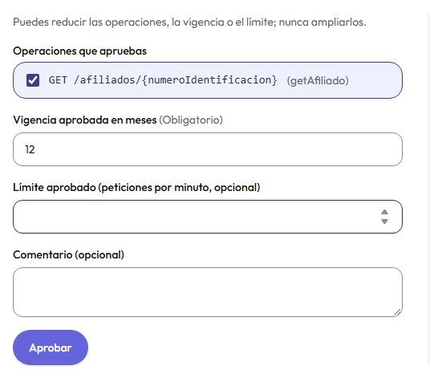

## 10. La primera consulta

<!-- roles: consumer -->

**Quién:** desarrollo de la entidad consumidora, desde el servidor de la aplicación, en la carpeta con `<CLIENT_ID>.key` y `<CLIENT_ID>.pem`.

1. La solicitud pasa a **Activa**: ya se puede consultar.

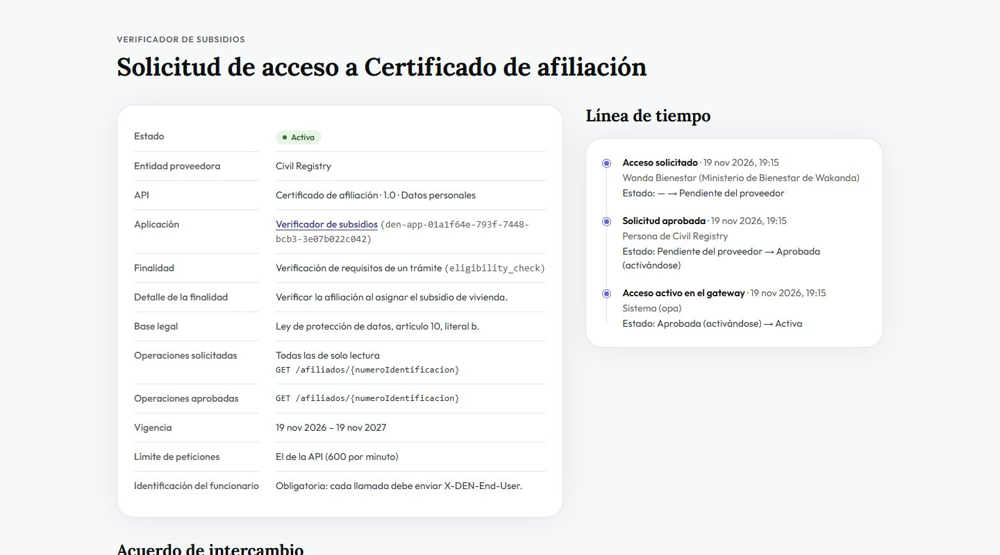

> **Consejo:** para integrar la consulta en tu sistema, abre la aplicación en **Mis aplicaciones**: su **Guía de integración** trae el programa completo en **curl, Python, Node.js, Java y C#**, ya con el Client ID de la aplicación. Cada uno pide el token con el certificado y hace la consulta con la finalidad y el funcionario; el secreto lo lee de la variable `DEN_CLIENT_SECRET`.

Para una primera prueba desde la terminal:

```bash tab="Script (Linux, macOS o Git Bash)"
./entity-check.sh check portal.example.org gateway.example.org        # llega a la red y guarda su raíz
./entity-check.sh call portal.example.org gateway.example.org <CLIENT_ID> \
  /civil-registry/certificados-afiliacion/v1/afiliados/1000000001 eligibility_check funcionario-123
```

```bash tab="curl (Linux o macOS)"
curl -fsS https://portal.example.org/api/v1/pki/ca -o red-ca.pem      # la raíz de la red
read -rs CLIENT_SECRET                                                 # pégalo: no queda en el historial
TOKEN=$(curl -fsS --cacert red-ca.pem --cert <CLIENT_ID>.pem --key <CLIENT_ID>.key \
  -u "<CLIENT_ID>:$CLIENT_SECRET" -d grant_type=client_credentials \
  https://gateway.example.org/oauth/token | sed -E 's/.*"access_token":"([^"]+)".*/\1/')
curl -sS --cacert red-ca.pem --cert <CLIENT_ID>.pem --key <CLIENT_ID>.key \
  -H "Authorization: Bearer $TOKEN" \
  -H "X-DEN-Purpose: eligibility_check" \
  -H "X-DEN-End-User: funcionario-123" \
  https://gateway.example.org/civil-registry/certificados-afiliacion/v1/afiliados/1000000001
```

- **Cada consulta declara su finalidad** (`X-DEN-Purpose`, una de las aprobadas) y **quién la hace** dentro de la entidad (`X-DEN-End-User`; la red guarda solo un seudónimo).
- El token dura unos minutos y está ligado al certificado: se pide otro cuando vence.
- Respuestas: **200** con los datos; **403** con la cabecera `X-DEN-Deny-Reason` si falta algo (`no_subscription`: no hay acceso aprobado; `end_user_required`: falta quién consulta); **404** si el registro no existe.

> **Consejo:** en Windows usa **Git Bash** y el script: el `curl` de Windows no puede usar un certificado y una clave PEM.

## Si algo falla

| Síntoma | Causa | Qué hacer |
| :-- | :-- | :-- |
| Venció el enlace de verificación | Dura 60 minutos | Inicia sesión con esa cuenta: la pantalla de verificación ofrece reenviarlo |
| "El correo ya existe" al registrarse | La cuenta se creó; solo falta verificarla | Inicia sesión y reenvía la verificación |
| **Invitaciones** sale vacía | El correo no es idéntico al de la solicitud, o no está verificado | Registra la cuenta con el correo exacto |
| No aparece un rol de plataforma | La persona no ha entrado nunca al portal | Que entre una vez y volver a darlo |
| **Aprobar** está deshabilitado | Las validaciones automáticas no han pasado | La ficha de la versión dice qué significa cada falla; corrige y **Repetir validaciones** |
| Validación con **504** | El gateway no llega al nodo por el túnel | En el nodo: `sudo /opt/den-node/install.sh status`; si la red cambió de dirección, `stop` y `start` |
| El portal rechaza el CSR | El `CN` no es el Client ID, o la clave no es ECDSA P-256/P-384 ni RSA 2048–4096 | Genera otro con el Client ID exacto |
| `schannel: Failed to import cert file` | El `curl` de Windows no puede usar el certificado y la clave PEM | Usa `./entity-check.sh call` en Git Bash |
| **403** `no_subscription` | La solicitud no está **Activa**, o la finalidad no es una de las aprobadas | Revisa la solicitud y la cabecera `X-DEN-Purpose` |
| **403** `end_user_required` | Falta la cabecera `X-DEN-End-User` | Envía quién consulta dentro de la entidad |

Más casos, sobre todo del nodo y de las APIs instantáneas, en el [recorrido completo](walkthrough.md#si-algo-falla).
