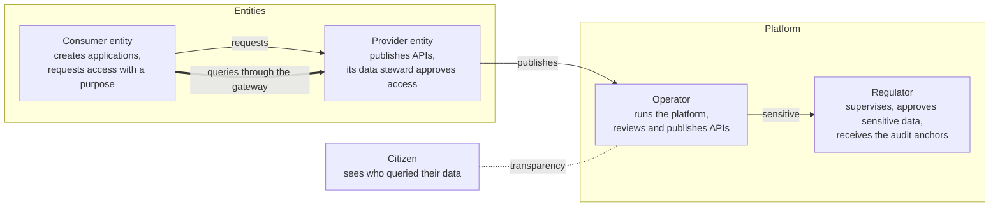
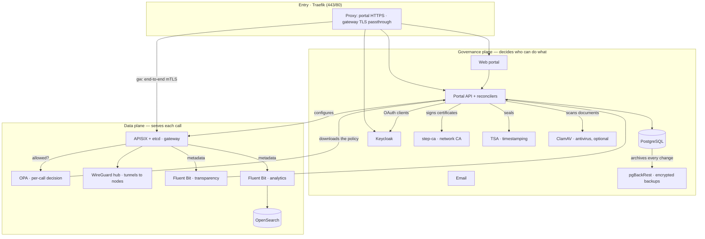
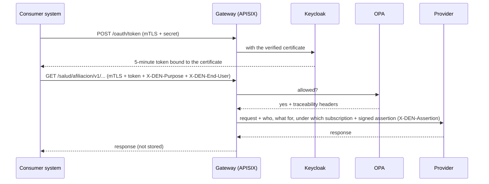

# Guide for the operator and the regulator

> Versión en español: [docs/es/guides/operator.md](../es/guides/operator.md)

Version 1.2 · November 2026 · code with milestone M6 (hardening) closed · for the network operator and the regulator

This guide explains **what each piece of the platform is, why it is there and who runs it**, and how the central infrastructure is deployed. For technical detail it refers to `ARCHITECTURE.md`, `DEPLOYMENT.md` and `OPERATIONS.md`; the step-by-step installation is in [`INSTALL.md`](../INSTALL.md).

## Suggested agenda (one-day session)

| Block | Content | Section |
| :-- | :-- | :-- |
| 1. The network on one page | What it solves, principles, who does what | §1, §2 |
| 2. Architecture | The two planes and each component | §3, §4 |
| 3. How everything flows | Publishing, requesting access, approving, calling, accountability to citizens | §5 |
| 4. Security and privacy | What the platform guarantees and how | §6 |
| 5. Live deployment | Installation on the operator's server with `install.sh` | §7 |
| 6. Operations | Day to day, backups, what to monitor | §8 |
| 7. Pilot vs. production | What is missing for production | §9 |

## 1. The network on one page

The Data Exchange Network (DEN) lets a public entity **query another entity's data** without copying it, with **explicit permission**, for a **declared purpose** and leaving **a trace of every request**.

- **The data stays at each entity.** The central gateway only passes the request and the response through; it does not store content (neither in a database nor in logs).
- **Nobody gets in without permission.** Each access is a *subscription*: a specific application, to a specific API, for a specific purpose, approved by the data steward of the entity that owns the data. If anything is missing, the gateway rejects the call.
- **Everything is audited.** Every change (who approved what, and when) goes into a hash-chained audit log that a timestamping authority seals daily: it cannot be rewritten without anyone noticing.
- **Citizens see who queried their data**, what for and when, with a verifiable receipt.
- **Only free software** with an OSI-approved license: no license costs and no vendor lock-in.
- **Reusable in any country:** everything specific to a country (authorities, document types, sectors, legal framework) is in `config/country/<code>.yaml`; `co.yaml` (Colombia) is the reference.

## 2. Who does what



| Role | Who | Can |
| :-- | :-- | :-- |
| `platform_admin` | Operator's technical team | Everything operational: approve entities, publish, manage nodes, suspend |
| `platform_reviewer` | Operator's analysts | Review entity registrations and API publications |
| `regulator` | Regulator | See everything read-only; approve publications of and access to **sensitive** data; indicators; audit |
| `auditor` | Oversight bodies | Read-only access to the audit |
| `entity_admin` | Each entity | Its people and their roles, its nodes |
| `api_publisher` | Each entity | Register its APIs and submit them for review |
| `data_steward` | Each entity's data steward | Approve, reject, suspend and revoke access to its APIs |
| `app_developer` | Each entity | Create applications, credentials and access requests |

Critical roles (platform roles and `data_steward`) require a **second factor** (a TOTP code from an authenticator app). Nobody approves what they themselves requested (separation of duties).

No screen grants platform roles yet. Each person of the operator registers in the portal, verifies the address and signs in once; then, on the server, `sudo ./install.sh platform-role grant <email> <role>` gives the role, audited (`list` shows who has which, `revoke` takes it away).

## 3. Architecture: two planes



- **Governance plane:** the portal and what surrounds it. It decides who can do what and turns that into configuration.
- **Data plane:** the gateway. It serves each call between entities with the latest configuration and the latest policy it received. **If the portal goes down, traffic keeps flowing.**
- The portal **never** configures the gateway "by hand": a *reconciler* works out from the database how APISIX, Keycloak, OPA and the hub should be set up, and adjusts them. It is idempotent: if something drifts or gets lost, the next pass (every 5 minutes, or when the API restarts) repairs it.

## 4. The components, one by one

For each one: **what it does**, **what happens if it goes down** and **what it stores**. In the pilot, they all run as containers.

### 4.1 Entry

| Component | What it does | If it goes down | Stores |
| :-- | :-- | :-- | :-- |
| **Traefik** (bundled proxy) | Receives everything on 443. For the portal name it terminates HTTPS (Let's Encrypt or your own certificate) and routes by path: `/` web, `/api/v1` API, `/auth` Keycloak. For the gateway name it **does not open the TLS**: it passes it untouched to APISIX, so that mTLS is end to end. It never exposes the internal routes (`/api/v1/internal`, `/api/v1/opa`) | Nobody gets in: neither people nor systems | Only the Let's Encrypt certificate. No access log (privacy) |

### 4.2 Governance plane

| Component | What it does | If it goes down | Stores |
| :-- | :-- | :-- | :-- |
| **Web portal** (Next.js) | The interface for everyone: catalog, interactive documentation, consoles for the operator, regulator, entity and audit. It does not decide permissions: the API does | No portal; traffic keeps flowing | Nothing |
| **Portal API** (NestJS) | The brain. It runs the workflows (registration, publication, request, approval), checks role and entity on **every** request, and records every change in the audit log. In the background it reconciles APISIX, Keycloak, OPA and the hub; signs certificates; seals the transparency log and the audit log; sends emails and notifications; expires subscriptions and certificates; rotates every 90 days the key the gateway uses to sign its assertions, and publishes the public keys (JWKS) | No portal and no changes; traffic keeps flowing with the latest state | Nothing of its own: everything is in PostgreSQL |
| **PostgreSQL** | **Single source of truth**: entities, people and roles, APIs, applications, subscriptions, audit log, transparency log, job queues. The audit log is insert-only, even for the database owner | The governance plane stops; traffic keeps flowing | Everything. **Backed up** |
| **pgBackRest** | Archives every PostgreSQL change within a few minutes (at most 5 minutes of loss), takes a full backup each week and a differential one each day, and keeps four weeks, in an **encrypted** repository. It can return to the latest state or to an exact point in time; restore is tested in CI | New changes wait to be archived; traffic keeps flowing | The encrypted repository. **Copied off the server** |
| **Keycloak** | Identity: it **authenticates, it does not authorize** (roles live in PostgreSQL). Three realms: `den-portal` (people, with a second factor), `den-gateway` (the entities' applications; the portal creates their clients) and `den-citizens` (simulated citizen identity; in production, the country's own is used) | Nobody can sign in; applications cannot get new tokens | Users and clients (in PostgreSQL) |
| **step-ca** | **The network's certificate authority.** It signs the applications' certificates (from the CSR the entity uploads: the private key never leaves the entity), the gateway's and the nodes'. Only the API talks to it | No certificates are issued; current ones keep working | The CA keys. **Losing them invalidates every certificate: they are backed up** |
| **TSA** (RFC 3161 timestamping) | Seals the audit log's daily anchor and the transparency log's batches: it proves they existed at that moment and that nobody rewrote them | Seals are queued and applied when it comes back | Its key (the development one; in production, the country's accredited TSA) |
| **Email** (Mailpit in the pilot) | Captures all email (invitations, notifications, account verification, anchors to the regulator) and shows it at `/mail`, behind a password. In production, the operator's SMTP | No emails go out | Pilot emails |
| **ClamAV** (antivirus, optional) | Scans every uploaded document (appointments, data exchange agreements) before storing it. An infected one is rejected; the log keeps the virus signature and the hash, never the name or the content | Documents cannot be uploaded (fails closed); traffic keeps flowing | Its virus signatures, which it updates from the internet |

### 4.3 Data plane

| Component | What it does | If it goes down | Stores |
| :-- | :-- | :-- | :-- |
| **APISIX** (gateway) | Every call between entities goes through here. It terminates **mTLS** (requiring the application's certificate), validates the token, strips the headers only the gateway may set, asks OPA, applies the subscription's limit, and forwards to the provider with the traceability headers and a **signed assertion** of the call. **It does not store bodies** | Traffic stops | Nothing (its configuration is in etcd) |
| **etcd** | Gateway configuration (routes, upstreams, certificates). It is rebuilt from PostgreSQL | APISIX keeps going with what it has in memory, with no new changes | Rebuildable configuration |
| **OPA** | **Decides each call** with the policy the portal publishes (current subscriptions, purposes, operations, certificate fingerprints). It answers "yes" or "no, for this reason" (`no_subscription`, `purpose_not_allowed`…). It does not query the portal's database online. Without a policy, it **denies everything** (fails closed) | Traffic stops | The latest policy, on disk: if it restarts without the portal, it keeps deciding with it. It refreshes it every 10–20 s |
| **WireGuard hub** | The central end of the encrypted tunnels that the **kit's nodes** open from each entity's network, from the inside out (the entity opens no inbound ports). The gateway reaches the node through the tunnel, with end-to-end mTLS. A node cannot reach other nodes or the platform | APIs served by nodes do not respond | Latest state of the tunnels |
| **Fluent Bit (transparency)** | Carries from the gateway to the portal the record of every **authorized** request for a person's data: who, what for, under which subscription, and the data subject's **pseudonym** (never their document number) | Records wait in its on-disk buffer | Temporary buffer |
| **Fluent Bit (analytics) + OpenSearch** | A second privacy barrier: it only lets allowed metadata through (no real path, no query string, no body) and stores it for the usage indicators | That metadata is lost; traffic is not affected | Usage metadata (expendable) |
| **Prometheus + Alertmanager + Grafana** | Metrics for the gateway, the API and OPA; nine alerts for the operator (5xx, latency, service down, stale policy, failed reconciliation, nodes offline, certificates about to expire, backed-up queue), delivered by email; dashboard at `/grafana` | No alerts; traffic is not affected | Metrics (30 days) |
| **Contract runner** (Schemathesis) | When an entity submits an API for review, it tests the API's OpenAPI contract against the sandbox. The operator only approves once the checks pass | Contracts are not tested | Nothing (it discards the report) |

### 4.4 Pilot tooling (does not go to production)

- **Test providers** (`mock-salud`, `mock-socioeconomico`): they simulate two entities with synthetic data.
- **Reference citizen app** (`/citizen-app`): shows what the country's real citizen app must implement (requests, notifications, receipts).
- **Seed data:** three fictitious entities and the demo users.

## 5. How everything flows

### 5.1 Publishing an API

```
draft → in review → approved by the operator → [approved by the regulator, if sensitive] → published
```

1. The entity's publisher uploads the OpenAPI contract and states where the service lives, which data it exposes, the legal basis and the allowed purposes.
2. When it is submitted for review, the portal tests connectivity (through the gateway) and the contract against the sandbox.
3. The operator reviews the API's details and data minimization. If the classification is **sensitive**, the regulator approves too.
4. Once published, the route appears in the gateway within seconds, **closed**: with no subscriptions, nobody gets in.

### 5.2 Requesting and granting access

```
pending provider → [pending regulator] → approved → active → (suspended | revoked | expired)
```

1. The consumer entity's developer creates an application: it gets a secret (shown only once) and uploads its CSR to obtain its certificate.
2. They request access: API, operations, **purpose** from the catalog, details, legal basis, validity period and data exchange agreement.
3. The provider's data steward approves (and can reduce operations, limit or validity period), rejects, or asks for more information.
4. Within 60 seconds OPA has the new policy and the subscription becomes **active**. Suspending or revoking also takes effect within 60 seconds.

### 5.3 A call



With each request, the provider receives the consumer entity and application, the subscription, the purpose, the operation and the official's hash: it no longer sees "only the gateway". With the **signed assertion** (one JWS per call, bound to the method, the URI and the body) it can also check, using the public keys at `https://<portal>/api/v1/gateway/jwks`, that the request went through the gateway and was not altered.

### 5.4 Accountability to citizens

Every authorized request for a person's data is recorded in the transparency log with the data subject's pseudonym. Every 10 seconds the records are grouped into batches signed by the operator and sealed by the TSA. From their folder, citizens see who queried them and what for, receive notifications, and download a receipt that **anyone can verify without trusting the portal** (the open verifier `den-verify-receipt`).

## 6. Security and privacy: what the platform guarantees

| Guarantee | How |
| :-- | :-- |
| Only identified systems reach the gateway | Mandatory mTLS with certificates from the network's CA; 5-minute tokens **bound to the certificate** (a stolen token is useless without the private key) |
| Only approved access | OPA decides each call with the current subscriptions; it fails closed |
| Content is not stored | Neither the gateway nor the logs store bodies; paths and query strings are masked; two barriers (APISIX + Fluent Bit) |
| The data subject is not exposed | Only a keyed pseudonym (HMAC), in the transparency log, never in the analytics |
| Nobody rewrites history | Hash-chained, insert-only audit log, with a daily anchor sealed by the TSA and sent to the regulator |
| Protected accounts | Second factor for critical roles; the owner is notified when a credential changes |
| Server-side authorization | Every endpoint checks role and entity; the full matrix is in `AUTHZ.md`, and tests verify it |
| Isolated entities | Each provider using mTLS accepts only the gateway certificate issued for it; a node cannot reach other nodes |
| The provider knows the request is legitimate | An assertion signed by the gateway on every call (ES256), bound to the request and to that provider, verifiable with a public JWKS. A forged header from the client is discarded |
| Reviewed against standards | OWASP ASVS level 2, chapter by chapter (`docs/security/ASVS-L2.md`), and WCAG 2.1 AA on all 42 screens, in Spanish and in English (`docs/accessibility`) |

## 7. Deploying the operator's infrastructure (live)

Full details in [`INSTALL.md`](../INSTALL.md). Summary:

1. **Requirements:** a Linux VPS with 4–8 vCPUs, 16 GB of RAM and a 100 GB SSD; a public IP; **two DNS names** (portal and gateway); ports 443/tcp, 80/tcp and 51820/udp open.
2. **Install:**
   ```bash
   git clone https://github.com/centre-for-dpi/data-exchange-admin-portal.git den && cd den
   sudo ./install.sh
   ```
   The script asks for the country, the two names, the proxy and the certificate, whether to enable observability and the document antivirus, and the demo password (12 characters or more). It then generates all the secrets, builds, starts and checks everything.
3. **Hand over:**
   - an encrypted copy of `.env`, kept off the server (in the operator's custody);
   - the credentials (`sudo ./install.sh credentials`) to the right people;
   - the demo users' second factor, enrolled on the phone of whoever will use them (`sudo ./install.sh otp` gives the key).
4. **Check:** `sudo ./install.sh status` and the walkthrough in `DEMO.md`.

**Who keeps what after the installation:**

| Secret | Why it matters | Suggested custodian |
| :-- | :-- | :-- |
| The full `.env` | Without it, the data cannot be recovered and receipts cannot be verified | Operator, encrypted copy off the server |
| `DEN_SUBJECT_REF_KEY`, `DEN_END_USER_HASH_SALT` | They define the pseudonyms; **they are not rotated** | Operator |
| The step-ca volume | The network CA's keys | Operator (encrypted backup) |
| `PGBACKREST_REPO1_CIPHER_PASS` | Encrypts the database backups: without it, none of them can be restored | Operator, copy off the server, next to the `.env` |
| `DEN_SECRETS_KEY` | Seals the clients' secrets and the key the gateway signs with | Operator, inside the `.env` |
| Keycloak administrator | Control over identities | Operator, two people |
| Users with the `regulator` role | Oversight | Regulator |

## 8. Day-to-day operations

- **Daily** (`OPERATIONS.md §4.1`): healthy services (`sudo ./install.sh status`), nothing out of sync with the gateway, an intact audit chain (Console → Audit → "Verify integrity"), an intact transparency log.
- **Backups:** the database backs itself up (pgBackRest): every change is archived within a few minutes and there is a backup every day, with a month of history. Run `sudo ./install.sh backup` before each update and regularly, to take a copy off the server. Also keep the `PGBACKREST_REPO1_CIPHER_PASS` key from the `.env` off the server: without it, nothing can be restored.
- **Restore:** `sudo ./install.sh restore` returns to the latest state; `sudo ./install.sh restore "2026-11-20 14:30:00-05"`, to that point in time (`OPERATIONS.md §6`).
- **Update:** `sudo ./install.sh update`, which backs up, updates, rebuilds and restarts.
- **Operator runbook** (`RUNBOOK.md`): registering an entity up to its first published API, suspension and offboarding; incidents with severities and a procedure for each case; rotation of the intermediate CA, planned and emergency; mass certificate revocation.
- **Mass certificate revocation:** Console → Mass certificate revocation, only `platform_admin` with a second factor. It filters by entity, by issue date and by intermediate, shows a preview, and revokes only if the set has not changed. Each certificate stops working within 60 seconds and the developers receive a notification. It cannot be undone.
- **Gateway signing key:** the portal rotates it on its own every 90 days; the previous one stays in the JWKS so that archived assertions keep verifying. If it is compromised, rotate it immediately as compromised (`POST /api/v1/admin/gateway-signing-keys/rotate`) and notify the providers (`RUNBOOK.md §2.2`).
- **When updating** a pilot installed before automatic backups existed, `update` adds the backup encryption key to the `.env` and says so: save the copy of the `.env` again.
- **Never** fix APISIX or Keycloak by hand: the reconciler reverts it. If something does not add up, look at `sync_state` (`OPERATIONS.md §4.2`).
- **Alerts** (with observability enabled): Prometheus monitors the gateway, the API and OPA, and Alertmanager emails the operator (in the pilot, to `/mail`) when there are many 5xx responses or high latency, a service does not respond, OPA falls behind on the policy, a reconciliation fails, nodes are offline, a certificate is about to expire, or the job queue backs up. The operator's dashboard is at `https://<portal>/grafana/`.

## 9. Pilot today vs. production

| Topic | Pilot (this installation) | Production |
| :-- | :-- | :-- |
| Topology | One server, with Docker Compose | Kubernetes with the Helm charts in `infra/helm`: ≥ 2 gateway nodes in different zones, portal and API replicas, a 3-member etcd, PostgreSQL with a replica, ingress and egress NetworkPolicies |
| Internal traffic | Separate Docker networks (gateway, providers, everything else) | In addition, TLS between components with an internal PKI (cert-manager) |
| Images | Built on the server | Published, versioned images, with their SBOM and vulnerability scanning (Trivy) |
| CA | Development CA on a volume | Offline root, intermediate in an HSM |
| Timestamping | Development TSA | The country's accredited TSA |
| Email | Mailpit | The operator's SMTP |
| Secrets | `.env` on disk | Secrets manager (OpenBao) |
| Citizen identity | Simulated (`den-citizens`) | The country's own |
| Initial data | Fictitious entities and demo users | No demo data; the first `platform_admin` is whoever signs in first with the address in `DEN_BOOTSTRAP_ADMIN_EMAIL`, verified by Keycloak (`DEPLOYMENT.md §9`) |
| Antivirus | Optional (installer step 5) | Enabled, with two replicas |
| Backups | Automatic with pgBackRest on the same server; the off-server copy with `install.sh backup` | Automatic, to the operator's object storage (Barman Cloud) |
| Metrics and alerts | Prometheus, Alertmanager and Grafana on the same server; notifications to Mailpit | The same, with the operator's SMTP and long-term metrics storage |

**What is already tested and what is missing:**

- **Resilience, tested** (`docs/performance/M6-04.md`): with the portal down for 45 seconds, both allowed and denied calls kept going, each as it should. OPA and APISIX restart without the portal. When it came back, the transparency log had every request from the outage, and a revocation reached the gateway in 18 seconds.
- **Backups, tested:** restore is tested in CI: loss of the volume, return to a point in time, and a repository that is unreadable without its key.
- **Load, partly tested** (`docs/performance/M6-03.md`): on the development machine, the gateway serves 200 requests per second with a p95 of 13 ms over the network at its initial scale (200 entities, 1,000 APIs, 5,000 subscriptions). The target is 500 per second with a p95 under 50 ms. It will be validated in a production-like environment, with the load generator on another machine.
- **Helm charts, not yet installed:** they are complete and statically validated. They will be installed for the first time in the operator's environment, together with a restore from its object storage.

**Decisions for the operator and the regulator:**

| Decision | Today | What it implies |
| :-- | :-- | :-- |
| Second factor for `entity_admin` and `api_publisher` | Only the platform roles (including `regulator` and `auditor`) and `data_steward` | ASVS level 2 requires it for all access. It is a configuration setting, but it changes how entities sign in |
| Public catalog | Off (`features.publicCatalog`) | When on, anyone can see the APIs with a public classification, without the steward's contact details or the status of the nodes |
| Signed gateway assertion | On (`features.gatewayAssertion`) | Each provider can verify it, and decide whether to require it |
| Tests with screen readers and with users | The automated accessibility review passes on every screen | Recommended before production (NVDA, VoiceOver) |
| Production TSA, CA and email | Development ones | Accredited TSA, HSM for the intermediate, and the operator's SMTP |

## 10. Frequently asked questions

- **Can the operator see the data being exchanged?** No. The gateway passes it through without storing it, and the logs only hold masked metadata.
- **What happens if the portal goes down?** Traffic between entities keeps flowing with the latest configuration and the latest policy. Only changes stop (new approvals, publications). It is tested: with the portal down, calls keep going; OPA and APISIX restart without it, and when the portal comes back it recovers the transparency records from the outage.
- **How does the provider know a request really comes from the gateway?** Through the signed assertion (`X-DEN-Assertion`): one JWS per call, bound to the method, the URI, the body and that provider, which it verifies with the portal's public keys. An assertion the client tries to slip in is discarded. The entity guide has verification examples in Node.js and Python.
- **How much traffic can it handle?** On the development machine, 200 requests per second with a p95 of 13 ms added by the gateway. The target, 500 per second, will be validated in a production-like environment. Capacity grows with more gateway nodes: each one counts limits on its own, and the policy gives it its share.
- **Is the portal available in English?** Yes, fully, in addition to Spanish, which is the default language. The emails and the citizen app are bilingual too.
- **Does an entity have to open inbound ports?** Not if it uses the kit: the node opens the tunnel outbound (UDP 51820). With an existing API, the entity must allow the gateway to reach it.
- **Can it be integrated with X-Road?** Yes: the gateway can use an operator's Security Server as an X-Road client (`ARCHITECTURE.md §10`).
- **Who approves access to sensitive data?** The data steward of the entity that owns the data and, in addition, the regulator.
- **How do you prove the audit log was not altered?** With the console's integrity check and with the daily anchor the regulator receives by email, sealed by an independent TSA.
- **Can it be taken to another country?** Yes, without changing code: a new `config/country/<code>.yaml` and the i18n texts. It is tested with an "example country" brought up from the `example.yaml` template (`pnpm example:country`): the full demo passes with its own sectors, purposes and document type.
