# User manual: from the first account to the first lookup

> Versión en español: [docs/es/guides/user-manual.md](../es/guides/user-manual.md)

<!--
How this manual is written (scripts/user-manual-html.mjs turns it into user-manual.html):
  <!- - roles: operator,provider,consumer,server - ->  after a "## ": who does the section
    a screenshot; its numbered boxes point, in
      order, at the items of the numbered list right before it
  > **Tip:** / > **Attention:**  tip and warning boxes
  ```bash tab="…"  consecutive blocks with tab="…" form tabs
The screenshots come from the real portal through `pnpm docs:manual --yes`; never edit them by hand.
-->

This manual takes the people who make one entity publish an API on the network, and another one consult it, through every step: creating the accounts, onboarding the entities, installing the node, publishing, approving, requesting access and making the first lookup. Every step has a screenshot of the portal with numbers on what to click or fill: select a number to jump to its instruction, or the screenshot to see it larger.

The screenshots were taken on a test network with synthetic data. Use these example values and replace them with yours:

| What | Example |
| :-- | :-- |
| Portal | `https://portal.example.org` |
| Gateway (its own name, for mTLS) | `https://gateway.example.org` |
| Provider entity | *Civil Registry*, identifier `civil-registry`, NIT `900000100` |
| Consumer entity | *Ministry of Welfare of Wakanda*, identifier `bienestar-wakanda`, NIT `900000200` |
| API | *Affiliation certificate*, identifier `certificados-afiliacion` |
| Node and service | Node `nodo-principal`, service on the node's path `/salud` |
| Test record | Document `1000000001` |

## Who does what

| Role | In the screenshots | What they do |
| :-- | :-- | :-- |
| **Network operator** | Ana (review) and Pablo (platform administration) | Approves entity onboarding and API publications; grants the platform roles |
| **Portal server** | Whoever administers the server | Grants the first platform role with a command |
| **Entity administrator** | Rosa Registro, of *Civil Registry* | Requests the onboarding, registers the node and hands over its token |
| **Data steward** | Diego Datos, of *Civil Registry* | Approves or rejects each access request to the entity's APIs |
| **Technical lead** | Tomás Técnico, of *Civil Registry* | Publishes the entity's APIs |
| **Infrastructure** of the provider | The team that runs its servers | Installs the node and connects the API |
| **Consumer entity** | Wanda Bienestar, of the *Ministry of Welfare of Wakanda* | One person with every role: creates the application, its certificate and requests access |

One person can hold several roles in their entity. What the portal never allows is approving what you yourself requested.

## Before you start

- **An authenticator app** on a phone (Google Authenticator, Microsoft Authenticator or any TOTP app). Critical roles need it: the platform roles, the entity administrator and the data steward.
- **Password:** at least 12 characters, different from the username and the e-mail, not one of the last 5.
- **The verification link lasts 60 minutes.** Have your mailbox open before registering. On a test network the portal's e-mails go to the test mailbox (`/mail`).
- **One private window per person** when playing several roles from the same computer, so sessions do not mix.

## 1. The operator's team

<!-- roles: operator,server -->

**Who:** each person of the operator, and whoever administers the portal's server. **You need:** each person's institutional e-mail.

### 1.1 Create the account

Everyone, of the operator or of an entity, creates their account the same way:

1. In the registration form, choose a **username** and type your institutional **e-mail**.
2. Type your **first and last name** as they will appear in the portal.
3. Select **Register**, open the verification e-mail and set your password.

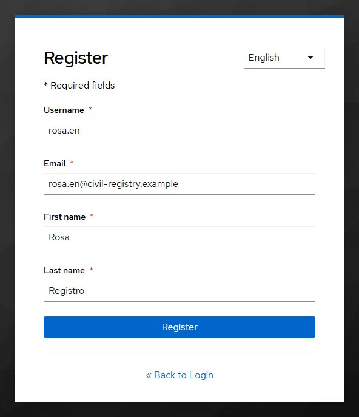

The first time you sign in, the portal says you have no roles yet: that is expected. Signing in once is what creates your account in the portal.

### 1.2 The first platform role, from the server

The first `platform_admin` (and recovery, if one day none is left) is granted on the portal's server:

```bash
sudo ./install.sh platform-role grant <email> platform_admin --reason "Technical team"
sudo ./install.sh platform-role list
```

### 1.3 The other roles, from the console

With their second factor set up, the `platform_admin` grants the other roles in **Operator console → Platform roles and accounts → Grant a role**:

1. The **e-mail** the person registered with.
2. The **role**: `Operator reviewer` (approves onboarding and APIs), `Platform administrator`, `Regulator` or `Auditor`.
3. The **reason**, for the audit log: who asked for it and on what grounds.
4. Select **Grant the role**.

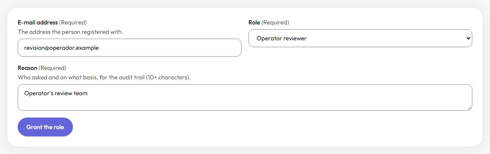

The person signs in again: Keycloak asks them to register the authenticator app (as in step 4.1), and from then on they see the **Operator console**.

### 1.4 Disable the demo accounts

Once the operator's own team has its roles, whoever runs the server disables the pilot's demo accounts:

```bash
sudo ./install.sh demo-users disable --reason "The operator's team has its roles"
```

> **Attention:** this cannot be undone from the installer. The command refuses if no `platform_admin` of your own is left active.

## 2. The provider entity requests its onboarding

<!-- roles: provider -->

**Who:** the person who will be the entity's administrator (Rosa). **You need:** the entity's details, the name and exact e-mail of its two officers, and the designation document as a PDF.

### 2.1 Open entity onboarding

1. Create your account as in step 1.1 and, on the home page, select **Entity onboarding**.

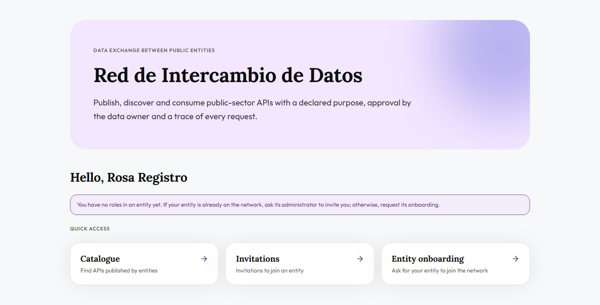

### 2.2 Fill in the request

1. The entity's **identifier**: it is the first segment of its routes on the gateway (`civil-registry`) and does not change later.
2. The **data steward's exact e-mail**: their invitation goes to that address.
3. The **technical lead's exact e-mail**.
4. Select **Create the request**.

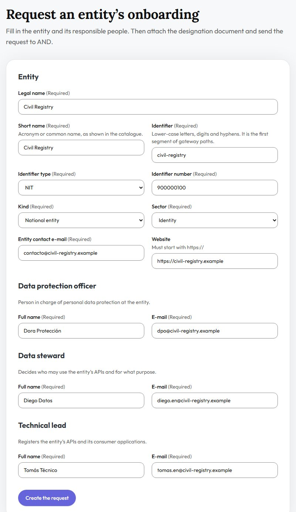

| Field | Example |
| :-- | :-- |
| Legal name / Short name | `Civil Registry` |
| Identification type and number | `NIT` · `900000100` |
| Kind / Sector | `National entity` · `Identity` |
| Contact e-mail, website | The institutional ones |
| Data protection officer | Name and e-mail |

> **Tip:** if one person will hold several roles, put their own e-mail in those fields: when the onboarding is approved they get the roles directly, with no invitations.

### 2.3 Upload the document and send

1. Upload the **designation document** (PDF, at most 10 MB): the act or letter that designates the officers, with the same names and e-mails, signed by whoever has the authority.
2. Select **Send for review**.

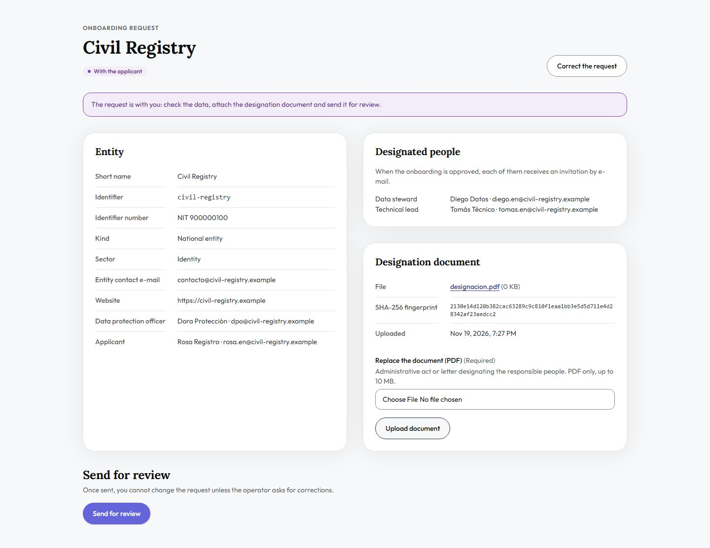

Once sent it can no longer be edited, unless the operator asks for corrections.

## 3. The operator approves the onboarding

<!-- roles: operator -->

**Who:** a person with the reviewer or platform administrator role, who is not the one who requested the onboarding (Ana).

1. In the **Operator console**, open the request under **Entity onboarding to review**.

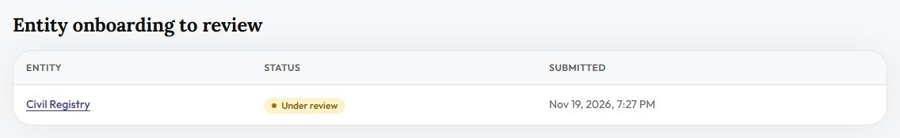

Check the details, the document and that the e-mails are institutional. Then decide:

1. **Approve the onboarding**. The other options are **Request corrections** (the applicant reads your comment) or **Reject** (final; frees the identifier).

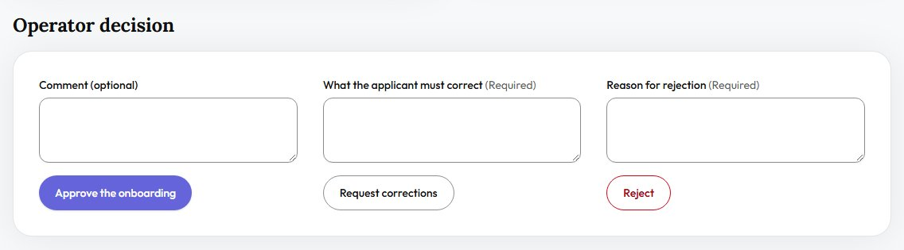

When approved, whoever requested the onboarding becomes the entity's administrator and each officer gets an invitation by e-mail, valid for 14 days.

## 4. The officers join the entity

<!-- roles: provider -->

**Who:** the administrator (Rosa), the data steward (Diego) and the technical lead (Tomás).

### 4.1 The administrator sets up the second factor

The next time she signs in, Keycloak asks the administrator to set up her authenticator app:

1. Scan the **QR code** with the app.
2. Type the **6-digit code** the app shows.
3. Select **Submit**.

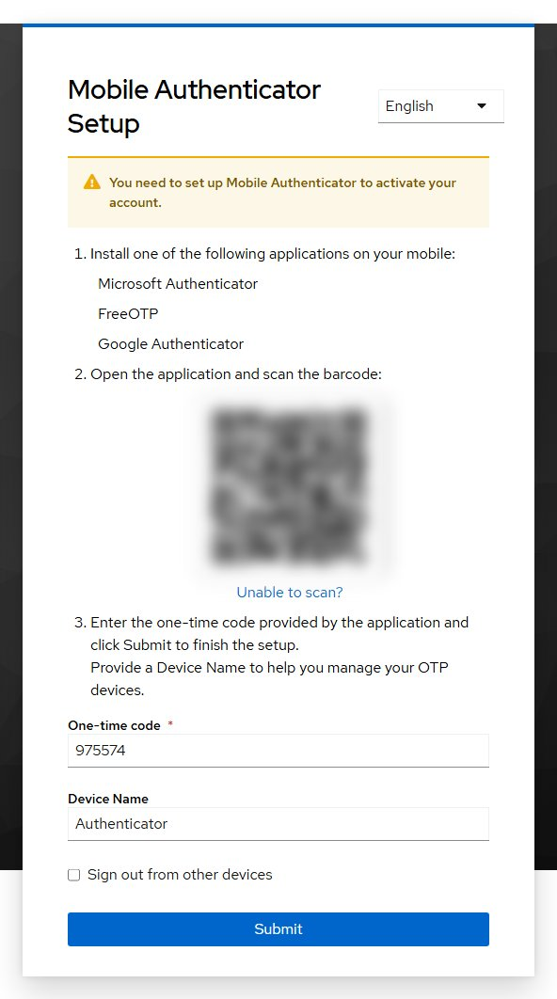

Until then she cannot act for the entity. From then on she sees **My entity**.

### 4.2 The officers accept their invitation

Each officer registers with **exactly** the e-mail in the request, verifies it and signs in:

1. In **Invitations**, select **Accept** on the entity's invitation.

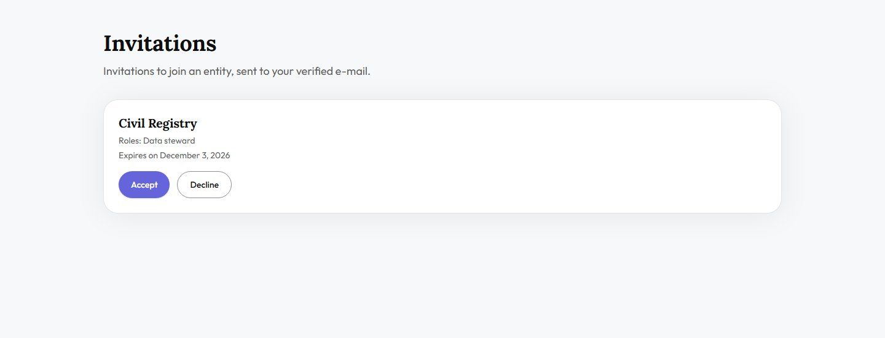

The data steward registers their authenticator app the first time they work in the entity, as in step 4.1.

> **Attention:** if **Invitations** is empty, the registration e-mail is not identical to the one in the request, or it is not verified.

## 5. The entity's node

<!-- roles: provider -->

The node is the secure channel between the network's gateway and the entity: it opens a tunnel **outwards**, with no inbound ports, and only accepts the gateway. Every provider entity comes in through its node.

**Who:** the administrator registers the node; infrastructure installs it. **You need:** an Ubuntu Server 22.04 or 24.04 server (amd64 or arm64) with internet access on UDP 51820 and TCP 443, and its clock in sync.

### 5.1 Register the node

1. In **My entity**, select **Kit nodes**.

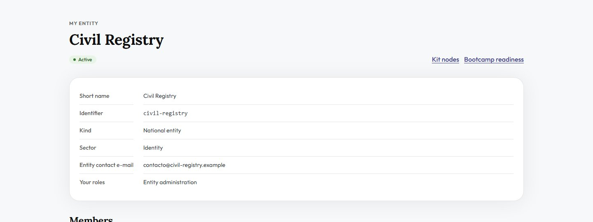

Under **Register a node**:

1. Type a **name** unique in the entity, for example `nodo-principal`.
2. Select **Register and issue token**.

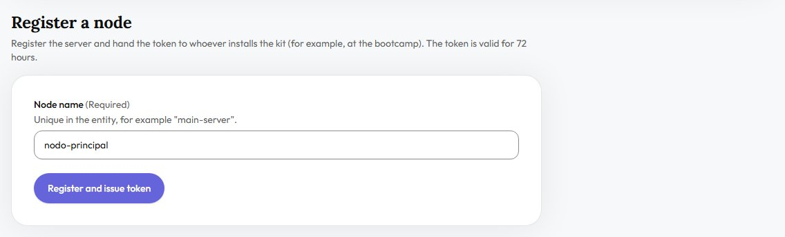

1. **Copy the token right then** and hand it to whoever installs the node.

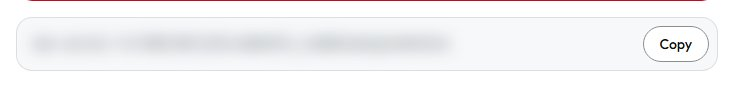

### 5.2 Install the node

The commands of the current version, with its checksum and the portal's address already in place, are under **Kit to install**, on the same page:

1. Copy the **commands** and run them on the node's server.

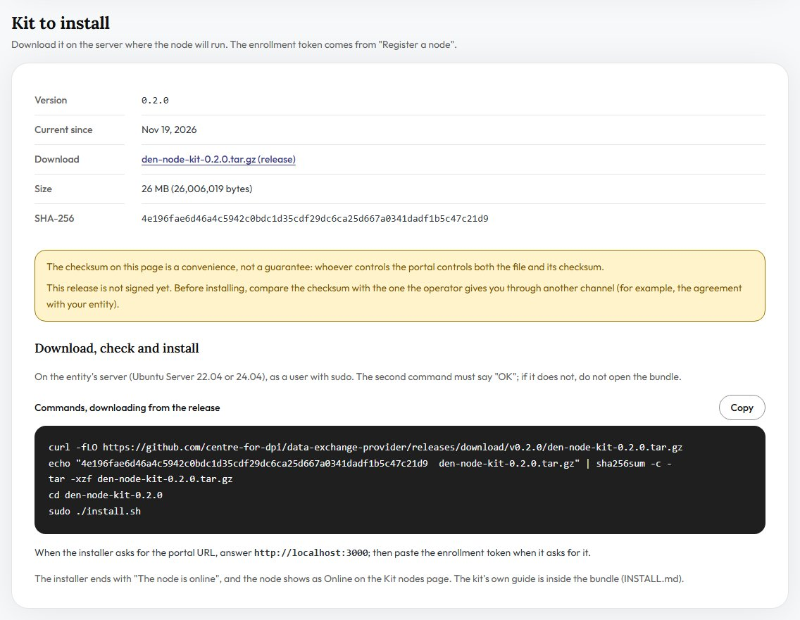

They have this shape (the checksum and the link are the current version's):

```bash
curl -fLO https://github.com/centre-for-dpi/data-exchange-provider/releases/download/v0.2.0/den-node-kit-0.2.0.tar.gz
echo "<SHA-256 checksum>  den-node-kit-0.2.0.tar.gz" | sha256sum -c -     # must say: OK
tar -xzf den-node-kit-0.2.0.tar.gz
cd den-node-kit-0.2.0
sudo ./install.sh
```

| Installer question | Answer |
| :-- | :-- |
| Mode | `canal` if the entity already has its API; `completo` for instant APIs over its database |
| Corporate proxy | `n`, or the proxy's address |
| Portal URL | `https://portal.example.org` |
| Token | The one from step 5.1 (it is not shown while pasted) |

The installer checks the system, installs Docker if missing and ends with **"The node is online"**.

### 5.3 Connect the API to the node

If the entity already has its API (`canal` mode):

```bash
sudo /opt/den-node/install.sh service
```

| Question | Example |
| :-- | :-- |
| Type | `proxy` |
| Service name | `afiliacion` |
| Path on the node | `/salud` (the portal asks for it in step 6.2) |
| Internal URL of the API | `http://api-afiliacion:8000` |
| Credential the internal API requires | `none`, `header`, `basic` or `certificate`; it never leaves the entity |
| The API's OpenAPI | The path of the **same file** uploaded to the portal |

If the entity has no API, the node publishes a **view** of its database as a lookup by key (`completo` mode, instant APIs). Preparing the view, the read-only user and the service file are in the [full walkthrough, step 5](walkthrough.md#5-the-entity-s-node).

To finish: `sudo /opt/den-node/install.sh doctor`, everything ✔.

### 5.4 Check it is online

1. Under **Kit nodes**, the node shows **Online** and its token **Used**.

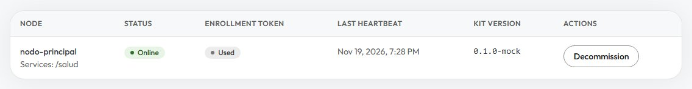

## 6. The technical lead publishes the API

<!-- roles: provider -->

**Who:** the technical lead (Tomás). **You need:** the OpenAPI file configured on the node, the regulation that allows sharing the data, and the list of data the API exposes.

### 6.1 Register the API

In **My APIs → Register API**:

1. The **identifier in the URL**: it forms the public route `/civil-registry/certificados-afiliacion/v1`.
2. The **classification**: `Public`, `Internal`, `Personal data` or `Sensitive data` (sensitive data APIs are also approved by the regulator).
3. Select **Register API**.

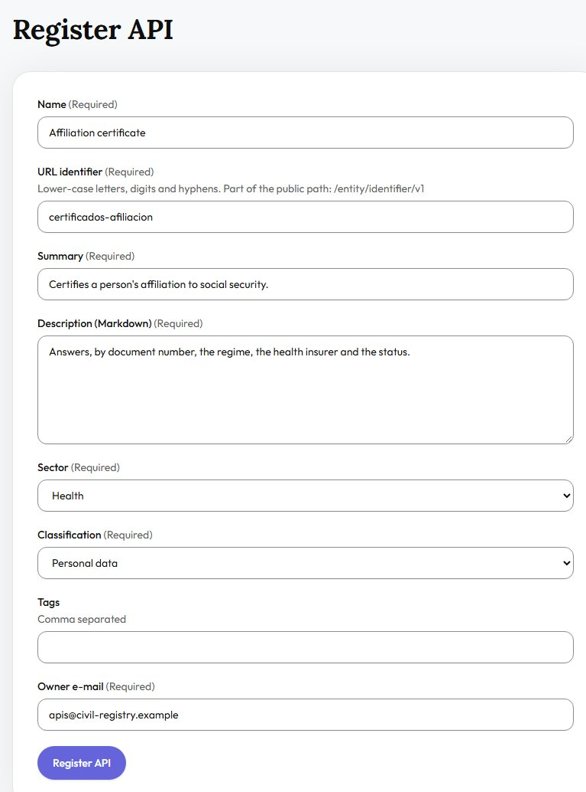

### 6.2 Create the version

In the API, select **New version** and type the version (`1.0`). Then, where the service lives:

1. Upload the **OpenAPI file**: the same one configured on the node.
2. Choose the **kit node** from step 5.1.
3. Type the **service path on the node** (`/salud`).

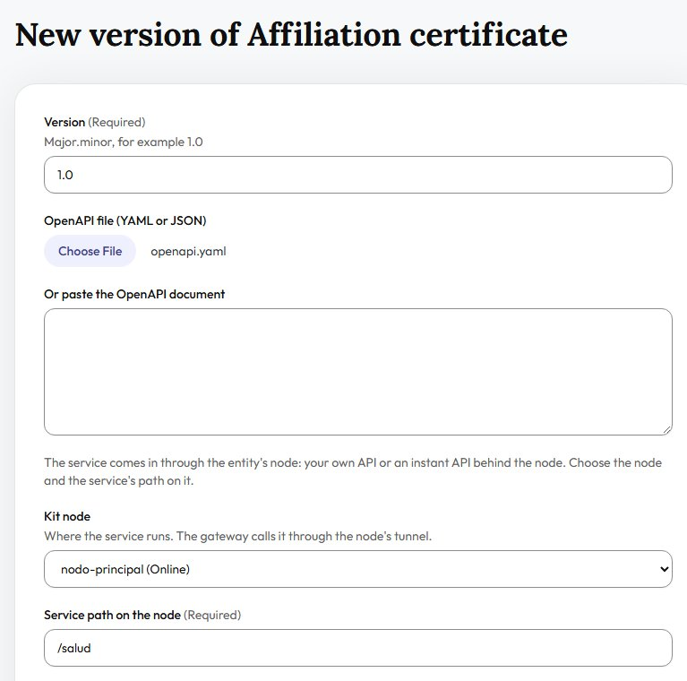

And what the network needs to know about the data:

1. Tick the **allowed purposes**, for example *Eligibility check for a procedure*.
2. Type each **data field** the response exposes, ticking the personal and sensitive ones.
3. Type the **legal basis**: the regulation that allows sharing the data.
4. Select **Create version**.

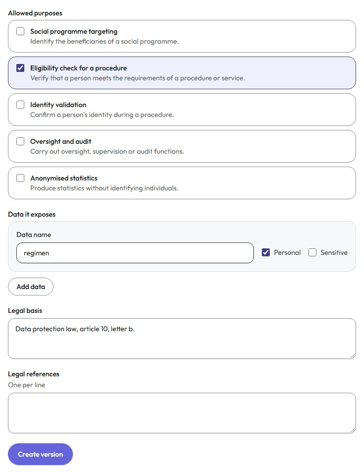

> **Attention:** common contract errors: an identification number in the query (`?document=`) instead of in the path, repeated `operationId`s, external references and, in personal data APIs, not declaring whose data it is (`x-den-data-subject`).

### 6.3 Send for review

1. Check the version sheet (each operation and where the data subject goes) and select **Send for review**.

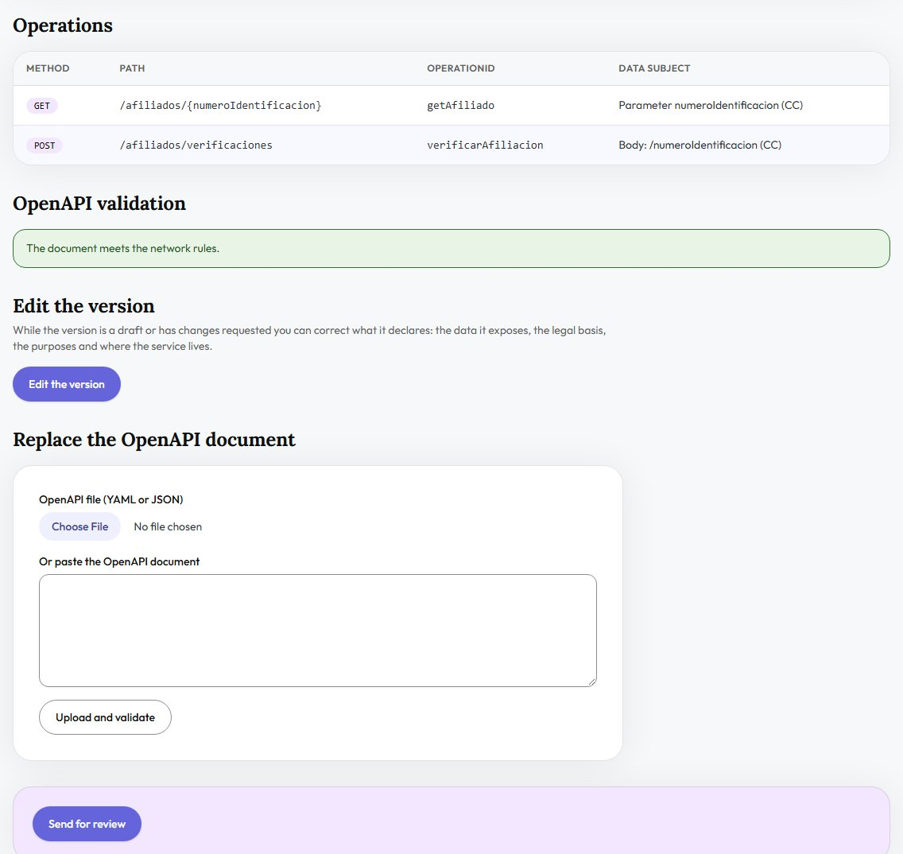

The portal runs the **automatic validations**: they call the service through the gateway, the tunnel and the node.

1. Wait until they say **Passed**.

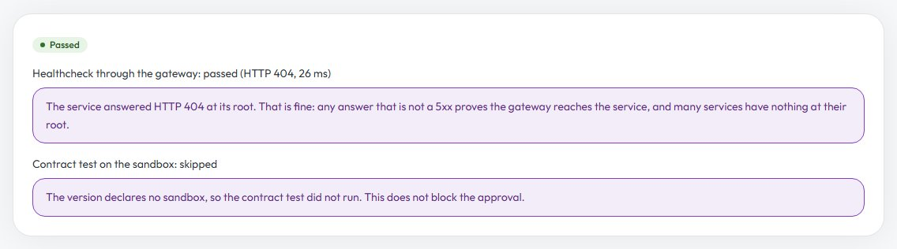

Validations can be repeated once every 5 minutes per version.

## 7. The operator approves the API

<!-- roles: operator -->

**Who:** a person of the operator with the reviewer role (Ana).

In **Operator console → Versions in review**, open the version and check the contract, the data it exposes and the purposes:

1. Check the **automatic validations** passed: with failed validations the portal does not allow approving.
2. Select **Approve**.

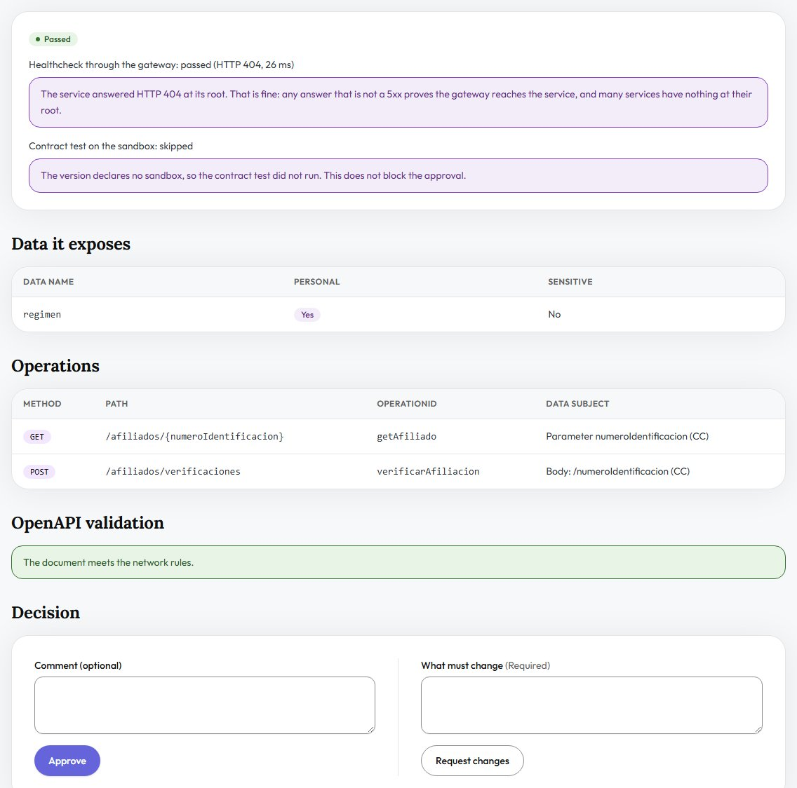

If the operator **requests changes**, the technical lead reads the comment on the sheet, selects **Edit the version**, fixes it and sends it again.

## 8. The consumer entity

<!-- roles: consumer -->

**Who:** the entity that will consult (Wanda, of the *Ministry of Welfare of Wakanda*). **You need:** the server where the application will run, with OpenSSL.

### 8.1 Onboarding

The same as steps 2 to 4, with the consumer entity's details.

> **Tip:** Wanda put her own e-mail as data steward and as technical lead: when the onboarding was approved she got every role, with no invitations to accept.

### 8.2 Create the application

In **My applications → Create application**:

1. The **application name**.
2. **What your entity will use it for**.
3. The **environment** (`Production` for real lookups).
4. Type the **technical contact e-mail** and select **Create application**.

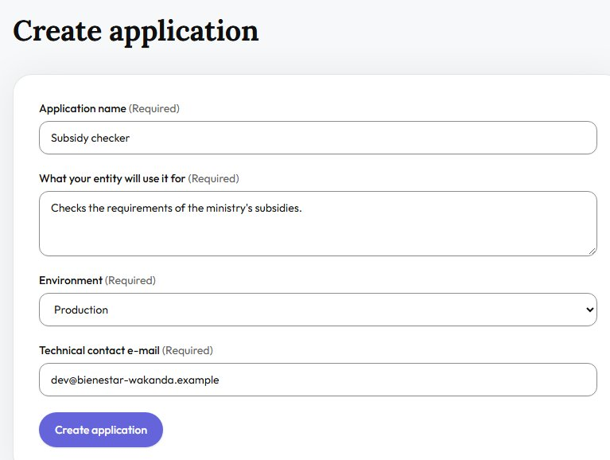

**Save the secret now** appears:

1. The **Client ID** identifies the application.
2. The **Client secret** is shown **only once**: keep it in the secret manager of the application's server.

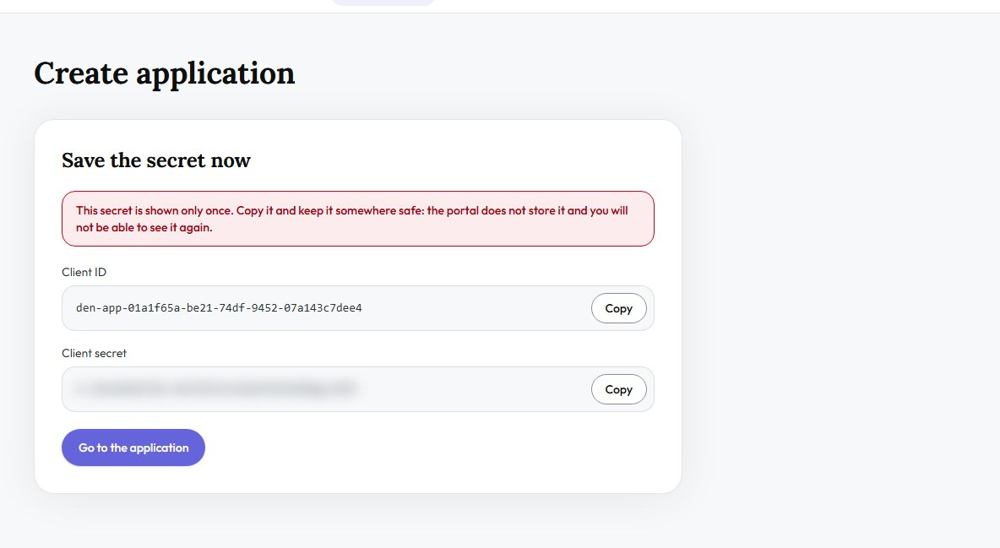

### 8.3 The application's certificate (mTLS)

The private key is generated **on the application's server** and never leaves it; only the request (CSR) goes to the portal. On the application's page, under **Client certificate (mTLS)**:

1. Pick your system's tab and run its **commands** on the application's server: the Client ID is already in them.
2. Paste the whole **CSR**, from `-----BEGIN CERTIFICATE REQUEST-----` to `-----END CERTIFICATE REQUEST-----`.
3. Select **Request certificate**.

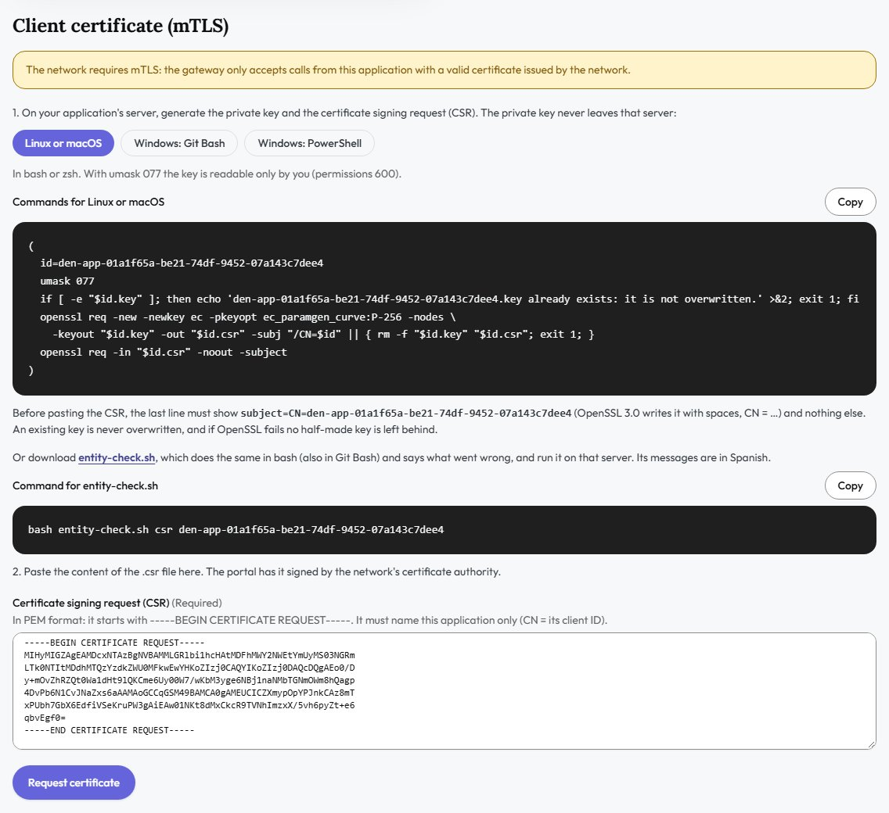

Another option is the `entity-check.sh` script, downloaded from that same page:

```bash
bash entity-check.sh csr <CLIENT_ID>   # creates <CLIENT_ID>.key (readable by its owner only) and <CLIENT_ID>.csr
cat <CLIENT_ID>.csr
```

1. Select **Download**: it downloads as `<CLIENT_ID>.pem`. Keep it with that name next to the key.

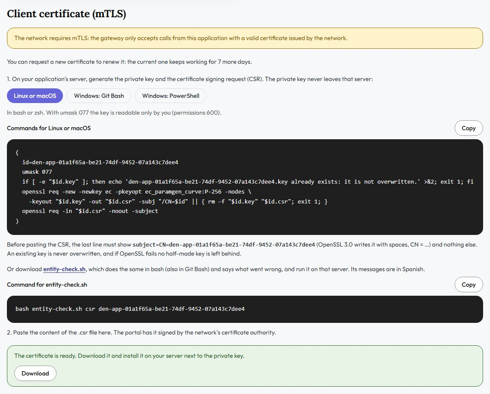

### 8.4 Request access

In the **Catalogue**:

1. **Search** the API by name, summary or tag and select **Filter**.
2. Open the **API**.

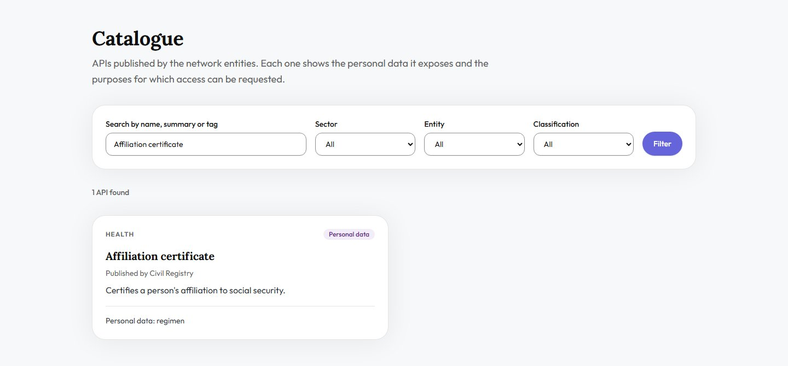

1. On the API's sheet, select **Request access**.

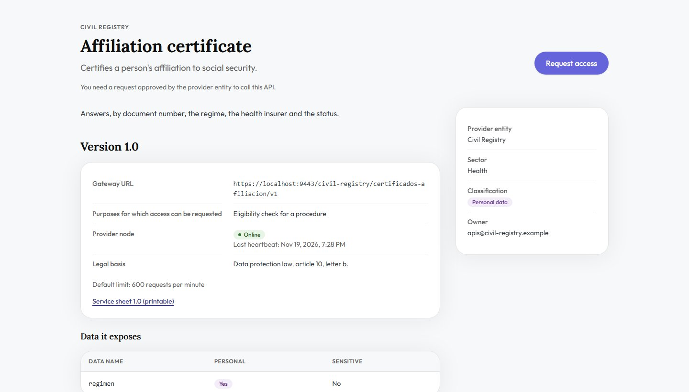

In the request:

1. The **application** that will make the calls (the one from step 8.2).
2. The **purpose**: one of those the API allows.
3. **What you will use the data for**: the specific procedure or programme; the provider entity reviews it.
4. The **legal basis**: the regulation or agreement that entitles you to process this data.
5. The **validity in months**: up to the classification's maximum (12 for personal data).
6. Select **Send request**.

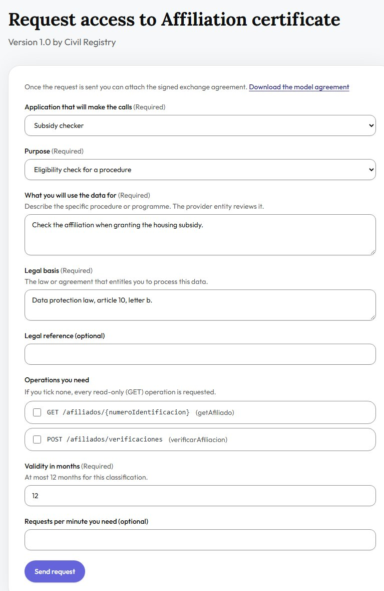

1. The request is **Waiting for the provider**.

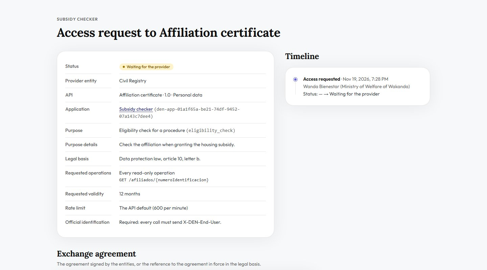

## 9. The provider entity decides

<!-- roles: provider -->

**Who:** the provider entity's data steward (Diego), with his second factor.

1. In **Requests**, open the request.

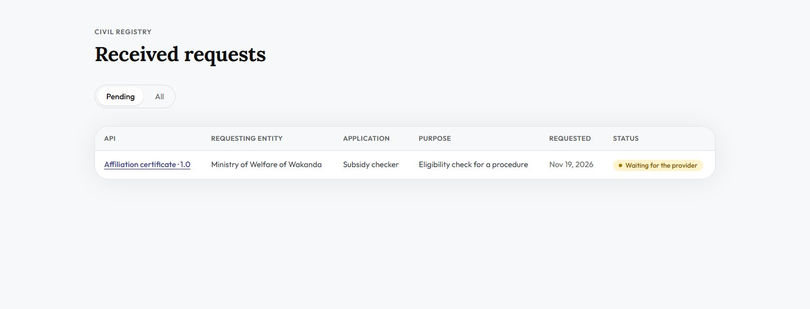

Check who asks, with which application, what for, on what legal basis and which personal data they will receive. To approve:

1. Adjust the **approved validity**: you can narrow the operations, the validity or the limit, never widen them.
2. Select **Approve** (or reject with a reason).

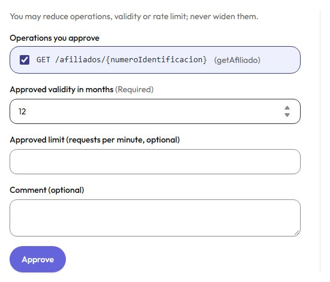

## 10. The first lookup

<!-- roles: consumer -->

**Who:** the consumer entity's developers, from the application's server, in the folder with `<CLIENT_ID>.key` and `<CLIENT_ID>.pem`.

1. The request becomes **Active**: lookups can start.

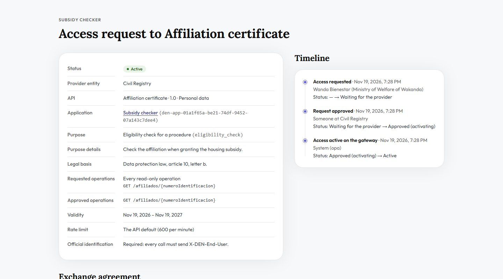

```bash tab="Script (Linux, macOS or Git Bash)"
./entity-check.sh check portal.example.org gateway.example.org        # reaches the network and keeps its root
./entity-check.sh call portal.example.org gateway.example.org <CLIENT_ID> \
  /civil-registry/certificados-afiliacion/v1/afiliados/1000000001 eligibility_check official-123
```

```bash tab="curl (Linux or macOS)"
curl -fsS https://portal.example.org/api/v1/pki/ca -o network-ca.pem   # the network's root
read -rs CLIENT_SECRET                                                 # paste it: it stays out of the history
TOKEN=$(curl -fsS --cacert network-ca.pem --cert <CLIENT_ID>.pem --key <CLIENT_ID>.key \
  -u "<CLIENT_ID>:$CLIENT_SECRET" -d grant_type=client_credentials \
  https://gateway.example.org/oauth/token | sed -E 's/.*"access_token":"([^"]+)".*/\1/')
curl -sS --cacert network-ca.pem --cert <CLIENT_ID>.pem --key <CLIENT_ID>.key \
  -H "Authorization: Bearer $TOKEN" \
  -H "X-DEN-Purpose: eligibility_check" \
  -H "X-DEN-End-User: official-123" \
  https://gateway.example.org/civil-registry/certificados-afiliacion/v1/afiliados/1000000001
```

- **Every lookup declares its purpose** (`X-DEN-Purpose`, one of the approved ones) and **who makes it** inside the entity (`X-DEN-End-User`; the network keeps only a pseudonym).
- The token lasts a few minutes and is bound to the certificate: ask for another when it expires.
- Answers: **200** with the data; **403** with the `X-DEN-Deny-Reason` header if something is missing (`no_subscription`: no approved access; `end_user_required`: who consults is missing); **404** if the record does not exist.

> **Tip:** on Windows use **Git Bash** and the script: Windows' `curl` cannot use a PEM certificate and key.

## When something fails

| Symptom | Cause | What to do |
| :-- | :-- | :-- |
| The verification link expired | It lasts 60 minutes | Sign in with that account: the verification screen offers to send it again |
| "Email already exists" when registering | The account was created; it only needs verifying | Sign in and resend the verification |
| **Invitations** is empty | The e-mail is not identical to the one in the request, or not verified | Register the account with the exact e-mail |
| A platform role does not show | The person never signed in to the portal | Have them sign in once and grant it again |
| **Approve** is disabled | The automatic validations have not passed | The version sheet explains each failure; fix it and **Run validations again** |
| Validation with **504** | The gateway cannot reach the node through the tunnel | On the node: `sudo /opt/den-node/install.sh status`; if the network changed address, `stop` and `start` |
| The portal rejects the CSR | The `CN` is not the Client ID, or the key is not ECDSA P-256/P-384 nor RSA 2048–4096 | Generate another with the exact Client ID |
| `schannel: Failed to import cert file` | Windows' `curl` cannot use the PEM certificate and key | Use `./entity-check.sh call` in Git Bash |
| **403** `no_subscription` | The request is not **Active**, or the purpose is not one of the approved ones | Check the request and the `X-DEN-Purpose` header |
| **403** `end_user_required` | The `X-DEN-End-User` header is missing | Send who consults inside the entity |

More cases, mostly about the node and the instant APIs, in the [full walkthrough](walkthrough.md#when-something-fails).
